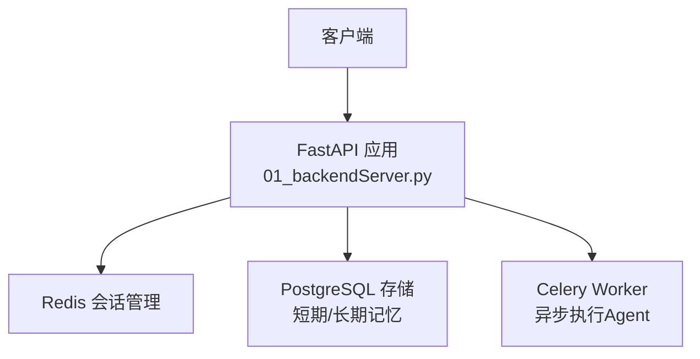
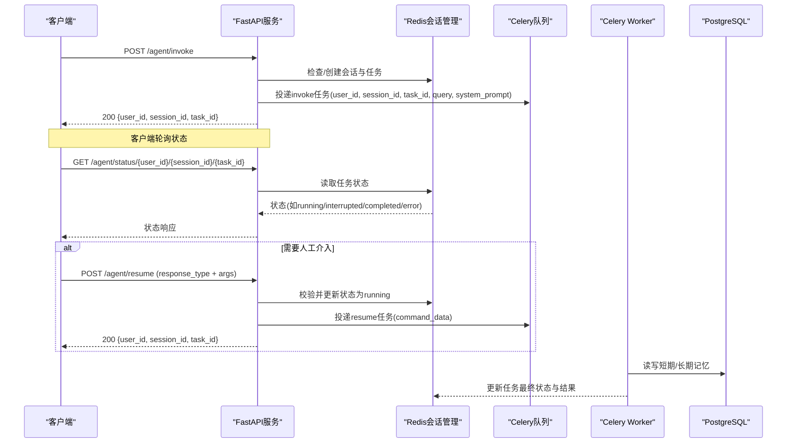
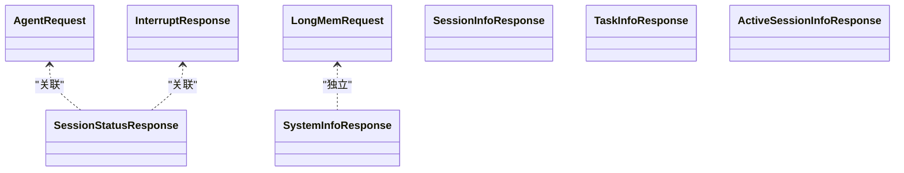

# API接口参考

<cite>
**本文引用的文件**
- [01_backendServer.py](file://01_backendServer.py)
- [utils/models.py](file://utils/models.py)
- [utils/config.py](file://utils/config.py)
- [README.md](file://README.md)
</cite>

## 目录
1. [简介](#简介)
2. [项目结构](#项目结构)
3. [核心组件](#核心组件)
4. [架构总览](#架构总览)
5. [详细接口说明](#详细接口说明)
6. [依赖关系分析](#依赖关系分析)
7. [性能与可用性](#性能与可用性)
8. [故障排查指南](#故障排查指南)
9. [结论](#结论)
10. [附录：错误码与处理策略](#附录错误码与处理策略)

## 简介
本参考文档面向第三方开发者，提供本项目的RESTful API完整规范。系统基于FastAPI构建，提供Agent智能体的异步调用、中断恢复、会话与任务状态查询、长期记忆写入等能力；通过Redis进行会话状态管理，PostgreSQL用于短期/长期记忆持久化，Celery负责异步任务执行。

## 项目结构
- 后端服务入口与路由定义位于后端脚本中，数据模型定义在统一模型文件中，配置项集中在配置类中。
- 前端脚本仅作为演示客户端，不改变API契约。

图表来源
- [01_backendServer.py:84-130](file://01_backendServer.py#L84-L130)
- [utils/config.py:13-26](file://utils/config.py#L13-L26)

章节来源
- [01_backendServer.py:1-130](file://01_backendServer.py#L1-L130)
- [utils/config.py:1-34](file://utils/config.py#L1-L34)

## 核心组件
- 会话与任务管理器：基于Redis的会话状态与任务状态维护（创建、更新、查询、删除）。
- 异步任务队列：使用Celery将Agent运行和恢复任务投递到Worker进程，实现非阻塞响应。
- 记忆存储：短期记忆通过LangGraph Checkpointer持久化至PostgreSQL；长期记忆通过Store写入PostgreSQL。
- 数据模型：统一的Pydantic模型约束请求与响应结构。

章节来源
- [01_backendServer.py:84-130](file://01_backendServer.py#L84-L130)
- [utils/models.py:1-97](file://utils/models.py#L1-L97)

## 架构总览
后端暴露一组REST端点，客户端通过HTTP调用触发Agent运行或恢复。服务端立即返回任务ID，后续通过状态查询接口轮询结果。中断场景下，客户端根据中断信息提交决策以继续执行。

图表来源
- [01_backendServer.py:132-173](file://01_backendServer.py#L132-L173)
- [01_backendServer.py:175-237](file://01_backendServer.py#L175-L237)
- [01_backendServer.py:315-344](file://01_backendServer.py#L315-L344)

## 详细接口说明

### 通用约定
- 基础URL：http://{HOST}:{PORT}，默认 HOST=0.0.0.0, PORT=8001（见配置）
- 认证方式：当前未启用鉴权中间件，所有接口均无需Token即可访问。生产环境建议增加鉴权（如JWT/OAuth2）。
- Content-Type：JSON（application/json）
- 字符编码：UTF-8
- 时间戳：浮点数秒级时间戳（last_updated等字段）

章节来源
- [utils/config.py:31-34](file://utils/config.py#L31-L34)

---

### POST /agent/invoke
- 功能：异步启动Agent执行，立即返回任务ID。
- 请求体字段（AgentRequest）：
  - user_id: string，必填
  - session_id: string，必填
  - task_id: string，必填
  - query: string，必填
  - system_message: string，可选，默认“你会使用工具来帮助用户。如果工具使用被拒绝，请提示用户。”
- 成功响应：200 JSON
  - user_id: string
  - session_id: string
  - task_id: string
- 业务逻辑：
  - 若该user_id+session_id+task_id不存在则创建会话（初始idle），设置任务状态为pending，投递异步任务。
- 典型使用场景：发起一次新的Agent查询。

示例
- 请求
  - POST /agent/invoke
  - Body: {"user_id":"u1","session_id":"s1","task_id":"t1","query":"上海天气如何？"}
- 响应
  - 200: {"user_id":"u1","session_id":"s1","task_id":"t1"}

章节来源
- [utils/models.py:7-18](file://utils/models.py#L7-L18)
- [01_backendServer.py:132-173](file://01_backendServer.py#L132-L173)

---

### POST /agent/resume
- 功能：恢复被中断的Agent执行，支持四种响应类型：accept、reject、edit、response。
- 请求体字段（InterruptResponse）：
  - user_id: string，必填
  - session_id: string，必填
  - task_id: string，必填
  - response_type: string，必填，取值：accept|reject|edit|response
  - args: object，可选，当response_type为edit或response时携带参数
- 成功响应：200 JSON
  - user_id: string
  - session_id: string
  - task_id: string
- 业务逻辑：
  - 校验会话存在且当前状态必须为interrupted，否则返回错误；更新状态为running，投递恢复任务。
- 典型使用场景：Human-in-the-loop审批工具调用或补充参数后继续执行。

示例
- 请求
  - POST /agent/resume
  - Body: {"user_id":"u1","session_id":"s1","task_id":"t1","response_type":"accept"}
- 响应
  - 200: {"user_id":"u1","session_id":"s1","task_id":"t1"}

章节来源
- [utils/models.py:44-54](file://utils/models.py#L44-L54)
- [01_backendServer.py:175-237](file://01_backendServer.py#L175-L237)

---

### GET /system/info
- 功能：获取系统内全部会话统计与活跃用户会话列表。
- 请求参数：无
- 成功响应（SystemInfoResponse）：
  - sessions_count: integer，系统内会话总数
  - active_users: object，可选，各用户的会话映射
- 典型使用场景：监控面板展示系统负载与活跃会话。

示例
- 请求
  - GET /system/info
- 响应
  - 200: {"sessions_count":12,"active_users":{"u1":["s1"],"u2":["s2"]}}

章节来源
- [utils/models.py:57-61](file://utils/models.py#L57-L61)
- [01_backendServer.py:239-251](file://01_backendServer.py#L239-L251)

---

### GET /agent/active/sessionid/{user_id}
- 功能：获取指定用户最近一次更新的会话ID。
- 路径参数：
  - user_id: string
- 成功响应（ActiveSessionInfoResponse）：
  - active_session_id: string，若用户不存在则为空字符串
- 典型使用场景：登录后自动打开最近会话。

示例
- 请求
  - GET /agent/active/sessionid/u1
- 响应
  - 200: {"active_session_id":"s1"}

章节来源
- [utils/models.py:74-76](file://utils/models.py#L74-L76)
- [01_backendServer.py:254-271](file://01_backendServer.py#L254-L271)

---

### GET /agent/sessionids/{user_id}
- 功能：获取指定用户的所有会话ID列表。
- 路径参数：
  - user_id: string
- 成功响应（SessionInfoResponse）：
  - session_ids: array<string>
- 典型使用场景：历史会话选择。

示例
- 请求
  - GET /agent/sessionids/u1
- 响应
  - 200: {"session_ids":["s1","s2"]}

章节来源
- [utils/models.py:64-66](file://utils/models.py#L64-L66)
- [01_backendServer.py:274-292](file://01_backendServer.py#L274-L292)

---

### GET /agent/tasks/{user_id}/{session_id}
- 功能：获取指定用户和会话下的所有任务ID列表。
- 路径参数：
  - user_id: string
  - session_id: string
- 成功响应（TaskInfoResponse）：
  - task_ids: array<string>
- 典型使用场景：查看某会话的历史任务。

示例
- 请求
  - GET /agent/tasks/u1/s1
- 响应
  - 200: {"task_ids":["t1","t2"]}

章节来源
- [utils/models.py:69-71](file://utils/models.py#L69-L71)
- [01_backendServer.py:295-313](file://01_backendServer.py#L295-L313)

---

### GET /agent/status/{user_id}/{session_id}/{task_id}
- 功能：查询指定任务的会话状态与最新响应。
- 路径参数：
  - user_id: string
  - session_id: string
  - task_id: string
- 成功响应（SessionStatusResponse）：
  - user_id: string
  - session_id: string
  - task_id: string
  - status: string，not_found|idle|running|completed|error
  - message: string，可选，错误消息
  - last_query: string，可选，上次查询内容
  - last_updated: float，可选，上次更新时间
  - last_response: object，可选，上一次响应（包含result或interrupt_data）
- 典型使用场景：轮询任务进度与结果。

示例
- 请求
  - GET /agent/status/u1/s1/t1
- 响应
  - 200: {"user_id":"u1","session_id":"s1","task_id":"t1","status":"completed","last_query":"上海天气如何？","last_updated":1710000000.0,"last_response":{"result":{"messages":[{"content":"..."}]}}}

章节来源
- [utils/models.py:79-96](file://utils/models.py#L79-L96)
- [01_backendServer.py:315-344](file://01_backendServer.py#L315-L344)

---

### POST /agent/write/longterm
- 功能：写入指定用户的长期记忆。
- 请求体字段（LongMemRequest）：
  - user_id: string，必填
  - memory_info: string，必填
- 成功响应：
  - status: "success"
  - memory_id: string，存储生成的唯一ID
  - message: string，提示信息
- 典型使用场景：保存用户偏好、历史摘要等长期信息。

示例
- 请求
  - POST /agent/write/longterm
  - Body: {"user_id":"u1","memory_info":"偏好：中文界面"}
- 响应
  - 200: {"status":"success","memory_id":"uuid...","message":"记忆存储成功"}

章节来源
- [utils/models.py:20-24](file://utils/models.py#L20-L24)
- [01_backendServer.py:346-374](file://01_backendServer.py#L346-L374)

---

### DELETE /agent/session/{user_id}/{session_id}
- 功能：删除指定用户的指定会话。
- 路径参数：
  - user_id: string
  - session_id: string
- 成功响应：
  - status: "success"
  - message: string，提示信息
- 典型使用场景：清理无用会话。

示例
- 请求
  - DELETE /agent/session/u1/s1
- 响应
  - 200: {"status":"success","message":"用户 u1:s1 的会话已删除"}

章节来源
- [01_backendServer.py:376-394](file://01_backendServer.py#L376-L394)

---

### DELETE /agent/task/{user_id}/{session_id}/{task_id}
- 功能：删除指定用户、会话下的指定任务。
- 路径参数：
  - user_id: string
  - session_id: string
  - task_id: string
- 成功响应：
  - status: "success"
  - message: string，提示信息
- 典型使用场景：清理无效任务记录。

示例
- 请求
  - DELETE /agent/task/u1/s1/t1
- 响应
  - 200: {"status":"success","message":"用户 u1:s1:t1 的任务已删除"}

章节来源
- [01_backendServer.py:396-414](file://01_backendServer.py#L396-L414)

## 依赖关系分析
- FastAPI应用初始化阶段建立Redis会话管理器、PostgreSQL连接池、短期/长期记忆存储。
- 路由处理器通过会话管理器进行CRUD操作，并通过Celery异步调度Agent执行。
- 数据模型由Pydantic定义，确保请求与响应的强类型校验。

图表来源
- [utils/models.py:7-96](file://utils/models.py#L7-L96)

章节来源
- [01_backendServer.py:84-130](file://01_backendServer.py#L84-L130)
- [utils/models.py:1-97](file://utils/models.py#L1-L97)

## 性能与可用性
- 异步调用：POST /agent/invoke与POST /agent/resume均为异步任务，立即返回任务ID，避免长连接阻塞。
- 会话与任务状态：通过Redis快速读写，降低数据库压力。
- 记忆持久化：短期记忆通过Checkpointer持久化，长期记忆通过Store写入，适合大文本与结构化数据。
- 可扩展性：Celery Worker可水平扩展，提升并发处理能力。
- 超时与TTL：会话与任务具备过期机制，避免资源泄漏。

[本节为通用指导，不直接分析具体文件]

## 故障排查指南
- 404 会话/任务不存在：检查user_id、session_id、task_id是否正确，或是否已被删除。
- 400 状态非法：恢复接口要求当前状态为interrupted，否则报错。
- 500 内部错误：检查Redis、PostgreSQL连接与权限，以及Celery Worker是否正常。
- 轮询超时：合理设置轮询间隔与最大重试次数，避免频繁请求。

章节来源
- [01_backendServer.py:175-237](file://01_backendServer.py#L175-L237)
- [01_backendServer.py:315-344](file://01_backendServer.py#L315-L344)

## 结论
本API提供完整的Agent生命周期管理能力，涵盖异步执行、中断恢复、会话与任务状态查询、长期记忆写入等关键能力。建议在生产环境中增加鉴权与限流，完善监控与告警，以提升安全性与稳定性。

[本节为总结，不直接分析具体文件]

## 附录：错误码与处理策略
- 200 OK：请求成功，返回对应数据模型。
- 400 Bad Request：请求参数或状态不合法（例如对非interrupted状态调用恢复）。
- 404 Not Found：会话或任务不存在。
- 500 Internal Server Error：服务器内部错误（如存储失败、未知异常）。

处理策略
- 客户端应依据HTTP状态码与响应体中的message字段进行错误分支处理。
- 对于404/400，建议提示用户重新输入或检查参数。
- 对于500，建议重试并上报日志，必要时降级或回退。

章节来源
- [01_backendServer.py:175-237](file://01_backendServer.py#L175-L237)
- [01_backendServer.py:315-344](file://01_backendServer.py#L315-L344)
- [01_backendServer.py:346-374](file://01_backendServer.py#L346-L374)