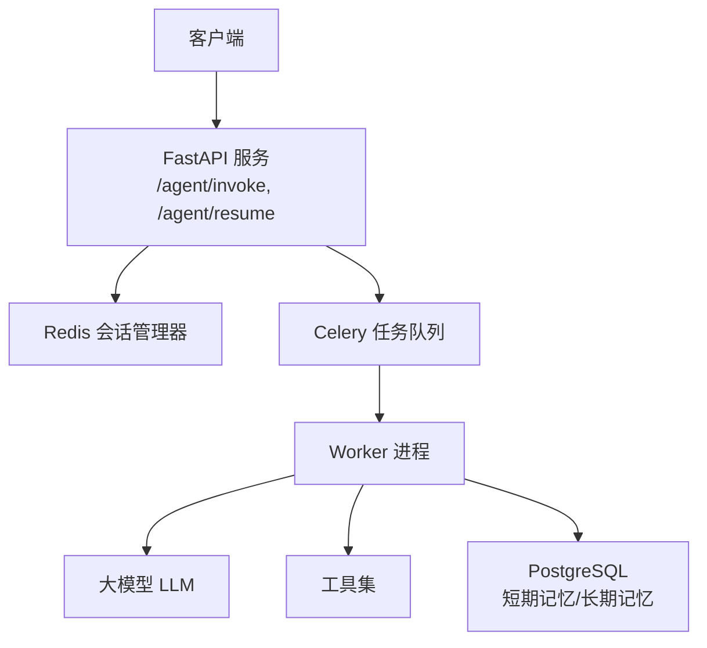
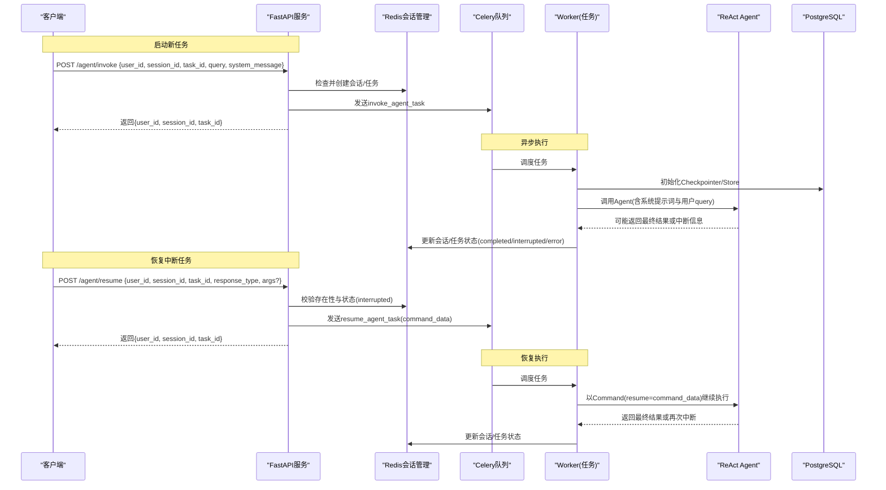
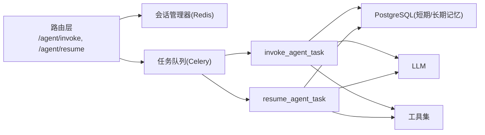

# Agent执行接口

<cite>
**本文引用的文件**
- [01_backendServer.py](file://01_backendServer.py)
- [utils/models.py](file://utils/models.py)
- [utils/tasks.py](file://utils/tasks.py)
- [README.md](file://README.md)
</cite>

## 目录
1. [简介](#简介)
2. [项目结构](#项目结构)
3. [核心组件](#核心组件)
4. [架构总览](#架构总览)
5. [详细接口说明](#详细接口说明)
6. [依赖关系分析](#依赖关系分析)
7. [性能与可用性](#性能与可用性)
8. [故障排查指南](#故障排查指南)
9. [结论](#结论)
10. [附录：客户端集成示例](#附录客户端集成示例)

## 简介
本文件为Agent执行接口的API文档，重点覆盖两个核心接口：
- POST /agent/invoke：启动新的Agent异步执行任务
- POST /agent/resume：恢复被中断的Agent任务执行

系统基于FastAPI提供HTTP API，使用Celery进行异步任务调度，Redis用于会话状态管理，PostgreSQL用于短期记忆（Checkpointer）和长期记忆（Store）。支持Human-in-the-Loop（HITL）中断与恢复流程。

## 项目结构
- 后端服务入口与路由定义位于主服务文件中，包含/agent/invoke、/agent/resume等接口实现
- 数据模型定义在models中，包括请求与响应结构
- 异步任务逻辑在tasks中，封装invoke_agent_task与resume_agent_task
- README提供了整体功能说明与运行方式

图表来源
- [01_backendServer.py:132-237](file://01_backendServer.py#L132-L237)
- [utils/tasks.py:318-451](file://utils/tasks.py#L318-L451)
- [utils/tasks.py:454-564](file://utils/tasks.py#L454-L564)

章节来源
- [README.md:1-39](file://README.md#L1-L39)
- [01_backendServer.py:126-130](file://01_backendServer.py#L126-L130)

## 核心组件
- FastAPI应用与生命周期管理：初始化Redis会话管理器、数据库连接池、短期记忆Checkpointer、长期记忆Store
- 会话管理：通过Redis维护用户会话、任务状态、过期时间等
- 异步任务：Celery任务负责实际调用ReAct Agent，处理中断与完成，更新会话与任务状态
- 数据模型：Pydantic模型定义请求与响应结构，确保参数校验与类型安全

章节来源
- [01_backendServer.py:84-130](file://01_backendServer.py#L84-L130)
- [utils/models.py:7-54](file://utils/models.py#L7-L54)
- [utils/tasks.py:318-451](file://utils/tasks.py#L318-L451)
- [utils/tasks.py:454-564](file://utils/tasks.py#L454-L564)

## 架构总览
下图展示了从客户端发起请求到Agent执行与结果返回的整体流程，包括invoke与resume两条路径。

图表来源
- [01_backendServer.py:132-237](file://01_backendServer.py#L132-L237)
- [utils/tasks.py:318-451](file://utils/tasks.py#L318-L451)
- [utils/tasks.py:454-564](file://utils/tasks.py#L454-L564)

## 详细接口说明

### 通用约定
- 内容类型：application/json
- 认证：当前未暴露鉴权字段，建议在生产环境增加鉴权中间件
- 错误响应：HTTP状态码+detail消息；业务状态由会话状态体现

### 接口一：POST /agent/invoke
- 功能：提交一个新的Agent执行任务，立即返回task_id，实际执行在后台异步进行
- 请求体字段
  - user_id: string，必填，用户唯一标识
  - session_id: string，必填，会话唯一标识
  - task_id: string，必填，任务唯一标识
  - query: string，必填，用户问题
  - system_message: string，可选，系统提示词；若未提供则使用默认值
- 成功响应体
  - user_id: string
  - session_id: string
  - task_id: string
- 错误处理
  - 400：请求体校验失败（由Pydantic自动返回）
  - 5xx：服务内部异常（如Redis/DB不可用）
- 业务逻辑要点
  - 若指定user_id/session_id/task_id不存在，则创建会话，初始状态idle
  - 将任务投递至Celery队列，设置任务状态为pending
  - 立即返回task_id供客户端轮询

章节来源
- [utils/models.py:7-17](file://utils/models.py#L7-L17)
- [01_backendServer.py:132-173](file://01_backendServer.py#L132-L173)

### 接口二：POST /agent/resume
- 功能：恢复被中断的Agent任务执行，传入人类反馈指令，继续执行直至完成或再次中断
- 请求体字段
  - user_id: string，必填
  - session_id: string，必填
  - task_id: string，必填
  - response_type: string，必填，取值范围：accept | edit | response | reject
  - args: object，可选，当response_type为edit或response时携带额外参数
- 成功响应体
  - user_id: string
  - session_id: string
  - task_id: string
- 错误处理
  - 404：会话任务不存在
  - 400：当前会话状态不是interrupted，无法恢复
  - 400：请求体验证失败
  - 5xx：服务内部异常
- 业务逻辑要点
  - 校验会话任务存在且状态为interrupted
  - 构造command_data={type, args?}，投递resume_agent_task
  - 设置任务状态为pending，立即返回task_id

章节来源
- [utils/models.py:44-54](file://utils/models.py#L44-L54)
- [01_backendServer.py:176-237](file://01_backendServer.py#L176-L237)

### 状态与轮询
- 查询会话状态接口：GET /agent/status/{user_id}/{session_id}/{task_id}
  - 返回字段：status（not_found/idle/running/completed/error）、last_query、last_updated、last_response等
- 典型轮询流程
  - invoke后轮询status直到completed/interrupted/error
  - 若interrupted，根据interrupt_data中的提示调用/agent/resume恢复
  - resume后继续轮询直至completed或再次interrupted

章节来源
- [01_backendServer.py:316-344](file://01_backendServer.py#L316-L344)
- [utils/models.py:79-96](file://utils/models.py#L79-L96)

### 请求与响应示例（JSON）
- 启动任务（/agent/invoke）
  - 请求示例
    - {
        "user_id": "u_001",
        "session_id": "s_001",
        "task_id": "t_001",
        "query": "帮我查询今天的天气",
        "system_message": "你会使用工具来帮助用户。如果工具使用被拒绝，请提示用户。"
      }
  - 成功响应示例
    - {
        "user_id": "u_001",
        "session_id": "s_001",
        "task_id": "t_001"
      }
- 恢复任务（/agent/resume）
  - 请求示例（接受工具调用）
    - {
        "user_id": "u_001",
        "session_id": "s_001",
        "task_id": "t_001",
        "response_type": "accept"
      }
  - 请求示例（编辑工具参数）
    - {
        "user_id": "u_001",
        "session_id": "s_001",
        "task_id": "t_001",
        "response_type": "edit",
        "args": {"args": {"hotel_name": "全季酒店"}}
      }
  - 请求示例（不调用工具直接反馈）
    - {
        "user_id": "u_001",
        "session_id": "s_001",
        "task_id": "t_001",
        "response_type": "response",
        "args": {"args": "不调用工具，直接回复：抱歉，暂时无法获取天气"}
      }
  - 成功响应示例
    - {
        "user_id": "u_001",
        "session_id": "s_001",
        "task_id": "t_001"
      }
- 常见错误响应
  - 404 会话任务不存在
    - {
        "detail": "用户会话任务 u_001:s_001:t_001 不存在"
      }
  - 400 非中断状态无法恢复
    - {
        "detail": "用户会话任务 u_001:s_001:t_001 当前状态为 running，无法恢复非中断状态的会话"
      }

章节来源
- [utils/models.py:7-54](file://utils/models.py#L7-L54)
- [01_backendServer.py:132-237](file://01_backendServer.py#L132-L237)

## 依赖关系分析
- FastAPI路由依赖：
  - 会话管理器（Redis）：用于创建/更新会话、任务状态、过期控制
  - Celery任务：invoke_agent_task、resume_agent_task
  - PostgreSQL：短期记忆（Checkpointer）与长期记忆（Store）
- 任务内部依赖：
  - LLM接入：动态获取语言模型
  - 工具集：Function Calling与HITL中断
  - 消息修剪：限制上下文长度
- 耦合与内聚
  - 路由层仅做参数校验、状态管理与任务调度，业务逻辑下沉至任务层，内聚性良好
  - 通过Redis解耦会话状态与计算资源，便于水平扩展

图表来源
- [01_backendServer.py:132-237](file://01_backendServer.py#L132-L237)
- [utils/tasks.py:318-451](file://utils/tasks.py#L318-L451)
- [utils/tasks.py:454-564](file://utils/tasks.py#L454-L564)

章节来源
- [01_backendServer.py:84-130](file://01_backendServer.py#L84-L130)
- [utils/tasks.py:1-19](file://utils/tasks.py#L1-L19)

## 性能与可用性
- 异步执行：/agent/invoke与/agent/resume均立即返回task_id，避免阻塞请求线程
- 会话状态机：idle → pending → running → completed/interrupted/error，支持故障恢复
- 上下文裁剪：通过消息修剪控制token数量，降低LLM调用成本
- 可扩展性：Celery Worker可水平扩展，Redis与PostgreSQL作为共享状态存储
- 建议
  - 合理设置TTL与会话清理策略，避免内存膨胀
  - 对高频场景启用缓存与限流
  - 监控任务队列积压与Worker健康度

[本节为通用指导，不直接分析具体文件]

## 故障排查指南
- 404 会话任务不存在
  - 检查user_id、session_id、task_id是否正确
  - 确认会话是否已过期或被删除
- 400 非中断状态无法恢复
  - 确认当前任务状态为interrupted后再调用/agent/resume
  - 可通过/agent/status查询当前状态
- 任务长时间pending
  - 检查Celery Worker是否正常运行
  - 查看消息队列堆积情况
- 任务执行失败
  - 查看任务日志与错误堆栈
  - 检查LLM与工具可用性
- 会话状态异常
  - 核对Redis键空间与TTL配置
  - 确认会话创建与更新逻辑未被并发破坏

章节来源
- [01_backendServer.py:176-237](file://01_backendServer.py#L176-L237)
- [01_backendServer.py:316-344](file://01_backendServer.py#L316-L344)
- [utils/tasks.py:420-451](file://utils/tasks.py#L420-L451)
- [utils/tasks.py:528-559](file://utils/tasks.py#L528-L559)

## 结论
本API通过/agent/invoke与/agent/resume实现了Agent任务的启动与恢复，结合Redis会话状态与Celery异步任务，提供高可用、可扩展的Agent执行能力。配合/agent/status可实现完整的异步执行与状态轮询闭环。建议在部署时完善鉴权、监控与告警机制，保障生产稳定性。

[本节为总结，不直接分析具体文件]

## 附录：客户端集成示例
以下示例展示如何调用/agent/invoke与/agent/resume，并通过/agent/status轮询任务状态。

- 步骤概览
  - 调用/agent/invoke提交任务，获得task_id
  - 轮询/agent/status直到状态为completed或interrupted
  - 若interrupted，根据中断信息调用/agent/resume恢复
  - 继续轮询直至completed或error

- Python示例（伪代码，示意调用流程）
  - 导入requests库
  - 定义BASE_URL与API端点
  - 定义函数invoke_agent(user_id, session_id, task_id, query, system_message)
    - 构造payload并POST到/agent/invoke
    - 返回{user_id, session_id, task_id}
  - 定义函数resume_agent(user_id, session_id, task_id, response_type, args=None)
    - 构造payload并POST到/agent/resume
    - 返回{user_id, session_id, task_id}
  - 定义函数get_status(user_id, session_id, task_id)
    - GET /agent/status/{user_id}/{session_id}/{task_id}
    - 返回状态对象
  - 主流程
    - 调用invoke_agent
    - 循环调用get_status
    - 若status为interrupted，读取中断信息并调用resume_agent
    - 若status为completed或error，结束轮询

- 前端交互参考
  - 前端服务中演示了invoke与resume的调用方式及中断处理流程，可作为集成参考

章节来源
- [02_frontendServer.py:52-79](file://02_frontendServer.py#L52-L79)
- [02_frontendServer.py:80-87](file://02_frontendServer.py#L80-L87)
- [02_frontendServer.py:541-571](file://02_frontendServer.py#L541-L571)