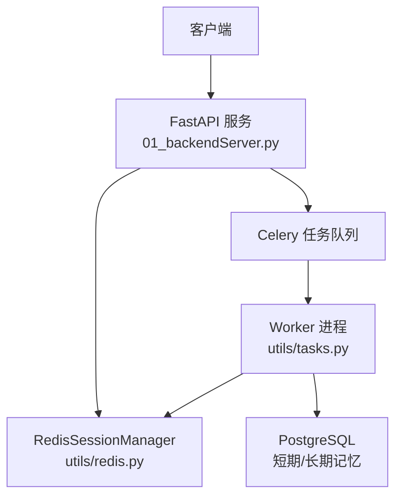
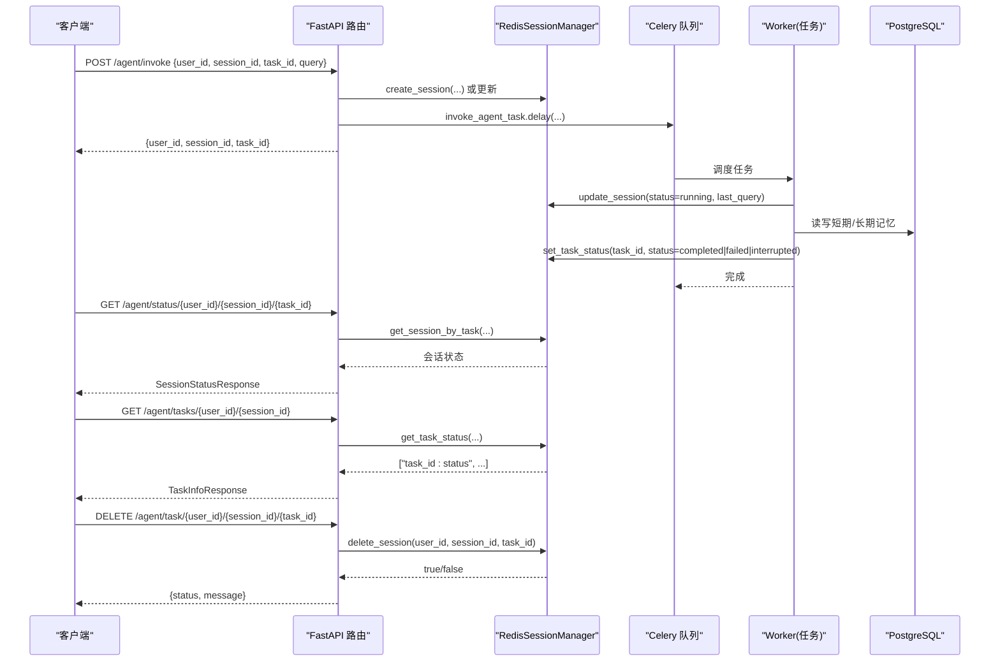
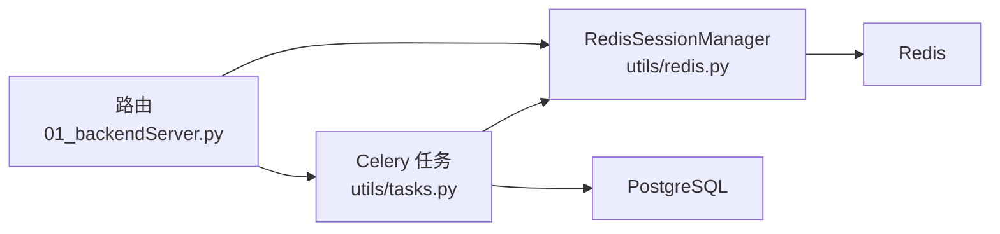
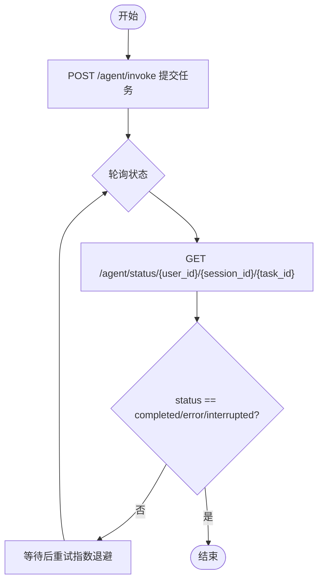
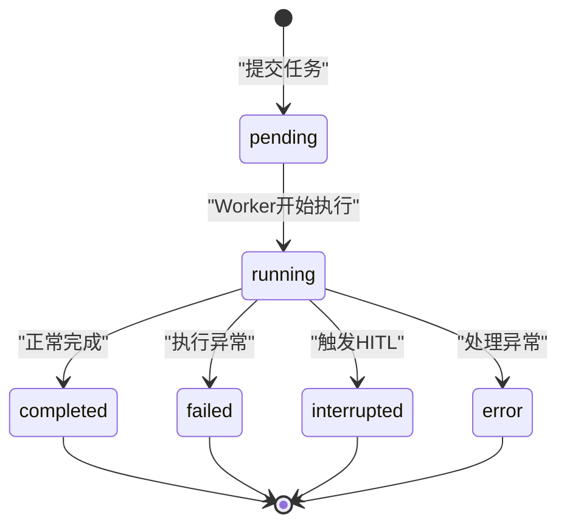

# 任务管理接口

<cite>
**本文引用的文件**
- [01_backendServer.py](file://01_backendServer.py)
- [utils/models.py](file://utils/models.py)
- [utils/redis.py](file://utils/redis.py)
- [utils/tasks.py](file://utils/tasks.py)
- [utils/config.py](file://utils/config.py)
- [README.md](file://README.md)
</cite>

## 目录
1. [简介](#简介)
2. [项目结构](#项目结构)
3. [核心组件](#核心组件)
4. [架构总览](#架构总览)
5. [详细接口说明](#详细接口说明)
6. [依赖关系分析](#依赖关系分析)
7. [性能与可用性](#性能与可用性)
8. [故障排查指南](#故障排查指南)
9. [结论](#结论)
10. [附录：客户端集成示例](#附录客户端集成示例)

## 简介
本文件为“任务管理接口”的权威API文档，聚焦以下三个接口：
- GET /agent/tasks/{user_id}/{session_id}：获取指定用户会话下的所有任务ID及状态列表
- GET /agent/status/{user_id}/{session_id}/{task_id}：查询指定任务的会话级状态详情
- DELETE /agent/task/{user_id}/{session_id}/{task_id}：删除指定任务及其关联会话数据

文档涵盖请求参数校验、响应数据结构（TaskInfoResponse、SessionStatusResponse）、任务状态机与生命周期、错误处理策略，以及客户端轮询与管理的最佳实践。

## 项目结构
后端基于FastAPI提供REST接口，使用Celery异步执行智能体任务，Redis持久化会话与任务状态，PostgreSQL用于短期记忆检查点与长期记忆存储。核心入口在01_backendServer.py中定义路由；模型定义在utils/models.py；会话与任务状态由utils/redis.py中的RedisSessionManager维护；异步任务逻辑在utils/tasks.py中实现；配置集中在utils/config.py。

图表来源
- [01_backendServer.py:126-130](file://01_backendServer.py#L126-L130)
- [utils/redis.py:37-103](file://utils/redis.py#L37-L103)
- [utils/tasks.py:319-451](file://utils/tasks.py#L319-L451)
- [utils/config.py:13-26](file://utils/config.py#L13-L26)

章节来源
- [01_backendServer.py:126-130](file://01_backendServer.py#L126-L130)
- [utils/config.py:13-26](file://utils/config.py#L13-L26)

## 核心组件
- FastAPI应用与路由：负责接收HTTP请求、参数校验、调用会话管理器与任务队列，并返回标准化响应。
- Redis会话管理器：维护用户-会话-任务的多维映射与状态，支持过期清理、批量查询与删除。
- Celery任务：异步执行智能体推理、中断恢复、结果处理与状态回写。
- 数据模型：统一请求/响应结构，确保前后端契约一致。

章节来源
- [01_backendServer.py:294-344](file://01_backendServer.py#L294-L344)
- [utils/redis.py:37-493](file://utils/redis.py#L37-L493)
- [utils/tasks.py:319-559](file://utils/tasks.py#L319-L559)
- [utils/models.py:1-97](file://utils/models.py#L1-L97)

## 架构总览
下图展示了任务从创建到完成/失败/中断的全链路交互，包括状态同步与持久化。

图表来源
- [01_backendServer.py:133-173](file://01_backendServer.py#L133-L173)
- [01_backendServer.py:294-344](file://01_backendServer.py#L294-L344)
- [01_backendServer.py:396-414](file://01_backendServer.py#L396-L414)
- [utils/tasks.py:319-451](file://utils/tasks.py#L319-L451)
- [utils/redis.py:65-103](file://utils/redis.py#L65-L103)
- [utils/redis.py:368-442](file://utils/redis.py#L368-L442)

## 详细接口说明

### 通用约定
- 路径参数均为字符串类型，需非空且符合业务标识规范（建议UUID或业务自增ID）。
- 成功响应均遵循Pydantic模型定义；失败时根据场景返回HTTP状态码与detail消息。
- 时间戳字段为浮点数秒级时间戳。

章节来源
- [utils/models.py:57-97](file://utils/models.py#L57-L97)

### 接口一：GET /agent/tasks/{user_id}/{session_id}
- 功能：获取指定用户和会话下的所有任务ID及其状态列表。
- 路径参数：
  - user_id: 字符串，必填
  - session_id: 字符串，必填
- 行为与约束：
  - 若该用户-会话不存在，返回空的任务列表。
  - 若存在，返回形如 ["task_id:status", ...] 的列表。
- 响应模型：TaskInfoResponse
  - task_ids: List[str]，元素格式为 "task_id:status"
- 典型响应示例（JSON）：
  - 存在任务：{"task_ids": ["abc123:completed", "def456:running"]}
  - 不存在会话：{"task_ids": []}
- 错误处理：
  - 无显式异常抛出；会话不存在时返回空列表。

章节来源
- [01_backendServer.py:294-313](file://01_backendServer.py#L294-L313)
- [utils/models.py:68-71](file://utils/models.py#L68-L71)
- [utils/redis.py:427-442](file://utils/redis.py#L427-L442)

### 接口二：GET /agent/status/{user_id}/{session_id}/{task_id}
- 功能：查询指定任务的会话级状态详情。
- 路径参数：
  - user_id: 字符串，必填
  - session_id: 字符串，必填
  - task_id: 字符串，必填
- 行为与约束：
  - 若任务不存在，返回状态为 not_found 的会话状态对象，并附带message提示。
  - 若存在，返回包含当前状态、最近查询、最近更新时间与最近响应的会话状态对象。
- 响应模型：SessionStatusResponse
  - user_id: string
  - session_id: string?
  - task_id: string
  - status: string，取值包括 not_found、idle、running、completed、error
  - message: string?
  - last_query: string?
  - last_updated: float?
  - last_response: AgentResponse?
- 典型响应示例（JSON）：
  - 任务存在且运行中：
    {"user_id":"u1","session_id":"s1","task_id":"t1","status":"running","last_query":"查询天气","last_updated":1710000000.0,"last_response":null}
  - 任务不存在：
    {"user_id":"u1","session_id":"s1","task_id":"t1","status":"not_found","message":"用户 u1:s1:t1 的会话不存在"}
- 错误处理：
  - 任务不存在时不抛异常，直接返回not_found状态。

章节来源
- [01_backendServer.py:316-344](file://01_backendServer.py#L316-L344)
- [utils/models.py:78-97](file://utils/models.py#L78-L97)
- [utils/redis.py:368-390](file://utils/redis.py#L368-L390)

### 接口三：DELETE /agent/task/{user_id}/{session_id}/{task_id}
- 功能：删除指定用户-会话-任务对应的会话数据。
- 路径参数：
  - user_id: 字符串，必填
  - session_id: 字符串，必填
  - task_id: 字符串，必填
- 行为与约束：
  - 若任务不存在，抛出HTTP 404异常，detail包含缺失信息。
  - 若存在，删除对应会话数据，并清理相关集合索引。
- 响应：
  - 成功：{"status":"success","message":"...已删除"}
- 错误处理：
  - 任务不存在：HTTP 404，detail提示任务不存在。

章节来源
- [01_backendServer.py:396-414](file://01_backendServer.py#L396-L414)
- [utils/redis.py:444-476](file://utils/redis.py#L444-L476)

## 依赖关系分析
- 路由层依赖RedisSessionManager进行会话与任务状态的CRUD。
- 任务执行层通过Celery异步执行，并在完成后回写任务状态与会话状态。
- 配置集中管理数据库、Redis、Celery等连接参数与超时。

图表来源
- [01_backendServer.py:294-344](file://01_backendServer.py#L294-L344)
- [utils/tasks.py:319-451](file://utils/tasks.py#L319-L451)
- [utils/redis.py:37-103](file://utils/redis.py#L37-L103)

章节来源
- [utils/config.py:13-26](file://utils/config.py#L13-L26)

## 性能与可用性
- 异步任务：通过Celery将耗时操作移出请求线程，提升吞吐与响应速度。
- 状态缓存：Redis作为会话与任务状态的高速缓存，支持过期清理与集合索引，降低查询成本。
- 资源回收：定期清理无效任务与空集合，避免内存膨胀。
- 建议：
  - 合理设置TTL与TASK_TTL，平衡数据保留与内存占用。
  - 对高频轮询的客户端增加退避策略，避免雪崩。
  - 监控Redis与PostgreSQL连接池使用情况，必要时扩容。

[本节为通用指导，无需特定文件引用]

## 故障排查指南
- 任务不存在（GET /agent/status）：
  - 现象：返回status=not_found，message提示不存在。
  - 排查：确认user_id/session_id/task_id是否正确；检查是否已被删除或过期。
- 会话无效（DELETE /agent/task）：
  - 现象：HTTP 404，detail提示任务不存在。
  - 排查：确认会话是否存在；检查Redis键空间与过期时间。
- 任务执行失败：
  - 现象：status=failed，last_response中包含错误信息。
  - 排查：查看Worker日志；检查LLM工具调用与数据库连接。
- 长时间无响应：
  - 现象：轮询未收到completed/failed/interrupted。
  - 排查：确认Celery Worker是否启动；检查Broker与队列堆积情况。

章节来源
- [01_backendServer.py:316-344](file://01_backendServer.py#L316-L344)
- [01_backendServer.py:396-414](file://01_backendServer.py#L396-L414)
- [utils/tasks.py:420-446](file://utils/tasks.py#L420-L446)
- [utils/tasks.py:528-554](file://utils/tasks.py#L528-L554)

## 结论
本任务管理接口以FastAPI为核心，结合Celery与Redis实现了高并发、可恢复的异步任务管理。通过标准化的响应模型与清晰的状态机，客户端可以可靠地轮询任务状态并完成生命周期管理。建议在集成时严格遵循参数校验与错误处理策略，并结合退避重试机制提升鲁棒性。

[本节为总结，无需特定文件引用]

## 附录：客户端集成示例

### 任务状态轮询流程

图表来源
- [01_backendServer.py:133-173](file://01_backendServer.py#L133-L173)
- [01_backendServer.py:316-344](file://01_backendServer.py#L316-L344)

### 完整管理流程
- 提交任务：POST /agent/invoke，立即获得task_id。
- 轮询状态：GET /agent/status/{user_id}/{session_id}/{task_id}，直到状态为completed、error或interrupted。
- 获取任务列表：GET /agent/tasks/{user_id}/{session_id}，展示所有任务及其状态。
- 删除任务：DELETE /agent/task/{user_id}/{session_id}/{task_id}，清理指定任务。

章节来源
- [01_backendServer.py:133-173](file://01_backendServer.py#L133-L173)
- [01_backendServer.py:294-344](file://01_backendServer.py#L294-L344)
- [01_backendServer.py:396-414](file://01_backendServer.py#L396-L414)

## 任务状态机与生命周期

### 状态含义
- pending：任务已入队，等待Worker执行。
- running：Worker正在执行智能体推理。
- completed：智能体正常完成，返回最终结果。
- failed：执行过程中发生异常，记录错误信息。
- interrupted：触发人工审查（HITL），需要客户端反馈继续或终止。
- error：系统内部错误（例如处理结果异常）。
- not_found：查询不到指定任务（仅用于状态查询接口）。

### 转换条件
- 提交任务：pending → running（Worker开始执行）
- 正常完成：running → completed
- 执行失败：running → failed
- 触发中断：running → interrupted
- 结果处理异常：任意状态 → error
- 查询不存在：— → not_found（仅查询时）

图表来源
- [utils/tasks.py:319-451](file://utils/tasks.py#L319-L451)
- [utils/tasks.py:455-559](file://utils/tasks.py#L455-L559)
- [utils/models.py:27-42](file://utils/models.py#L27-L42)

章节来源
- [utils/tasks.py:319-451](file://utils/tasks.py#L319-L451)
- [utils/tasks.py:455-559](file://utils/tasks.py#L455-L559)
- [utils/models.py:27-42](file://utils/models.py#L27-L42)

## 数据模型参考

### TaskInfoResponse
- 字段：
  - task_ids: List[str]，元素格式为 "task_id:status"
- 用途：列出某会话下所有任务及其状态。

章节来源
- [utils/models.py:68-71](file://utils/models.py#L68-L71)

### SessionStatusResponse
- 字段：
  - user_id: string
  - session_id: string?
  - task_id: string
  - status: string（not_found/idle/running/completed/error）
  - message: string?
  - last_query: string?
  - last_updated: float?
  - last_response: AgentResponse?
- 用途：返回指定任务的会话级状态详情。

章节来源
- [utils/models.py:78-97](file://utils/models.py#L78-L97)

### AgentResponse（被SessionStatusResponse.last_response引用）
- 字段：
  - session_id: string
  - task_id: string
  - status: string（completed/error/interrupted）
  - timestamp: float
  - message: string?
  - result: dict?
  - interrupt_data: dict?
- 用途：封装智能体执行结果或中断信息。

章节来源
- [utils/models.py:27-42](file://utils/models.py#L27-L42)