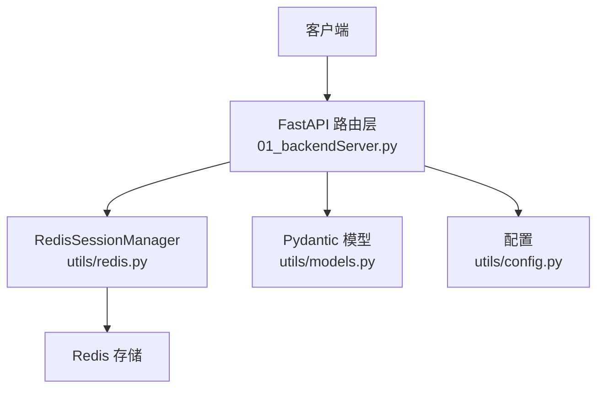
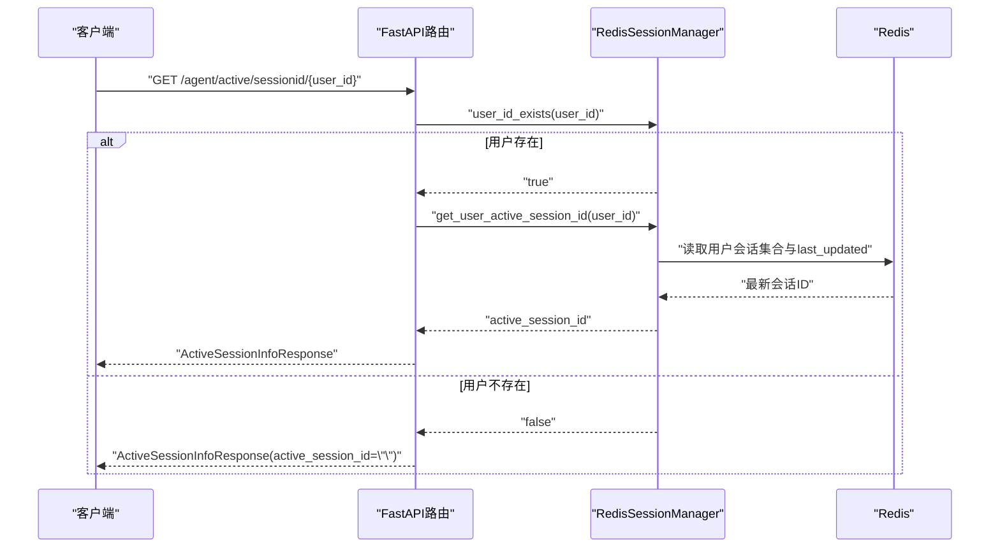
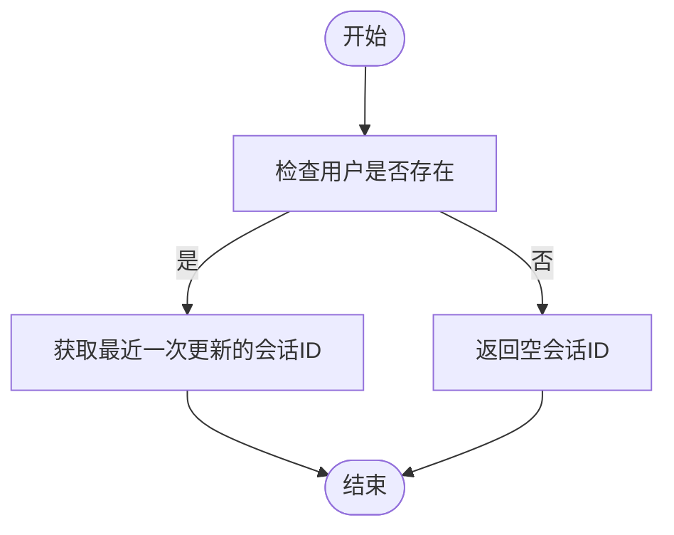
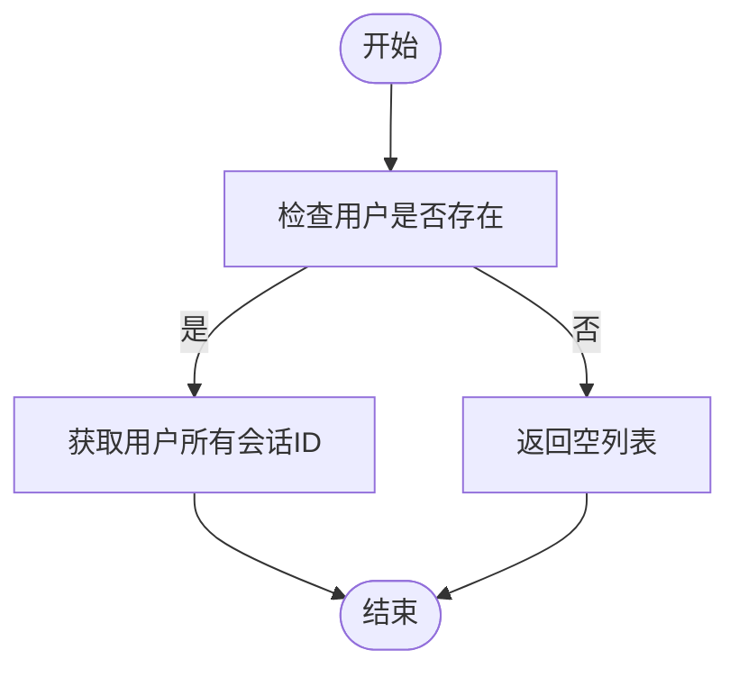
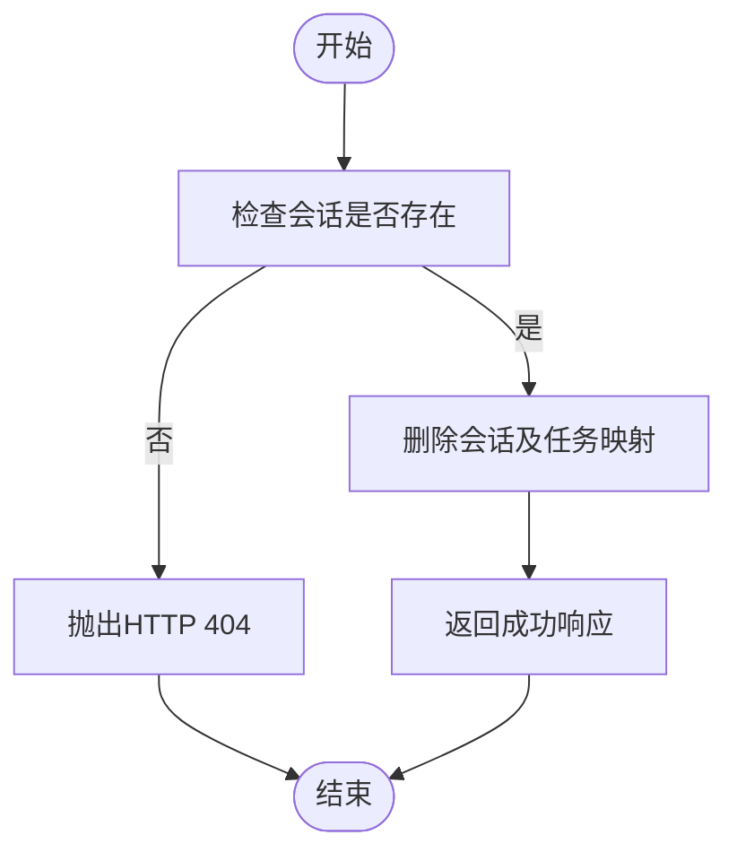

# 会话管理接口

<cite>
**本文引用的文件**
- [01_backendServer.py](file://01_backendServer.py)
- [utils/models.py](file://utils/models.py)
- [utils/redis.py](file://utils/redis.py)
- [utils/config.py](file://utils/config.py)
- [README.md](file://README.md)
</cite>

## 目录
1. [简介](#简介)
2. [项目结构](#项目结构)
3. [核心组件](#核心组件)
4. [架构总览](#架构总览)
5. [详细接口说明](#详细接口说明)
6. [依赖关系分析](#依赖关系分析)
7. [性能与一致性](#性能与一致性)
8. [故障排查指南](#故障排查指南)
9. [结论](#结论)
10. [附录：使用示例与最佳实践](#附录使用示例与最佳实践)

## 简介
本章节面向需要集成“会话管理”能力的开发者，提供完整的API文档。重点覆盖以下接口：
- GET /agent/active/sessionid/{user_id}：获取指定用户最近一次更新的活跃会话ID
- GET /agent/sessionids/{user_id}：列出指定用户的所有会话ID
- DELETE /agent/session/{user_id}/{session_id}：删除指定用户的指定会话（含其下所有任务）

同时给出请求/响应数据模型、错误处理策略、会话生命周期与状态转换机制，以及实际调用示例和集成建议。

## 项目结构
后端服务基于FastAPI实现，会话状态通过Redis进行持久化与过期管理；数据模型通过Pydantic定义并作为响应类型约束。关键文件职责如下：
- 01_backendServer.py：定义HTTP路由与业务编排逻辑，调用会话管理器完成CRUD操作
- utils/models.py：定义请求/响应数据模型（如ActiveSessionInfoResponse、SessionInfoResponse等）
- utils/redis.py：实现RedisSessionManager，封装会话的创建、更新、查询、清理与删除
- utils/config.py：集中配置Redis、数据库、TTL等参数
- README.md：项目功能概述与运行方式说明



图表来源
- [01_backendServer.py:126-130](file://01_backendServer.py#L126-L130)
- [utils/redis.py:37-49](file://utils/redis.py#L37-L49)
- [utils/models.py:56-77](file://utils/models.py#L56-L77)
- [utils/config.py:18-26](file://utils/config.py#L18-L26)

章节来源
- [01_backendServer.py:126-130](file://01_backendServer.py#L126-L130)
- [utils/models.py:56-77](file://utils/models.py#L56-L77)
- [utils/redis.py:37-49](file://utils/redis.py#L37-L49)
- [utils/config.py:18-26](file://utils/config.py#L18-L26)

## 核心组件
- FastAPI应用与会话管理器初始化：在应用生命周期中初始化Redis会话管理器、数据库连接池、短期/长期记忆存储，并在关闭时释放资源
- 会话管理器（RedisSessionManager）：负责会话的创建、更新、查询、清理、删除，维护用户-会话-任务的映射关系，支持TTL过期与自动清理
- 数据模型：统一约束请求与响应结构，确保前后端契约一致

章节来源
- [01_backendServer.py:83-124](file://01_backendServer.py#L83-L124)
- [utils/redis.py:37-49](file://utils/redis.py#L37-L49)
- [utils/models.py:56-77](file://utils/models.py#L56-L77)

## 架构总览
下图展示了会话管理相关接口的整体流程：客户端请求进入FastAPI路由层，路由层校验参数后调用RedisSessionManager完成具体操作，最终返回符合Pydantic模型的响应。



图表来源
- [01_backendServer.py:253-271](file://01_backendServer.py#L253-L271)
- [utils/redis.py:147-151](file://utils/redis.py#L147-L151)
- [utils/redis.py:217-244](file://utils/redis.py#L217-L244)

章节来源
- [01_backendServer.py:253-271](file://01_backendServer.py#L253-L271)
- [utils/redis.py:147-151](file://utils/redis.py#L147-L151)
- [utils/redis.py:217-244](file://utils/redis.py#L217-L244)

## 详细接口说明

### 接口一：获取用户最近一次更新的活跃会话ID
- URL模式：GET /agent/active/sessionid/{user_id}
- 路径参数：
  - user_id：字符串，用户唯一标识
- 查询参数：无
- 成功响应模型：ActiveSessionInfoResponse
  - active_session_id：字符串，若用户存在则返回最近一次更新的会话ID；否则为空字符串
- 行为说明：
  - 若用户不存在，返回空会话ID，便于前端自动创建新会话
  - 若用户存在，返回按last_updated时间戳排序的最新会话ID
- 错误处理：
  - 未定义HTTP异常；当用户不存在时以空会话ID语义化处理
- 典型请求示例：
  - GET http://localhost:8001/agent/active/sessionid/user_123
- 典型响应示例：
  - {"active_session_id": "a1b2c3d4-..."}
  - 或当用户不存在：{"active_session_id": ""}

章节来源
- [01_backendServer.py:253-271](file://01_backendServer.py#L253-L271)
- [utils/models.py:73-77](file://utils/models.py#L73-L77)
- [utils/redis.py:217-244](file://utils/redis.py#L217-L244)

### 接口二：列出用户的所有会话ID
- URL模式：GET /agent/sessionids/{user_id}
- 路径参数：
  - user_id：字符串，用户唯一标识
- 查询参数：无
- 成功响应模型：SessionInfoResponse
  - session_ids：字符串数组，包含该用户的所有会话ID（去重）
- 行为说明：
  - 若用户不存在，返回空列表
  - 若用户存在，返回该用户所有有效会话ID
- 错误处理：
  - 未定义HTTP异常；当用户不存在时以空列表语义化处理
- 典型请求示例：
  - GET http://localhost:8001/agent/sessionids/user_123
- 典型响应示例：
  - {"session_ids": ["s1", "s2", "s3"]}
  - 或当用户不存在：{"session_ids": []}

章节来源
- [01_backendServer.py:273-292](file://01_backendServer.py#L273-L292)
- [utils/models.py:63-67](file://utils/models.py#L63-L67)
- [utils/redis.py:206-215](file://utils/redis.py#L206-L215)

### 接口三：删除指定用户的指定会话
- URL模式：DELETE /agent/session/{user_id}/{session_id}
- 路径参数：
  - user_id：字符串，用户唯一标识
  - session_id：字符串，会话唯一标识
- 查询参数：无
- 成功响应：
  - status：字符串，固定为"success"
  - message：字符串，描述删除结果
- 错误处理：
  - 若会话不存在，抛出HTTP 404，detail提示“用户 {user_id}:{session_id} 的会话不存在”
- 行为说明：
  - 删除该会话下的所有任务及其映射关系
- 典型请求示例：
  - DELETE http://localhost:8001/agent/session/user_123/s1
- 典型响应示例：
  - {"status": "success", "message": "用户 user_123:s1 的会话已删除"}
- 失败示例：
  - HTTP 404: {"detail": "用户 user_123:s1 的会话不存在"}

章节来源
- [01_backendServer.py:376-394](file://01_backendServer.py#L376-L394)
- [utils/redis.py:444-476](file://utils/redis.py#L444-L476)

## 依赖关系分析
- 路由层依赖：
  - 会话管理器（RedisSessionManager）：提供用户存在性检查、会话ID获取、会话删除等操作
  - Pydantic模型：用于响应体结构与类型校验
  - 配置模块：提供Redis连接参数、TTL等
- 会话管理器依赖：
  - Redis异步客户端：执行键值存取、集合操作、过期控制
  - 清理逻辑：在读写前清理无效任务，保证数据一致性

```mermaid
classDiagram
class FastAPI路由 {
+GET "/agent/active/sessionid/{user_id}"
+GET "/agent/sessionids/{user_id}"
+DELETE "/agent/session/{user_id}/{session_id}"
}
class RedisSessionManager {
+user_id_exists()
+get_user_active_session_id()
+get_all_session_ids()
+delete_session()
}
class Pydantic模型 {
+ActiveSessionInfoResponse
+SessionInfoResponse
}
class 配置 {
+REDIS_HOST, REDIS_PORT, REDIS_DB
+SESSION_TIMEOUT, TTL
}
FastAPI路由 --> RedisSessionManager : "调用"
FastAPI路由 --> Pydantic模型 : "响应模型"
FastAPI路由 --> 配置 : "读取TTL等"
```

图表来源
- [01_backendServer.py:253-394](file://01_backendServer.py#L253-L394)
- [utils/redis.py:147-244](file://utils/redis.py#L147-L244)
- [utils/models.py:56-77](file://utils/models.py#L56-L77)
- [utils/config.py:18-26](file://utils/config.py#L18-L26)

章节来源
- [01_backendServer.py:253-394](file://01_backendServer.py#L253-L394)
- [utils/redis.py:147-244](file://utils/redis.py#L147-L244)
- [utils/models.py:56-77](file://utils/models.py#L56-L77)
- [utils/config.py:18-26](file://utils/config.py#L18-L26)

## 性能与一致性
- 过期与清理：
  - 会话与任务均设置TTL，避免脏数据累积
  - 读操作前会触发清理逻辑，移除过期或无效的会话与任务映射，保证返回数据的准确性
- 并发与锁：
  - 当前实现未显式加锁，依赖Redis原子操作与TTL保障基本一致性
  - 在高并发场景下，建议结合业务幂等性与重试机制，避免重复创建或误删
- 可扩展性：
  - 可通过调整TTL与清理频率平衡内存占用与实时性
  - 如需强一致性，可在关键写路径引入分布式锁或版本字段

[本节为通用性能讨论，不直接分析具体代码文件]

## 故障排查指南
- 用户不存在：
  - 获取活跃会话ID接口返回空会话ID，前端可据此创建新会话
  - 获取会话列表接口返回空列表
- 会话不存在：
  - 删除会话接口将返回HTTP 404，需在前端捕获并提示“会话不存在”
- 清理逻辑异常：
  - 若发现会话列表与实际不一致，检查Redis中是否存在孤立键或TTL配置是否合理
- 日志定位：
  - 查看应用日志输出，关注“用户不存在”、“会话不存在”、“移除无效任务”等关键字

章节来源
- [01_backendServer.py:253-292](file://01_backendServer.py#L253-L292)
- [01_backendServer.py:376-394](file://01_backendServer.py#L376-L394)
- [utils/redis.py:246-341](file://utils/redis.py#L246-L341)

## 结论
本会话管理接口提供了对“用户-会话-任务”关系的便捷访问能力，涵盖查询活跃会话、列举历史会话与删除会话三大核心场景。通过Redis的TTL与清理机制，系统能够在高并发环境下保持较好的数据一致性与资源利用率。开发者可依据本文档快速集成到现有应用中，并结合错误处理与日志监控提升稳定性。

[本节为总结性内容，不直接分析具体代码文件]

## 附录：使用示例与最佳实践

### 典型调用流程（获取活跃会话ID）


图表来源
- [01_backendServer.py:253-271](file://01_backendServer.py#L253-L271)
- [utils/redis.py:147-151](file://utils/redis.py#L147-L151)
- [utils/redis.py:217-244](file://utils/redis.py#L217-L244)

### 典型调用流程（列举用户会话ID）


图表来源
- [01_backendServer.py:273-292](file://01_backendServer.py#L273-L292)
- [utils/redis.py:206-215](file://utils/redis.py#L206-L215)

### 典型调用流程（删除会话）


图表来源
- [01_backendServer.py:376-394](file://01_backendServer.py#L376-L394)
- [utils/redis.py:444-476](file://utils/redis.py#L444-L476)

### 错误处理策略
- 用户不存在：
  - 活跃会话ID接口：返回空会话ID
  - 会话列表接口：返回空列表
- 会话不存在：
  - 删除会话接口：返回HTTP 404，携带错误详情
- 建议：
  - 前端根据响应结构进行分支处理，必要时引导用户创建新会话
  - 记录关键错误日志以便追踪问题

章节来源
- [01_backendServer.py:253-292](file://01_backendServer.py#L253-L292)
- [01_backendServer.py:376-394](file://01_backendServer.py#L376-L394)

### 实际使用场景与集成建议
- 登录恢复最近会话：
  - 调用活跃会话ID接口，若返回空则创建新会话；否则复用已有会话继续交互
- 历史会话管理：
  - 调用会话列表接口展示历史会话，支持选择并恢复特定会话
- 会话清理：
  - 定期调用删除会话接口清理无用会话，减少Redis占用
- 监控与告警：
  - 关注日志中的“移除无效任务”、“会话不存在”等关键字，及时发现问题

章节来源
- [README.md:17-28](file://README.md#L17-L28)
- [01_backendServer.py:253-394](file://01_backendServer.py#L253-L394)
- [utils/redis.py:246-341](file://utils/redis.py#L246-L341)