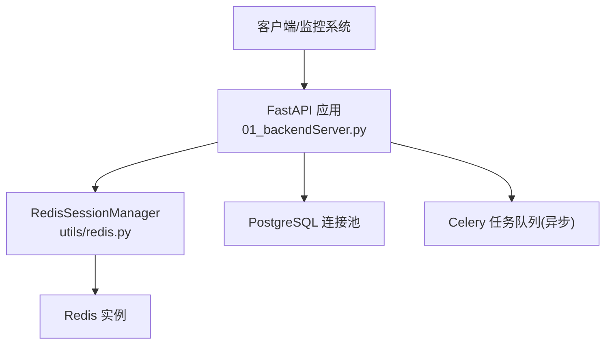
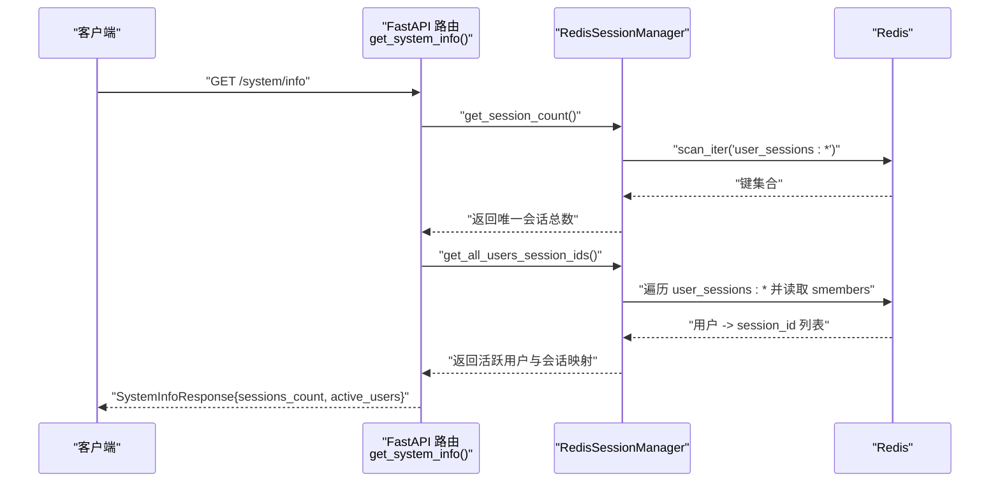
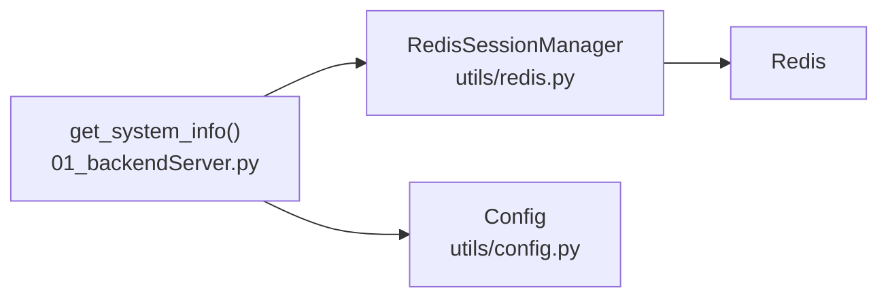

# 系统管理接口

<cite>
**本文引用的文件**
- [01_backendServer.py](file://01_backendServer.py)
- [utils/models.py](file://utils/models.py)
- [utils/redis.py](file://utils/redis.py)
- [utils/config.py](file://utils/config.py)
- [README.md](file://README.md)
</cite>

## 目录
1. [简介](#简介)
2. [项目结构](#项目结构)
3. [核心组件](#核心组件)
4. [架构总览](#架构总览)
5. [详细组件分析](#详细组件分析)
6. [依赖关系分析](#依赖关系分析)
7. [性能考虑](#性能考虑)
8. [故障排查指南](#故障排查指南)
9. [结论](#结论)
10. [附录](#附录)

## 简介
本章节聚焦于系统管理接口 GET /system/info，该接口用于获取系统的整体运行状态信息，包括会话总数、活跃用户列表等监控指标。通过该接口，运维与监控系统可以实时掌握当前系统中所有用户的会话分布与数量，辅助健康检查、容量评估与告警策略制定。

## 项目结构
本项目基于 FastAPI 提供异步 API 服务，使用 Redis 作为会话状态存储，PostgreSQL 用于短期/长期记忆持久化，Celery 用于异步任务调度。GET /system/info 位于后端主入口文件中，响应模型定义在 utils/models.py，数据访问逻辑封装在 utils/redis.py 的会话管理器中。



图表来源
- [01_backendServer.py:126-130](file://01_backendServer.py#L126-L130)
- [utils/redis.py:37-49](file://utils/redis.py#L37-L49)
- [utils/config.py:13-26](file://utils/config.py#L13-L26)

章节来源
- [README.md:1-39](file://README.md#L1-L39)
- [01_backendServer.py:126-130](file://01_backendServer.py#L126-L130)

## 核心组件
- 路由层：定义 GET /system/info 接口，负责接收请求并组装响应。
- 数据模型：SystemInfoResponse 描述响应体结构，包含 sessions_count 和 active_users。
- 会话管理器：RedisSessionManager 提供 get_session_count() 与 get_all_users_session_ids() 等方法，从 Redis 聚合统计与会话映射。
- 配置：统一配置类 Config 管理数据库、Redis、TTL 等参数。

章节来源
- [01_backendServer.py:240-251](file://01_backendServer.py#L240-L251)
- [utils/models.py:57-61](file://utils/models.py#L57-L61)
- [utils/redis.py:167-204](file://utils/redis.py#L167-L204)
- [utils/config.py:13-26](file://utils/config.py#L13-L26)

## 架构总览
GET /system/info 的整体调用流程如下：



图表来源
- [01_backendServer.py:240-251](file://01_backendServer.py#L240-L251)
- [utils/redis.py:167-204](file://utils/redis.py#L167-L204)

## 详细组件分析

### 接口：GET /system/info
- 功能与用途
  - 获取系统内全部会话的状态概览，包括会话总数与活跃用户及其会话 ID 列表。
  - 适用于运维监控、健康检查、容量规划与告警。
- 请求
  - 方法：GET
  - 路径：/system/info
  - 请求头：无特殊要求
  - 请求体：无
- 响应
  - 类型：SystemInfoResponse
  - 字段说明
    - sessions_count: int，当前系统内有效会话总数（去重后的 user_id + session_id）
    - active_users: Optional[Dict[str, Any]]，每个用户对应的 session_id 列表；若为空则为 None
- 错误处理
  - 正常情况返回 200 与 SystemInfoResponse。
  - 底层异常由 FastAPI 默认处理为 5xx。
- 示例
  - 请求示例
    - GET http://localhost:8001/system/info
  - 响应示例
    - {
        "sessions_count": 123,
        "active_users": {
          "user_001": ["s1", "s2"],
          "user_002": ["s3"]
        }
      }

章节来源
- [01_backendServer.py:240-251](file://01_backendServer.py#L240-L251)
- [utils/models.py:57-61](file://utils/models.py#L57-L61)

### 响应模型：SystemInfoResponse
- 字段
  - sessions_count: int，系统内有效会话总数
  - active_users: Optional[Dict[str, Any]]，活跃用户到其 session_id 列表的映射
- 语义
  - sessions_count 表示当前有效的“用户+会话”组合数量，避免同一会话下多个任务导致的重复计数。
  - active_users 便于快速定位哪些用户有活跃会话，以及每个用户下的会话 ID 集合。

章节来源
- [utils/models.py:57-61](file://utils/models.py#L57-L61)

### 数据收集机制与更新频率
- 数据来源
  - 会话与任务映射存储在 Redis，键模式包括：
    - user_sessions:{user_id}：集合，元素为 "session_id:task_id"
    - task_mapping:{user_id}:{session_id}：集合，元素为 task_id
    - session:{user_id}:{session_id}:{task_id}：哈希/JSON，存储会话详情（状态、更新时间等）
- 统计逻辑
  - get_session_count()：清理无效任务后，扫描所有 user_sessions:*，提取唯一的 user_id:session_id 并计数。
  - get_all_users_session_ids()：清理无效任务后，遍历 user_sessions:*，对每个用户提取唯一的 session_id 列表。
- 更新频率
  - 接口每次调用都会实时查询 Redis，因此反映的是调用时刻的系统快照。
  - 会话 TTL 与任务 TTL 由配置控制，过期后会被清理，影响统计结果。

章节来源
- [utils/redis.py:167-204](file://utils/redis.py#L167-L204)
- [utils/config.py:18-26](file://utils/config.py#L18-L26)

### 在运维监控与健康检查中的应用
- 健康检查
  - 定期轮询 /system/info，若 sessions_count 突降或长时间为 0，可能提示服务异常或 Redis 不可用。
- 容量与负载
  - 通过 sessions_count 趋势判断系统负载变化，结合业务峰值进行扩容决策。
- 告警策略
  - 当 sessions_count 超过阈值或增长速率异常时触发告警。
  - 当 active_users 中某用户会话数异常增多，可标记潜在滥用或异常行为。

### 性能考虑与优化建议
- 大数据量下的查询优化
  - 减少 scan_iter 全表扫描频率：可在应用层缓存最近一次统计结果，设置较短 TTL（如 1-5 秒），降低 Redis 压力。
  - 限制 active_users 的数据规模：如需展示更多维度，可按需分页或仅返回 Top N 用户。
  - 合理设置 Redis 键空间大小：及时清理过期会话与任务，避免无用键膨胀。
- 并发与超时
  - 在高并发场景下，确保 Redis 连接池与网络超时配置合理，避免阻塞。
- 资源隔离
  - 将监控接口与核心业务接口部署在不同实例或命名空间，避免相互影响。

## 依赖关系分析
- 路由依赖
  - FastAPI 路由 get_system_info 依赖 RedisSessionManager 提供的统计方法。
- 数据访问依赖
  - RedisSessionManager 依赖 Redis 客户端，通过 scan_iter 与集合操作完成统计。
- 配置依赖
  - Config 提供 Redis 地址、端口、数据库索引、会话与任务 TTL 等关键参数。



图表来源
- [01_backendServer.py:240-251](file://01_backendServer.py#L240-L251)
- [utils/redis.py:37-49](file://utils/redis.py#L37-L49)
- [utils/config.py:18-26](file://utils/config.py#L18-L26)

章节来源
- [01_backendServer.py:240-251](file://01_backendServer.py#L240-L251)
- [utils/redis.py:167-204](file://utils/redis.py#L167-L204)
- [utils/config.py:18-26](file://utils/config.py#L18-L26)

## 性能考虑
- 建议在监控侧实现本地缓存与限频，例如每 2-5 秒拉取一次，避免高频调用导致 Redis 压力过大。
- 对于超大键空间，可考虑分片或按租户维度拆分 Redis 实例，降低单次扫描范围。
- 关注 Redis 内存使用与慢查询日志，必要时调整 maxmemory 与淘汰策略。

## 故障排查指南
- 常见问题
  - 返回 sessions_count 为 0：检查 Redis 是否可达、会话是否已过期或被清理。
  - active_users 为空：确认是否存在有效会话映射，或是否被清理逻辑移除。
  - 接口超时：检查 Redis 网络延迟与连接池配置。
- 定位步骤
  - 查看应用日志，确认路由是否被调用及异常堆栈。
  - 检查 Redis 键空间，验证 user_sessions:* 与 task_mapping:* 是否存在。
  - 核对 Config 中的 Redis 地址、端口、DB 索引与 TTL 配置。

章节来源
- [utils/redis.py:246-341](file://utils/redis.py#L246-L341)
- [utils/config.py:18-26](file://utils/config.py#L18-L26)

## 结论
GET /system/info 提供了轻量而实时的系统会话监控能力，适合集成到运维监控与仪表盘系统中。通过合理的缓存与限流策略，可以在保证数据新鲜度的同时，有效控制对 Redis 的压力。配合健康检查与告警规则，可有效提升系统的可观测性与稳定性。

## 附录

### 监控集成示例（Python）
以下示例展示如何将 /system/info 集成到监控系统或仪表盘应用中，定期拉取并记录关键指标。

```python
import requests
import time
import logging

logging.basicConfig(level=logging.INFO)
logger = logging.getLogger(__name__)

BASE_URL = "http://localhost:8001"

def fetch_system_info():
    try:
        resp = requests.get(f"{BASE_URL}/system/info")
        resp.raise_for_status()
        return resp.json()
    except Exception as e:
        logger.error("获取系统信息失败: %s", e)
        return None

def main():
    while True:
        data = fetch_system_info()
        if data:
            logger.info("sessions_count=%s, active_users_keys=%s",
                        data.get("sessions_count"),
                        list(data.get("active_users", {}).keys()))
        else:
            logger.warning("本次未获取到系统信息")
        time.sleep(5)

if __name__ == "__main__":
    main()
```

说明
- 上述代码每 5 秒拉取一次 /system/info，并记录会话总数与活跃用户键名。
- 可根据需要扩展为写入时序数据库（如 Prometheus、InfluxDB）或渲染到前端仪表盘。

章节来源
- [01_backendServer.py:240-251](file://01_backendServer.py#L240-L251)
- [utils/models.py:57-61](file://utils/models.py#L57-L61)