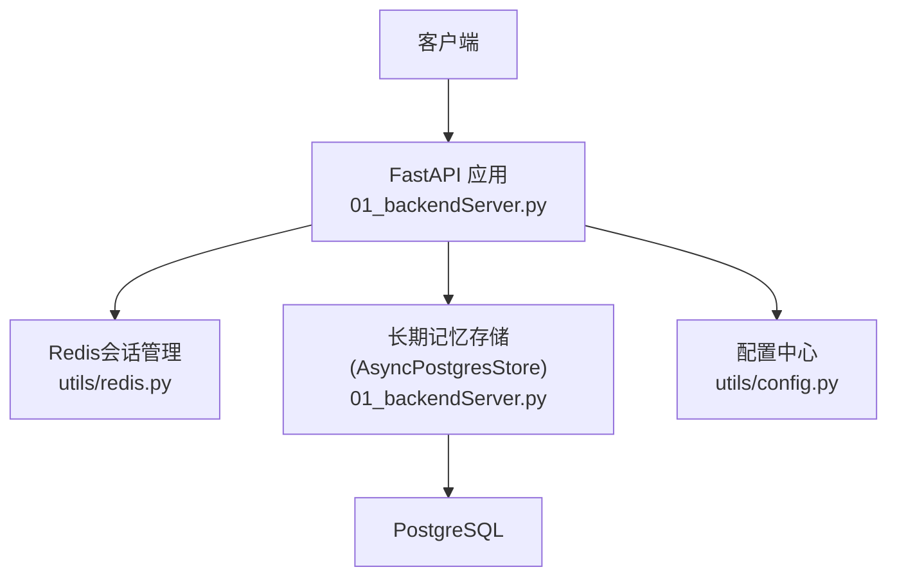
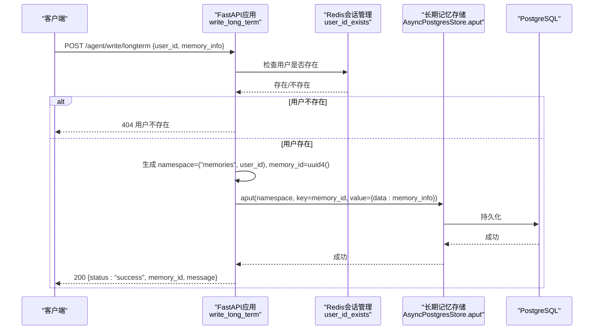
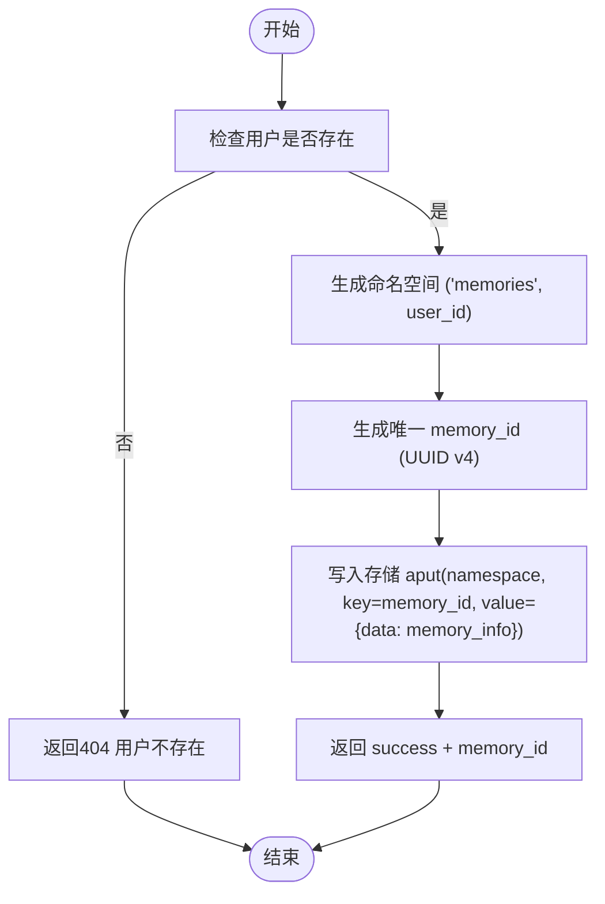
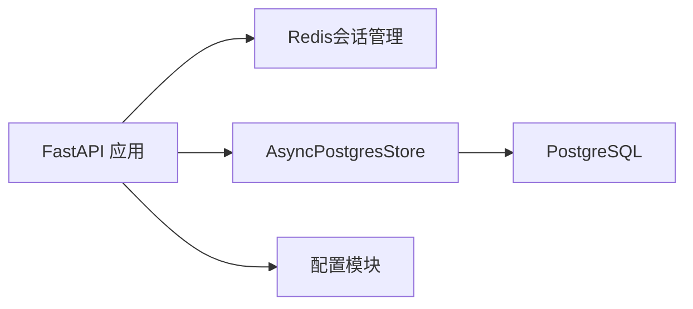

# 记忆管理接口

<cite>
**本文引用的文件**
- [01_backendServer.py](file://01_backendServer.py)
- [utils/models.py](file://utils/models.py)
- [utils/redis.py](file://utils/redis.py)
- [utils/config.py](file://utils/config.py)
- [utils/tasks.py](file://utils/tasks.py)
- [README.md](file://README.md)
</cite>

## 目录
1. [简介](#简介)
2. [项目结构](#项目结构)
3. [核心组件](#核心组件)
4. [架构总览](#架构总览)
5. [详细组件分析](#详细组件分析)
6. [依赖关系分析](#依赖关系分析)
7. [性能考虑](#性能考虑)
8. [故障排查指南](#故障排查指南)
9. [结论](#结论)
10. [附录](#附录)

## 简介
本文件为“长期记忆写入”接口的完整API文档，聚焦于 POST /agent/write/longterm。该接口用于在Agent执行过程中持久化重要的上下文信息与用户偏好设置，实现跨会话、跨任务的长期记忆能力。系统通过命名空间与用户隔离策略保障多用户数据的安全性与可维护性。

## 项目结构
- 后端服务入口：FastAPI应用定义在 01_backendServer.py，包含长期记忆写入接口及资源初始化逻辑。
- 数据模型：请求与响应模型定义在 utils/models.py，其中 LongMemRequest 描述长期记忆写入的请求体。
- 会话与状态管理：Redis会话管理器在 utils/redis.py，提供用户存在性检查等能力。
- 配置：数据库连接池、Redis、Celery等参数在 utils/config.py。
- 长期记忆读取（辅助）：在 utils/tasks.py 中提供读取长期记忆的函数，便于理解存储结构与查询方式。
- 项目说明：功能概览与测试流程见 README.md。

图表来源
- [01_backendServer.py:84-130](file://01_backendServer.py#L84-L130)
- [utils/redis.py:37-54](file://utils/redis.py#L37-L54)
- [utils/config.py:13-26](file://utils/config.py#L13-L26)

章节来源
- [01_backendServer.py:84-130](file://01_backendServer.py#L84-L130)
- [README.md:1-33](file://README.md#L1-L33)

## 核心组件
- 长期记忆写入接口：POST /agent/write/longterm
- 请求模型：LongMemRequest（user_id, memory_info）
- 存储机制：基于 LangGraph AsyncPostgresStore 的键值存储，使用命名空间 (“memories”, user_id) 进行用户隔离
- 记忆ID生成：UUID v4，全局唯一
- 会话校验：通过 RedisSessionManager.user_id_exists 验证用户是否存在

章节来源
- [01_backendServer.py:346-374](file://01_backendServer.py#L346-L374)
- [utils/models.py:19-25](file://utils/models.py#L19-L25)
- [utils/redis.py:146-151](file://utils/redis.py#L146-L151)

## 架构总览
长期记忆写入的整体流程如下：
- 客户端发送 POST /agent/write/longterm，携带 user_id 和 memory_info
- 服务端校验用户是否存在（基于Redis会话管理）
- 若用户存在，生成命名空间 (“memories”, user_id) 与唯一 memory_id
- 将 {data: memory_info} 写入 AsyncPostgresStore
- 返回包含 status、memory_id、message 的成功响应；异常时返回HTTP错误码与详细信息

图表来源
- [01_backendServer.py:346-374](file://01_backendServer.py#L346-L374)
- [01_backendServer.py:43-80](file://01_backendServer.py#L43-L80)
- [utils/redis.py:146-151](file://utils/redis.py#L146-L151)

## 详细组件分析

### 接口规范：POST /agent/write/longterm
- 路径：/agent/write/longterm
- 方法：POST
- 内容类型：application/json
- 请求体模型：LongMemRequest
  - user_id: string，必填，用户的唯一标识
  - memory_info: string，必填，要保存的记忆内容
- 成功响应：
  - status: "success"
  - memory_id: string，本次写入生成的唯一记忆ID
  - message: string，提示信息
- 错误响应：
  - 404：用户不存在
  - 500：存储失败或内部异常

章节来源
- [utils/models.py:19-25](file://utils/models.py#L19-L25)
- [01_backendServer.py:346-374](file://01_backendServer.py#L346-L374)

### 请求示例（JSON）
- 示例请求体字段：
  - user_id: 字符串，如 "user_123"
  - memory_info: 字符串，如 "用户偏好：喜欢红色主题，语言设置为中文"
- 参考前端调用封装位置：[02_frontendServer.py:128-157](file://02_frontendServer.py#L128-L157)

章节来源
- [02_frontendServer.py:128-157](file://02_frontendServer.py#L128-L157)

### 成功响应示例
- 示例响应体字段：
  - status: "success"
  - memory_id: UUID字符串，如 "a1b2c3d4-..." 
  - message: "记忆存储成功"
- 参考后端构造位置：[01_backendServer.py:364-368](file://01_backendServer.py#L364-L368)

章节来源
- [01_backendServer.py:364-368](file://01_backendServer.py#L364-L368)

### 长期记忆写入流程与数据结构
- 命名空间：("memories", user_id)，按用户隔离
- 键：memory_id（UUID v4），保证唯一性
- 值：{"data": memory_info}，存储原始记忆内容
- 存储后端：LangGraph AsyncPostgresStore，底层为PostgreSQL
- 写入成功后记录日志并返回 memory_id

图表来源
- [01_backendServer.py:43-80](file://01_backendServer.py#L43-L80)
- [01_backendServer.py:346-374](file://01_backendServer.py#L346-L374)

章节来源
- [01_backendServer.py:43-80](file://01_backendServer.py#L43-L80)
- [01_backendServer.py:346-374](file://01_backendServer.py#L346-L374)

### 短期记忆与长期记忆的区别及使用场景
- 短期记忆：
  - 用途：会话内的上下文历史、聊天消息等临时信息
  - 存储：LangGraph Checkpointer（基于PostgreSQL），随会话生命周期管理
  - 特点：与任务/会话强绑定，适合当前对话上下文
- 长期记忆：
  - 用途：跨会话的用户偏好、重要上下文、知识片段等持久信息
  - 存储：AsyncPostgresStore，按命名空间 ("memories", user_id) 隔离
  - 特点：独立于会话，支持跨任务、跨会话复用
- 使用建议：
  - 在Agent执行过程中，将关键用户偏好、业务规则、历史决策结果等写入长期记忆
  - 在需要时读取长期记忆以增强上下文，提升个性化与一致性

章节来源
- [README.md:7-11](file://README.md#L7-L11)
- [README.md:29-32](file://README.md#L29-L32)
- [utils/tasks.py:87-124](file://utils/tasks.py#L87-L124)

### 命名空间管理与用户隔离策略
- 命名空间设计：("memories", user_id)
- 隔离策略：每个用户拥有独立的命名空间，避免数据交叉
- 扩展建议：如需更细粒度隔离，可在命名空间中增加二级维度（如 domain、tenant）

章节来源
- [01_backendServer.py:56-64](file://01_backendServer.py#L56-L64)

### 错误处理机制
- 用户不存在：
  - 触发条件：RedisSessionManager.user_id_exists 返回 False
  - 响应：HTTP 404，detail 提示用户不存在
- 存储失败：
  - 触发条件：AsyncPostgresStore.aput 抛出异常
  - 响应：HTTP 500，detail 包含具体错误信息
- 其他异常：
  - 统一捕获并记录日志，返回500错误

章节来源
- [01_backendServer.py:353-374](file://01_backendServer.py#L353-L374)
- [01_backendServer.py:74-80](file://01_backendServer.py#L74-L80)

### 实际使用场景与代码示例指引
- 场景1：在Agent工具调用后，将用户确认的偏好写入长期记忆（如主题、语言、地区）
  - 参考前端调用封装：[02_frontendServer.py:128-157](file://02_frontendServer.py#L128-L157)
- 场景2：在Agent完成复杂任务后，将关键决策结果持久化，供后续会话复用
  - 参考后端写入逻辑：[01_backendServer.py:43-80](file://01_backendServer.py#L43-L80)
- 场景3：读取长期记忆以增强上下文（例如加载用户偏好）
  - 参考读取逻辑：[utils/tasks.py:87-124](file://utils/tasks.py#L87-L124)

章节来源
- [02_frontendServer.py:128-157](file://02_frontendServer.py#L128-L157)
- [01_backendServer.py:43-80](file://01_backendServer.py#L43-L80)
- [utils/tasks.py:87-124](file://utils/tasks.py#L87-L124)

## 依赖关系分析
- FastAPI应用依赖：
  - Redis会话管理器：用于用户存在性检查与会话状态管理
  - AsyncPostgresStore：用于长期记忆持久化
  - 配置模块：数据库连接池、Redis、Celery等参数
- 外部依赖：
  - PostgreSQL：长期记忆与短期记忆存储后端
  - Redis：会话状态与任务调度中间件

图表来源
- [01_backendServer.py:84-130](file://01_backendServer.py#L84-L130)
- [utils/config.py:13-26](file://utils/config.py#L13-L26)

章节来源
- [01_backendServer.py:84-130](file://01_backendServer.py#L84-L130)
- [utils/config.py:13-26](file://utils/config.py#L13-L26)

## 性能考虑
- 异步I/O：接口与存储均为异步操作，减少阻塞
- 连接池：数据库连接池配置合理大小，避免连接耗尽
- 命名空间隔离：降低锁竞争与扫描范围
- 日志轮转：控制日志文件大小与保留数量，避免磁盘占用过高

章节来源
- [utils/config.py:13-26](file://utils/config.py#L13-L26)
- [01_backendServer.py:21-40](file://01_backendServer.py#L21-L40)

## 故障排查指南
- 404 用户不存在：
  - 检查Redis中是否存在该用户的会话集合
  - 确认前置流程是否已创建会话并绑定用户
- 500 存储失败：
  - 检查PostgreSQL连接与权限
  - 查看应用日志中的异常堆栈
- 无法读取长期记忆：
  - 确认命名空间是否正确 ("memories", user_id)
  - 检查存储层查询是否返回有效结果

章节来源
- [01_backendServer.py:353-374](file://01_backendServer.py#L353-L374)
- [utils/tasks.py:98-115](file://utils/tasks.py#L98-L115)

## 结论
POST /agent/write/longterm 提供了稳定、可扩展的长期记忆写入能力，通过命名空间与用户隔离确保数据安全。结合短期记忆与长期记忆，可实现跨会话的上下文保持与个性化服务。建议在Agent执行的关键节点写入重要信息，并在后续流程中读取以提升用户体验与系统智能性。

## 附录
- 配置项参考：
  - 数据库URI、连接池大小、Redis地址、Celery代理等
  - 参考位置：[utils/config.py:13-26](file://utils/config.py#L13-L26)
- 前端调用示例位置：
  - 参考位置：[02_frontendServer.py:128-157](file://02_frontendServer.py#L128-L157)