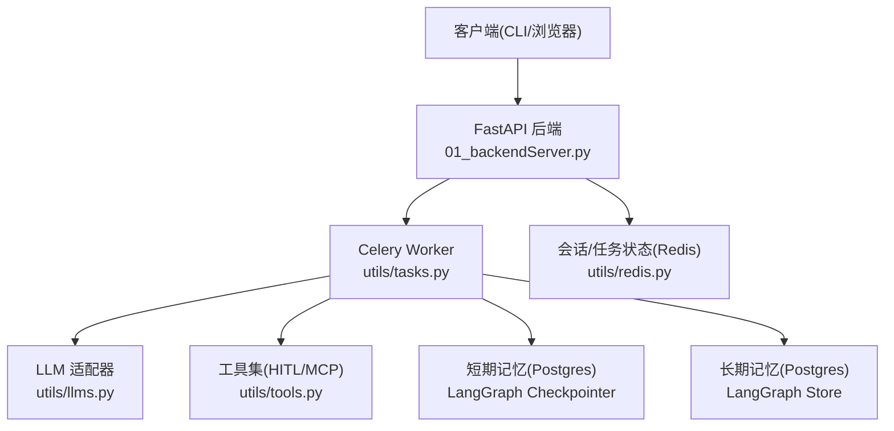
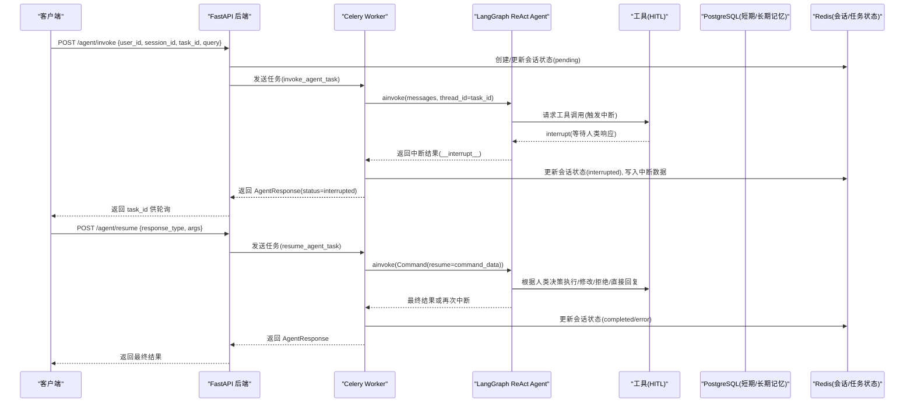
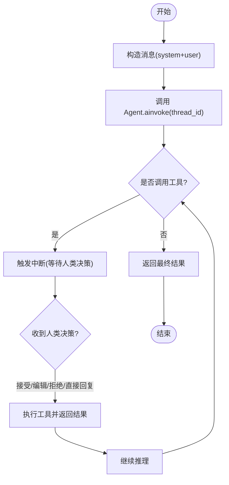
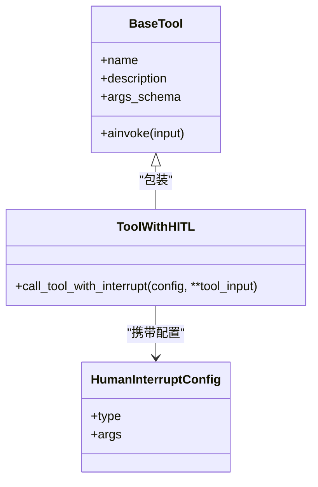
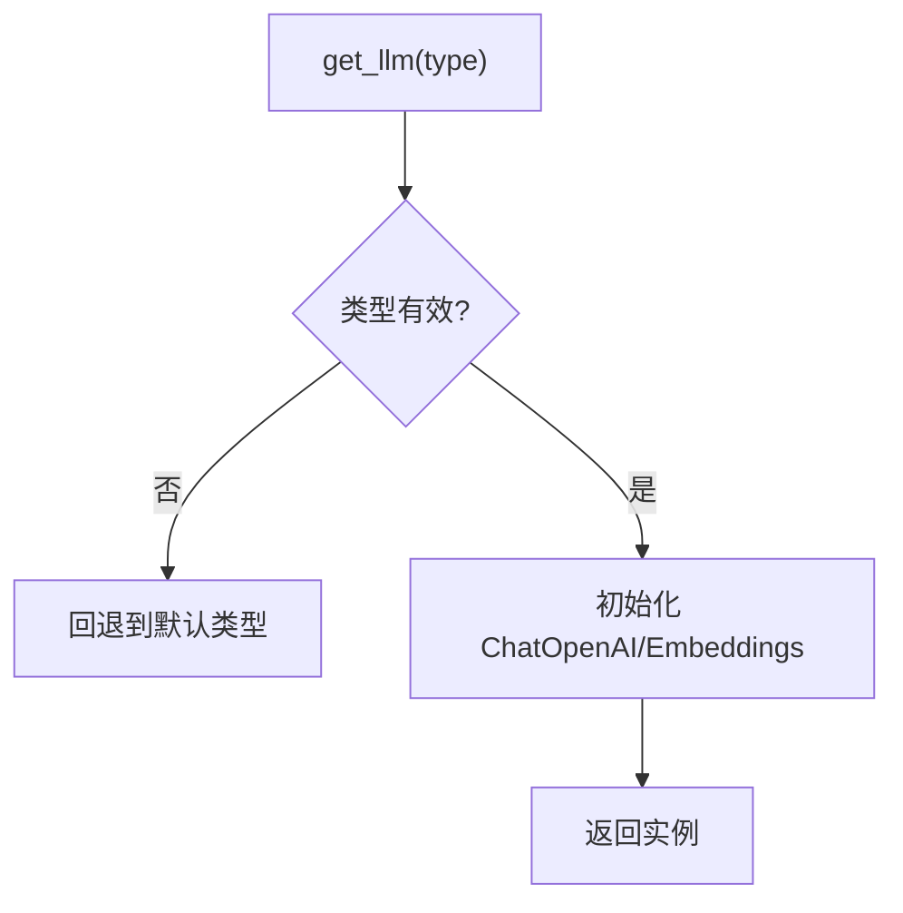
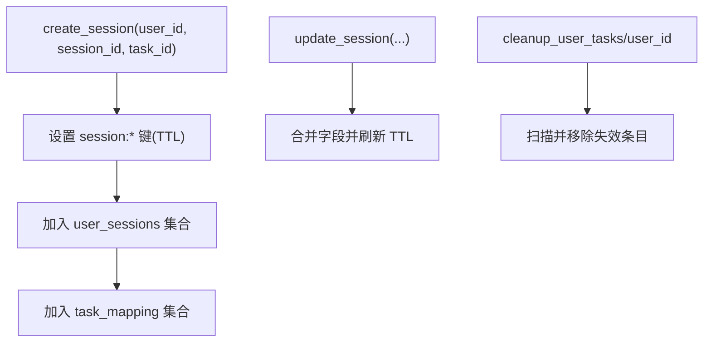
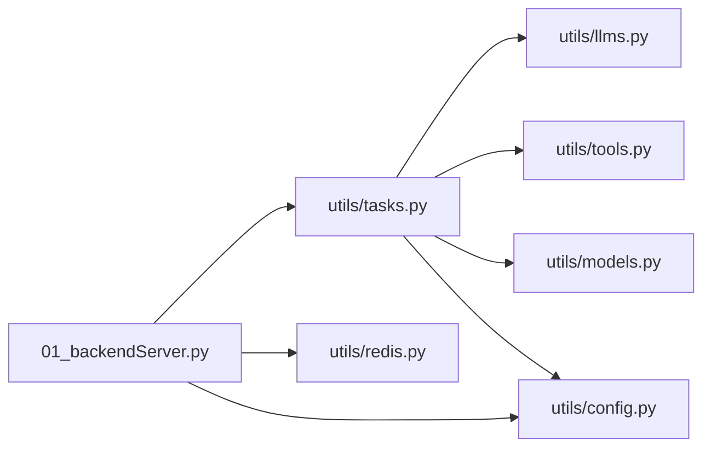

# Agent执行引擎

<cite>
**本文引用的文件**
- [README.md](file://README.md)
- [01_backendServer.py](file://01_backendServer.py)
- [02_frontendServer.py](file://02_frontendServer.py)
- [utils/config.py](file://utils/config.py)
- [utils/llms.py](file://utils/llms.py)
- [utils/tools.py](file://utils/tools.py)
- [utils/models.py](file://utils/models.py)
- [utils/redis.py](file://utils/redis.py)
- [utils/tasks.py](file://utils/tasks.py)
</cite>

## 目录
1. [简介](#简介)
2. [项目结构](#项目结构)
3. [核心组件](#核心组件)
4. [架构总览](#架构总览)
5. [详细组件分析](#详细组件分析)
6. [依赖关系分析](#依赖关系分析)
7. [性能与优化建议](#性能与优化建议)
8. [故障排查指南](#故障排查指南)
9. [结论](#结论)
10. [附录：配置与扩展指南](#附录：配置与扩展指南)

## 简介
本仓库实现了一个基于 LangGraph ReAct 架构的 Agent 执行引擎，提供异步任务调度、人机协作（HITL）工具审批、多厂商 LLM 适配、短期/长期记忆持久化、会话状态管理等功能。后端通过 FastAPI 暴露 REST API，前端使用 Rich 构建交互式 CLI，Celery + Redis 作为异步任务队列与消息代理，PostgreSQL 用于短期记忆检查点与长期记忆存储。

## 项目结构
- 后端服务入口与路由：01_backendServer.py
- 前端交互演示：02_frontendServer.py
- 配置中心：utils/config.py
- LLM 适配器：utils/llms.py
- 工具注册与 HITL 包装：utils/tools.py
- 数据模型定义：utils/models.py
- 会话与任务状态管理（Redis）：utils/redis.py
- 异步任务与 Agent 执行流程：utils/tasks.py
- 文档与使用说明：README.md

图表来源
- [01_backendServer.py:126-173](file://01_backendServer.py#L126-L173)
- [utils/tasks.py:319-451](file://utils/tasks.py#L319-L451)
- [utils/llms.py:70-119](file://utils/llms.py#L70-L119)
- [utils/tools.py:121-175](file://utils/tools.py#L121-L175)
- [utils/redis.py:37-103](file://utils/redis.py#L37-L103)

章节来源
- [README.md:1-39](file://README.md#L1-L39)
- [01_backendServer.py:126-173](file://01_backendServer.py#L126-L173)
- [utils/config.py:4-34](file://utils/config.py#L4-L34)

## 核心组件
- 后端 API：提供 /agent/invoke、/agent/resume、/agent/status、/system/info 等接口，负责会话创建、任务入队、状态查询与清理。
- 异步任务：Celery 任务 invoke_agent_task 与 resume_agent_task，封装 ReAct Agent 的执行、中断恢复、结果处理与状态更新。
- LLM 适配器：统一初始化 OpenAI、通义千问、Ollama 等模型的 ChatOpenAI 与 Embeddings。
- 工具系统：自定义工具 + MCP 服务器工具，统一通过 add_human_in_the_loop 包装，支持 accept/reject/edit/response 四种审查类型。
- 记忆系统：短期记忆通过 LangGraph Checkpointer 持久化到 PostgreSQL；长期记忆通过 LangGraph Store 读写用户偏好等。
- 会话与任务状态：Redis 维护 user/session/task 三维状态，支持过期、清理、恢复与查询。

章节来源
- [01_backendServer.py:133-237](file://01_backendServer.py#L133-L237)
- [utils/tasks.py:319-559](file://utils/tasks.py#L319-L559)
- [utils/llms.py:70-119](file://utils/llms.py#L70-L119)
- [utils/tools.py:37-118](file://utils/tools.py#L37-L118)
- [utils/redis.py:37-103](file://utils/redis.py#L37-L103)

## 架构总览
ReAct 推理-行动循环由 LangGraph 驱动，Agent 在每一步决定“思考”或“调用工具”。当需要外部能力时，工具被包装为带 HITL 的中断点，等待人类决策后再继续执行。

图表来源
- [01_backendServer.py:133-237](file://01_backendServer.py#L133-L237)
- [utils/tasks.py:319-559](file://utils/tasks.py#L319-L559)
- [utils/tools.py:37-118](file://utils/tools.py#L37-L118)
- [utils/redis.py:369-415](file://utils/redis.py#L369-L415)

## 详细组件分析

### ReAct 推理-行动循环与执行流程
- 推理阶段：Agent 根据当前上下文生成下一步动作（继续对话或调用工具）。
- 行动阶段：若选择工具，则进入 HITL 中断，等待人类决策；否则直接输出答案。
- 中断恢复：通过 Command(resume=...) 将人类决策注入 Agent，从上次中断点继续执行。

图表来源
- [utils/tasks.py:367-402](file://utils/tasks.py#L367-L402)
- [utils/tasks.py:492-505](file://utils/tasks.py#L492-L505)
- [utils/tools.py:65-116](file://utils/tools.py#L65-L116)

章节来源
- [utils/tasks.py:319-451](file://utils/tasks.py#L319-L451)
- [utils/tasks.py:455-559](file://utils/tasks.py#L455-L559)

### 工具调用机制与 HITL 四种审查类型
- 工具注册：get_tools() 聚合自定义工具与 MCP 工具，并为每个工具添加 HITL 包装。
- 参数验证：工具函数声明参数类型，LangChain 自动进行基础校验；HITL 包装保留原工具的 args_schema。
- 四种审查类型：
  - accept：按原参数执行工具
  - edit：替换参数后执行工具
  - reject：不调用工具，返回拒绝信息
  - response：不调用工具，直接以用户反馈作为工具响应

图表来源
- [utils/tools.py:37-118](file://utils/tools.py#L37-L118)
- [utils/tools.py:121-175](file://utils/tools.py#L121-L175)

章节来源
- [utils/tools.py:37-118](file://utils/tools.py#L37-L118)
- [utils/tools.py:121-175](file://utils/tools.py#L121-L175)

### 多 LLM 适配器设计
- 支持类型：openai、oneapi、qwen、ollama
- 统一接口：initialize_llm(llm_type) 返回 ChatOpenAI 与 OpenAIEmbeddings
- 环境变量：OPENAI_API_KEY、DASHSCOPE_API_KEY 等
- 默认回退：若指定类型失败，尝试默认类型

图表来源
- [utils/llms.py:70-119](file://utils/llms.py#L70-L119)
- [utils/llms.py:122-138](file://utils/llms.py#L122-L138)

章节来源
- [utils/llms.py:31-119](file://utils/llms.py#L31-L119)
- [utils/llms.py:122-138](file://utils/llms.py#L122-L138)

### 会话与任务状态管理（Redis）
- 键空间：
  - session:{user_id}:{session_id}:{task_id}：会话数据（状态、最近查询、最近响应、更新时间）
  - user_sessions:{user_id}：用户所有 session_id:task_id 集合
  - task_mapping:{user_id}:{session_id}：会话内所有 task_id 集合
  - task:{task_id}：任务状态（status、result、error、绑定关系）
- 生命周期：TTL 控制过期；定期清理无效任务；支持删除会话/任务。

图表来源
- [utils/redis.py:65-103](file://utils/redis.py#L65-L103)
- [utils/redis.py:106-144](file://utils/redis.py#L106-L144)
- [utils/redis.py:246-341](file://utils/redis.py#L246-L341)

章节来源
- [utils/redis.py:37-103](file://utils/redis.py#L37-L103)
- [utils/redis.py:246-341](file://utils/redis.py#L246-L341)

### 前端交互与恢复流程
- 启动后获取系统信息，提示输入用户 ID，自动恢复最近会话或新建会话。
- 主循环支持命令：exit、new、history、status、setting。
- 遇到中断时，展示工具名称与参数，引导用户选择 accept/no/edit/response。
- 支持历史会话与任务恢复，自动检测 interrupted 状态并继续。

章节来源
- [02_frontendServer.py:672-800](file://02_frontendServer.py#L672-L800)
- [02_frontendServer.py:50-107](file://02_frontendServer.py#L50-L107)
- [02_frontendServer.py:325-497](file://02_frontendServer.py#L325-L497)

## 依赖关系分析
- 后端依赖：FastAPI、uvicorn、psycopg_pool、langgraph-checkpoint-postgres、langgraph-store-postgres、celery、redis、rich。
- 任务依赖：langgraph.prebuilt.create_react_agent、langchain_core.messages.utils.trim_messages、langchain_mcp_adapters.client.MultiServerMCPClient。
- 模型依赖：langchain_openai.ChatOpenAI、OpenAIEmbeddings。

图表来源
- [01_backendServer.py:1-19](file://01_backendServer.py#L1-L19)
- [utils/tasks.py:1-19](file://utils/tasks.py#L1-L19)
- [utils/llms.py:1-6](file://utils/llms.py#L1-L6)
- [utils/tools.py:1-12](file://utils/tools.py#L1-L12)
- [utils/models.py:1-4](file://utils/models.py#L1-L4)
- [utils/config.py:1-4](file://utils/config.py#L1-L4)

章节来源
- [01_backendServer.py:1-19](file://01_backendServer.py#L1-L19)
- [utils/tasks.py:1-19](file://utils/tasks.py#L1-L19)

## 性能与优化建议
- 短期记忆修剪：pre_model_hook 中 trim_messages 限制消息 token 数量，避免上下文过大导致延迟与成本上升。
- 连接池：PostgreSQL 使用 AsyncConnectionPool 控制最小/最大连接数，减少连接开销。
- 超时与重试：LLM 初始化时设置 timeout 与 max_retries，提升鲁棒性。
- 会话 TTL：合理设置 SESSION_TIMEOUT 与 TASK_TTL，避免内存膨胀。
- 日志轮转：ConcurrentRotatingFileHandler 控制日志大小与备份数量，便于生产环境运维。
- 并行任务：Celery Worker 可水平扩展，结合 Redis 作为消息代理，提高吞吐。

[本节为通用指导，不直接分析具体文件]

## 故障排查指南
- 常见错误定位：
  - LLM 初始化失败：检查环境变量与网络连通性，查看日志中的初始化错误。
  - 工具调用异常：确认工具参数类型与必填项，查看 HITL 包装中的异常捕获与日志。
  - 会话状态不一致：检查 Redis 键是否存在与 TTL 是否过期，必要时执行清理。
  - 数据库连接问题：确认 Postgres 连接串与连接池配置，查看连接池打开/关闭日志。
- 调试技巧：
  - 启用 DEBUG 级别日志，关注关键路径：invoke_agent_task、resume_agent_task、process_agent_result。
  - 使用 parse_messages 打印消息流，观察 tool_calls 与元数据。
  - 前端 CLI 支持 status/new/history 命令，辅助定位中断与恢复问题。

章节来源
- [utils/tasks.py:137-193](file://utils/tasks.py#L137-L193)
- [utils/tasks.py:195-264](file://utils/tasks.py#L195-L264)
- [utils/llms.py:114-119](file://utils/llms.py#L114-L119)
- [utils/tools.py:80-116](file://utils/tools.py#L80-L116)
- [utils/redis.py:246-341](file://utils/redis.py#L246-L341)

## 结论
该 Agent 执行引擎以 LangGraph ReAct 为核心，结合 HITL 工具审批、多 LLM 适配、短期/长期记忆与异步任务调度，提供了可扩展、可恢复、可观测的智能体服务能力。开发者可通过配置与扩展工具集快速定制行为，并通过日志与前端交互进行调试与监控。

[本节为总结，不直接分析具体文件]

## 附录：配置与扩展指南
- 配置项（utils/config.py）
  - 数据库：DB_URI、MIN_SIZE、MAX_SIZE
  - Redis：REDIS_HOST、REDIS_PORT、REDIS_DB、SESSION_TIMEOUT、TTL、CELERY_BROKER_URL、TASK_TTL
  - LLM：LLM_TYPE（openai/oneapi/qwen/ollama）
  - 服务：HOST、PORT
- 扩展 LLM 适配器
  - 在 MODEL_CONFIGS 中添加新厂商配置，确保 base_url、api_key、chat_model、embedding_model 正确。
  - 使用 get_llm(type) 获取实例，异常时自动回退默认类型。
- 扩展工具
  - 在 get_tools() 中新增 @tool 装饰的函数，或通过 MultiServerMCPClient 接入第三方工具。
  - 使用 add_human_in_the_loop 包装工具，获得 HITL 能力。
- 扩展记忆
  - 短期记忆：LangGraph Checkpointer 自动持久化节点状态，无需额外代码。
  - 长期记忆：通过 store.aput/asearch 读写用户偏好，可在 system_message 中拼接以提升个性化。
- 调试与测试
  - 使用前端 CLI 的 status/new/history 命令验证状态与恢复。
  - 开启 DEBUG 日志，关注 invoke/resume 流程与工具调用细节。

章节来源
- [utils/config.py:4-34](file://utils/config.py#L4-L34)
- [utils/llms.py:31-119](file://utils/llms.py#L31-L119)
- [utils/tools.py:121-175](file://utils/tools.py#L121-L175)
- [02_frontendServer.py:672-800](file://02_frontendServer.py#L672-L800)