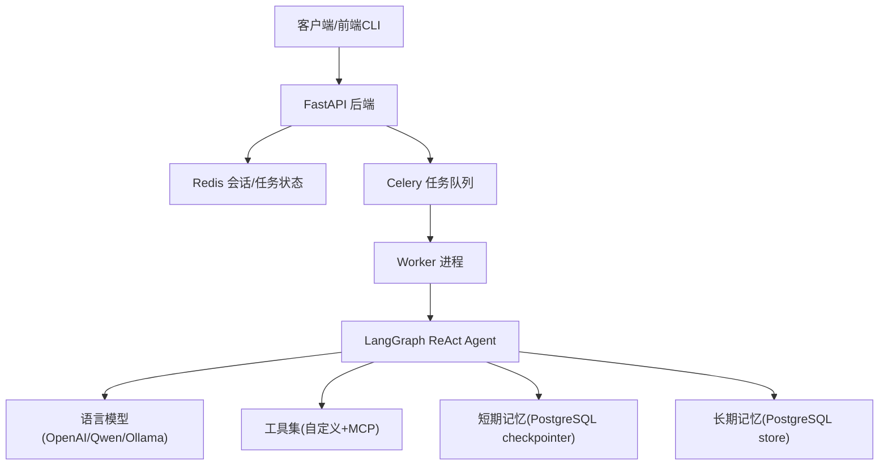
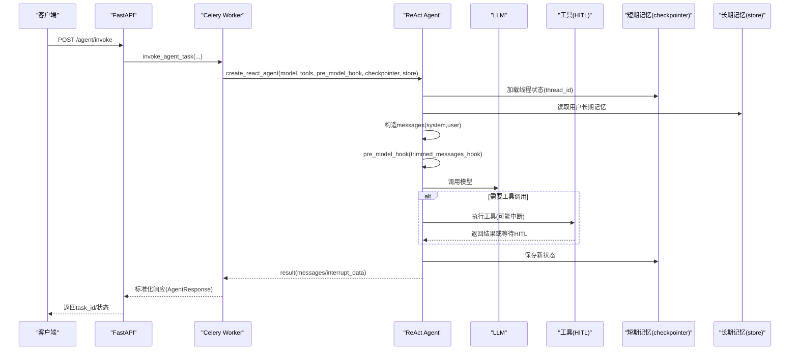
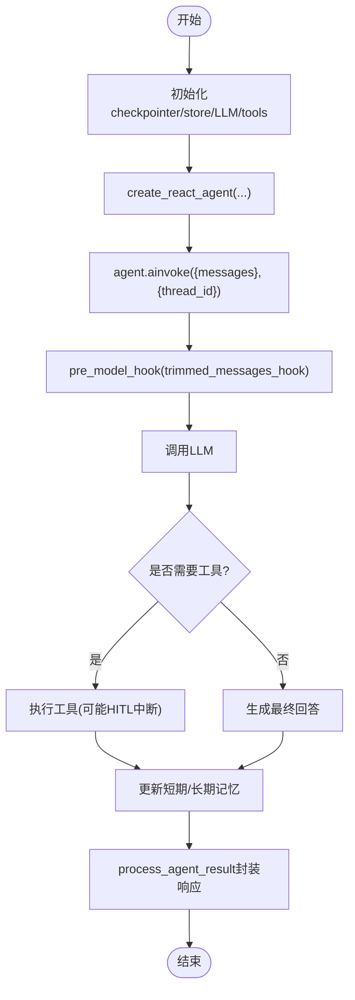
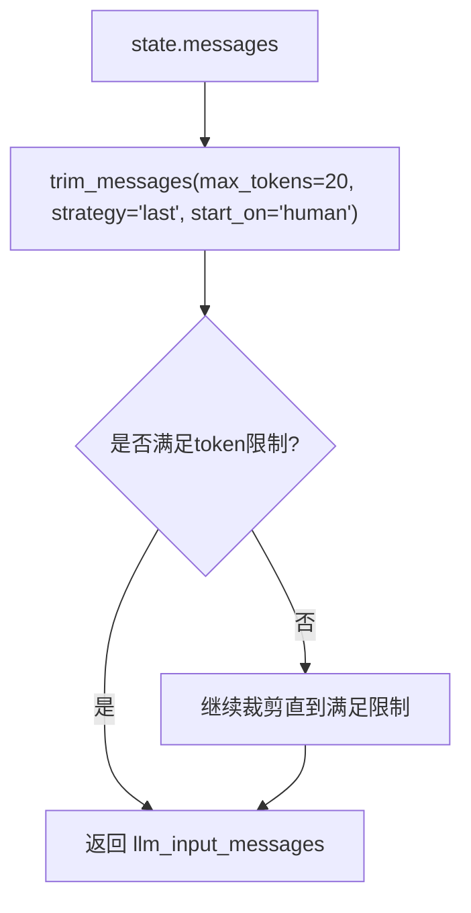
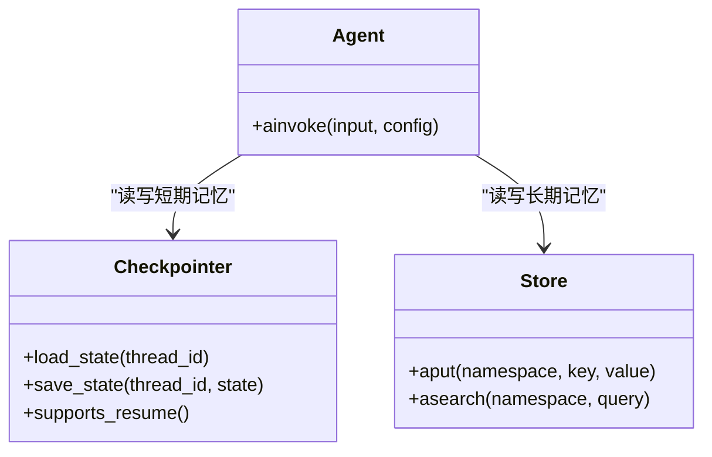
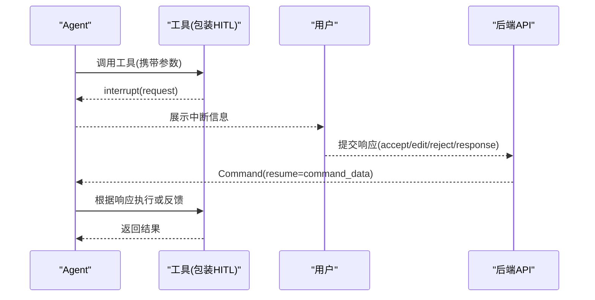
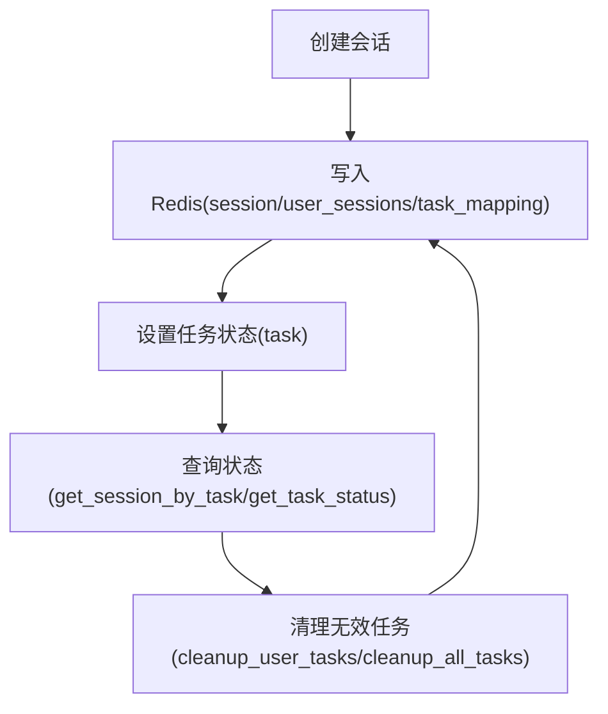
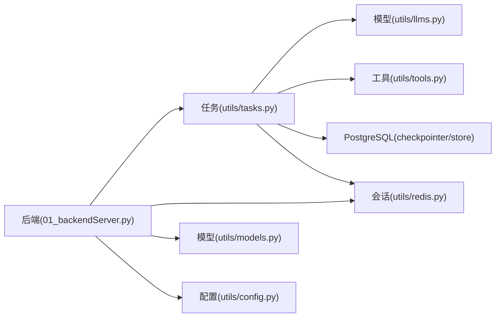

# ReAct架构实现

<cite>
**本文引用的文件**
- [README.md](file://README.md)
- [01_backendServer.py](file://01_backendServer.py)
- [02_frontendServer.py](file://02_frontendServer.py)
- [utils/config.py](file://utils/config.py)
- [utils/tasks.py](file://utils/tasks.py)
- [utils/tools.py](file://utils/tools.py)
- [utils/llms.py](file://utils/llms.py)
- [utils/models.py](file://utils/models.py)
- [utils/redis.py](file://utils/redis.py)
</cite>

## 目录
1. [简介](#简介)
2. [项目结构](#项目结构)
3. [核心组件](#核心组件)
4. [架构总览](#架构总览)
5. [详细组件分析](#详细组件分析)
6. [依赖关系分析](#依赖关系分析)
7. [性能考虑](#性能考虑)
8. [故障排查指南](#故障排查指南)
9. [结论](#结论)
10. [附录](#附录)

## 简介
本项目基于 LangGraph 的 ReAct 架构，构建了一个生产级 Agent 服务。系统通过 FastAPI 暴露异步 API，使用 Celery 将 Agent 执行任务分发到 Worker 进程；借助 PostgreSQL 作为短期记忆（checkpointer）与长期记忆（store）的持久化存储，Redis 用于会话状态管理与任务调度消息代理；支持 Human-in-the-Loop（HITL）人工审查工具调用、多模型接入、会话恢复与历史管理、以及短期记忆的消息修剪优化。前端演示程序使用 rich 库提供交互式 CLI，便于联调与调试。

## 项目结构
- 后端服务：FastAPI 应用负责接收请求、创建/恢复任务、维护会话状态，并调用 Celery 任务执行 Agent。
- 任务执行：Celery Worker 中构建 ReAct Agent，调用 create_react_agent，注入 LLM、工具、pre_model_hook、checkpointer、store，并通过 agent.ainvoke 执行推理-行动循环。
- 记忆系统：PostgreSQL 同时承担短期记忆（检查点）和长期记忆（命名空间键值存储）。
- 会话与任务：Redis 保存会话状态、任务状态、过期策略与清理逻辑。
- 工具与 HITL：自定义工具与 MCP Server 工具统一包装为带人工审查的工具，支持 accept/edit/reject/response 四种响应类型。
- 模型接入：支持 OpenAI、阿里通义千问、本地 Ollama 等模型，通过配置切换。

图表来源
- [01_backendServer.py:84-130](file://01_backendServer.py#L84-L130)
- [utils/tasks.py:319-451](file://utils/tasks.py#L319-L451)
- [utils/tools.py:121-175](file://utils/tools.py#L121-L175)
- [utils/llms.py:70-138](file://utils/llms.py#L70-L138)
- [utils/redis.py:37-103](file://utils/redis.py#L37-L103)

章节来源
- [README.md:1-39](file://README.md#L1-L39)
- [01_backendServer.py:84-130](file://01_backendServer.py#L84-L130)
- [utils/config.py:4-34](file://utils/config.py#L4-L34)

## 核心组件
- ReAct Agent 构建与执行：在 Celery 任务中通过 create_react_agent 组装模型、工具、钩子、检查点与存储，并使用 agent.ainvoke 驱动推理-行动循环。
- 消息修剪钩子：pre_model_hook=trimmed_messages_hook 在每次模型调用前对消息进行修剪，控制上下文长度与 token 消耗。
- 短期记忆（checkpointer）：AsyncPostgresSaver 持久化节点状态，支持中断恢复与状态回溯。
- 长期记忆（store）：AsyncPostgresStore 按命名空间存储用户偏好等信息，并在系统提示词中动态注入。
- 会话与任务管理：RedisSessionManager 维护 user/session/task 的多维状态，支持过期、清理、查询与恢复。
- 工具与 HITL：add_human_in_the_loop 将工具调用包装为可中断流程，支持接受、编辑参数、拒绝或直接反馈。
- 模型接入：get_llm 根据配置返回 ChatOpenAI/OpenAIEmbeddings，支持多厂商与本地模型。

章节来源
- [utils/tasks.py:66-85](file://utils/tasks.py#L66-L85)
- [utils/tasks.py:319-451](file://utils/tasks.py#L319-L451)
- [utils/tasks.py:455-559](file://utils/tasks.py#L455-L559)
- [utils/tools.py:37-118](file://utils/tools.py#L37-L118)
- [utils/llms.py:70-138](file://utils/llms.py#L70-L138)
- [utils/redis.py:37-103](file://utils/redis.py#L37-L103)

## 架构总览
ReAct 推理-行动循环由 LangGraph 内部状态机驱动，create_react_agent 将模型、工具、钩子与记忆系统集成。agent.ainvoke 接收消息与配置（thread_id），执行如下流程：
- 读取短期记忆（checkpointer）中的历史状态
- 构造输入消息（system + user），经 pre_model_hook 修剪
- 调用 LLM 生成下一步动作（思考/工具调用/最终回答）
- 若需工具调用，进入工具执行阶段，可能触发 HITL 中断
- 更新短期记忆（checkpointer）与长期记忆（store）
- 返回结果或中断数据，供上层处理与恢复

图表来源
- [utils/tasks.py:319-451](file://utils/tasks.py#L319-L451)
- [utils/tasks.py:455-559](file://utils/tasks.py#L455-L559)
- [utils/tools.py:37-118](file://utils/tools.py#L37-L118)
- [utils/llms.py:70-138](file://utils/llms.py#L70-L138)

## 详细组件分析

### ReAct Agent 构建与 ainvoke 调用流程
- 构建：在 Celery 任务中初始化 checkpointer、store、LLM、tools，调用 create_react_agent 装配 Agent。
- 调用：agent.ainvoke 传入 {"messages": [...]} 与 config={"configurable": {"thread_id": task_id}}，以 thread_id 区分不同会话/任务的短期记忆。
- 结果处理：process_agent_result 判断是否包含 __interrupt__，封装为 AgentResponse；filter_last_human_conversation 筛选最近一次完整对话。

图表来源
- [utils/tasks.py:319-451](file://utils/tasks.py#L319-L451)
- [utils/tasks.py:195-264](file://utils/tasks.py#L195-L264)
- [utils/tasks.py:267-315](file://utils/tasks.py#L267-L315)

章节来源
- [utils/tasks.py:319-451](file://utils/tasks.py#L319-L451)
- [utils/tasks.py:455-559](file://utils/tasks.py#L455-L559)
- [utils/tasks.py:195-264](file://utils/tasks.py#L195-L264)
- [utils/tasks.py:267-315](file://utils/tasks.py#L267-L315)

### 消息处理机制与 trimmed_messages_hook
- 作用：在每次模型调用前对 state["messages"] 进行修剪，限制 token 数量与消息条数，避免上下文过大导致成本与延迟上升。
- 实现：使用 trim_messages，策略为保留最后若干条消息，从 human 消息开始计数，确保人类交互不被截断。
- 输出：返回 {"llm_input_messages": trimmed_messages}，供后续模型调用使用。

图表来源
- [utils/tasks.py:66-85](file://utils/tasks.py#L66-L85)

章节来源
- [utils/tasks.py:66-85](file://utils/tasks.py#L66-L85)

### 短期记忆（checkpointer）与长期记忆（store）
- 短期记忆（checkpointer）：
  - 使用 AsyncPostgresSaver 持久化节点状态，支持 thread_id 隔离。
  - 支持中断恢复：resume_agent_task 通过 Command(resume=command_data) 恢复执行。
- 长期记忆（store）：
  - 使用 AsyncPostgresStore 按命名空间 ("memories", user_id) 存储用户偏好等。
  - 在系统提示词中动态拼接长期记忆内容，增强个性化。

图表来源
- [utils/tasks.py:319-451](file://utils/tasks.py#L319-L451)
- [utils/tasks.py:455-559](file://utils/tasks.py#L455-L559)
- [01_backendServer.py:44-80](file://01_backendServer.py#L44-L80)

章节来源
- [utils/tasks.py:319-451](file://utils/tasks.py#L319-L451)
- [utils/tasks.py:455-559](file://utils/tasks.py#L455-L559)
- [01_backendServer.py:44-80](file://01_backendServer.py#L44-L80)

### HITL 工具调用与中断恢复
- add_human_in_the_loop：将任意工具包装为可中断流程，构造 HumanInterrupt 请求，调用 interrupt 获取用户决策。
- 支持四种响应：
  - accept：直接执行原工具
  - edit：修改参数后执行
  - reject：拒绝调用，返回提示信息
  - response：不调用工具，直接反馈用户输入
- 前端 CLI 提供交互界面，引导用户选择并调用 resume_agent 恢复执行。

图表来源
- [utils/tools.py:37-118](file://utils/tools.py#L37-L118)
- [02_frontendServer.py:50-107](file://02_frontendServer.py#L50-L107)
- [utils/tasks.py:455-559](file://utils/tasks.py#L455-L559)

章节来源
- [utils/tools.py:37-118](file://utils/tools.py#L37-L118)
- [02_frontendServer.py:50-107](file://02_frontendServer.py#L50-L107)
- [utils/tasks.py:455-559](file://utils/tasks.py#L455-L559)

### 会话与任务管理（Redis）
- RedisSessionManager 维护多维索引：
  - session:{user_id}:{session_id}:{task_id}：会话数据
  - user_sessions:{user_id}：用户会话集合
  - task_mapping:{user_id}:{session_id}：会话任务映射
  - task:{task_id}：任务状态
- 支持过期与清理：自动清理无效任务，保证内存与存储健康。
- 前端与后端通过 API 查询/更新状态，实现故障恢复与历史管理。

图表来源
- [utils/redis.py:37-103](file://utils/redis.py#L37-L103)
- [utils/redis.py:247-341](file://utils/redis.py#L247-L341)
- [utils/redis.py:392-442](file://utils/redis.py#L392-L442)

章节来源
- [utils/redis.py:37-103](file://utils/redis.py#L37-L103)
- [utils/redis.py:247-341](file://utils/redis.py#L247-L341)
- [utils/redis.py:392-442](file://utils/redis.py#L392-L442)

### 模型接入与配置
- get_llm 根据 Config.LLM_TYPE 返回对应模型的 ChatOpenAI 与 OpenAIEmbeddings。
- 支持 openai、oneapi、qwen、ollama 等类型，环境变量注入 API Key 与 base_url。
- 默认温度与重试策略提升稳定性。

章节来源
- [utils/llms.py:31-138](file://utils/llms.py#L31-L138)
- [utils/config.py:28-34](file://utils/config.py#L28-L34)

## 依赖关系分析
- FastAPI 后端依赖：
  - utils.tasks：Celery 任务与 Agent 执行逻辑
  - utils.redis：会话与任务状态管理
  - utils.models：请求/响应数据模型
  - utils.config：统一配置
- Celery Worker 依赖：
  - langgraph.prebuilt.create_react_agent：ReAct 架构核心
  - langchain_core.messages.utils.trim_messages：消息修剪
  - psycopg_pool：PostgreSQL 连接池
- 工具层依赖：
  - langchain_core.tools：工具定义与装饰器
  - langgraph.types.interrupt：中断机制
  - langchain_mcp_adapters.client：MCP Server 工具集成

图表来源
- [01_backendServer.py:84-130](file://01_backendServer.py#L84-L130)
- [utils/tasks.py:319-451](file://utils/tasks.py#L319-L451)
- [utils/tools.py:121-175](file://utils/tools.py#L121-L175)
- [utils/llms.py:70-138](file://utils/llms.py#L70-L138)

章节来源
- [01_backendServer.py:84-130](file://01_backendServer.py#L84-L130)
- [utils/tasks.py:319-451](file://utils/tasks.py#L319-L451)
- [utils/tools.py:121-175](file://utils/tools.py#L121-L175)
- [utils/llms.py:70-138](file://utils/llms.py#L70-L138)

## 性能考虑
- 消息修剪：trimmed_messages_hook 限制 max_tokens 与策略，减少上下文大小，降低 token 成本与延迟。
- 连接池：psycopg_pool 配置 min_size/max_size，提高数据库并发能力。
- 异步执行：Celery 异步任务与 async/await 提升吞吐。
- 会话过期：Redis TTL 与定期清理避免内存泄漏。
- 模型超时与重试：LLM 初始化时设置 timeout 与 max_retries，增强鲁棒性。

[本节为通用指导，不直接分析具体文件]

## 故障排查指南
- 常见问题：
  - 会话不存在：检查 Redis 键是否存在，确认 user_id/session_id/task_id 是否正确。
  - 非中断状态无法恢复：确保仅对 interrupted 状态的会话调用 /agent/resume。
  - 工具调用失败：查看日志中工具执行异常，确认 HITL 响应类型与参数格式。
  - 长期记忆读取失败：检查 PostgreSQL store 命名空间与查询结果。
- 调试技巧：
  - 启用 DEBUG 日志，观察消息解析与工具调用细节。
  - 使用 parse_messages 打印消息结构与元数据，定位问题。
  - 通过 /agent/status 查询会话状态，结合 last_response 分析错误。

章节来源
- [01_backendServer.py:176-237](file://01_backendServer.py#L176-L237)
- [utils/tasks.py:137-193](file://utils/tasks.py#L137-L193)
- [utils/tasks.py:195-264](file://utils/tasks.py#L195-L264)
- [utils/redis.py:369-390](file://utils/redis.py#L369-L390)

## 结论
本实现基于 LangGraph 的 ReAct 架构，提供了完整的推理-行动循环、短期/长期记忆、HITL 人工审查、多模型接入与会话恢复能力。通过 trimmed_messages_hook 优化消息上下文，利用 checkpointer 与 store 分别管理短期与长期记忆，结合 Redis 的会话与任务管理，实现了高可用、可扩展的 Agent 服务。开发者可根据需求扩展工具、调整钩子与配置，定制执行行为与性能表现。

[本节为总结，不直接分析具体文件]

## 附录
- ReAct 配置选项：
  - model：语言模型实例
  - tools：工具列表（自定义/MCP）
  - pre_model_hook：消息修剪钩子
  - checkpointer：短期记忆持久化
  - store：长期记忆存储
  - config.thread_id：会话/任务隔离标识
- 自定义扩展方法：
  - 新增工具：使用 @tool 装饰器定义，并通过 add_human_in_the_loop 包装。
  - 自定义钩子：实现 trimmed_messages_hook 类似的函数，返回 {"llm_input_messages": ...}。
  - 扩展记忆：在 store 中增加命名空间与键值，或在 checkpointer 中自定义状态序列化。

章节来源
- [utils/tasks.py:319-451](file://utils/tasks.py#L319-L451)
- [utils/tools.py:121-175](file://utils/tools.py#L121-L175)
- [utils/tasks.py:66-85](file://utils/tasks.py#L66-L85)