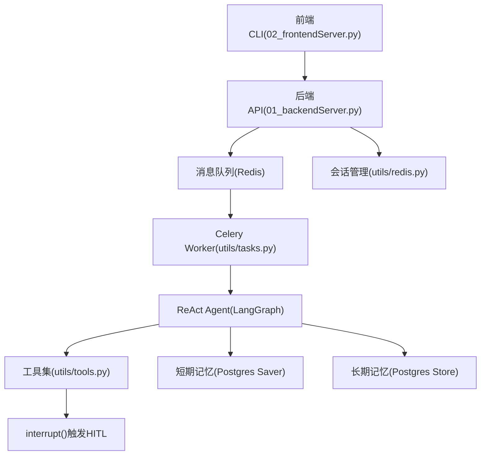
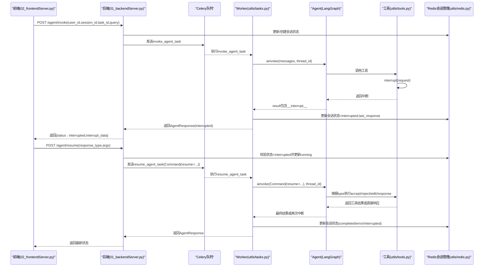
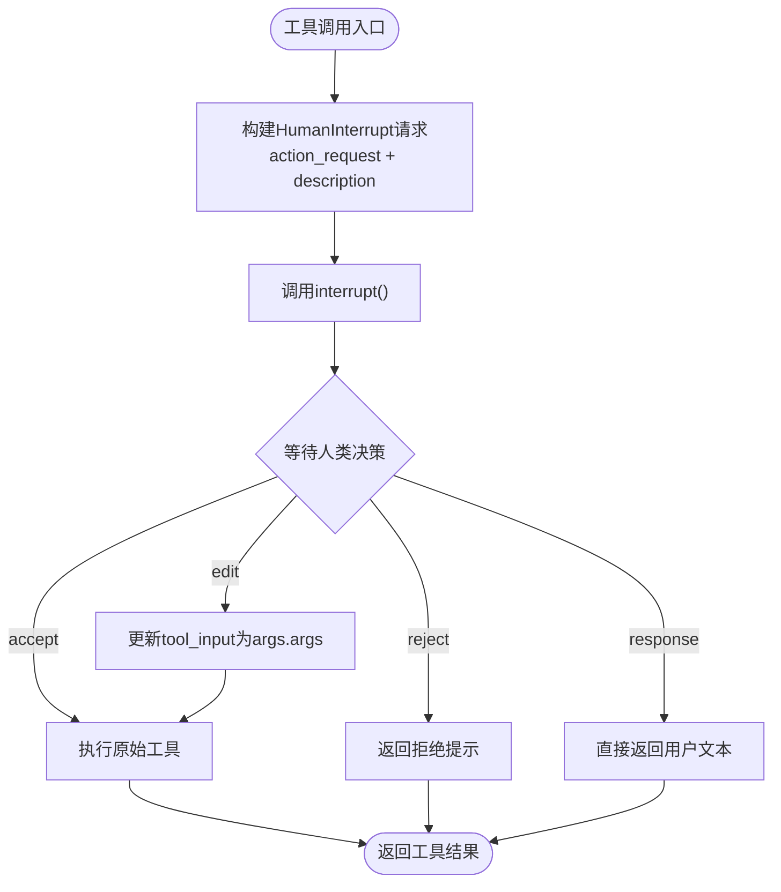
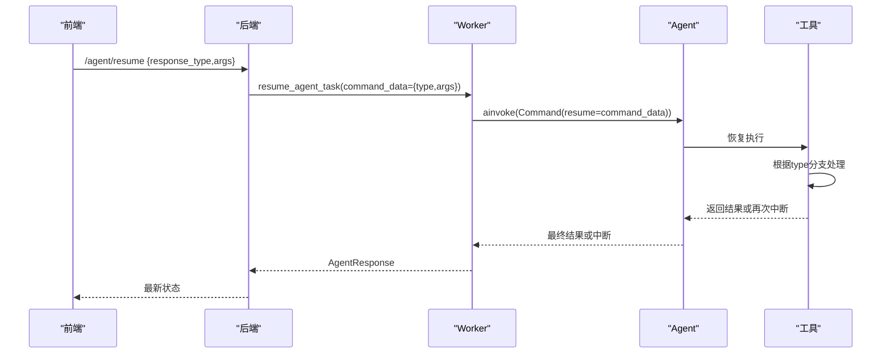
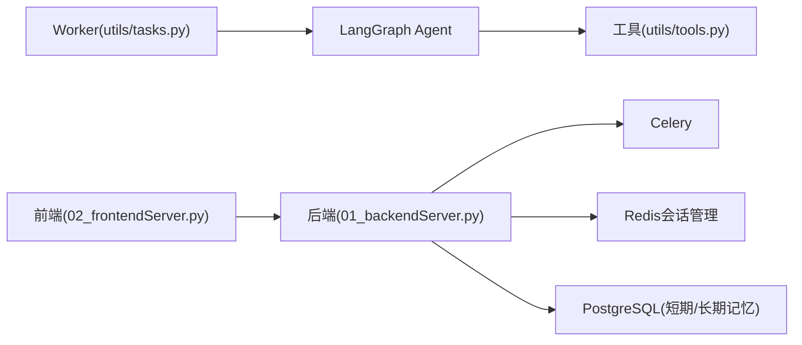

# 人机协作机制

<cite>
**本文引用的文件**
- [01_backendServer.py](file://01_backendServer.py)
- [02_frontendServer.py](file://02_frontendServer.py)
- [utils/tasks.py](file://utils/tasks.py)
- [utils/tools.py](file://utils/tools.py)
- [utils/redis.py](file://utils/redis.py)
- [utils/models.py](file://utils/models.py)
- [utils/config.py](file://utils/config.py)
- [README.md](file://README.md)
</cite>

## 目录
1. [简介](#简介)
2. [项目结构](#项目结构)
3. [核心组件](#核心组件)
4. [架构总览](#架构总览)
5. [详细组件分析](#详细组件分析)
6. [依赖关系分析](#依赖关系分析)
7. [性能与扩展性](#性能与扩展性)
8. [故障排查指南](#故障排查指南)
9. [结论](#结论)
10. [附录：配置与自定义扩展](#附录配置与自定义扩展)

## 简介
本项目基于 LangGraph 的 ReAct Agent，提供“人工在环”（Human-in-the-Loop, HITL）能力。当智能体准备调用工具时，会触发中断，等待人类决策后再继续执行。系统支持四种审查类型：accept、reject、edit、response，并通过异步任务队列（Celery）与 Redis 会话管理实现多用户、可恢复的人机协作流程。

## 项目结构
- 后端服务：FastAPI 暴露 REST API，负责接收请求、调度 Celery 任务、维护会话状态与结果。
- 前端演示：Rich CLI 模拟客户端交互，处理用户输入并调用后端接口。
- 任务执行：Celery Worker 运行智能体，使用 LangGraph Checkpointer 持久化短期记忆，PostgreSQL Store 存储长期记忆。
- 工具层：为工具包装 HITL 逻辑，统一通过 interrupt 函数触发人工审查。
- 会话管理：Redis 存储会话状态、任务状态、过期策略等。

图表来源
- [01_backendServer.py:132-237](file://01_backendServer.py#L132-L237)
- [02_frontendServer.py:50-107](file://02_frontendServer.py#L50-L107)
- [utils/tasks.py:319-559](file://utils/tasks.py#L319-L559)
- [utils/tools.py:37-118](file://utils/tools.py#L37-L118)
- [utils/redis.py:37-493](file://utils/redis.py#L37-L493)

章节来源
- [README.md:1-199](file://README.md#L1-L199)
- [01_backendServer.py:1-424](file://01_backendServer.py#L1-L424)
- [02_frontendServer.py:1-860](file://02_frontendServer.py#L1-L860)

## 核心组件
- 中断与恢复
  - interrupt：在工具执行前触发，返回人类决策（accept/reject/edit/response）。
  - Command(resume=...)：恢复被中断的智能体执行，携带人类反馈数据。
- 四种审查类型
  - accept：批准原参数调用工具。
  - reject：拒绝调用，返回固定提示或业务定制信息。
  - edit：修改工具参数后重新调用。
  - response：不调用工具，直接以用户提供的文本作为响应。
- 会话与任务状态
  - Redis 维护 session/task 状态、最近查询、最近响应、过期时间等。
- 异步任务
  - invoke_agent_task：首次运行智能体。
  - resume_agent_task：恢复被中断的智能体。

章节来源
- [utils/tools.py:37-118](file://utils/tools.py#L37-L118)
- [utils/tasks.py:194-264](file://utils/tasks.py#L194-L264)
- [utils/tasks.py:319-559](file://utils/tasks.py#L319-L559)
- [utils/redis.py:37-493](file://utils/redis.py#L37-L493)
- [utils/models.py:6-97](file://utils/models.py#L6-L97)

## 架构总览
整体流程分为“初始调用”和“恢复执行”两条路径：
- 初始调用：前端发起 /agent/invoke -> 后端创建/校验会话 -> 提交 invoke_agent_task -> Worker 构建 Agent -> 若工具触发 interrupt -> 返回 interrupted 状态 -> 前端展示中断信息。
- 恢复执行：前端根据中断信息选择四种操作之一 -> 调用 /agent/resume -> 后端构造 Command(resume=command_data) -> 提交 resume_agent_task -> Worker 恢复执行 -> 完成或再次中断。

图表来源
- [01_backendServer.py:132-237](file://01_backendServer.py#L132-L237)
- [02_frontendServer.py:50-107](file://02_frontendServer.py#L50-L107)
- [utils/tasks.py:319-559](file://utils/tasks.py#L319-L559)
- [utils/tools.py:37-118](file://utils/tools.py#L37-L118)
- [utils/redis.py:37-493](file://utils/redis.py#L37-L493)

## 详细组件分析

### 中断触发与处理（interrupt）
- 触发点：工具在执行前通过 add_human_in_the_loop 包装，构造 HumanInterrupt 请求并调用 interrupt。
- 数据结构：request 包含 action_request（工具名与参数）、config（可选配置）、description（面向用户的说明）。
- 返回值：由前端/外部系统通过 /agent/resume 回传，类型为 accept/reject/edit/response，并可能携带 args。
- 工具侧处理：根据 type 决定执行原始工具、修改参数后执行、返回拒绝提示或直接返回用户文本。

图表来源
- [utils/tools.py:37-118](file://utils/tools.py#L37-L118)

章节来源
- [utils/tools.py:37-118](file://utils/tools.py#L37-L118)

### 四种审查类型的处理逻辑
- accept：按原参数调用工具，记录日志并返回工具结果。
- reject：不调用工具，返回固定提示或业务定制信息。
- edit：从 args 中读取新的参数，替换 tool_input 后调用工具。
- response：不调用工具，直接将用户提供的文本作为工具响应。

章节来源
- [utils/tools.py:79-116](file://utils/tools.py#L79-L116)
- [02_frontendServer.py:522-547](file://02_frontendServer.py#L522-L547)

### Command对象与resume参数传递
- resume参数构造：后端 /agent/resume 将 response_type 与可选 args 封装为 command_data。
- 传递方式：resume_agent_task 使用 Command(resume=command_data) 调用 agent.ainvoke，LangGraph 将命令注入到中断点。
- 恢复执行：Agent 在中断点收到 Command，工具侧根据 type 分支处理，完成后续流程。

图表来源
- [01_backendServer.py:175-237](file://01_backendServer.py#L175-L237)
- [utils/tasks.py:455-559](file://utils/tasks.py#L455-L559)
- [utils/tools.py:37-118](file://utils/tools.py#L37-L118)

章节来源
- [01_backendServer.py:175-237](file://01_backendServer.py#L175-L237)
- [utils/tasks.py:455-559](file://utils/tasks.py#L455-L559)

### 会话与任务状态管理（Redis）
- 会话键：session:{user_id}:{session_id}:{task_id}，存储 status、last_query、last_response、last_updated、ttl。
- 任务映射：task_mapping:{user_id}:{session_id} 集合维护 task_id。
- 任务状态：task:{task_id} 存储任务状态与绑定信息。
- 清理策略：定期清理无效任务与会话，避免内存泄漏。

章节来源
- [utils/redis.py:37-493](file://utils/redis.py#L37-L493)

### 前端交互与自动恢复
- 中断展示：当状态为 interrupted，显示中断描述、工具名称与参数。
- 用户输入：支持 yes/no/edit/response，分别映射到 accept/reject/edit/response。
- 自动恢复：检测到 interrupted 且存在 last_response.interrupt_data 时，自动进入恢复流程。

章节来源
- [02_frontendServer.py:324-497](file://02_frontendServer.py#L324-L497)
- [02_frontendServer.py:499-558](file://02_frontendServer.py#L499-L558)

## 依赖关系分析
- 后端依赖
  - FastAPI：路由与生命周期管理。
  - Celery：异步任务调度。
  - Redis：会话与任务状态。
  - PostgreSQL：短期记忆（Checkpointer）与长期记忆（Store）。
- 任务执行依赖
  - LangGraph：ReAct Agent、interrupt、Command。
  - LLM：通过 utils/llms 获取模型。
  - 工具：MCP 工具与自定义工具，均通过 add_human_in_the_loop 包装。
- 前端依赖
  - Rich：控制台界面与交互。
  - requests：HTTP 调用后端 API。

图表来源
- [01_backendServer.py:1-424](file://01_backendServer.py#L1-L424)
- [utils/tasks.py:1-564](file://utils/tasks.py#L1-L564)
- [utils/tools.py:1-175](file://utils/tools.py#L1-L175)
- [utils/redis.py:1-493](file://utils/redis.py#L1-L493)

章节来源
- [utils/config.py:1-34](file://utils/config.py#L1-L34)
- [utils/models.py:1-97](file://utils/models.py#L1-L97)

## 性能与扩展性
- 异步与并发
  - Celery Worker 并行处理多个任务，提升吞吐。
  - Redis 会话管理支持高并发读写。
- 记忆修剪
  - 预模型钩子 trimmed_messages_hook 限制消息 token 数量，控制上下文长度。
- 可扩展性
  - 工具列表动态加载，支持 MCP 工具与自定义工具。
  - 可通过 add_human_in_the_loop 快速为任意工具添加 HITL。
- 配置项
  - 数据库连接池大小、Redis TTL、Celery 代理地址、LLM 类型等均可通过 Config 调整。

章节来源
- [utils/tasks.py:66-85](file://utils/tasks.py#L66-L85)
- [utils/tools.py:121-175](file://utils/tools.py#L121-L175)
- [utils/config.py:1-34](file://utils/config.py#L1-L34)

## 故障排查指南
- 常见问题
  - 无法恢复非中断会话：/agent/resume 要求当前状态为 interrupted，否则返回 400。
  - 会话不存在：/agent/resume 检查 user_id:session_id:task_id 是否存在，不存在返回 404。
  - 工具调用失败：工具内部异常会被捕获并记录日志，建议查看应用日志 logfile/app.log。
  - 长时间运行无响应：检查 Celery Worker 是否启动，确认 Redis 与 PostgreSQL 连通性。
- 调试技巧
  - 启用 DEBUG 日志级别，观察中断与恢复流程。
  - 使用 Redis 客户端查看 session 与 task 键值，确认状态流转。
  - 在前端打印中断数据，确认 action_request 与 args 是否正确。
  - 对工具进行单元测试，确保 add_human_in_the_loop 包装正确。

章节来源
- [01_backendServer.py:175-237](file://01_backendServer.py#L175-L237)
- [utils/tasks.py:420-451](file://utils/tasks.py#L420-L451)
- [utils/tasks.py:528-559](file://utils/tasks.py#L528-L559)
- [utils/redis.py:246-341](file://utils/redis.py#L246-L341)

## 结论
本项目实现了完整的人机协作流程：通过 interrupt 触发工具调用前的审批，支持四种审查类型；利用 Command(resume=...) 恢复执行；借助 Redis 与 PostgreSQL 实现会话与记忆的持久化与恢复；通过 Celery 实现异步与可扩展的任务调度。开发者可基于现有框架快速扩展工具与审查逻辑，满足生产级需求。

## 附录：配置与自定义扩展
- 配置选项
  - 数据库：DB_URI、MIN_SIZE、MAX_SIZE。
  - Redis：REDIS_HOST、REDIS_PORT、REDIS_DB、SESSION_TIMEOUT、TTL。
  - Celery：CELERY_BROKER_URL、TASK_TTL。
  - LLM：LLM_TYPE（openai/qwen/oneapi/ollama）。
  - 服务：HOST、PORT。
- 自定义扩展
  - 新增工具：在 get_tools 中添加 @tool 装饰的函数，并通过 add_human_in_the_loop 包装。
  - 自定义中断行为：在 add_human_in_the_loop 中扩展 response 分支逻辑。
  - 调整审查提示：修改 HumanInterrupt.description，优化用户引导。
  - 会话策略：调整 Redis TTL 与清理策略，适应不同业务场景。

章节来源
- [utils/config.py:1-34](file://utils/config.py#L1-L34)
- [utils/tools.py:121-175](file://utils/tools.py#L121-L175)
- [utils/redis.py:246-341](file://utils/redis.py#L246-L341)