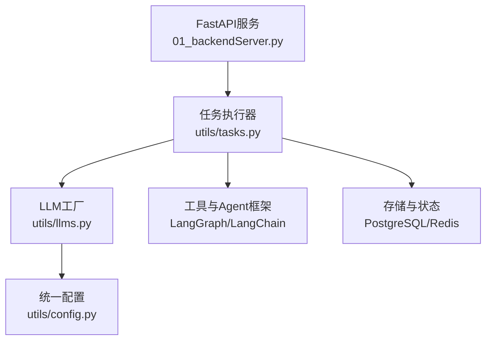
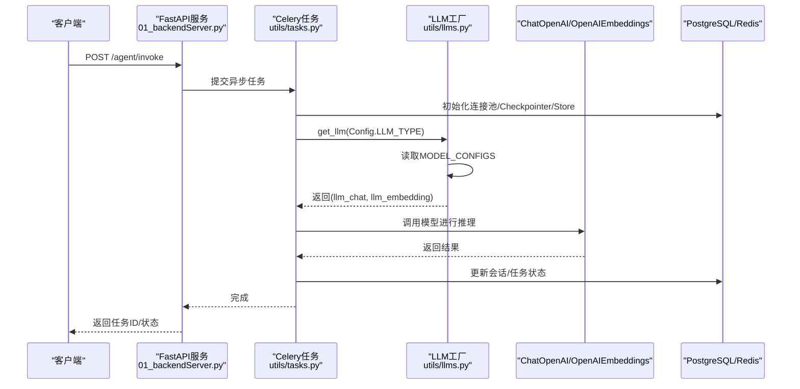
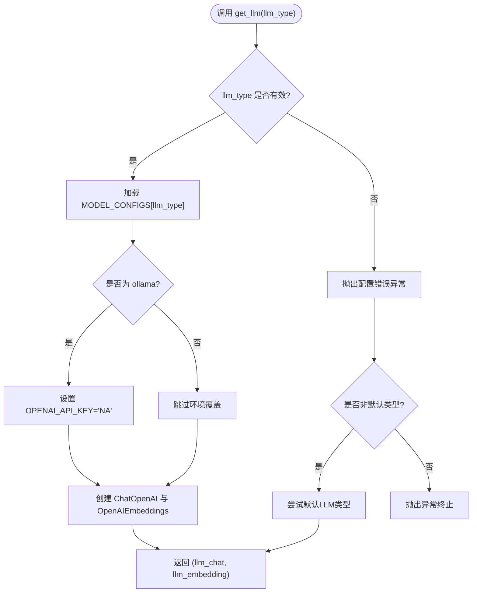
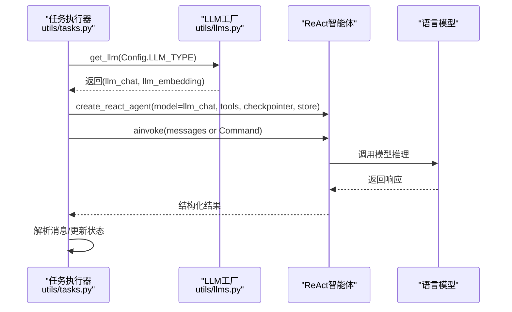
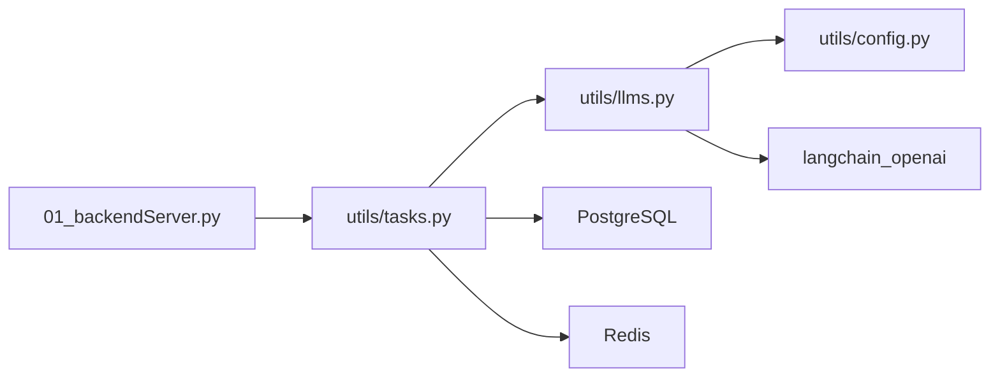

# 多LLM支持

<cite>
**本文引用的文件**
- [utils/llms.py](file://utils/llms.py)
- [utils/config.py](file://utils/config.py)
- [utils/tasks.py](file://utils/tasks.py)
- [01_backendServer.py](file://01_backendServer.py)
- [README.md](file://README.md)
</cite>

## 目录
1. [简介](#简介)
2. [项目结构](#项目结构)
3. [核心组件](#核心组件)
4. [架构总览](#架构总览)
5. [详细组件分析](#详细组件分析)
6. [依赖关系分析](#依赖关系分析)
7. [性能考量](#性能考量)
8. [故障排查指南](#故障排查指南)
9. [结论](#结论)
10. [附录：新LLM提供商集成指南](#附录新llm提供商集成指南)

## 简介
本技术文档聚焦于多LLM支持的实现与使用，重点解释 get_llm 工厂函数的设计模式、不同厂商模型的初始化与配置方式（OpenAI、通义千问、Ollama等）、模型选择策略与切换机制，并提供新增LLM提供商的集成步骤。同时给出性能对比建议与最佳实践，帮助开发者选择合适的模型并优化使用效果。

## 项目结构
本项目采用模块化组织，LLM相关能力集中在 utils 目录下：
- utils/llms.py：提供 LLM 初始化与获取的统一入口（工厂函数）
- utils/config.py：集中管理配置项（包括默认LLM类型、日志、数据库、Redis等）
- utils/tasks.py：任务执行流程中调用 get_llm 获取模型实例，构建ReAct智能体并执行
- 01_backendServer.py：FastAPI服务入口，负责请求路由与异步任务调度
- README.md：项目说明与运行指引

图表来源
- [01_backendServer.py:126-173](file://01_backendServer.py#L126-L173)
- [utils/tasks.py:350-418](file://utils/tasks.py#L350-L418)
- [utils/llms.py:70-138](file://utils/llms.py#L70-L138)
- [utils/config.py:4-34](file://utils/config.py#L4-L34)

章节来源
- [01_backendServer.py:126-173](file://01_backendServer.py#L126-L173)
- [utils/tasks.py:350-418](file://utils/tasks.py#L350-L418)
- [utils/llms.py:70-138](file://utils/llms.py#L70-L138)
- [utils/config.py:4-34](file://utils/config.py#L4-L34)

## 核心组件
- LLM工厂函数
  - initialize_llm(llm_type)：根据 llm_type 从配置字典加载参数，创建 ChatOpenAI 与 OpenAIEmbeddings 实例，返回两者。包含异常封装与日志记录。
  - get_llm(llm_type)：对 initialize_llm 的封装，提供默认值与失败回退到默认LLM类型的重试逻辑。
- 配置中心
  - Config.LLM_TYPE：全局默认LLM类型（当前为 qwen），可在运行时通过配置切换。
  - MODEL_CONFIGS：集中维护各厂商模型的 base_url、api_key、chat_model、embedding_model 等参数。
- 任务执行器
  - 在 invoke_agent_task 与 resume_agent_task 中通过 get_llm(Config.LLM_TYPE) 获取模型，构造 ReAct Agent 并执行推理。

章节来源
- [utils/llms.py:31-138](file://utils/llms.py#L31-L138)
- [utils/config.py:28-30](file://utils/config.py#L28-L30)
- [utils/tasks.py:350-418](file://utils/tasks.py#L350-L418)
- [utils/tasks.py:480-526](file://utils/tasks.py#L480-L526)

## 架构总览
下图展示了从HTTP请求到LLM调用的完整链路，以及多LLM选择的工厂模式如何工作。

图表来源
- [01_backendServer.py:132-173](file://01_backendServer.py#L132-L173)
- [utils/tasks.py:350-418](file://utils/tasks.py#L350-L418)
- [utils/llms.py:70-138](file://utils/llms.py#L70-L138)

## 详细组件分析

### LLM工厂函数与模型配置
- 设计模式
  - 工厂方法：initialize_llm 根据传入的 llm_type 动态创建对应厂商的模型实例，屏蔽底层差异。
  - 配置驱动：MODEL_CONFIGS 集中管理各厂商的连接地址、密钥、模型名等，便于扩展与维护。
  - 容错与回退：get_llm 在初始化失败时自动回退到默认LLM类型，提升鲁棒性。
- 支持的厂商与配置
  - openai：通过环境变量注入 base_url 与 api_key，默认 chat_model 为 gpt-4o-mini，embedding_model 为 text-embedding-3-small。
  - oneapi：指向第三方兼容接口地址，chat_model 为 qwen-max，embedding_model 为 text-embedding-v1。
  - qwen：阿里通义千问兼容v1接口，base_url 为 dashscope 兼容端点，chat_model 为 qwen-max，embedding_model 为 text-embedding-v1。
  - ollama：本地开源模型，base_url 为 localhost:11434/v1，特殊处理 OPENAI_API_KEY 环境变量，chat_model 为 llama3.1:8b，embedding_model 为 nomic-embed-text:latest。
- 关键行为
  - 温度参数固定为 DEFAULT_TEMPERATURE（当前为0），保证输出稳定性。
  - 超时与重试：timeout=30秒，max_retries=2，增强网络波动下的可用性。
  - 日志记录：成功初始化与错误信息均记录至统一日志文件。

图表来源
- [utils/llms.py:70-138](file://utils/llms.py#L70-L138)

章节来源
- [utils/llms.py:31-138](file://utils/llms.py#L31-L138)

### 模型选择策略与切换机制
- 默认选择：Config.LLM_TYPE 指定全局默认LLM类型（当前为 qwen）。
- 运行时切换：修改 Config.LLM_TYPE 即可在所有任务执行路径中切换到新的LLM类型。
- 失败回退：当指定类型初始化失败时，get_llm 会尝试使用默认类型再次初始化，提高系统韧性。
- 厂商适配：所有厂商均通过统一的 ChatOpenAI 与 OpenAIEmbeddings 接口访问，只需调整 base_url、api_key、model 等参数。

章节来源
- [utils/config.py:28-30](file://utils/config.py#L28-L30)
- [utils/llms.py:60-62](file://utils/llms.py#L60-L62)
- [utils/llms.py:122-138](file://utils/llms.py#L122-L138)

### 在任务执行中的使用
- 任务入口：invoke_agent_task 与 resume_agent_task 在执行前通过 get_llm(Config.LLM_TYPE) 获取模型实例。
- 智能体构建：将模型与工具列表、检查点、长期记忆存储一起传入 create_react_agent，形成可执行的ReAct智能体。
- 执行与结果：调用 agent.ainvoke 执行推理，解析消息并更新任务状态。

图表来源
- [utils/tasks.py:350-418](file://utils/tasks.py#L350-L418)
- [utils/tasks.py:480-526](file://utils/tasks.py#L480-L526)
- [utils/llms.py:70-138](file://utils/llms.py#L70-L138)

章节来源
- [utils/tasks.py:350-418](file://utils/tasks.py#L350-L418)
- [utils/tasks.py:480-526](file://utils/tasks.py#L480-L526)

## 依赖关系分析
- 模块耦合
  - tasks.py 依赖 llms.py 提供的 get_llm 与 config.py 的 Config.LLM_TYPE。
  - llms.py 依赖 config.py 的日志与轮转配置，以及 langchain_openai 的 ChatOpenAI/OpenAIEmbeddings。
  - 01_backendServer.py 作为服务入口，调度任务并管理生命周期资源。
- 外部依赖
  - PostgreSQL：短期记忆Checkpointer与长期记忆Store。
  - Redis：会话状态管理与任务状态跟踪。
  - LangGraph/LangChain：智能体编排与工具集成。

图表来源
- [01_backendServer.py:126-173](file://01_backendServer.py#L126-L173)
- [utils/tasks.py:350-418](file://utils/tasks.py#L350-L418)
- [utils/llms.py:70-138](file://utils/llms.py#L70-L138)
- [utils/config.py:4-34](file://utils/config.py#L4-L34)

章节来源
- [01_backendServer.py:126-173](file://01_backendServer.py#L126-L173)
- [utils/tasks.py:350-418](file://utils/tasks.py#L350-L418)
- [utils/llms.py:70-138](file://utils/llms.py#L70-L138)
- [utils/config.py:4-34](file://utils/config.py#L4-L34)

## 性能考量
- 并发与重试
  - 通过 Celery 异步任务队列分发请求，避免阻塞主线程。
  - LLM调用设置超时与重试次数，降低偶发网络问题影响。
- 上下文与成本
  - 固定 temperature=0 提升输出稳定性；如需创造性可考虑引入可调参数。
  - 合理选择 embedding_model 与 chat_model，平衡质量与成本。
- 本地与云端
  - Ollama本地模型适合隐私与离线场景，但需关注硬件资源与推理速度。
  - 云端模型（OpenAI、通义千问）具备更强能力与弹性，注意延迟与费用。
- 监控与日志
  - 统一日志记录初始化与错误信息，便于定位瓶颈与问题。

[本节为通用指导，不直接分析具体文件]

## 故障排查指南
- 常见错误
  - 不支持的LLM类型：检查传入的 llm_type 是否在 MODEL_CONFIGS 中定义。
  - 初始化失败：确认 base_url、api_key、模型名称是否正确，网络可达性与鉴权是否通过。
  - Ollama环境：确保 OPENAI_API_KEY 被设置为占位值，且本地服务端口可用。
- 回退机制
  - 当指定类型初始化失败时，系统会自动尝试默认类型；若默认类型也失败，则抛出异常。
- 日志定位
  - 查看统一日志文件，搜索“初始化LLM失败”或“LLM配置错误”关键字，结合堆栈信息定位问题。

章节来源
- [utils/llms.py:114-138](file://utils/llms.py#L114-L138)

## 结论
本项目通过工厂函数与配置驱动的LLM抽象，实现了多厂商模型的统一接入与灵活切换。任务执行器在需要时通过 get_llm 获取模型，构建ReAct智能体完成推理。该设计具备良好的可扩展性与鲁棒性，便于后续接入更多LLM提供商并进行性能优化。

[本节为总结，不直接分析具体文件]

## 附录：新LLM提供商集成指南
- 步骤概览
  1. 在 MODEL_CONFIGS 中添加新厂商的配置条目，包含 base_url、api_key、chat_model、embedding_model。
  2. 如存在特殊环境要求（例如Ollama的环境变量覆盖），在 initialize_llm 中增加相应分支处理。
  3. 通过修改 Config.LLM_TYPE 或在调用处传入新的 llm_type 完成切换。
  4. 验证初始化与调用是否正常，检查日志与错误回退机制。
- 注意事项
  - 保持接口一致性：所有厂商均通过 ChatOpenAI/OpenAIEmbeddings 访问，仅需调整参数。
  - 安全与敏感信息：建议使用环境变量注入 api_key，避免硬编码。
  - 性能与稳定性：为新增厂商配置合理的 timeout 与 max_retries，必要时添加重试或熔断策略。
- 参考位置
  - 配置与工厂：[utils/llms.py:31-138](file://utils/llms.py#L31-L138)
  - 全局默认类型：[utils/config.py:28-30](file://utils/config.py#L28-L30)
  - 任务中使用：[utils/tasks.py:350-418](file://utils/tasks.py#L350-L418), [utils/tasks.py:480-526](file://utils/tasks.py#L480-L526)

章节来源
- [utils/llms.py:31-138](file://utils/llms.py#L31-L138)
- [utils/config.py:28-30](file://utils/config.py#L28-L30)
- [utils/tasks.py:350-418](file://utils/tasks.py#L350-L418)
- [utils/tasks.py:480-526](file://utils/tasks.py#L480-L526)