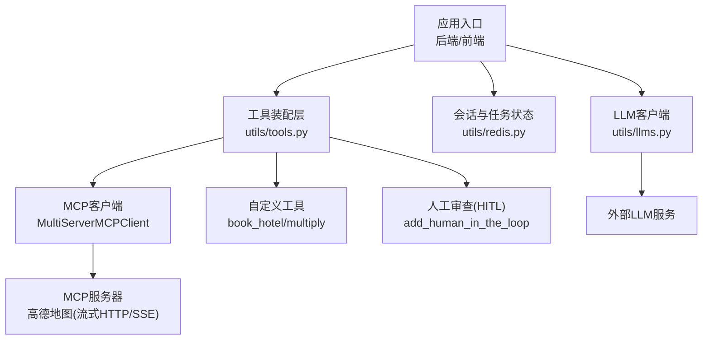
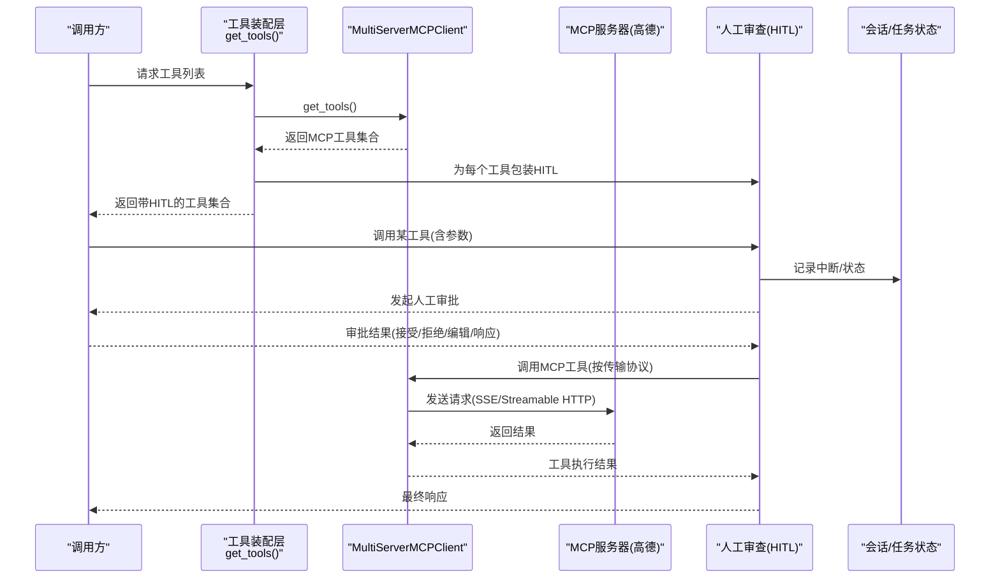
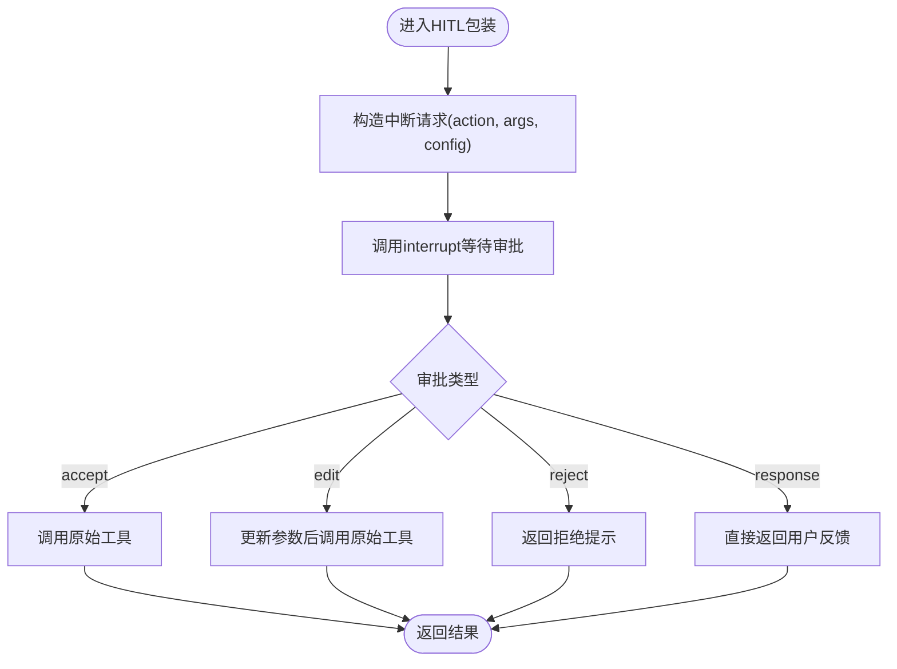
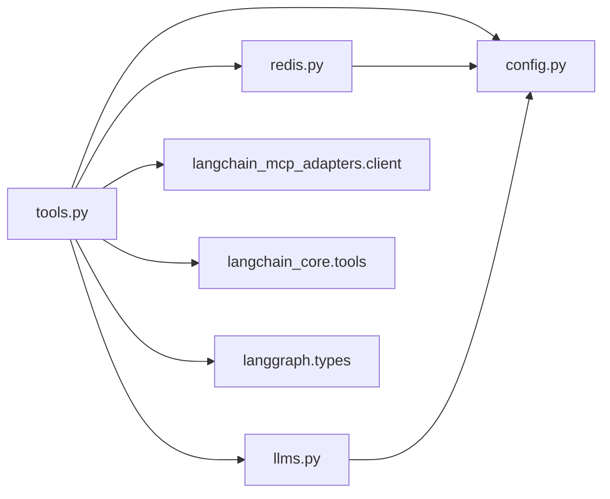

# MCP服务器集成

<cite>
**本文引用的文件**
- [utils/tools.py](file://utils/tools.py)
- [utils/config.py](file://utils/config.py)
- [utils/redis.py](file://utils/redis.py)
- [utils/llms.py](file://utils/llms.py)
- [README.md](file://README.md)
</cite>

## 目录
1. [简介](#简介)
2. [项目结构](#项目结构)
3. [核心组件](#核心组件)
4. [架构总览](#架构总览)
5. [详细组件分析](#详细组件分析)
6. [依赖关系分析](#依赖关系分析)
7. [性能与调优](#性能与调优)
8. [故障排查指南](#故障排查指南)
9. [结论](#结论)
10. [附录](#附录)

## 简介
本技术文档聚焦于在本项目中集成MCP（Model Context Protocol）服务器的方案与实践，重点围绕MultiServerMCPClient的使用、传输协议配置（SSE、Streamable HTTP）、工具发现机制、连接管理与容错、以及高德地图MCP服务器的集成示例。同时提供性能调优与监控建议，帮助开发者构建稳定可靠的外部工具集成。

## 项目结构
本项目采用模块化组织方式：
- utils/tools.py：工具注册与MCP客户端初始化、工具发现、人工审查（HITL）包装
- utils/config.py：统一配置项（日志、数据库、Redis、服务端口等）
- utils/redis.py：会话与任务状态管理（基于Redis的持久化与过期策略）
- utils/llms.py：大模型客户端初始化（包含超时与重试配置示例）
- README.md：系统功能与测试说明

图表来源
- [utils/tools.py:121-175](file://utils/tools.py#L121-L175)
- [utils/redis.py:37-103](file://utils/redis.py#L37-L103)
- [utils/llms.py:95-102](file://utils/llms.py#L95-L102)

章节来源
- [README.md:1-38](file://README.md#L1-L38)
- [utils/tools.py:121-175](file://utils/tools.py#L121-L175)
- [utils/redis.py:37-103](file://utils/redis.py#L37-L103)
- [utils/llms.py:95-102](file://utils/llms.py#L95-L102)

## 核心组件
- MultiServerMCPClient：用于连接多个MCP服务器并获取其暴露的工具集合。当前实现中支持两种传输协议：
  - SSE（Server-Sent Events）
  - Streamable HTTP（可流式HTTP）
- 工具发现与装配：通过client.get_tools()拉取MCP工具，结合add_human_in_the_loop为每个工具注入人工审查能力；同时合并自定义工具。
- 会话与任务管理：基于Redis的会话与任务状态存储，支持TTL过期、清理无效数据、查询与更新。
- LLM客户端：提供统一的LLM初始化封装，包含超时与重试参数，便于扩展不同厂商模型。

章节来源
- [utils/tools.py:121-175](file://utils/tools.py#L121-L175)
- [utils/redis.py:37-103](file://utils/redis.py#L37-L103)
- [utils/llms.py:95-102](file://utils/llms.py#L95-L102)

## 架构总览
下图展示了从请求到工具执行的整体流程，包括MCP工具发现、HITL审批、工具调用与结果返回。

图表来源
- [utils/tools.py:37-118](file://utils/tools.py#L37-L118)
- [utils/tools.py:121-175](file://utils/tools.py#L121-L175)
- [utils/redis.py:37-103](file://utils/redis.py#L37-L103)

## 详细组件分析

### MultiServerMCPClient使用与配置
- 多服务器配置：以字典形式传入各MCP服务的标识、URL与transport类型。当前示例中包含高德地图的streamable_http传输；SSE传输已注释，可按需启用。
- 传输协议：
  - sse：适用于服务端推送事件场景
  - streamable_http：适用于可流式HTTP通信
- 工具发现：调用client.get_tools()获取全部可用工具，随后进行HITL包装与合并自定义工具。

章节来源
- [utils/tools.py:153-166](file://utils/tools.py#L153-L166)

### 工具发现机制
- 动态加载：通过get_tools()在运行时从MCP服务器拉取工具定义，无需硬编码。
- 版本管理：当前代码未显式实现版本控制逻辑；建议在后续扩展中加入工具元数据中的版本字段校验与兼容处理。
- 工具组合：将MCP工具与本地自定义工具（如book_hotel、multiply）合并，统一对外暴露。

章节来源
- [utils/tools.py:121-175](file://utils/tools.py#L121-L175)

### 人工审查（HITL）流程
- 包装机制：add_human_in_the_loop将任意工具或BaseTool转换为带中断能力的工具。
- 审批类型：
  - accept：直接执行原工具
  - edit：修改参数后执行
  - reject：拒绝调用并返回提示
  - response：跳过工具调用，直接返回用户反馈
- 异常处理：捕获工具调用异常并记录日志，避免中断流程崩溃。

图表来源
- [utils/tools.py:37-118](file://utils/tools.py#L37-L118)

章节来源
- [utils/tools.py:37-118](file://utils/tools.py#L37-L118)

### 连接管理与容错
- 连接池：当前代码未显式实现MCP连接池；可通过复用MultiServerMCPClient实例或在更上层维护连接池以提升并发性能。
- 超时与重试：
  - LLM客户端示例中设置了timeout与max_retries，可作为参考迁移至MCP客户端封装层。
  - 建议在工具调用外层增加超时与重试逻辑，提升鲁棒性。
- 故障恢复：
  - 会话与任务状态通过Redis持久化，支持过期清理与恢复。
  - 可在HITL中断点保存上下文，以便失败后恢复。

章节来源
- [utils/llms.py:95-102](file://utils/llms.py#L95-L102)
- [utils/redis.py:37-103](file://utils/redis.py#L37-L103)

### 高德地图MCP服务器集成示例
- API密钥配置：通过环境变量AMAP_MAPS_API_KEY注入到MCP URL中。
- 传输选择：
  - 当前启用streamable_http传输
  - 可切换至sse传输（取消注释并调整URL）
- 请求处理流程：
  - 初始化MultiServerMCPClient
  - 获取工具列表
  - 为工具添加HITL
  - 合并自定义工具并返回

章节来源
- [utils/tools.py:153-166](file://utils/tools.py#L153-L166)

## 依赖关系分析
- 模块耦合：
  - tools.py依赖config.py（日志与配置）、redis.py（会话状态可选）、llms.py（LLM客户端示例）
  - redis.py依赖config.py（Redis与TTL配置）
  - llms.py提供LLM初始化示例，体现超时与重试模式
- 外部依赖：
  - langchain_mcp_adapters.client.MultiServerMCPClient：MCP客户端
  - langchain_core.tools.BaseTool与tool装饰器：工具抽象与创建
  - langgraph.types.interrupt与HumanInterruptConfig：HITL中断机制
  - redis.asyncio：异步Redis操作

图表来源
- [utils/tools.py:1-11](file://utils/tools.py#L1-L11)
- [utils/redis.py:1-10](file://utils/redis.py#L1-L10)
- [utils/llms.py:1-10](file://utils/llms.py#L1-L10)

章节来源
- [utils/tools.py:1-11](file://utils/tools.py#L1-L11)
- [utils/redis.py:1-10](file://utils/redis.py#L1-L10)
- [utils/llms.py:1-10](file://utils/llms.py#L1-L10)

## 性能与调优
- 连接复用与池化
  - 建议对MultiServerMCPClient进行单例或池化管理，减少重复建立连接的开销。
  - 在高并发场景下，可为不同MCP服务器维护独立连接池，避免资源争用。
- 超时与重试
  - 参考llms.py中的timeout与max_retries设置，为MCP工具调用增加超时保护与指数退避重试。
  - 针对网络抖动或服务端限流，合理设置重试次数与间隔。
- 缓存与去重
  - 对频繁调用的MCP工具结果进行短期缓存（如内存或Redis），降低外部调用压力。
  - 对相同输入进行去重，避免重复计算。
- 监控与指标
  - 在工具调用前后记录耗时、成功率、错误码等指标，便于定位瓶颈。
  - 结合日志轮转（ConcurrentRotatingFileHandler）与结构化日志，便于检索与分析。
- 资源限制
  - 限制并发调用数，防止雪崩效应。
  - 对大响应体进行分块处理或流式消费，降低内存占用。

[本节为通用指导，不直接分析具体文件]

## 故障排查指南
- 常见错误与处理
  - 工具调用失败：检查HITL包装中的异常捕获与日志输出，确认参数与权限。
  - 连接超时：检查MCP服务器可达性与网络配置，必要时增加超时与重试。
  - 会话丢失：确认Redis连接与TTL设置，确保会话键未被提前清理。
- 诊断步骤
  - 查看日志文件logfile/app.log，定位错误堆栈与关键信息。
  - 检查Redis中会话与任务状态，确认是否存在过期或脏数据。
  - 验证环境变量AMAP_MAPS_API_KEY是否正确注入。
- 恢复策略
  - 利用Redis的会话恢复能力，从中断点继续执行。
  - 对失败的MCP调用进行幂等重试，避免副作用。

章节来源
- [utils/tools.py:14-34](file://utils/tools.py#L14-L34)
- [utils/redis.py:246-341](file://utils/redis.py#L246-L341)
- [utils/config.py:6-11](file://utils/config.py#L6-L11)

## 结论
本项目通过MultiServerMCPClient实现了与MCP服务器的灵活集成，支持多种传输协议与工具动态发现。结合HITL机制与Redis会话管理，提供了可控、可恢复的工具调用流程。建议在后续迭代中完善连接池、超时重试、缓存与监控体系，进一步提升系统的稳定性与性能。

[本节为总结性内容，不直接分析具体文件]

## 附录
- 环境变量
  - AMAP_MAPS_API_KEY：高德地图MCP服务器API密钥
- 配置项
  - Redis：host、port、db、session_timeout、ttl
  - 日志：LOG_FILE、MAX_BYTES、BACKUP_COUNT
- 运行与测试
  - 参考README中的功能测试步骤，验证HITL与工具调用流程

章节来源
- [utils/config.py:18-26](file://utils/config.py#L18-L26)
- [README.md:111-193](file://README.md#L111-L193)