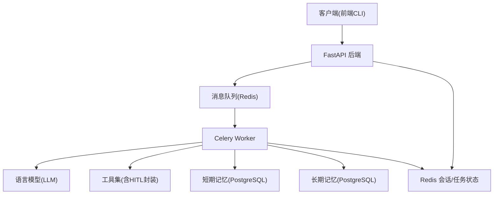
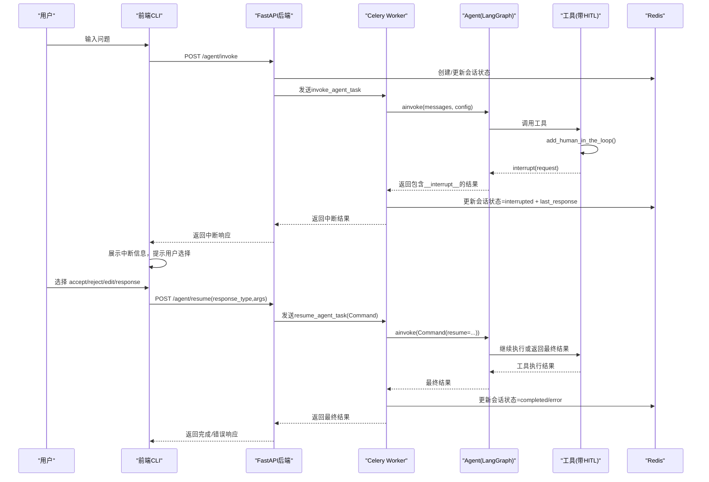
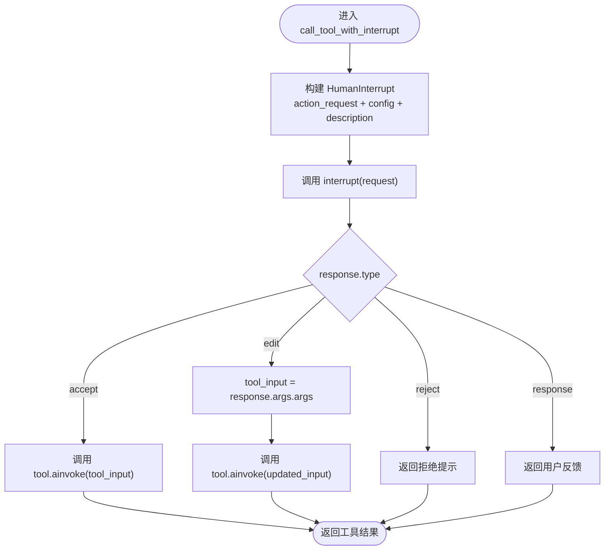
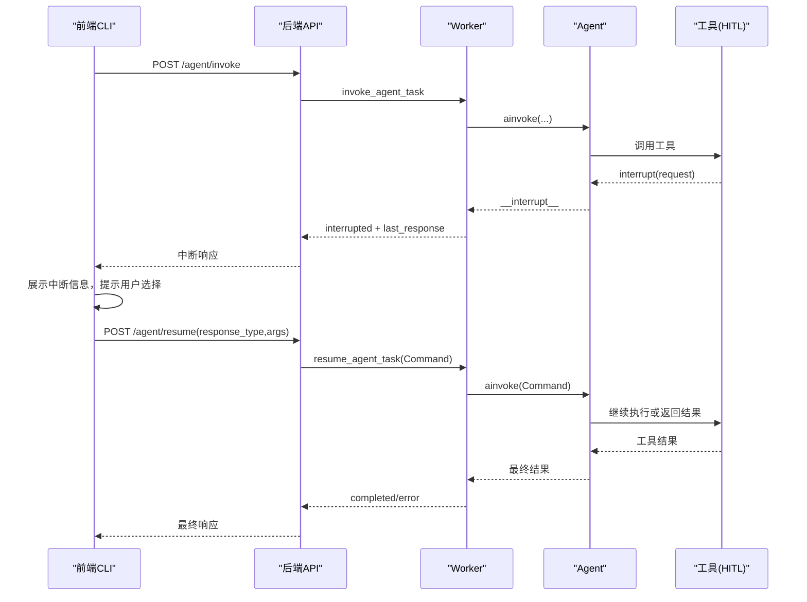
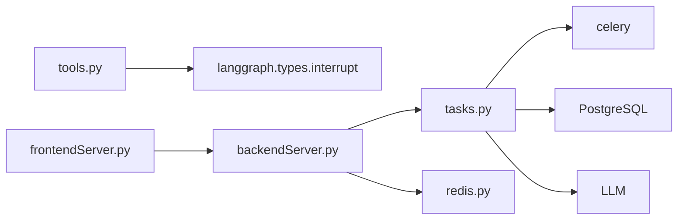

# 人机协作审批流程

<cite>
**本文引用的文件**
- [01_backendServer.py](file://01_backendServer.py)
- [02_frontendServer.py](file://02_frontendServer.py)
- [utils/tools.py](file://utils/tools.py)
- [utils/tasks.py](file://utils/tasks.py)
- [utils/models.py](file://utils/models.py)
- [utils/redis.py](file://utils/redis.py)
- [utils/config.py](file://utils/config.py)
- [README.md](file://README.md)
</cite>

## 目录
1. [简介](#简介)
2. [项目结构](#项目结构)
3. [核心组件](#核心组件)
4. [架构总览](#架构总览)
5. [详细组件分析](#详细组件分析)
6. [依赖关系分析](#依赖关系分析)
7. [性能与可扩展性](#性能与可扩展性)
8. [故障排查指南](#故障排查指南)
9. [结论](#结论)
10. [附录：API与数据模型速查](#附录api与数据模型速查)

## 简介
本技术文档聚焦于人机协作（Human-in-the-Loop, HITL）审批流程，围绕 add_human_in_the_loop 函数的实现原理、中断机制、四种审批类型（accept、reject、edit、response）的处理方式展开。同时说明中断请求的创建过程（action_request 结构、参数传递与上下文信息）、完整的审批交互流程示例、状态同步机制、异常处理与超时策略，以及如何扩展新的审批类型与处理逻辑。

## 项目结构
本项目采用前后端分离的异步任务调度架构：
- 后端 FastAPI 服务提供 Agent 调用、恢复、会话与任务管理等接口
- Celery Worker 异步执行 Agent 运行与恢复任务
- Redis 用于会话状态与任务状态存储
- PostgreSQL 用于短期记忆（Checkpointer）与长期记忆（Store）
- 前端 Rich CLI 演示用户交互与中断处理

图表来源
- [01_backendServer.py:126-173](file://01_backendServer.py#L126-L173)
- [01_backendServer.py:176-237](file://01_backendServer.py#L176-L237)
- [utils/tasks.py:319-451](file://utils/tasks.py#L319-L451)
- [utils/tasks.py:455-559](file://utils/tasks.py#L455-L559)
- [utils/redis.py:37-103](file://utils/redis.py#L37-L103)

章节来源
- [README.md:1-199](file://README.md#L1-L199)
- [01_backendServer.py:126-173](file://01_backendServer.py#L126-L173)
- [01_backendServer.py:176-237](file://01_backendServer.py#L176-L237)
- [utils/tasks.py:319-451](file://utils/tasks.py#L319-L451)
- [utils/tasks.py:455-559](file://utils/tasks.py#L455-L559)
- [utils/redis.py:37-103](file://utils/redis.py#L37-L103)

## 核心组件
- add_human_in_the_loop：为任意工具添加人工审查能力，构造 HumanInterrupt 并调用 interrupt，根据响应类型执行不同分支
- 中断处理与恢复：后端 /agent/invoke 启动任务，/agent/resume 接收用户决策并恢复执行；前端负责展示中断信息与收集用户输入
- 会话与任务状态管理：Redis 维护 session/task 状态，支持故障恢复与多会话并发
- 异步任务执行：Celery Worker 执行 Agent 运行与恢复，结合 LangGraph Checkpointer/Store 实现状态持久化

章节来源
- [utils/tools.py:38-118](file://utils/tools.py#L38-L118)
- [01_backendServer.py:133-173](file://01_backendServer.py#L133-L173)
- [01_backendServer.py:176-237](file://01_backendServer.py#L176-L237)
- [utils/tasks.py:195-264](file://utils/tasks.py#L195-L264)
- [utils/redis.py:37-103](file://utils/redis.py#L37-L103)

## 架构总览
下图展示了从用户发起查询到触发工具调用、进入 HITL 审批、用户决策并恢复执行的完整链路。

图表来源
- [01_backendServer.py:133-173](file://01_backendServer.py#L133-L173)
- [01_backendServer.py:176-237](file://01_backendServer.py#L176-L237)
- [utils/tasks.py:319-451](file://utils/tasks.py#L319-L451)
- [utils/tasks.py:455-559](file://utils/tasks.py#L455-L559)
- [utils/tools.py:38-118](file://utils/tools.py#L38-L118)
- [utils/redis.py:37-103](file://utils/redis.py#L37-L103)

## 详细组件分析

### add_human_in_the_loop 函数实现原理
- 作用：将任意可调用对象或 BaseTool 包装为带人工审查能力的工具
- 关键步骤：
  - 若传入非 BaseTool，则使用 create_tool 转换为 BaseTool
  - 构造 HumanInterrupt 请求，包含 action_request（工具名与参数）、config（可选 HumanInterruptConfig）、description（面向用户的提示文本）
  - 调用 interrupt(request) 阻塞等待用户决策
  - 根据 response.type 分支处理：
    - accept：直接调用原始工具的 ainvoke
    - edit：用 response.args.args 替换原参数后调用
    - reject：返回拒绝提示
    - response：将用户反馈作为工具输出
  - 异常捕获与日志记录，确保健壮性

图表来源
- [utils/tools.py:38-118](file://utils/tools.py#L38-L118)

章节来源
- [utils/tools.py:38-118](file://utils/tools.py#L38-L118)

### HumanInterruptConfig 配置选项与中断机制
- 在 add_human_in_the_loop 中，HumanInterruptConfig 作为可选参数传入 HumanInterrupt 的 config 字段，可用于控制中断行为（如超时、重试、权限等），具体字段由 LangGraph 框架定义
- 当前代码未显式设置该配置，默认使用框架默认值；如需自定义，可在调用 add_human_in_the_loop 时传入相应配置项
- 中断机制通过 LangGraph 的 interrupt 函数实现，会在工具调用处暂停执行，等待外部命令恢复

章节来源
- [utils/tools.py:38-76](file://utils/tools.py#L38-L76)

### 四种审批类型的处理方式
- accept（接受）：允许工具按原参数执行，返回工具结果
- reject（拒绝）：不执行工具，返回拒绝提示信息
- edit（编辑）：使用用户提供的 args 覆盖原参数后执行工具
- response（直接响应）：不调用工具，直接将用户反馈作为工具输出

这些类型在后端 resume 接口与前端交互中被统一处理，并通过 Command(resume=...) 传递给 Agent 继续执行。

章节来源
- [utils/tools.py:80-116](file://utils/tools.py#L80-L116)
- [01_backendServer.py:176-237](file://01_backendServer.py#L176-L237)
- [02_frontendServer.py:81-107](file://02_frontendServer.py#L81-L107)

### 中断请求的创建过程：action_request、参数传递与上下文
- action_request 结构：
  - action：工具名称
  - args：工具调用参数
- 上下文信息：
  - config：可选的 HumanInterruptConfig
  - description：面向用户的提示文本，包含工具名、参数与操作指引
- 参数传递：
  - 前端通过 /agent/resume 提交 response_type 与 args（edit/response 时需要携带新参数）
  - 后端组装 command_data 并发送到 Worker，Worker 使用 Command(resume=command_data) 恢复执行

章节来源
- [utils/tools.py:66-76](file://utils/tools.py#L66-L76)
- [01_backendServer.py:176-237](file://01_backendServer.py#L176-L237)
- [utils/tasks.py:455-505](file://utils/tasks.py#L455-L505)

### 完整审批流程示例与用户交互界面设计
- 前端展示中断面板，显示描述信息与工具参数
- 用户输入选择：yes/no/edit/response
- 前端调用 resume 接口并提交对应类型与参数
- 后端校验会话存在性与状态，更新状态为 running，发送恢复任务
- Worker 恢复执行，直至完成或再次中断

图表来源
- [02_frontendServer.py:500-557](file://02_frontendServer.py#L500-L557)
- [01_backendServer.py:176-237](file://01_backendServer.py#L176-L237)
- [utils/tasks.py:455-559](file://utils/tasks.py#L455-L559)

章节来源
- [02_frontendServer.py:500-557](file://02_frontendServer.py#L500-L557)
- [01_backendServer.py:176-237](file://01_backendServer.py#L176-L237)
- [utils/tasks.py:455-559](file://utils/tasks.py#L455-L559)

### 状态同步机制
- Redis 存储会话与任务状态，键模式包括：
  - session:{user_id}:{session_id}:{task_id}：会话数据
  - user_sessions:{user_id}：用户会话集合
  - task_mapping:{user_id}:{session_id}：会话任务映射
  - task:{task_id}：任务状态
- 生命周期：
  - 启动任务：更新状态为 running，写入 last_query
  - 中断：更新状态为 interrupted，写入 last_response（含 interrupt_data）
  - 恢复：更新状态为 running，发送恢复命令
  - 完成：更新状态为 completed，写入 filtered result
  - 错误：更新状态为 error，写入错误信息
- 清理：定期清理过期会话与无效任务，保持状态一致性

章节来源
- [utils/redis.py:37-103](file://utils/redis.py#L37-L103)
- [utils/redis.py:106-144](file://utils/redis.py#L106-L144)
- [utils/redis.py:247-341](file://utils/redis.py#L247-L341)
- [utils/redis.py:392-442](file://utils/redis.py#L392-L442)
- [utils/tasks.py:195-264](file://utils/tasks.py#L195-L264)

### 异常处理策略与超时处理方案
- 异常捕获：
  - 工具调用失败：记录错误日志，返回错误响应
  - 会话不存在或状态非法：抛出 HTTP 404/400
  - Worker 内部异常：构造错误响应并更新会话状态为 error
- 超时处理：
  - 会话 TTL：默认 3600 秒，可通过 Config.TTL 调整
  - 任务 TTL：默认 3600 秒，可通过 Config.TASK_TTL 调整
  - 前端轮询等待：最多等待 30 秒，超时则创建新会话避免冲突
- 建议：
  - 为 HumanInterruptConfig 设置合理的超时与重试策略
  - 在前端增加重试与退避策略，提升用户体验

章节来源
- [utils/tools.py:87-114](file://utils/tools.py#L87-L114)
- [01_backendServer.py:184-197](file://01_backendServer.py#L184-L197)
- [utils/tasks.py:420-446](file://utils/tasks.py#L420-L446)
- [utils/tasks.py:528-554](file://utils/tasks.py#L528-L554)
- [utils/config.py:18-26](file://utils/config.py#L18-L26)
- [02_frontendServer.py:445-464](file://02_frontendServer.py#L445-L464)

### 如何扩展新的审批类型与处理逻辑
- 在 add_human_in_the_loop 中新增分支：
  - 识别新的 response.type
  - 实现对应的处理逻辑（如参数校验、业务规则、审计日志）
  - 返回合适的工具结果或错误信息
- 在前端与后端同步扩展：
  - 前端增加用户输入选项与提示
  - 后端 /agent/resume 接收并传递新的 response_type
  - Worker 恢复执行时处理新的 Command
- 建议在 models 中定义新的枚举或约束，保证类型安全

章节来源
- [utils/tools.py:80-116](file://utils/tools.py#L80-L116)
- [02_frontendServer.py:526-550](file://02_frontendServer.py#L526-L550)
- [01_backendServer.py:176-237](file://01_backendServer.py#L176-L237)

## 依赖关系分析
- 模块耦合：
  - tools.py 依赖 langgraph.types.interrupt 与 langchain_core.tools
  - tasks.py 依赖 celery、langgraph.checkpoint.postgres、langchain_mcp_adapters
  - redis.py 依赖 redis.asyncio 与 pydantic 模型
  - backend 依赖 fastapi、uvicorn、utils.*
- 外部依赖：
  - PostgreSQL：短期记忆与长期记忆
  - Redis：会话与任务状态、消息代理
  - LLM：OpenAI、通义千问、Ollama 等

图表来源
- [utils/tools.py:1-11](file://utils/tools.py#L1-L11)
- [utils/tasks.py:1-18](file://utils/tasks.py#L1-L18)
- [01_backendServer.py:1-19](file://01_backendServer.py#L1-L19)
- [02_frontendServer.py:1-13](file://02_frontendServer.py#L1-L13)

章节来源
- [utils/tools.py:1-11](file://utils/tools.py#L1-L11)
- [utils/tasks.py:1-18](file://utils/tasks.py#L1-L18)
- [01_backendServer.py:1-19](file://01_backendServer.py#L1-L19)
- [02_frontendServer.py:1-13](file://02_frontendServer.py#L1-L13)

## 性能与可扩展性
- 异步执行：Celery Worker 解耦主线程，提高吞吐
- 连接池：PostgreSQL AsyncConnectionPool 减少连接开销
- 状态存储：Redis 高性能读写，支持快速状态查询与恢复
- 可扩展点：
  - 新增工具：通过 get_tools 注册并自动添加 HITL
  - 新增审批类型：在工具封装与前后端同步扩展
  - 配置优化：调整 TTL、连接池大小、日志级别

[本节为通用指导，无需特定文件引用]

## 故障排查指南
- 常见问题：
  - 会话不存在：检查 Redis 键是否存在，确认 user_id/session_id/task_id 是否正确
  - 无法恢复：确认会话状态为 interrupted，且 last_response 包含 interrupt_data
  - 工具调用失败：查看日志中的错误信息，检查工具实现与参数
- 定位方法：
  - 查看后端日志文件 logfile/app.log
  - 检查 Redis 中的会话与任务状态
  - 使用 /agent/status 接口获取最新状态
- 恢复策略：
  - 重新发起 /agent/invoke 创建新任务
  - 修正参数后通过 /agent/resume 恢复

章节来源
- [01_backendServer.py:184-197](file://01_backendServer.py#L184-L197)
- [utils/tasks.py:420-446](file://utils/tasks.py#L420-L446)
- [utils/redis.py:369-390](file://utils/redis.py#L369-L390)

## 结论
本项目实现了基于 LangGraph 的人机协作审批流程，通过 add_human_in_the_loop 将工具调用与人类决策无缝衔接。系统具备完善的会话与任务状态管理、异步任务调度、异常处理与超时策略，支持多种审批类型与扩展点。通过前后端协同，用户可以在富文本界面中直观地进行审批操作，系统能够可靠地恢复执行并返回结果。

[本节为总结，无需特定文件引用]

## 附录：API与数据模型速查
- 主要接口：
  - POST /agent/invoke：启动 Agent 任务，返回 task_id
  - POST /agent/resume：恢复被中断的任务，提交审批结果
  - GET /agent/status/{user_id}/{session_id}/{task_id}：查询会话状态
  - GET /system/info：获取系统会话统计
- 数据模型：
  - AgentRequest：用户ID、会话ID、任务ID、查询、系统提示
  - InterruptResponse：用户ID、会话ID、任务ID、响应类型、参数
  - SessionStatusResponse：会话状态详情，包括 last_response

章节来源
- [01_backendServer.py:133-173](file://01_backendServer.py#L133-L173)
- [01_backendServer.py:176-237](file://01_backendServer.py#L176-L237)
- [utils/models.py:7-96](file://utils/models.py#L7-L96)