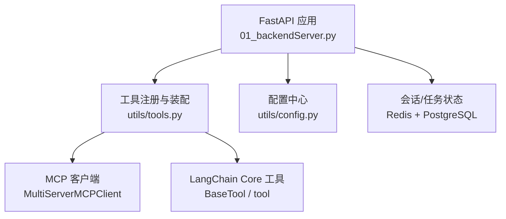
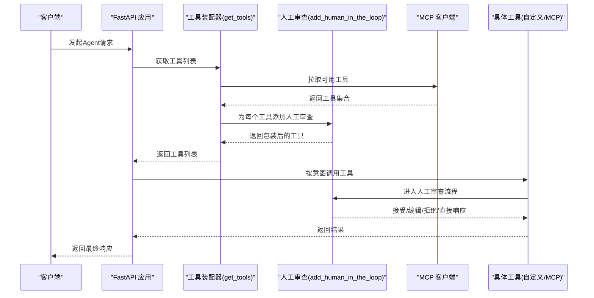
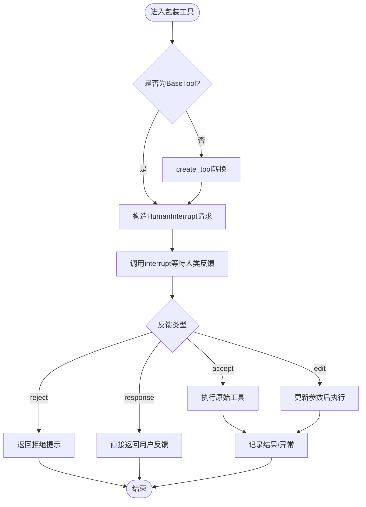
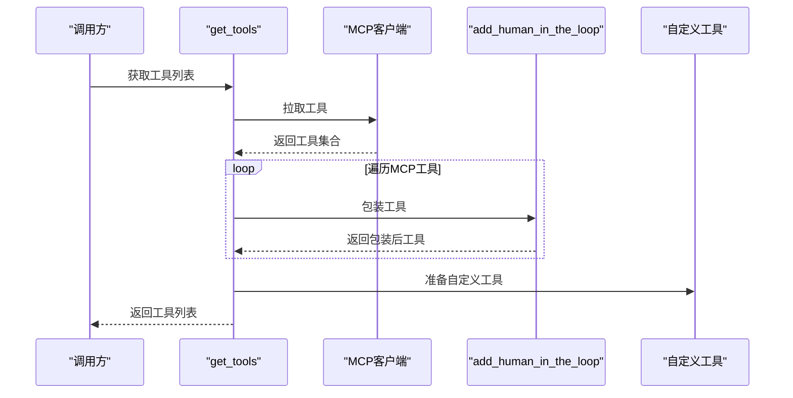
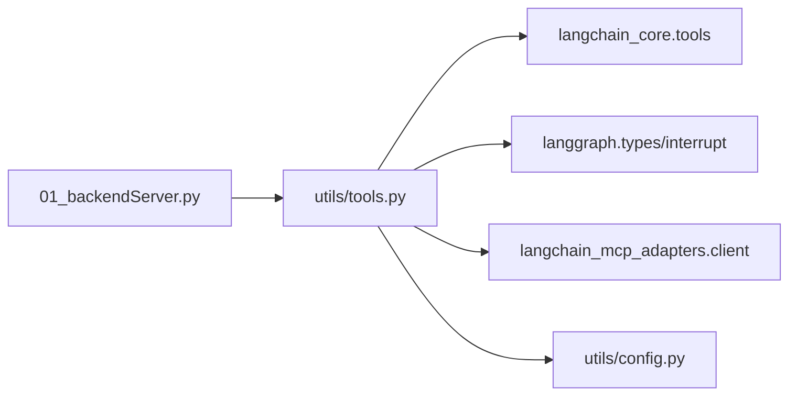

# 工具注册机制

<cite>
**本文引用的文件**
- [utils/tools.py](file://utils/tools.py)
- [01_backendServer.py](file://01_backendServer.py)
- [README.md](file://README.md)
- [utils/config.py](file://utils/config.py)
</cite>

## 目录
1. [简介](#简介)
2. [项目结构](#项目结构)
3. [核心组件](#核心组件)
4. [架构总览](#架构总览)
5. [详细组件分析](#详细组件分析)
6. [依赖关系分析](#依赖关系分析)
7. [性能与内存优化](#性能与内存优化)
8. [故障排查指南](#故障排查指南)
9. [结论](#结论)
10. [附录：开发规范与示例](#附录开发规范与示例)

## 简介
本技术文档聚焦于“工具注册机制”，围绕 @tool 装饰器的使用、自定义工具开发规范（函数签名、参数类型标注、返回值处理）、工具元数据管理（名称、描述、参数模式验证），以及工具生命周期与内存占用优化策略进行系统化说明。同时提供从简单数学计算到复杂业务逻辑的完整开发示例，并给出错误处理、日志记录与性能优化的最佳实践。

## 项目结构
- 后端服务入口：FastAPI 应用负责会话管理、任务调度与状态查询，工具通过统一接口获取并注入 Agent 执行流程。
- 工具模块：集中定义工具注册、人工审查（Human-in-the-Loop）封装、MCP 工具集成与工具列表组装。
- 配置模块：统一管理日志、数据库、Redis、LLM 等运行期配置。
- 文档：README 描述了系统能力、测试流程与工具样例。

图表来源
- [01_backendServer.py:84-130](file://01_backendServer.py#L84-L130)
- [utils/tools.py:121-175](file://utils/tools.py#L121-L175)
- [utils/config.py:4-34](file://utils/config.py#L4-L34)

章节来源
- [01_backendServer.py:84-130](file://01_backendServer.py#L84-L130)
- [utils/tools.py:121-175](file://utils/tools.py#L121-L175)
- [utils/config.py:4-34](file://utils/config.py#L4-L34)
- [README.md:1-199](file://README.md#L1-L199)

## 核心组件
- 工具装饰器与基类：基于 LangChain 的 @tool 装饰器与 BaseTool，用于声明式定义工具、自动推导参数模式与元数据。
- 人工审查封装：add_human_in_the_loop 将任意可调用对象或 BaseTool 包装为支持中断与人类反馈的工具。
- 工具装配器：get_tools 聚合 MCP 工具与自定义工具，统一添加人工审查后返回供上层使用。
- 日志与配置：统一的日志轮转与配置项，保障工具调用的可观测性与稳定性。

章节来源
- [utils/tools.py:1-175](file://utils/tools.py#L1-L175)
- [utils/config.py:4-34](file://utils/config.py#L4-L34)

## 架构总览
工具注册与执行的关键路径如下：
- 服务启动时初始化资源（数据库连接池、短期/长期记忆存储）。
- 通过 get_tools 动态构建工具集，包含 MCP 工具与本地自定义工具。
- 所有工具在执行前经过 add_human_in_the_loop 包装，进入 Human-in-the-Loop 流程。
- Agent 在推理过程中根据模型意图选择工具，调用被包装后的工具，依据人类反馈决定继续、修改参数、拒绝或直接响应。

图表来源
- [01_backendServer.py:84-130](file://01_backendServer.py#L84-L130)
- [utils/tools.py:121-175](file://utils/tools.py#L121-L175)
- [utils/tools.py:37-118](file://utils/tools.py#L37-L118)

## 详细组件分析

### 工具装饰器与元数据管理
- 使用 @tool 装饰器声明工具名称与描述，自动提取函数签名生成参数模式（args_schema），便于模型理解与校验。
- 工具名称需唯一且语义清晰；描述应准确表达用途与输入输出。
- 参数类型标注有助于自动生成 JSON Schema，提升参数校验质量。
- 返回值建议保持简洁明确，必要时以结构化数据返回，便于上层解析。

章节来源
- [utils/tools.py:121-152](file://utils/tools.py#L121-L152)
- [README.md:121-159](file://README.md#L121-L159)

### 人工审查（Human-in-the-Loop）封装
- add_human_in_the_loop 接收 Callable 或 BaseTool，若为普通函数则通过 create_tool 转换为 BaseTool。
- 使用 create_tool 重新包装，继承原工具的 name、description、args_schema，确保元数据一致性。
- 内部异步函数 call_tool_with_interrupt 构造 HumanInterrupt 请求，调用 interrupt 等待人类反馈。
- 支持四种响应类型：accept（接受并执行）、edit（修改参数后执行）、reject（拒绝并返回提示）、response（不调用工具直接反馈）。
- 异常捕获与日志记录，保证失败路径可追踪。

图表来源
- [utils/tools.py:37-118](file://utils/tools.py#L37-L118)

章节来源
- [utils/tools.py:37-118](file://utils/tools.py#L37-L118)

### 工具装配器与MCP集成
- get_tools 内定义两个自定义工具：book_hotel（酒店预定）与 multiply（乘法计算）。
- 通过 MultiServerMCPClient 连接高德地图 MCP Server，拉取可用工具。
- 对 MCP 工具逐一添加人工审查，再追加自定义工具（其中 book_hotel 也经人工审查包装，multiply 未包装）。
- 返回工具列表供上层使用。

图表来源
- [utils/tools.py:121-175](file://utils/tools.py#L121-L175)

章节来源
- [utils/tools.py:121-175](file://utils/tools.py#L121-L175)

### 服务生命周期与工具可用性
- FastAPI 应用通过 lifespan 初始化 Redis、PostgreSQL 连接池、短期/长期记忆存储。
- 工具注册不在此处硬编码，而是通过 get_tools 动态获取，便于扩展与维护。
- 会话与任务状态由 Redis 管理，支持恢复与过期控制。

章节来源
- [01_backendServer.py:84-130](file://01_backendServer.py#L84-L130)
- [01_backendServer.py:132-237](file://01_backendServer.py#L132-L237)

## 依赖关系分析
- 工具模块依赖 LangChain Core 的 BaseTool 与 tool 装饰器，用于工具声明与参数模式推导。
- 依赖 langgraph 的 interrupt 与 HumanInterruptConfig，实现人工审查流程。
- 依赖 langchain_mcp_adapters.client.MultiServerMCPClient 接入外部 MCP 工具。
- 日志与配置依赖 concurrent_log_handler 与 utils/config。

图表来源
- [utils/tools.py:1-12](file://utils/tools.py#L1-L12)
- [01_backendServer.py:84-130](file://01_backendServer.py#L84-L130)

章节来源
- [utils/tools.py:1-12](file://utils/tools.py#L1-L12)
- [01_backendServer.py:84-130](file://01_backendServer.py#L84-L130)

## 性能与内存优化
- 工具包装复用：add_human_in_the_loop 仅进行一次包装，避免重复创建 BaseTool 实例。
- 并发日志：使用 ConcurrentRotatingFileHandler 降低高并发下的 I/O 竞争。
- 连接池：数据库连接池最小/最大连接数合理设置，减少连接建立开销。
- 工具惰性加载：get_tools 按需拉取 MCP 工具，避免不必要的网络请求。
- 参数校验前置：利用 @tool 自动生成的 args_schema 在调用前完成参数校验，减少无效调用。
- 内存占用：尽量返回轻量级数据结构，避免在工具中持有大对象引用；及时释放临时变量。

[本节为通用指导，不直接分析具体文件]

## 故障排查指南
- 工具调用失败：检查 add_human_in_the_loop 中的异常捕获与日志输出，定位具体错误信息。
- 人工审查无响应：确认 interrupt 调用是否阻塞，检查前端或上游是否提供反馈。
- MCP 工具不可用：核对 MCP 服务端 URL、传输方式与密钥配置，确保网络可达。
- 会话恢复失败：检查 Redis 中会话状态是否为 interrupted，确保任务 ID 存在。
- 日志缺失：确认日志文件路径与权限，检查配置中的 LOG_FILE、MAX_BYTES、BACKUP_COUNT。

章节来源
- [utils/tools.py:83-115](file://utils/tools.py#L83-L115)
- [01_backendServer.py:175-237](file://01_backendServer.py#L175-L237)
- [utils/config.py:4-11](file://utils/config.py#L4-L11)

## 结论
本项目通过 @tool 装饰器与 LangChain 生态实现了声明式工具注册与参数模式推导，结合 add_human_in_the_loop 提供了安全可控的人工审查机制。工具装配器统一整合 MCP 与自定义工具，便于扩展与维护。配合完善的日志与配置管理，系统在可靠性、可观测性与性能方面具备良好基础。后续可进一步引入工具缓存、批量调用与更细粒度的权限控制。

[本节为总结性内容，不直接分析具体文件]

## 附录：开发规范与示例

### 函数签名定义与参数类型标注
- 使用 Python 类型注解明确参数类型，如 str、float、int、list、dict 等，以便自动生成参数模式。
- 可选参数建议使用默认值，并在描述中说明用途。
- 复杂参数可使用 Pydantic 模型（由 LangChain 自动识别）以提升校验能力。

章节来源
- [utils/tools.py:124-152](file://utils/tools.py#L124-L152)

### 返回值处理
- 返回字符串时保持简洁可读；返回结构化数据时建议使用 dict 或 Pydantic 模型。
- 对于耗时操作，优先使用异步函数，避免阻塞事件循环。

章节来源
- [utils/tools.py:124-152](file://utils/tools.py#L124-L152)

### 工具元数据管理
- 名称：唯一且具业务含义，便于调试与追踪。
- 描述：准确表达工具用途、输入输出与注意事项。
- 参数模式：由 @tool 自动推导，必要时可通过 args_schema 显式指定。

章节来源
- [utils/tools.py:58-63](file://utils/tools.py#L58-L63)
- [utils/tools.py:124-152](file://utils/tools.py#L124-L152)

### 完整开发示例
- 简单数学计算工具：multiply，接收两个浮点数并返回乘积结果字符串。
- 复杂业务逻辑工具：book_hotel，模拟酒店预订，接收酒店名称并返回预定成功消息。
- MCP 工具：通过 MultiServerMCPClient 接入高德地图工具，统一添加人工审查后参与 Agent 决策。

章节来源
- [utils/tools.py:121-175](file://utils/tools.py#L121-L175)
- [README.md:121-159](file://README.md#L121-L159)

### 工具注册最佳实践
- 错误处理：在工具内部捕获异常并返回友好提示，同时在包装层记录错误日志。
- 日志记录：关键路径记录入参、出参与异常堆栈，便于问题定位。
- 性能优化：避免在工具中进行重型同步 I/O；合理使用连接池与缓存。
- 生命周期管理：工具应保持无状态或轻量状态；长连接置于连接池管理。
- 内存优化：及时释放临时对象；避免在工具中持有全局大对象引用。

章节来源
- [utils/tools.py:83-115](file://utils/tools.py#L83-L115)
- [utils/config.py:4-11](file://utils/config.py#L4-L11)