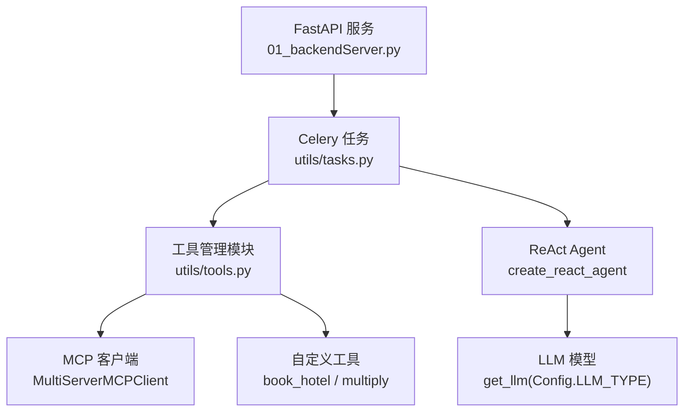
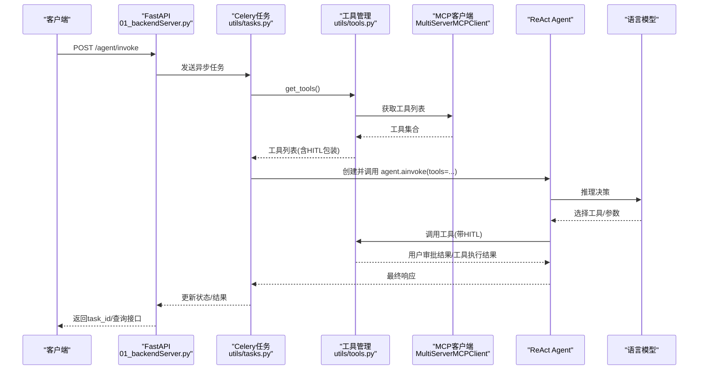
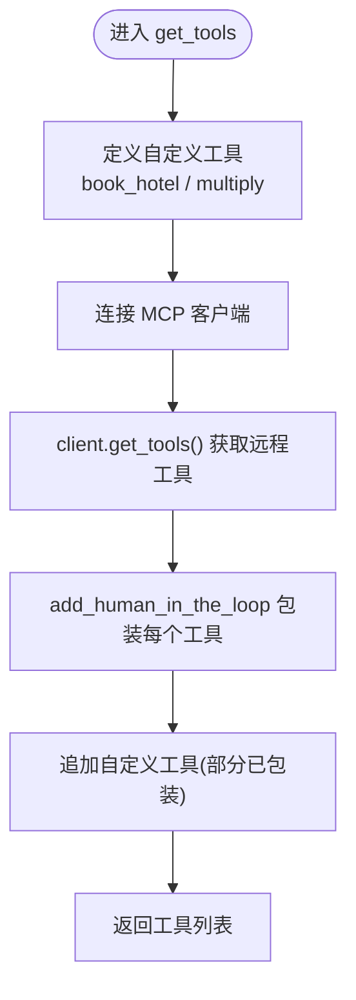
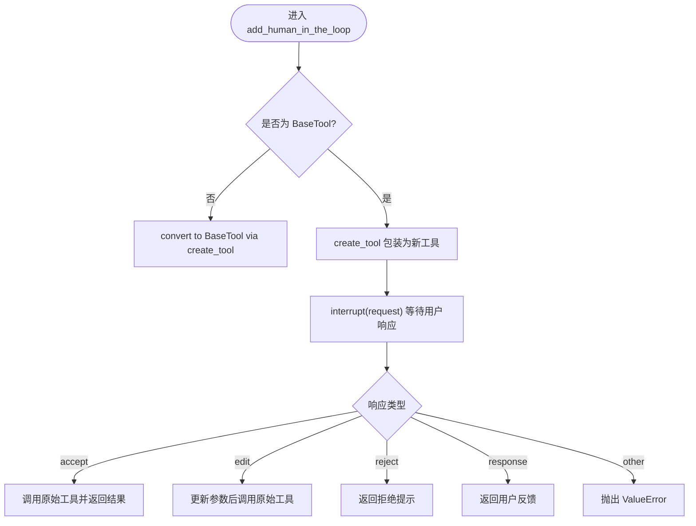
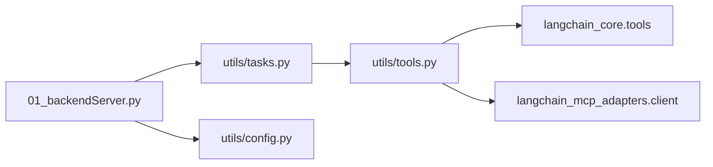

# 工具管理与调度

<cite>
**本文引用的文件**
- [utils/tools.py](file://utils/tools.py)
- [utils/tasks.py](file://utils/tasks.py)
- [01_backendServer.py](file://01_backendServer.py)
- [utils/config.py](file://utils/config.py)
- [README.md](file://README.md)
</cite>

## 目录
1. [简介](#简介)
2. [项目结构](#项目结构)
3. [核心组件](#核心组件)
4. [架构总览](#架构总览)
5. [详细组件分析](#详细组件分析)
6. [依赖关系分析](#依赖关系分析)
7. [性能考量](#性能考量)
8. [故障排查指南](#故障排查指南)
9. [结论](#结论)
10. [附录](#附录)

## 简介
本技术文档聚焦于“工具管理与调度”子系统，围绕 get_tools 函数的实现逻辑展开，解释如何统一管理自定义工具与 MCP（Model Context Protocol）工具，并说明工具列表的动态生成机制、懒加载与缓存策略、以及扩展方式。同时提供测试方法与最佳实践建议，帮助在生产环境中稳定运行并持续演进。

## 项目结构
- utils/tools.py：工具发现、包装与统一入口 get_tools；包含人工审查（HITL）封装 add_human_in_the_loop。
- utils/tasks.py：智能体任务执行流程，调用 get_tools 获取工具集合并注入 ReAct Agent。
- 01_backendServer.py：FastAPI 服务入口，负责会话管理、任务调度与生命周期初始化。
- utils/config.py：集中配置项（数据库、Redis、日志等）。
- README.md：系统功能概述与测试指引。

图表来源
- [01_backendServer.py:84-130](file://01_backendServer.py#L84-L130)
- [utils/tasks.py:360-399](file://utils/tasks.py#L360-L399)
- [utils/tools.py:122-175](file://utils/tools.py#L122-L175)

章节来源
- [01_backendServer.py:84-130](file://01_backendServer.py#L84-L130)
- [utils/tasks.py:360-399](file://utils/tasks.py#L360-L399)
- [utils/tools.py:122-175](file://utils/tools.py#L122-L175)

## 核心组件
- get_tools：统一的工具发现与组装入口，聚合自定义工具与 MCP 工具，返回供 Agent 使用的工具列表。
- add_human_in_the_loop：为任意工具（可调用或 BaseTool）添加人工审查能力，支持接受、拒绝、编辑参数或直接响应四种处理路径。
- MultiServerMCPClient：连接外部 MCP Server，动态拉取可用工具集合。
- tasks 中的 invoke/resume 任务：在每次执行时调用 get_tools 构建工具集合并创建 ReAct Agent。

章节来源
- [utils/tools.py:37-118](file://utils/tools.py#L37-L118)
- [utils/tools.py:122-175](file://utils/tools.py#L122-L175)
- [utils/tasks.py:360-399](file://utils/tasks.py#L360-L399)
- [utils/tasks.py:485-505](file://utils/tasks.py#L485-L505)

## 架构总览
下图展示了从 API 请求到工具调用的完整链路，包括 HITL 中断与恢复流程。

图表来源
- [01_backendServer.py:133-173](file://01_backendServer.py#L133-L173)
- [utils/tasks.py:360-418](file://utils/tasks.py#L360-L418)
- [utils/tools.py:122-175](file://utils/tools.py#L122-L175)

## 详细组件分析

### get_tools 函数：统一工具管理与动态生成
- 职责：
  - 定义并注册自定义工具（如 book_hotel、multiply）。
  - 通过 MultiServerMCPClient 连接 MCP Server，拉取远程工具集合。
  - 将 MCP 工具与自定义工具统一包装为带 HITL 能力的工具对象。
  - 返回供 Agent 使用的工具列表。
- 关键点：
  - 自定义工具使用 @tool 装饰器声明名称、描述与参数模式。
  - MCP 工具通过 client.get_tools() 动态发现，无需硬编码。
  - 所有工具均通过 add_human_in_the_loop 包装，确保调用前有人工审批环节。
  - 当前实现未进行去重与排序，直接拼接 MCP 工具与自定义工具。

图表来源
- [utils/tools.py:122-175](file://utils/tools.py#L122-L175)

章节来源
- [utils/tools.py:122-175](file://utils/tools.py#L122-L175)

### add_human_in_the_loop：工具的人工审查封装
- 输入：
  - tool：可调用对象或 BaseTool。
  - interrupt_config：可选的中断配置。
- 行为：
  - 若传入非 BaseTool，则通过 create_tool 转换为 BaseTool。
  - 使用 create_tool 装饰器创建新工具，继承原工具的名称、描述与参数模式。
  - 内部 call_tool_with_interrupt 构造 HumanInterrupt 请求，调用 interrupt 等待用户响应。
  - 根据响应类型执行不同分支：
    - accept：调用原始工具并返回结果。
    - edit：使用用户修改后的参数重新调用工具。
    - reject：返回拒绝提示。
    - response：直接返回用户反馈。
- 异常处理：
  - 对不支持的响应类型抛出 ValueError。
  - 捕获工具调用异常并记录错误日志。

图表来源
- [utils/tools.py:37-118](file://utils/tools.py#L37-L118)

章节来源
- [utils/tools.py:37-118](file://utils/tools.py#L37-L118)

### 工具列表的动态生成机制
- 工具发现：
  - 自定义工具：在 get_tools 内以 @tool 装饰器声明，运行时即注册。
  - MCP 工具：通过 MultiServerMCPClient 连接远端服务，调用 get_tools 动态获取。
- 去重策略：
  - 当前实现未显式去重，若存在同名工具可能导致覆盖或冲突。建议在后续版本增加基于工具名的去重逻辑。
- 排序策略：
  - 当前实现按“先 MCP 工具，后自定义工具”的顺序追加，无额外排序规则。可根据业务需求引入优先级或分类排序。

章节来源
- [utils/tools.py:122-175](file://utils/tools.py#L122-L175)

### 懒加载与缓存机制
- 懒加载：
  - 当前 get_tools 在每次任务执行时被调用，属于按需加载，避免启动时全量初始化。
- 缓存机制：
  - 代码中未实现工具列表缓存。考虑到 MCP 工具可能变化不频繁，可在进程级或应用级缓存工具列表，减少网络开销。
  - 建议：
    - 使用内存缓存（如 dict + TTL）存储工具列表。
    - 提供刷新接口以支持热更新。
    - 结合 Redis 做跨进程共享缓存。

章节来源
- [utils/tasks.py:360-399](file://utils/tasks.py#L360-L399)
- [utils/tasks.py:485-505](file://utils/tasks.py#L485-L505)

### 工具管理的最佳实践
- 工具分类：
  - 将工具按领域划分（如地图、计算、业务操作），便于管理与权限控制。
- 命名规范：
  - 工具名应具语义化且唯一，避免冲突；建议使用“领域_动作”格式。
- 版本控制：
  - 为工具增加版本号字段，支持向后兼容与灰度发布。
- 安全与审计：
  - 保留 HITL 审批日志，记录调用者、参数与结果。
  - 对敏感工具增加二次确认或白名单机制。

[本节为通用指导，不直接分析具体文件]

### 工具测试方法
- 单元测试：
  - 针对 add_human_in_the_loop 的分支（accept/edit/reject/response）编写用例，验证不同响应下的行为。
  - 模拟 MCP 工具返回，验证 get_tools 的组装结果。
- 集成测试：
  - 启动后端服务与 Celery Worker，端到端验证 /agent/invoke 与 /agent/resume 流程。
  - 验证 HITL 中断与恢复是否正常工作。
- 性能基准测试：
  - 对比有无缓存时的工具获取耗时与资源占用。
  - 评估并发场景下工具列表的稳定性与延迟。

章节来源
- [README.md:121-165](file://README.md#L121-L165)
- [utils/tasks.py:360-418](file://utils/tasks.py#L360-L418)
- [utils/tasks.py:485-526](file://utils/tasks.py#L485-L526)

### 扩展现有工具管理系统
- 新增工具来源：
  - 在 get_tools 中添加新的 MCP 客户端配置或本地工具注册逻辑。
  - 遵循现有包装模式，确保所有工具具备 HITL 能力。
- 增强管理能力：
  - 增加工具元数据（分类、版本、权限），并在工具列表中携带。
  - 实现去重与排序策略，保证工具列表的一致性与可预测性。
  - 引入缓存层，提升性能与可用性。
- 监控与可观测性：
  - 记录工具发现、调用与审批的关键指标。
  - 提供健康检查接口，暴露工具可用性状态。

[本节为扩展建议，不直接分析具体文件]

## 依赖关系分析
- 模块耦合：
  - tasks 依赖 tools 提供的 get_tools。
  - tools 依赖 langchain_core.tools 与 langchain_mcp_adapters.client。
  - backend 服务通过 lifespan 初始化资源，任务在独立进程中执行。
- 外部依赖：
  - PostgreSQL：短期记忆与长期记忆持久化。
  - Redis：会话状态与任务队列。
  - MCP Server：远程工具源。

图表来源
- [01_backendServer.py:84-130](file://01_backendServer.py#L84-L130)
- [utils/tasks.py:360-399](file://utils/tasks.py#L360-L399)
- [utils/tools.py:122-175](file://utils/tools.py#L122-L175)
- [utils/config.py:1-34](file://utils/config.py#L1-L34)

章节来源
- [01_backendServer.py:84-130](file://01_backendServer.py#L84-L130)
- [utils/tasks.py:360-399](file://utils/tasks.py#L360-L399)
- [utils/tools.py:122-175](file://utils/tools.py#L122-L175)
- [utils/config.py:1-34](file://utils/config.py#L1-L34)

## 性能考量
- 工具发现成本：
  - MCP 工具拉取涉及网络请求，建议缓存以减少重复开销。
- 并发与资源：
  - 多任务并行时，避免重复建立 MCP 连接；可使用连接池或单例客户端。
- 内存使用：
  - 工具列表较大时，注意对象生命周期管理，及时释放不再使用的工具实例。
- 优化建议：
  - 实现进程级缓存与失效策略。
  - 对高频工具进行预热。
  - 监控网络超时与重试策略。

[本节提供一般性指导，不直接分析具体文件]

## 故障排查指南
- 常见问题：
  - MCP 连接失败：检查环境变量与网络连通性。
  - 工具调用被拒绝：查看 HITL 审批日志与用户交互记录。
  - 工具冲突：当存在同名工具时，需增加去重逻辑。
- 日志定位：
  - 工具调用与异常信息记录在 tools.py 的日志处理器中。
  - 任务执行过程中的错误会在 tasks.py 中捕获并更新状态。
- 恢复策略：
  - 利用 /agent/resume 接口恢复中断任务。
  - 通过会话状态查询接口确认当前任务状态。

章节来源
- [utils/tools.py:14-34](file://utils/tools.py#L14-L34)
- [utils/tasks.py:420-446](file://utils/tasks.py#L420-L446)
- [utils/tasks.py:528-554](file://utils/tasks.py#L528-L554)

## 结论
get_tools 实现了自定义工具与 MCP 工具的统一管理，并通过 add_human_in_the_loop 提供强大的人工审查能力。当前系统在工具发现与组装上较为简洁，适合快速迭代。未来可通过引入去重、排序、缓存与监控等机制，进一步提升系统的稳定性与性能。配合完善的测试与最佳实践，可支撑生产环境的高可用运行。

[本节为总结性内容，不直接分析具体文件]

## 附录
- 相关接口与流程参考：
  - 后端服务生命周期与资源初始化：[01_backendServer.py:84-130](file://01_backendServer.py#L84-L130)
  - 任务执行与工具注入：[utils/tasks.py:360-399](file://utils/tasks.py#L360-L399)、[utils/tasks.py:485-505](file://utils/tasks.py#L485-L505)
  - 工具管理与 HITL 封装：[utils/tools.py:37-118](file://utils/tools.py#L37-L118)、[utils/tools.py:122-175](file://utils/tools.py#L122-L175)
  - 配置项与环境变量：[utils/config.py:1-34](file://utils/config.py#L1-L34)
  - 测试指引与功能说明：[README.md:121-165](file://README.md#L121-L165)