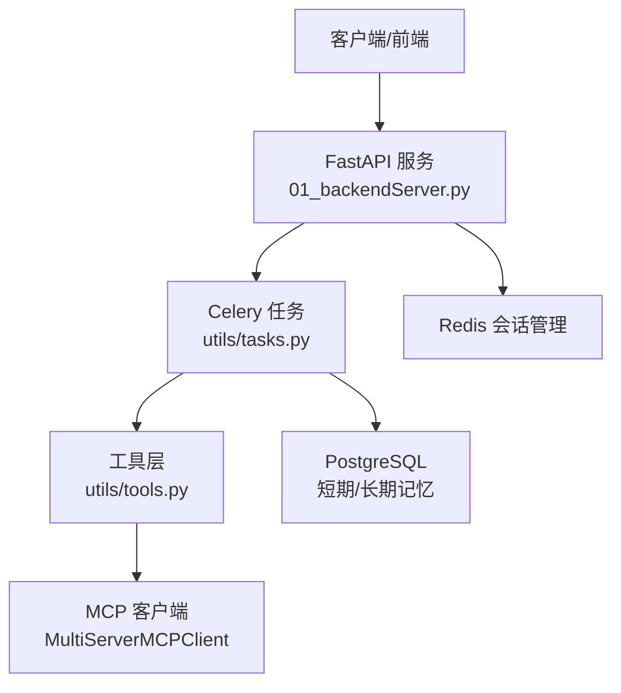
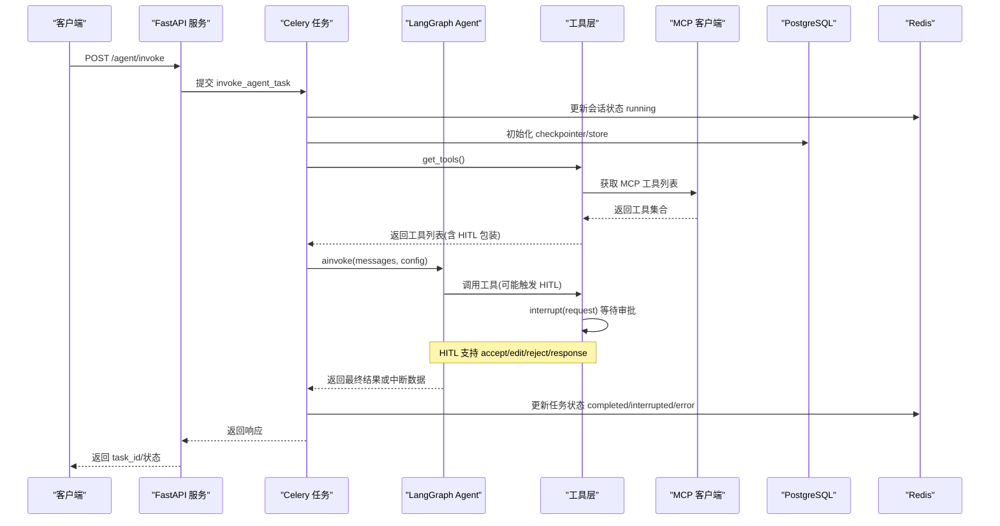
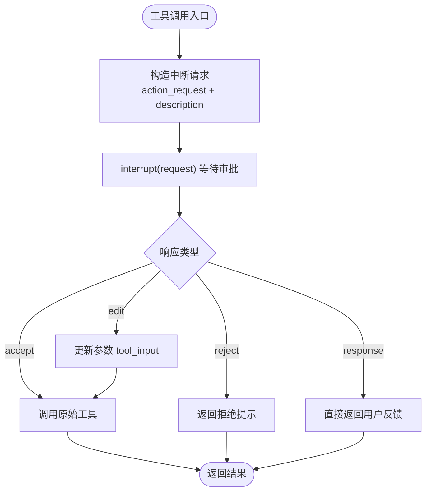
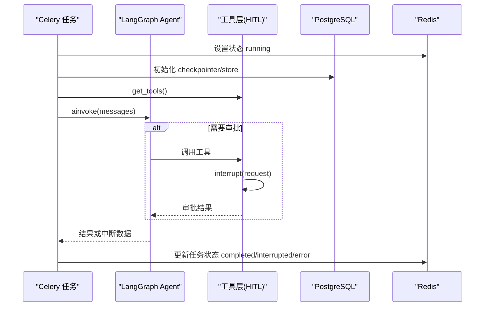
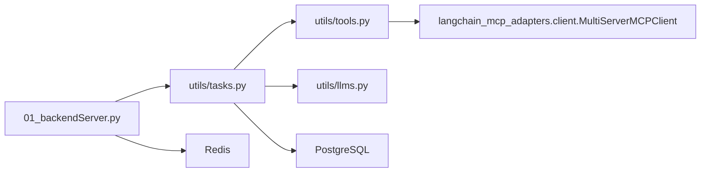

# 工具系统

<cite>
**本文引用的文件**
- [utils/tools.py](file://utils/tools.py)
- [01_backendServer.py](file://01_backendServer.py)
- [utils/tasks.py](file://utils/tasks.py)
- [utils/config.py](file://utils/config.py)
- [README.md](file://README.md)
</cite>

## 目录
1. [简介](#简介)
2. [项目结构](#项目结构)
3. [核心组件](#核心组件)
4. [架构总览](#架构总览)
5. [详细组件分析](#详细组件分析)
6. [依赖关系分析](#依赖关系分析)
7. [性能考量](#性能考量)
8. [故障排查指南](#故障排查指南)
9. [结论](#结论)
10. [附录](#附录)

## 简介
本技术文档聚焦于“工具系统”的设计与实现，覆盖以下关键主题：
- 工具注册机制：基于 @tool 装饰器的自定义工具开发规范
- MCP 服务器工具集成：工具发现、参数验证与执行流程
- 工具调用审批流程（HITL）：人工审查机制的实现细节
- 最佳实践：错误处理、日志记录与性能优化
- 测试方法与调试技巧：帮助开发者快速集成与扩展工具功能

该系统以 FastAPI 提供 API，使用 LangGraph ReAct Agent 编排智能体，结合 Celery 异步任务队列、PostgreSQL 短期/长期记忆存储以及 Redis 会话管理，形成高可用、可扩展的工具化智能体服务。

## 项目结构
- 后端入口与 API：FastAPI 应用、生命周期管理、REST 接口
- 工具层：工具定义、MCP 客户端集成、HITL 包装器
- 任务层：Celery 任务调度、Agent 运行与恢复、结果处理
- 配置与基础设施：数据库连接池、Redis 会话、日志轮转

图表来源
- [01_backendServer.py:84-130](file://01_backendServer.py#L84-L130)
- [utils/tasks.py:318-451](file://utils/tasks.py#L318-L451)
- [utils/tools.py:121-175](file://utils/tools.py#L121-L175)

章节来源
- [01_backendServer.py:84-130](file://01_backendServer.py#L84-L130)
- [utils/tasks.py:318-451](file://utils/tasks.py#L318-L451)
- [utils/tools.py:121-175](file://utils/tools.py#L121-L175)
- [utils/config.py:4-34](file://utils/config.py#L4-L34)

## 核心组件
- 工具注册与包装
  - 通过 @tool 装饰器定义自定义工具
  - 通过 add_human_in_the_loop 为任意工具添加 HITL 审批能力
- MCP 工具集成
  - 使用 MultiServerMCPClient 动态发现并加载远端工具
  - 统一包装为带 HITL 的 BaseTool
- 智能体执行与恢复
  - create_react_agent 构建 ReAct Agent
  - invoke_agent_task 与 resume_agent_task 分别负责首次调用与中断恢复
- 会话与状态管理
  - Redis 维护会话状态、任务状态与过期策略
  - PostgreSQL 作为短期/长期记忆持久化

章节来源
- [utils/tools.py:37-118](file://utils/tools.py#L37-L118)
- [utils/tools.py:121-175](file://utils/tools.py#L121-L175)
- [utils/tasks.py:318-451](file://utils/tasks.py#L318-L451)
- [utils/tasks.py:455-559](file://utils/tasks.py#L455-L559)
- [01_backendServer.py:132-237](file://01_backendServer.py#L132-L237)

## 架构总览
下图展示了从请求到工具执行的端到端流程，包括 HITL 审批与 MCP 工具调用。

图表来源
- [01_backendServer.py:132-173](file://01_backendServer.py#L132-L173)
- [utils/tasks.py:318-451](file://utils/tasks.py#L318-L451)
- [utils/tools.py:121-175](file://utils/tools.py#L121-L175)
- [utils/tools.py:37-118](file://utils/tools.py#L37-L118)

## 详细组件分析

### 工具注册机制与自定义工具开发规范
- 使用 @tool 装饰器声明工具名称、描述与参数模式
- 工具函数需为异步可调用对象，便于在 Agent 中 await 执行
- 推荐遵循以下规范：
  - 明确参数类型与约束，利于参数校验与提示生成
  - 返回结构化结果，便于上层解析与展示
  - 内部进行异常捕获与日志记录，避免传播未处理异常
  - 对副作用操作（如网络调用、写库）增加幂等性与重试策略

示例路径参考
- [utils/tools.py:121-151](file://utils/tools.py#L121-L151)

章节来源
- [utils/tools.py:121-151](file://utils/tools.py#L121-L151)

### MCP 服务器工具集成
- 通过 MultiServerMCPClient 配置远端 MCP Server 地址与传输方式
- 调用 client.get_tools() 动态发现可用工具
- 将发现的工具统一包装为带 HITL 的 BaseTool，确保一致的执行与审批体验
- 支持多种传输协议（如 streamable_http），可按需切换

集成要点
- 环境变量注入敏感信息（如 API Key）
- 工具发现失败时降级或告警
- 对工具元数据（名称、描述、参数模式）保持透明

章节来源
- [utils/tools.py:153-175](file://utils/tools.py#L153-L175)

### 工具调用的审批流程（HITL）
- add_human_in_the_loop 将任意工具包装为带中断能力的 BaseTool
- 工具执行前构造 HumanInterrupt 请求，包含 action_request、config、description
- 调用 interrupt(request) 进入审批等待，支持四种响应类型：
  - accept：批准执行，直接调用原始工具
  - edit：编辑参数后重新执行
  - reject：拒绝执行，返回固定提示
  - response：不调用工具，直接返回用户反馈
- 所有分支均记录日志，便于审计与排障

图表来源
- [utils/tools.py:37-118](file://utils/tools.py#L37-L118)

章节来源
- [utils/tools.py:37-118](file://utils/tools.py#L37-L118)

### 智能体执行与恢复流程
- invoke_agent_task：
  - 初始化 Redis 会话管理器、PostgreSQL 连接池、checkpointer、store
  - 获取 LLM 与工具列表，构建 ReAct Agent
  - 读取长期记忆并拼接至 system_prompt
  - 调用 agent.ainvoke，解析消息与结果，更新任务状态
- resume_agent_task：
  - 使用 Command(resume=command_data) 恢复被中断的会话
  - 复用相同工具与记忆上下文，继续执行直至完成或再次中断

图表来源
- [utils/tasks.py:318-451](file://utils/tasks.py#L318-L451)
- [utils/tasks.py:455-559](file://utils/tasks.py#L455-L559)
- [utils/tools.py:37-118](file://utils/tools.py#L37-L118)

章节来源
- [utils/tasks.py:318-451](file://utils/tasks.py#L318-L451)
- [utils/tasks.py:455-559](file://utils/tasks.py#L455-L559)

### 参数验证与错误处理
- 参数验证：
  - 由 @tool 装饰器与 LangChain/LangGraph 的类型系统保障
  - 建议在工具内部对边界值进行二次校验，提升鲁棒性
- 错误处理：
  - 工具内部 try/except 捕获异常并记录日志
  - Agent 层 process_agent_result 统一封装中断与错误响应
  - 任务层 catch 异常后更新会话与任务状态为 error/failed

章节来源
- [utils/tools.py:83-114](file://utils/tools.py#L83-L114)
- [utils/tasks.py:194-264](file://utils/tasks.py#L194-L264)
- [utils/tasks.py:420-446](file://utils/tasks.py#L420-L446)

### 日志记录与审计
- 统一使用 ConcurrentRotatingFileHandler 进行日志轮转
- 关键节点记录：
  - 工具调用与审批结果
  - 智能体执行与中断数据
  - 会话与任务状态变更
- 建议：
  - 区分 INFO/ERROR 级别，便于检索
  - 在 HITL 分支中记录决策依据与参数变更

章节来源
- [utils/tools.py:14-34](file://utils/tools.py#L14-L34)
- [utils/tasks.py:21-40](file://utils/tasks.py#L21-L40)
- [01_backendServer.py:21-40](file://01_backendServer.py#L21-L40)

## 依赖关系分析
- 模块耦合
  - 后端 API 依赖任务层与配置；任务层依赖工具层与 LLM；工具层依赖 MCP 客户端
- 外部依赖
  - PostgreSQL：短期/长期记忆
  - Redis：会话与任务状态
  - Celery：异步任务队列
  - LangChain/LangGraph：Agent 与工具框架
  - MCP 适配器：远端工具发现与调用

图表来源
- [01_backendServer.py:84-130](file://01_backendServer.py#L84-L130)
- [utils/tasks.py:318-451](file://utils/tasks.py#L318-L451)
- [utils/tools.py:121-175](file://utils/tools.py#L121-L175)

章节来源
- [utils/config.py:4-34](file://utils/config.py#L4-L34)
- [utils/tasks.py:318-451](file://utils/tasks.py#L318-L451)
- [utils/tools.py:121-175](file://utils/tools.py#L121-L175)

## 性能考量
- 工具执行
  - 优先使用异步 I/O，减少阻塞
  - 对远程调用设置超时与重试，避免长尾延迟
- 记忆与上下文
  - 使用 trimmed_messages_hook 控制消息长度，降低 token 消耗
  - 合理配置 PostgreSQL 连接池大小，避免资源争用
- 并发与队列
  - 利用 Celery 并行处理多任务，注意 broker 与 worker 数量匹配
  - Redis 会话 TTL 与过期策略影响内存占用与恢复成本
- 日志与监控
  - 控制日志级别与轮转策略，避免磁盘压力
  - 对关键指标（工具调用次数、审批通过率、错误率）进行采集

[本节为通用指导，不直接分析具体文件]

## 故障排查指南
- 常见问题定位
  - 工具调用失败：检查工具内部异常与日志，确认参数格式与权限
  - HITL 无响应：确认前端/客户端是否正确处理中断并回传命令
  - 会话无法恢复：检查 Redis 中任务状态是否为 interrupted，且携带完整中断数据
  - MCP 工具不可用：检查网络连通性与 API Key，确认 get_tools 成功
- 诊断步骤
  - 查看日志文件 logfile/app.log，过滤 ERROR 与关键 INFO
  - 查询 Redis 中的会话与任务状态，核对 last_response 与 interrupt_data
  - 检查 PostgreSQL 连接池与 checkpointer/store 初始化是否成功
  - 复现最小用例，逐步隔离问题域（工具、Agent、队列、存储）

章节来源
- [utils/tasks.py:194-264](file://utils/tasks.py#L194-L264)
- [utils/tasks.py:420-446](file://utils/tasks.py#L420-L446)
- [01_backendServer.py:176-237](file://01_backendServer.py#L176-L237)

## 结论
该工具系统通过标准化的工具注册、MCP 工具集成与 HITL 审批机制，提供了安全可控、可扩展的智能体工具执行能力。结合异步任务队列与持久化记忆，实现了高可用与可恢复的服务形态。建议在生产环境中完善监控与告警，持续优化工具质量与执行效率。

[本节为总结性内容，不直接分析具体文件]

## 附录
- 快速上手
  - 安装依赖并启动 PostgreSQL、Redis
  - 启动 Celery Worker 与后端服务，按 README 进行测试
- 扩展工具
  - 新增自定义工具：使用 @tool 装饰器，遵循参数与返回规范
  - 接入新 MCP Server：在 get_tools 中追加配置，验证工具发现与执行
- 调试技巧
  - 开启 DEBUG 日志，关注 HITL 分支与工具调用栈
  - 使用前端交互界面模拟审批流程，验证不同响应类型

章节来源
- [README.md:111-193](file://README.md#L111-L193)