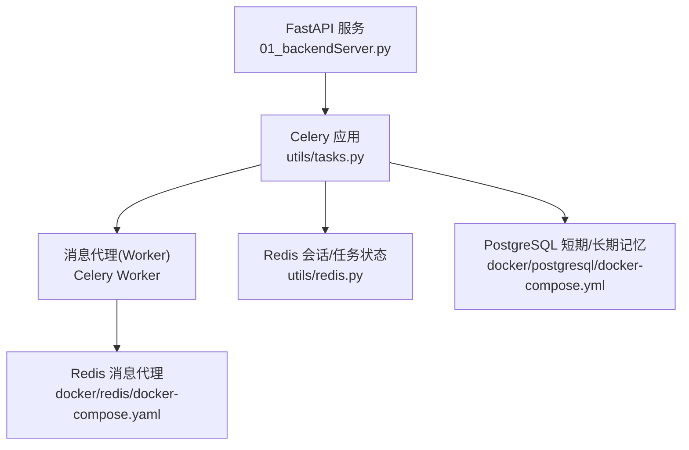
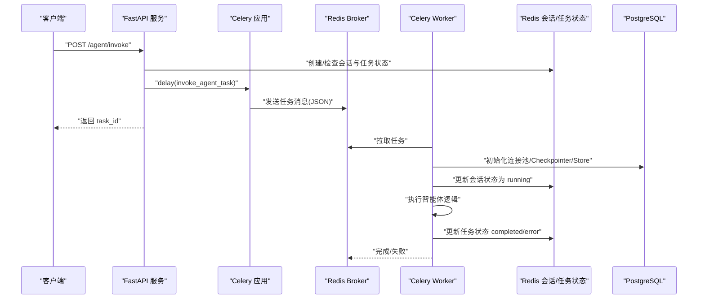
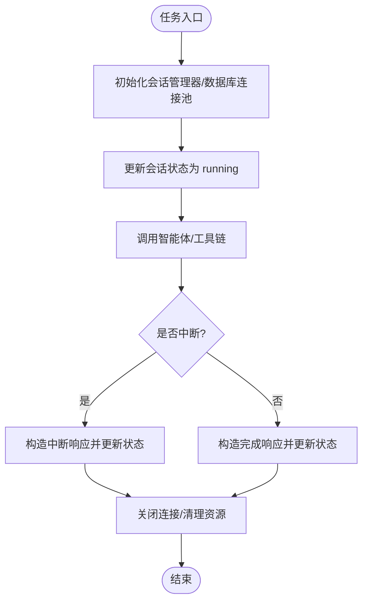
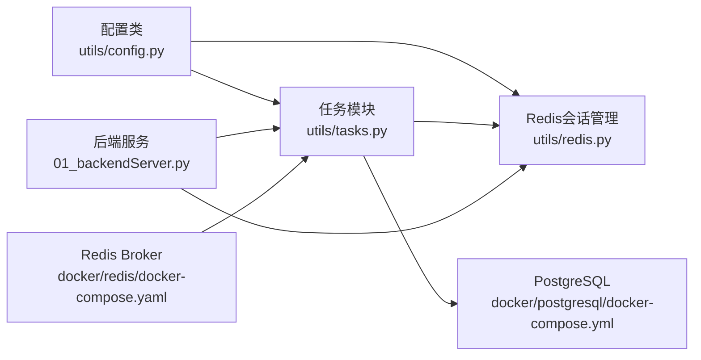

# Celery任务队列配置

<cite>
**本文引用的文件**
- [utils/tasks.py](file://utils/tasks.py)
- [utils/config.py](file://utils/config.py)
- [01_backendServer.py](file://01_backendServer.py)
- [utils/redis.py](file://utils/redis.py)
- [docker/redis/docker-compose.yaml](file://docker/redis/docker-compose.yaml)
- [docker/postgresql/docker-compose.yml](file://docker/postgresql/docker-compose.yml)
- [README.md](file://README.md)
</cite>

## 目录
1. [简介](#简介)
2. [项目结构](#项目结构)
3. [核心组件](#核心组件)
4. [架构总览](#架构总览)
5. [详细组件分析](#详细组件分析)
6. [依赖关系分析](#依赖关系分析)
7. [性能调优建议](#性能调优建议)
8. [故障排查指南](#故障排查指南)
9. [结论](#结论)
10. [附录](#附录)

## 简介
本文件围绕项目中Celery任务队列的配置与使用进行系统化说明，重点覆盖：
- Celery实例的初始化过程（应用名称、消息代理、序列化与时区等）
- 任务队列的关键配置项（序列化格式、接受内容类型、结果序列化、时区等）
- Celery与Redis的集成（broker URL与连接参数）
- 性能调优建议（并发数、超时、重试机制等）
- 常见配置问题与解决方案

## 项目结构
本项目采用模块化组织：
- 配置集中管理于配置类中，便于统一维护
- Celery实例与任务定义位于任务模块
- 后端服务通过FastAPI暴露接口并调度异步任务
- Redis用于会话状态与任务状态存储，PostgreSQL用于短期/长期记忆持久化

图表来源
- [01_backendServer.py:126-173](file://01_backendServer.py#L126-L173)
- [utils/tasks.py:43-63](file://utils/tasks.py#L43-L63)
- [utils/redis.py:37-49](file://utils/redis.py#L37-L49)
- [docker/redis/docker-compose.yaml:5-28](file://docker/redis/docker-compose.yaml#L5-L28)
- [docker/postgresql/docker-compose.yml:4-22](file://docker/postgresql/docker-compose.yml#L4-L22)

章节来源
- [README.md:111-192](file://README.md#L111-L192)

## 核心组件
- 配置中心：集中管理数据库、Redis、Celery Broker、TTL等关键参数
- Celery应用：创建Celery实例、设置序列化与时区等全局配置
- 任务定义：两个异步任务分别用于初始调用与恢复中断后的继续执行
- 后端服务：接收请求，将任务投递到队列，并更新任务状态
- Redis会话管理：维护用户会话、任务状态及映射关系
- 数据持久化：PostgreSQL用于短期/长期记忆

章节来源
- [utils/config.py:4-27](file://utils/config.py#L4-L27)
- [utils/tasks.py:43-63](file://utils/tasks.py#L43-L63)
- [utils/tasks.py:318-451](file://utils/tasks.py#L318-L451)
- [utils/tasks.py:454-559](file://utils/tasks.py#L454-L559)
- [01_backendServer.py:132-173](file://01_backendServer.py#L132-L173)
- [utils/redis.py:37-49](file://utils/redis.py#L37-L49)

## 架构总览
下图展示了从HTTP请求到任务执行、再到状态更新的完整流程。

图表来源
- [01_backendServer.py:132-173](file://01_backendServer.py#L132-L173)
- [utils/tasks.py:318-451](file://utils/tasks.py#L318-L451)
- [utils/redis.py:392-415](file://utils/redis.py#L392-L415)
- [docker/redis/docker-compose.yaml:5-28](file://docker/redis/docker-compose.yaml#L5-L28)

## 详细组件分析

### Celery实例初始化与全局配置
- 应用名称：设置为后端服务入口模块名，便于Worker定位任务模块
- 消息代理：使用Redis作为Broker，URL来自配置类
- 序列化与时区：
  - 任务序列化格式：JSON
  - 接受的内容类型：仅JSON
  - 结果序列化格式：JSON
  - 时区：Asia/Shanghai，启用UTC时间
- 这些配置确保任务在进程间传递时使用一致的序列化方式，避免兼容性问题；同时保证时间戳一致性与可追溯性

章节来源
- [utils/tasks.py:43-63](file://utils/tasks.py#L43-L63)
- [utils/config.py:18-27](file://utils/config.py#L18-L27)

### 任务定义与执行流程
- 任务一：invoke_agent_task
  - 负责异步运行智能体，处理用户请求，更新会话与任务状态，最终返回结构化结果
  - 内部包含异常处理、会话状态更新、错误记录与资源清理
- 任务二：resume_agent_task
  - 负责恢复被中断的智能体执行，基于命令数据继续执行，并更新状态
- 两者均通过Redis会话管理器维护状态，并通过PostgreSQL进行短期/长期记忆存取

图表来源
- [utils/tasks.py:318-451](file://utils/tasks.py#L318-L451)
- [utils/tasks.py:454-559](file://utils/tasks.py#L454-L559)
- [utils/redis.py:392-415](file://utils/redis.py#L392-L415)

章节来源
- [utils/tasks.py:318-451](file://utils/tasks.py#L318-L451)
- [utils/tasks.py:454-559](file://utils/tasks.py#L454-L559)

### 后端服务与任务调度
- FastAPI服务提供多个接口，其中关键的是：
  - /agent/invoke：创建或检查会话，提交任务到队列，立即返回task_id
  - /agent/resume：校验会话状态为中断后，提交恢复任务
- 服务层负责：
  - 会话存在性检查与创建
  - 任务状态写入Redis（pending/running/completed/error）
  - 快速响应前端，避免阻塞

章节来源
- [01_backendServer.py:132-173](file://01_backendServer.py#L132-L173)
- [01_backendServer.py:175-237](file://01_backendServer.py#L175-L237)

### Redis集成与会话管理
- Redis作为消息代理（Broker）与会话/任务状态存储
- 会话数据结构包括：
  - 会话键：session:{user_id}:{session_id}:{task_id}
  - 任务映射：task_mapping:{user_id}:{session_id}
  - 任务状态：task:{task_id}
- TTL控制：
  - 会话过期时间由配置类中的SESSION_TIMEOUT控制
  - 任务状态过期时间由配置类中的TASK_TTL控制

章节来源
- [utils/redis.py:37-49](file://utils/redis.py#L37-L49)
- [utils/redis.py:65-103](file://utils/redis.py#L65-L103)
- [utils/redis.py:392-415](file://utils/redis.py#L392-L415)
- [utils/config.py:18-27](file://utils/config.py#L18-L27)

### 配置项详解
- 应用名称：Celery应用主模块名，用于Worker发现任务
- 消息代理URL：Redis连接字符串，包含主机、端口、库号
- 序列化格式：任务与结果均采用JSON，提升跨语言/版本兼容性
- 接受内容类型：限制为JSON，防止未知格式导致解析错误
- 时区设置：启用UTC并设置本地时区，确保日志与时间戳一致性
- 任务TTL：任务状态在Redis中的过期时间，避免脏数据堆积

章节来源
- [utils/tasks.py:43-63](file://utils/tasks.py#L43-L63)
- [utils/config.py:18-27](file://utils/config.py#L18-L27)

## 依赖关系分析
- 配置依赖：所有模块通过配置类获取统一的连接参数与默认值
- 任务依赖：任务模块依赖配置、LLM、工具、Redis会话管理、PostgreSQL
- 服务依赖：后端服务依赖任务模块、Redis会话管理、PostgreSQL
- 外部依赖：Redis作为消息代理与缓存，PostgreSQL作为持久化存储

图表来源
- [utils/config.py:4-27](file://utils/config.py#L4-L27)
- [utils/tasks.py:43-63](file://utils/tasks.py#L43-L63)
- [utils/redis.py:37-49](file://utils/redis.py#L37-L49)
- [01_backendServer.py:126-173](file://01_backendServer.py#L126-L173)
- [docker/redis/docker-compose.yaml:5-28](file://docker/redis/docker-compose.yaml#L5-L28)
- [docker/postgresql/docker-compose.yml:4-22](file://docker/postgresql/docker-compose.yml#L4-L22)

章节来源
- [utils/config.py:4-27](file://utils/config.py#L4-L27)
- [utils/tasks.py:43-63](file://utils/tasks.py#L43-L63)
- [utils/redis.py:37-49](file://utils/redis.py#L37-L49)
- [01_backendServer.py:126-173](file://01_backendServer.py#L126-L173)

## 性能调优建议
- 并发数配置
  - Worker并发数应根据CPU核数与I/O特性调整，通常以CPU核数为基准，结合网络与数据库连接池大小综合评估
  - 若任务多为I/O密集（如网络调用），可适当提高并发；若为CPU密集，需避免过度并发导致上下文切换开销
- 任务超时设置
  - 为长耗时任务设置合理的超时时间，避免僵尸任务占用资源
  - 结合业务SLA设定不同任务的超时阈值，并在监控中告警
- 重试机制
  - 对幂等且可能因瞬时故障失败的任务启用自动重试，设置退避策略与最大重试次数
  - 对于非幂等任务需谨慎重试，避免重复副作用
- 序列化与传输
  - 保持任务与结果序列化格式一致（当前为JSON），减少反序列化开销
  - 控制任务载荷大小，避免大对象频繁传输
- 资源隔离
  - 将不同业务域的任务分配到不同的队列或Worker组，避免相互影响
- 监控与观测
  - 监控队列长度、任务延迟、失败率、Worker利用率等指标，持续优化

[本节为通用指导，不直接分析具体代码文件]

## 故障排查指南
- 无法连接Redis
  - 检查Redis容器是否启动成功，端口映射是否正确
  - 确认Broker URL与配置一致，网络可达
- 任务未执行
  - 确认已启动Celery Worker，并指向正确的应用与任务模块
  - 检查队列中是否有积压任务，Worker日志是否有报错
- 任务超时或失败
  - 查看任务日志与异常堆栈，定位具体失败点
  - 检查数据库连接池、外部服务可用性
- 会话状态不一致
  - 检查Redis键是否存在与TTL设置是否合理
  - 清理无效会话与任务映射，避免脏数据影响

章节来源
- [docker/redis/docker-compose.yaml:5-28](file://docker/redis/docker-compose.yaml#L5-L28)
- [utils/redis.py:246-341](file://utils/redis.py#L246-L341)
- [utils/tasks.py:420-446](file://utils/tasks.py#L420-L446)
- [utils/tasks.py:528-554](file://utils/tasks.py#L528-L554)

## 结论
本项目通过Celery与Redis实现了高可用的异步任务队列，配合FastAPI提供即时响应的API接口。配置集中、序列化一致、时区统一，确保了任务的可追踪性与稳定性。通过合理的并发、超时与重试策略，以及完善的监控与故障排查手段，可有效支撑生产环境的稳定运行。

[本节为总结性内容，不直接分析具体代码文件]

## 附录
- 启动Worker的命令参考：在项目根目录下执行celery命令，指定应用与日志级别
- 环境准备：使用Docker Compose启动Redis与PostgreSQL，确保端口与服务可用

章节来源
- [README.md:187-192](file://README.md#L187-L192)
- [docker/redis/docker-compose.yaml:5-28](file://docker/redis/docker-compose.yaml#L5-L28)
- [docker/postgresql/docker-compose.yml:4-22](file://docker/postgresql/docker-compose.yml#L4-L22)