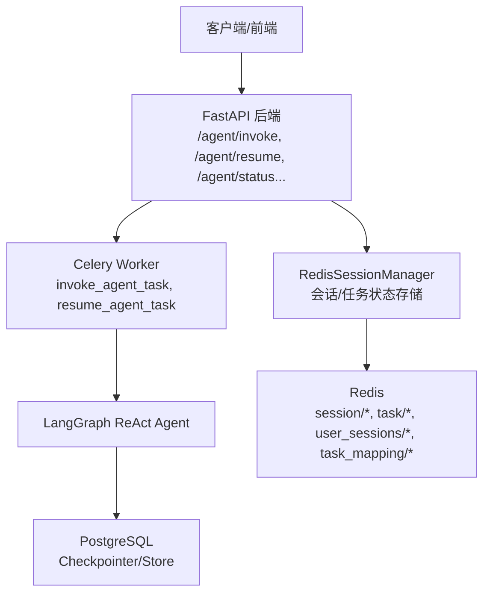
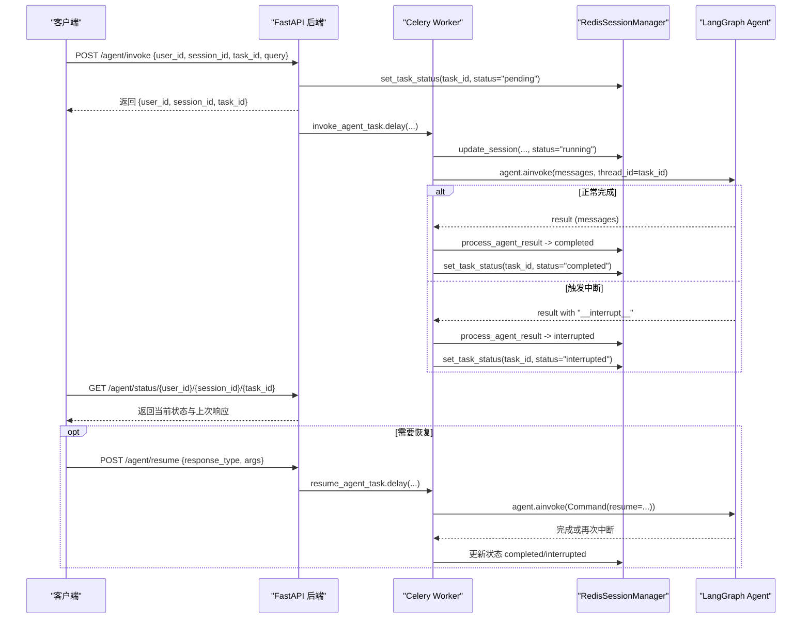
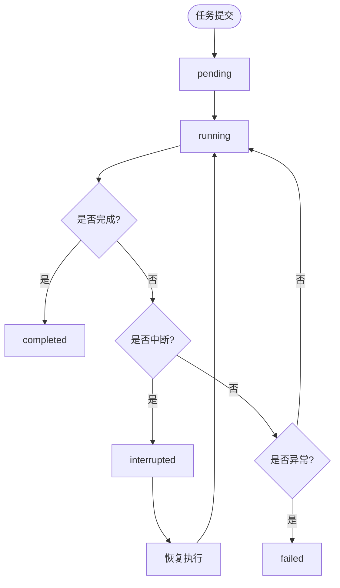
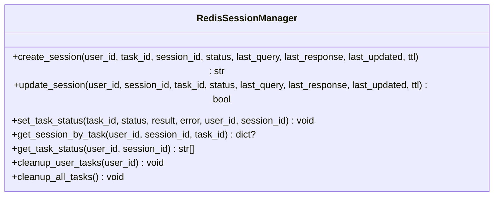
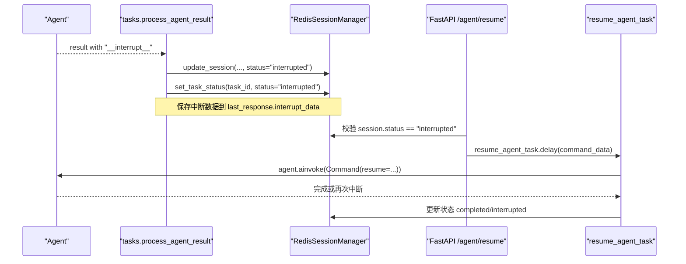
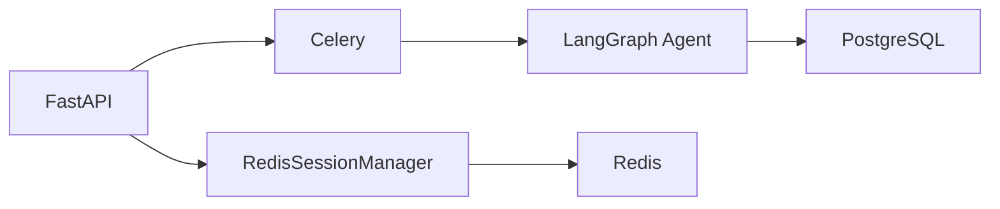

# 任务状态管理

<cite>
**本文引用的文件**
- [01_backendServer.py](file://01_backendServer.py)
- [utils/tasks.py](file://utils/tasks.py)
- [utils/redis.py](file://utils/redis.py)
- [utils/models.py](file://utils/models.py)
- [utils/config.py](file://utils/config.py)
- [README.md](file://README.md)
</cite>

## 目录
1. [简介](#简介)
2. [项目结构](#项目结构)
3. [核心组件](#核心组件)
4. [架构总览](#架构总览)
5. [详细组件分析](#详细组件分析)
6. [依赖关系分析](#依赖关系分析)
7. [性能考虑](#性能考虑)
8. [故障排查指南](#故障排查指南)
9. [结论](#结论)
10. [附录](#附录)

## 简介
本文件围绕“任务状态管理”展开，系统性说明任务生命周期各状态（pending、running、completed、failed、interrupted）的定义与转换规则；阐述基于 Redis 的任务与会话状态存储机制、状态更新与查询接口；解释会话与任务的关联绑定（用户ID、会话ID、任务ID）；详述中断处理流程（__interrupt__）、中断数据结构与恢复执行方式；提供状态监控与查询方法（轮询、事件通知建议）；并给出最佳实践与故障排查指南。

## 项目结构
本项目采用前后端分离的异步任务架构：
- 后端服务（FastAPI）暴露 REST API，负责创建会话、提交任务、恢复中断、查询状态等。
- 任务执行通过 Celery 异步执行，使用 Redis 作为消息代理和状态存储。
- LangGraph 智能体在任务中运行，支持短期记忆（PostgreSQL Checkpointer）与长期记忆（PostgreSQL Store）。
- 前端脚本用于演示交互、状态轮询与中断恢复。

图表来源
- [01_backendServer.py:132-237](file://01_backendServer.py#L132-L237)
- [utils/tasks.py:318-559](file://utils/tasks.py#L318-L559)
- [utils/redis.py:37-493](file://utils/redis.py#L37-L493)

章节来源
- [README.md:1-199](file://README.md#L1-L199)

## 核心组件
- 任务调度与执行
  - invoke_agent_task：接收用户请求，启动智能体执行，更新会话与任务状态。
  - resume_agent_task：恢复被中断的智能体执行，继续推进到完成或再次中断。
- 会话与任务状态管理
  - RedisSessionManager：封装 Redis 操作，维护 session/*、task/*、user_sessions/*、task_mapping/* 等键空间，提供创建、更新、查询、清理能力。
- API 层
  - /agent/invoke：提交任务，设置 pending，返回 task_id。
  - /agent/resume：校验当前为 interrupted，更新为 running，提交恢复任务。
  - /agent/status/{user_id}/{session_id}/{task_id}：查询会话与任务状态。
  - /agent/tasks/{user_id}/{session_id}：获取会话下所有任务的状态列表。
- 数据模型
  - AgentResponse、InterruptResponse、SessionStatusResponse 等定义响应结构与字段。

章节来源
- [utils/tasks.py:318-559](file://utils/tasks.py#L318-L559)
- [utils/redis.py:37-493](file://utils/redis.py#L37-L493)
- [01_backendServer.py:132-344](file://01_backendServer.py#L132-L344)
- [utils/models.py:1-97](file://utils/models.py#L1-L97)

## 架构总览
任务从提交到完成的完整流转如下：
- 客户端调用 /agent/invoke，后端创建或复用会话，设置任务状态为 pending，并通过 Celery 提交异步任务。
- Celery Worker 执行 invoke_agent_task，将会话状态更新为 running，构造智能体输入并执行。
- 智能体可能返回最终结果（completed）或触发 __interrupt__（interrupted），由 process_agent_result 统一处理并更新会话与任务状态。
- 若为 interrupted，客户端调用 /agent/resume 携带 response_type 与 args，后端校验并恢复执行。
- 前端通过 /agent/status 轮询获取最新状态，展示结果或提示中断决策。

图表来源
- [01_backendServer.py:132-237](file://01_backendServer.py#L132-L237)
- [utils/tasks.py:318-559](file://utils/tasks.py#L318-L559)
- [utils/redis.py:392-442](file://utils/redis.py#L392-L442)

## 详细组件分析

### 任务生命周期与状态转换
- 状态集合
  - pending：任务已入队等待执行。
  - running：任务正在执行中。
  - completed：任务成功完成，包含最终结果。
  - failed：任务执行异常失败。
  - interrupted：智能体触发 __interrupt__，需人工介入后恢复。
- 转换规则
  - pending → running：invoke_agent_task 开始执行时更新会话状态为 running。
  - running → completed：process_agent_result 检测到无 __interrupt__ 且执行成功。
  - running → interrupted：process_agent_result 检测到 __interrupt__。
  - running → failed：执行过程中抛出异常，捕获后更新会话与任务状态为 error/failed。
  - interrupted → running：resume_agent_task 恢复执行前，将会话状态更新为 running。
  - running → completed/interrupted：恢复执行后根据结果再次判定。

图表来源
- [utils/tasks.py:318-559](file://utils/tasks.py#L318-L559)
- [utils/redis.py:392-442](file://utils/redis.py#L392-L442)
- [01_backendServer.py:132-237](file://01_backendServer.py#L132-L237)

章节来源
- [utils/tasks.py:194-264](file://utils/tasks.py#L194-L264)
- [utils/tasks.py:318-559](file://utils/tasks.py#L318-L559)
- [01_backendServer.py:132-237](file://01_backendServer.py#L132-L237)

### Redis 中的任务状态存储机制
- 键空间设计
  - session:{user_id}:{session_id}:{task_id}：会话数据，包含 session_id、task_id、status、last_query、last_response、last_updated。
  - task:{task_id}：任务状态数据，包含 task_id、status、result、error、user_id、session_id。
  - user_sessions:{user_id}：用户的所有 session_id:task_id 集合。
  - task_mapping:{user_id}:{session_id}：会话下的所有 task_id 集合。
- 过期策略
  - 会话 TTL：默认 SESSION_TIMEOUT（可动态覆盖）。
  - 任务 TTL：TASK_TTL（默认 3600 秒）。
- 主要操作
  - create_session：创建会话并建立映射。
  - update_session：增量更新会话字段。
  - set_task_status：写入任务状态并绑定到用户与会话。
  - get_session_by_task：按用户/会话/任务读取会话详情。
  - get_task_status：批量获取会话下任务的状态列表。
  - cleanup_user_tasks/cleanup_all_tasks：清理过期或无效数据，保持一致性。

图表来源
- [utils/redis.py:65-144](file://utils/redis.py#L65-L144)
- [utils/redis.py:392-442](file://utils/redis.py#L392-L442)
- [utils/redis.py:246-341](file://utils/redis.py#L246-L341)

章节来源
- [utils/redis.py:37-493](file://utils/redis.py#L37-L493)

### 会话状态与任务状态的关联关系
- 绑定关系
  - 每个会话可包含多个任务（多轮对话或多子任务）。
  - user_sessions:{user_id} 记录该用户的所有 session_id:task_id 组合。
  - task_mapping:{user_id}:{session_id} 记录该会话下的所有 task_id。
  - set_task_status 在写入任务状态时，自动将 task_id 加入对应 mapping，便于查询。
- 查询接口
  - /agent/tasks/{user_id}/{session_id}：返回 task_id:status 列表。
  - /agent/status/{user_id}/{session_id}/{task_id}：返回具体会话与任务的详细信息。
- 失效清理
  - 查询前会调用 cleanup_user_tasks 清理过期条目，确保返回有效数据。

章节来源
- [utils/redis.py:94-103](file://utils/redis.py#L94-L103)
- [utils/redis.py:412-415](file://utils/redis.py#L412-L415)
- [utils/redis.py:427-442](file://utils/redis.py#L427-L442)
- [01_backendServer.py:294-344](file://01_backendServer.py#L294-L344)

### 中断处理机制（__interrupt__）
- 触发点
  - 智能体在执行过程中调用 interrupt，返回带有 __interrupt__ 的结果。
- 处理流程
  - process_agent_result 检测 __interrupt__，提取中断数据（如 action_request、description 等），构造 AgentResponse(status="interrupted", interrupt_data=...)。
  - 更新会话状态为 interrupted，并写入任务状态为 interrupted。
- 恢复执行
  - 客户端调用 /agent/resume，携带 response_type（accept/reject/edit/response）与可选 args。
  - 后端校验当前会话状态必须为 interrupted，否则拒绝。
  - resume_agent_task 使用 Command(resume=command_data) 恢复执行，继续推进至完成或再次中断。
- 中断数据结构
  - 典型字段包括 description、action_request（含 action、args）等，用于前端展示与用户决策。

图表来源
- [utils/tasks.py:194-264](file://utils/tasks.py#L194-L264)
- [utils/tasks.py:454-559](file://utils/tasks.py#L454-L559)
- [01_backendServer.py:175-237](file://01_backendServer.py#L175-L237)

章节来源
- [utils/tasks.py:194-264](file://utils/tasks.py#L194-L264)
- [utils/tasks.py:454-559](file://utils/tasks.py#L454-L559)
- [01_backendServer.py:175-237](file://01_backendServer.py#L175-L237)

### 状态监控与查询方法
- 轮询查询
  - 前端周期性调用 /agent/status/{user_id}/{session_id}/{task_id} 获取最新状态与上次响应。
  - 当状态为 interrupted，显示中断信息并引导用户选择 accept/reject/edit/response。
  - 当状态为 completed，展示最终结果；为 error，展示错误信息。
- 批量查询
  - /agent/tasks/{user_id}/{session_id} 返回该会话下所有任务的状态列表，便于概览。
- 事件通知（建议）
  - 当前实现以轮询为主。可扩展方案：
    - 使用 Redis Pub/Sub 发布状态变更事件，客户端订阅特定 task_id 的事件通道。
    - 或使用 WebSocket 推送状态变化，减少轮询开销。

章节来源
- [01_backendServer.py:294-344](file://01_backendServer.py#L294-L344)
- [utils/redis.py:427-442](file://utils/redis.py#L427-L442)

### 最佳实践
- 状态一致性
  - 每次状态更新都设置 TTL，避免脏数据长期残留。
  - 查询前执行 cleanup_user_tasks，保证返回数据的有效性。
- 幂等性
  - 任务 ID 唯一，重复提交应识别并避免重复执行。
- 超时与重试
  - 合理设置 TASK_TTL 与 SESSION_TIMEOUT，防止资源泄漏。
  - 对网络或外部依赖调用增加重试与熔断策略。
- 可观测性
  - 记录关键状态转换日志，便于问题定位。
  - 结合 Prometheus/Grafana 采集任务耗时、成功率等指标。
- 安全与隔离
  - 严格校验 user_id/session_id/task_id 的归属关系，防止越权访问。
  - 对敏感参数进行脱敏与权限控制。

[本节为通用指导，不直接分析具体文件]

## 依赖关系分析
- 模块耦合
  - FastAPI 依赖 RedisSessionManager 进行状态读写。
  - Celery Worker 依赖 RedisSessionManager 与 LangGraph Agent。
  - Agent 依赖 PostgreSQL Checkpointer/Store 进行短期与长期记忆。
- 外部依赖
  - Redis：消息代理与状态存储。
  - PostgreSQL：检查点与长期记忆持久化。
  - Celery：异步任务队列。

图表来源
- [01_backendServer.py:132-237](file://01_backendServer.py#L132-L237)
- [utils/tasks.py:318-559](file://utils/tasks.py#L318-L559)
- [utils/redis.py:37-493](file://utils/redis.py#L37-L493)

章节来源
- [utils/config.py:1-34](file://utils/config.py#L1-L34)

## 性能考虑
- 连接池
  - PostgreSQL 使用 AsyncConnectionPool，配置 min_size/max_size，提高并发能力。
- 缓存与过期
  - Redis 会话与任务均设置 TTL，定期清理无效数据，降低内存占用。
- 异步执行
  - 使用 Celery 将智能体执行放入后台任务，提升 API 响应速度。
- 消息修剪
  - trimmed_messages_hook 限制消息 token 数量，控制上下文大小，降低 LLM 调用成本。
- 批量查询优化
  - get_task_status 先获取 task_ids，再逐个查询状态，注意在高并发场景下可引入缓存或聚合接口。

[本节为通用指导，不直接分析具体文件]

## 故障排查指南
- 常见问题
  - 会话不存在：检查 user_id/session_id/task_id 是否正确，确认是否已创建会话。
  - 无法恢复非中断会话：/agent/resume 要求当前状态为 interrupted，否则会拒绝。
  - 任务状态不一致：检查 Redis 键是否存在及 TTL 是否过期，必要时执行清理。
  - 长时间 running：检查 Celery Worker 是否正常运行，查看任务日志。
- 诊断步骤
  - 使用 /agent/tasks/{user_id}/{session_id} 获取任务列表与状态。
  - 使用 /agent/status/{user_id}/{session_id}/{task_id} 查看会话详情与上次响应。
  - 检查 Redis 键空间：session:*、task:*、user_sessions:*、task_mapping:*。
  - 查看应用日志 logfile/app.log，关注状态转换与异常堆栈。
- 恢复策略
  - 清理过期数据：调用 cleanup_user_tasks 或手动删除无效键。
  - 重启 Celery Worker：确保任务队列消费正常。
  - 重新提交任务：若任务不可恢复，生成新 task_id 重新发起。

章节来源
- [01_backendServer.py:175-237](file://01_backendServer.py#L175-L237)
- [utils/redis.py:246-341](file://utils/redis.py#L246-L341)
- [utils/tasks.py:420-446](file://utils/tasks.py#L420-L446)

## 结论
本项目通过 FastAPI + Celery + Redis + LangGraph 构建了完整的异步任务与状态管理体系。任务状态在 Redis 中以清晰的键空间组织，配合会话与任务的映射关系，实现了多用户、多会话、多任务的高效管理与查询。中断机制通过 __interrupt__ 与恢复接口形成闭环，支持人类在环（HITL）的灵活干预。建议在现有基础上引入事件推送与更完善的监控告警，以提升用户体验与系统可观测性。

[本节为总结，不直接分析具体文件]

## 附录
- API 参考
  - POST /agent/invoke：提交任务，返回 task_id。
  - POST /agent/resume：恢复中断，携带 response_type 与 args。
  - GET /agent/status/{user_id}/{session_id}/{task_id}：查询会话与任务状态。
  - GET /agent/tasks/{user_id}/{session_id}：获取会话下所有任务状态列表。
  - GET /system/info：系统会话总数与活跃用户。
- 数据模型
  - AgentResponse：包含 session_id、task_id、status、timestamp、message、result、interrupt_data。
  - InterruptResponse：包含 user_id、session_id、task_id、response_type、args。
  - SessionStatusResponse：包含 user_id、session_id、task_id、status、message、last_query、last_updated、last_response。

章节来源
- [01_backendServer.py:132-344](file://01_backendServer.py#L132-L344)
- [utils/models.py:1-97](file://utils/models.py#L1-L97)