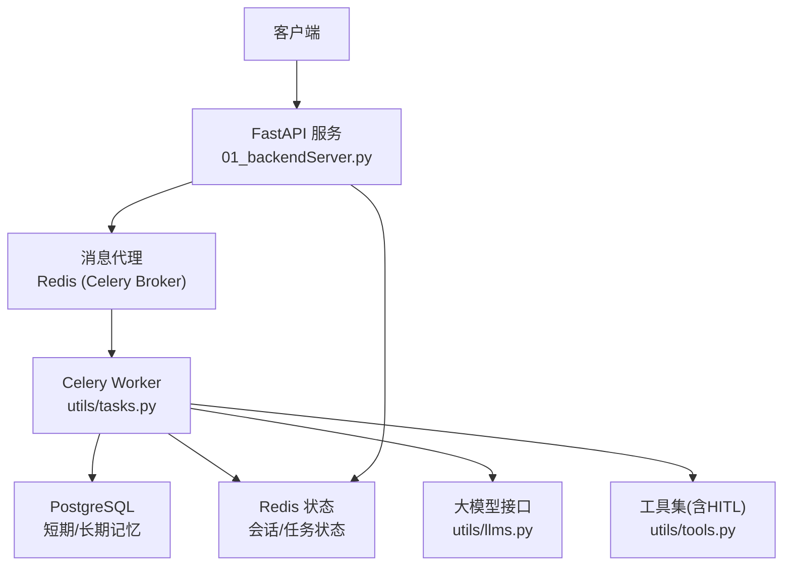
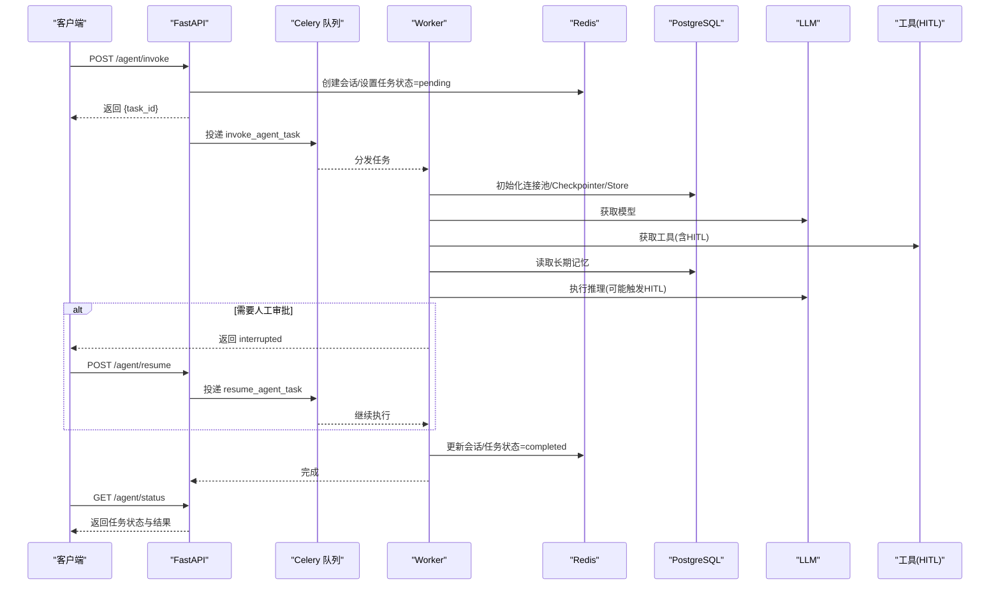
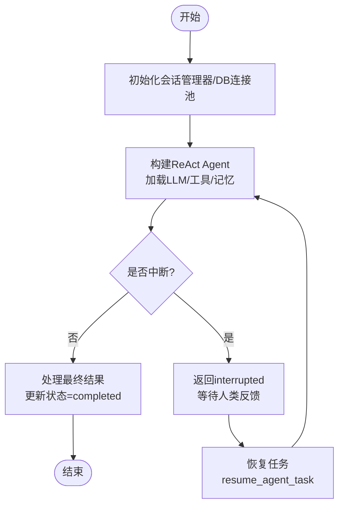
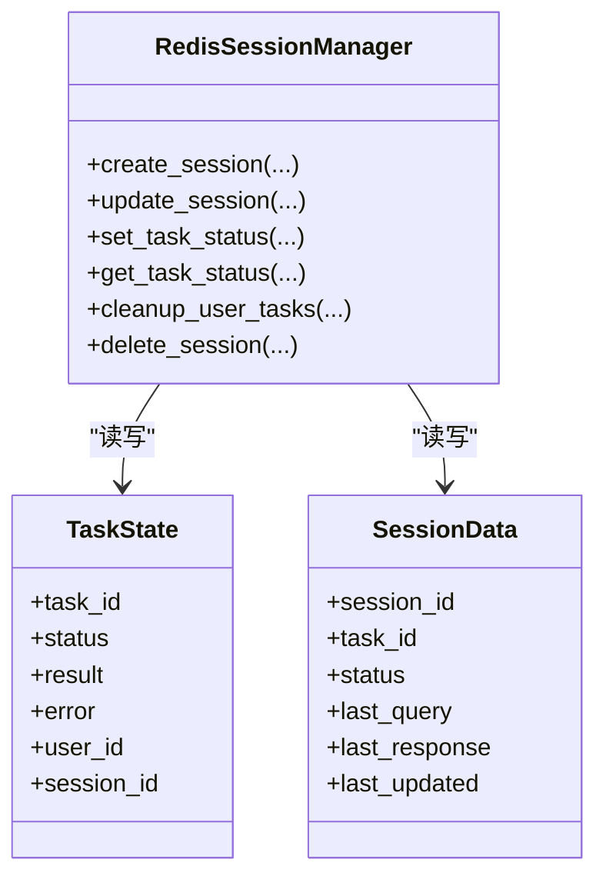
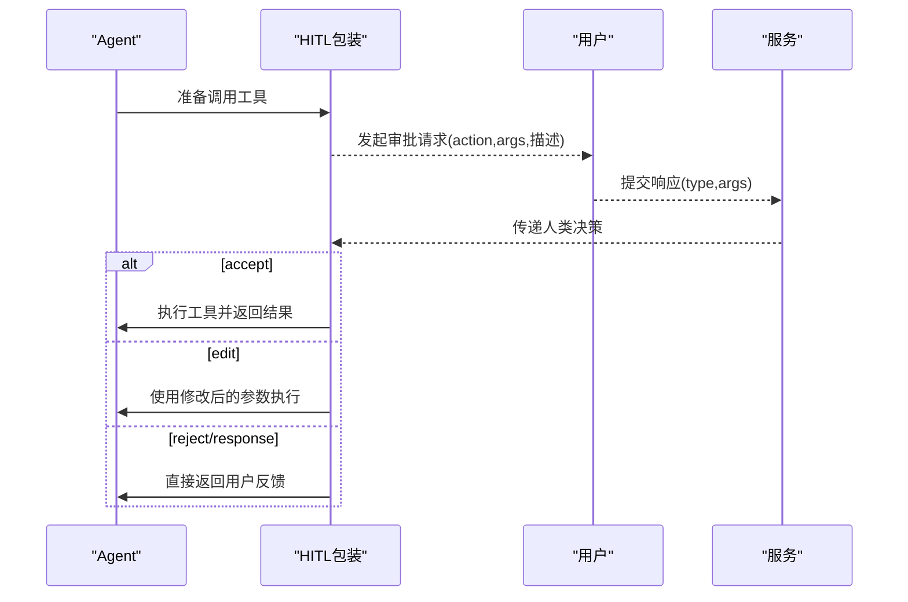
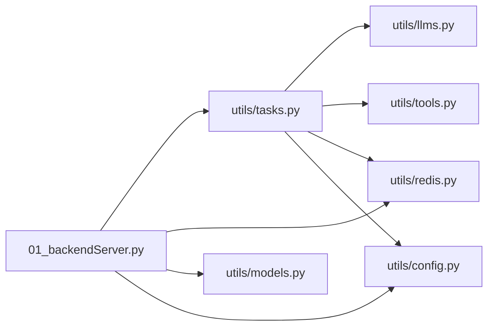

# 任务调度系统

<cite>
**本文引用的文件**
- [01_backendServer.py](file://01_backendServer.py)
- [utils/tasks.py](file://utils/tasks.py)
- [utils/config.py](file://utils/config.py)
- [utils/redis.py](file://utils/redis.py)
- [utils/models.py](file://utils/models.py)
- [utils/tools.py](file://utils/tools.py)
- [utils/llms.py](file://utils/llms.py)
- [README.md](file://README.md)
</cite>

## 目录
1. [简介](#简介)
2. [项目结构](#项目结构)
3. [核心组件](#核心组件)
4. [架构总览](#架构总览)
5. [详细组件分析](#详细组件分析)
6. [依赖关系分析](#依赖关系分析)
7. [性能与并发特性](#性能与并发特性)
8. [配置与调优](#配置与调优)
9. [监控、日志与故障排查](#监控日志与故障排查)
10. [结论](#结论)

## 简介
本系统基于 FastAPI 提供对外 API，使用 Celery + Redis 作为异步任务队列，结合 LangGraph 的 ReAct Agent、PostgreSQL（短期记忆 Checkpointer 与长期记忆 Store）以及 Redis（会话状态与任务状态），实现“提交任务—异步执行—结果持久化—可恢复”的完整流程。支持 Human-in-the-Loop（HITL）人工审查工具调用，具备多用户、多会话、多任务管理能力，并提供查询接口以轮询任务状态与结果。

## 项目结构
- 后端服务入口：FastAPI 应用，定义 REST 接口，负责接收请求、创建/更新会话、投递 Celery 任务、返回 task_id。
- 任务模块：Celery 任务定义，封装异步执行逻辑，管理数据库连接池、Agent 构建、消息处理、结果写入与状态更新。
- 存储层：Redis 用于会话与任务状态；PostgreSQL 用于短期记忆（checkpointer）与长期记忆（store）。
- 模型与工具：Pydantic 数据模型统一入参出参；工具集包含自定义工具与 MCP 工具，并支持 HITL。
- 配置中心：集中管理数据库、Redis、Celery、LLM 等配置项。

图表来源
- [01_backendServer.py:133-173](file://01_backendServer.py#L133-L173)
- [utils/tasks.py:44-63](file://utils/tasks.py#L44-L63)
- [utils/tasks.py:319-451](file://utils/tasks.py#L319-L451)
- [utils/redis.py:37-490](file://utils/redis.py#L37-L490)
- [utils/llms.py:70-138](file://utils/llms.py#L70-L138)
- [utils/tools.py:121-175](file://utils/tools.py#L121-L175)

章节来源
- [01_backendServer.py:1-424](file://01_backendServer.py#L1-L424)
- [utils/tasks.py:1-564](file://utils/tasks.py#L1-L564)
- [utils/config.py:1-34](file://utils/config.py#L1-L34)
- [utils/redis.py:1-493](file://utils/redis.py#L1-L493)
- [utils/models.py:1-97](file://utils/models.py#L1-L97)
- [utils/tools.py:1-175](file://utils/tools.py#L1-L175)
- [utils/llms.py:1-151](file://utils/llms.py#L1-L151)
- [README.md:1-199](file://README.md#L1-L199)

## 核心组件
- FastAPI 服务：暴露 /agent/invoke、/agent/resume、/agent/status 等接口，负责会话生命周期管理与任务投递。
- Celery 任务：invoke_agent_task、resume_agent_task 两个任务分别处理首次调用与中断恢复。
- Redis 会话管理器：维护 user/session/task 三维状态，提供 TTL、清理、查询能力。
- PostgreSQL 存储：短期记忆（checkpointer）用于节点状态恢复；长期记忆（store）用于用户偏好等持久化。
- LLM 适配：统一初始化不同厂商模型，支持 OpenAI、通义千问、本地 Ollama 等。
- 工具与 HITL：为工具调用增加人工审批环节，支持 accept/edit/reject/response 四种响应类型。

章节来源
- [01_backendServer.py:133-237](file://01_backendServer.py#L133-L237)
- [utils/tasks.py:319-559](file://utils/tasks.py#L319-L559)
- [utils/redis.py:37-490](file://utils/redis.py#L37-L490)
- [utils/llms.py:70-138](file://utils/llms.py#L70-L138)
- [utils/tools.py:37-118](file://utils/tools.py#L37-L118)

## 架构总览
系统采用“API 快速返回 + 后台异步执行”的模式：
- 客户端调用 /agent/invoke，服务端立即返回 task_id，并在 Redis 中记录任务状态为 pending。
- Celery Worker 消费任务，初始化数据库连接池、构建 Agent、读取长期记忆、执行推理与工具调用，必要时触发 HITL。
- 任务完成后，将最终结果或中断信息写入 Redis，并更新会话与任务状态。
- 客户端通过 /agent/status 轮询任务状态，直到 completed/interrupted/error。

图表来源
- [01_backendServer.py:133-237](file://01_backendServer.py#L133-L237)
- [utils/tasks.py:319-559](file://utils/tasks.py#L319-L559)
- [utils/redis.py:37-490](file://utils/redis.py#L37-L490)
- [utils/tools.py:37-118](file://utils/tools.py#L37-L118)

## 详细组件分析

### 任务定义与执行（Celery）
- 任务入口：invoke_agent_task 负责首次调用；resume_agent_task 负责恢复被中断的任务。
- 执行流程：
  - 初始化 Redis 会话管理器，更新会话状态为 running。
  - 建立 PostgreSQL 连接池，初始化 checkpointer 与 store。
  - 获取 LLM 与工具列表，构造 ReAct Agent。
  - 读取用户长期记忆并注入 system prompt。
  - 调用 agent.ainvoke 执行推理，解析消息，处理中断或最终结果。
  - 更新会话与任务状态，返回标准化响应。
- 错误处理：捕获异常，更新会话状态为 error，任务状态为 failed，并关闭资源。

图表来源
- [utils/tasks.py:319-451](file://utils/tasks.py#L319-L451)
- [utils/tasks.py:455-559](file://utils/tasks.py#L455-L559)

章节来源
- [utils/tasks.py:319-559](file://utils/tasks.py#L319-L559)

### 任务分发与状态管理（Redis）
- 键空间设计：
  - session:{user_id}:{session_id}:{task_id}：会话详情（status、last_query、last_response、last_updated）。
  - user_sessions:{user_id}：集合，记录该用户的所有 session_id:task_id。
  - task_mapping:{user_id}:{session_id}：集合，记录该会话下的所有 task_id。
  - task:{task_id}：任务状态（status、result、error、user_id、session_id）。
- 关键操作：
  - create_session/update_session：创建/更新会话，维护 TTL。
  - set_task_status/get_task_status：设置/查询任务状态，绑定到用户与会话。
  - cleanup_user_tasks/cleanup_all_tasks：定期清理过期数据，保持一致性。
- 生命周期：idle → pending → running → completed/interrupted/error。

图表来源
- [utils/redis.py:37-490](file://utils/redis.py#L37-L490)

章节来源
- [utils/redis.py:37-490](file://utils/redis.py#L37-L490)

### 人机协同（HITL）与工具链
- 工具包装：add_human_in_the_loop 为任意工具添加中断审批，支持 accept/edit/reject/response。
- 工具来源：
  - 自定义工具：book_hotel、multiply。
  - MCP 工具：从外部服务动态获取，并统一包装 HITL。
- 交互流程：当 Agent 决定调用工具时，进入中断点，前端收集人类决策后通过 /agent/resume 恢复执行。

图表来源
- [utils/tools.py:37-118](file://utils/tools.py#L37-L118)
- [01_backendServer.py:176-237](file://01_backendServer.py#L176-L237)

章节来源
- [utils/tools.py:37-175](file://utils/tools.py#L37-L175)
- [01_backendServer.py:176-237](file://01_backendServer.py#L176-L237)

### 数据模型与接口契约
- 请求模型：
  - AgentRequest：user_id、session_id、task_id、query、system_message。
  - InterruptResponse：user_id、session_id、task_id、response_type、args。
  - LongMemRequest：user_id、memory_info。
- 响应模型：
  - AgentResponse：session_id、task_id、status、timestamp、message/result/interrupt_data。
  - SystemInfoResponse、SessionInfoResponse、TaskInfoResponse、ActiveSessionInfoResponse、SessionStatusResponse。

章节来源
- [utils/models.py:1-97](file://utils/models.py#L1-L97)

## 依赖关系分析
- 服务层依赖：
  - FastAPI 依赖 utils.tasks（Celery 任务）、utils.redis（会话管理）、utils.models（数据模型）、utils.config（配置）。
- 任务层依赖：
  - Celery 任务依赖 utils.llms（模型初始化）、utils.tools（工具与 HITL）、utils.redis（状态更新）、utils.config（配置）。
- 存储依赖：
  - PostgreSQL：短期记忆（AsyncPostgresSaver）与长期记忆（AsyncPostgresStore）。
  - Redis：会话与任务状态、Celery Broker。

图表来源
- [01_backendServer.py:1-424](file://01_backendServer.py#L1-L424)
- [utils/tasks.py:1-564](file://utils/tasks.py#L1-L564)
- [utils/redis.py:1-493](file://utils/redis.py#L1-L493)
- [utils/models.py:1-97](file://utils/models.py#L1-L97)
- [utils/config.py:1-34](file://utils/config.py#L1-L34)
- [utils/llms.py:1-151](file://utils/llms.py#L1-L151)
- [utils/tools.py:1-175](file://utils/tools.py#L1-L175)

章节来源
- [01_backendServer.py:1-424](file://01_backendServer.py#L1-L424)
- [utils/tasks.py:1-564](file://utils/tasks.py#L1-L564)
- [utils/redis.py:1-493](file://utils/redis.py#L1-L493)
- [utils/models.py:1-97](file://utils/models.py#L1-L97)
- [utils/config.py:1-34](file://utils/config.py#L1-L34)
- [utils/llms.py:1-151](file://utils/llms.py#L1-L151)
- [utils/tools.py:1-175](file://utils/tools.py#L1-L175)

## 性能与并发特性
- 异步执行：FastAPI 非阻塞，Celery Worker 独立进程消费任务，避免阻塞请求线程。
- 连接池：PostgreSQL 使用 AsyncConnectionPool，控制最小/最大连接数，减少连接开销。
- 会话与任务 TTL：Redis 键设置过期时间，自动清理无效数据，降低内存占用。
- 消息序列化：Celery 使用 JSON 序列化，跨语言兼容性好，便于扩展。
- 并发控制：
  - 当前代码未显式限制 Worker 并发度，可通过 Celery worker 启动参数（如 -c）调整。
  - 建议根据硬件与下游服务容量合理设置并发，避免过载。
- 负载均衡：
  - 单 Broker 场景下，多个 Worker 实例共享队列，天然具备水平扩展能力。
  - 可按业务维度拆分队列（如按用户/会话隔离）以实现更细粒度负载分配。

[本节为通用指导，不直接分析具体文件]

## 配置与调优
- 关键配置项（位于 utils/config.py）：
  - 日志：LOG_FILE、MAX_BYTES、BACKUP_COUNT。
  - 数据库：DB_URI、MIN_SIZE、MAX_SIZE。
  - Redis：REDIS_HOST、REDIS_PORT、REDIS_DB、SESSION_TIMEOUT、TTL。
  - Celery：CELERY_BROKER_URL、TASK_TTL。
  - LLM：LLM_TYPE（openai/qwen/oneapi/ollama）。
  - 服务：HOST、PORT。
- 调优建议：
  - 数据库连接池：根据并发量调整 MIN_SIZE/MAX_SIZE，观察连接耗尽与超时情况。
  - Redis TTL：根据业务会话活跃周期调整 TTL，平衡内存与可用性。
  - Celery Worker：根据 CPU/内存与下游延迟调整并发度与重试策略。
  - LLM 超时与重试：在 llms.py 中设置 timeout/max_retries，提升鲁棒性。
  - 日志轮转：合理设置 MAX_BYTES/BACKUP_COUNT，避免磁盘占满。

章节来源
- [utils/config.py:1-34](file://utils/config.py#L1-L34)
- [utils/llms.py:95-102](file://utils/llms.py#L95-L102)

## 监控、日志与故障排查
- 日志：
  - 各模块均使用 ConcurrentRotatingFileHandler 输出到 logfile/app.log，便于集中查看。
  - 关键路径：任务创建、状态变更、错误堆栈、HITL 交互。
- 监控指标（建议）：
  - 任务队列长度、Worker 空闲率、任务平均耗时、失败率。
  - Redis 键数量与内存使用、PostgreSQL 连接池使用率。
- 常见故障：
  - 无法连接 Redis/PostgreSQL：检查网络、端口、认证信息与连接池配置。
  - 任务长时间 pending：检查 Worker 是否运行、队列是否堆积、是否有死信。
  - HITL 无响应：确认前端是否正确回调 /agent/resume，状态是否为 interrupted。
  - 模型调用失败：检查 API Key、Base URL、超时与重试配置。
- 排查步骤：
  - 查看日志定位错误阶段（API→Broker→Worker→DB/LLM）。
  - 通过 /agent/status 轮询任务状态，结合 Redis 中的 task 键核对。
  - 对长耗时任务启用分段日志，定位瓶颈。

章节来源
- [utils/tasks.py:21-40](file://utils/tasks.py#L21-L40)
- [01_backendServer.py:21-40](file://01_backendServer.py#L21-L40)
- [utils/redis.py:13-32](file://utils/redis.py#L13-L32)
- [utils/tools.py:14-34](file://utils/tools.py#L14-L34)
- [utils/llms.py:8-28](file://utils/llms.py#L8-L28)

## 结论
本任务调度系统以 FastAPI 为入口、Celery+Redis 为异步执行引擎，结合 LangGraph 的 ReAct Agent 与 PostgreSQL 的记忆能力，实现了可扩展、可恢复、可观测的智能体任务调度方案。通过 HITL 机制，系统在自动化与人工干预之间取得平衡；通过 Redis 的状态管理与 TTL，保障了多用户多会话的一致性。生产部署时，建议重点优化 Worker 并发、数据库连接池、Redis TTL 与日志轮转策略，并结合监控指标持续迭代。