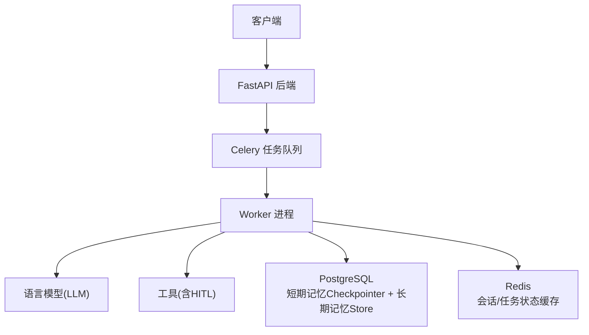
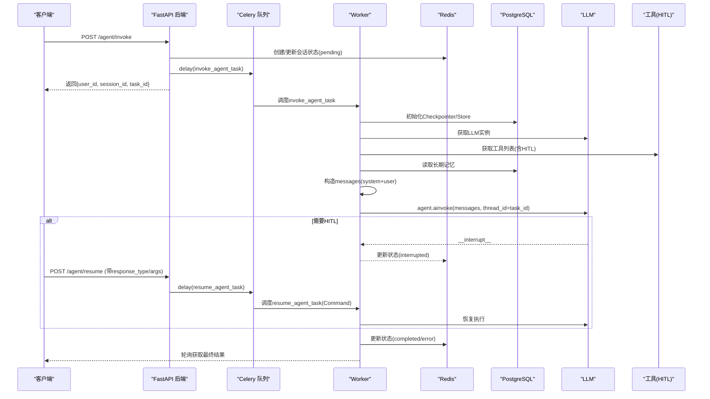
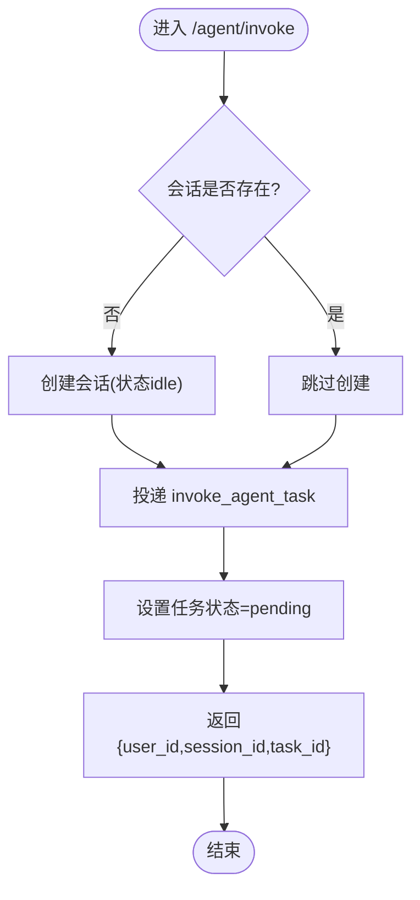
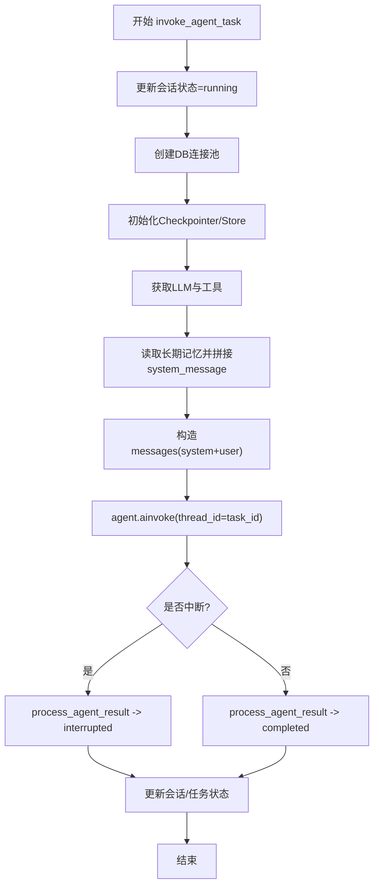
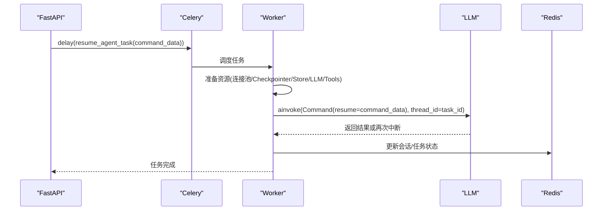
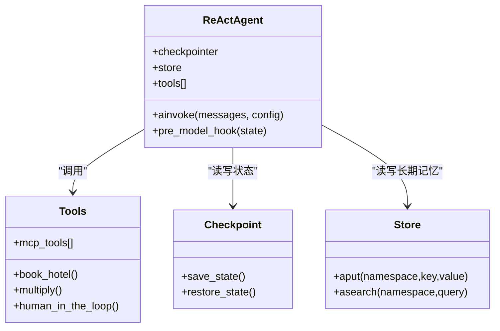
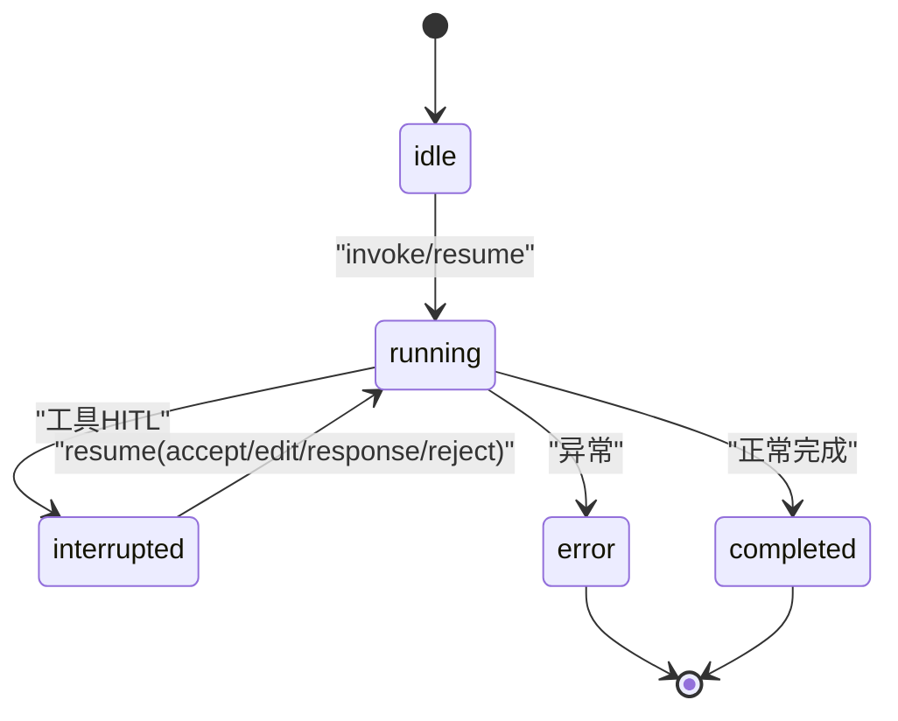
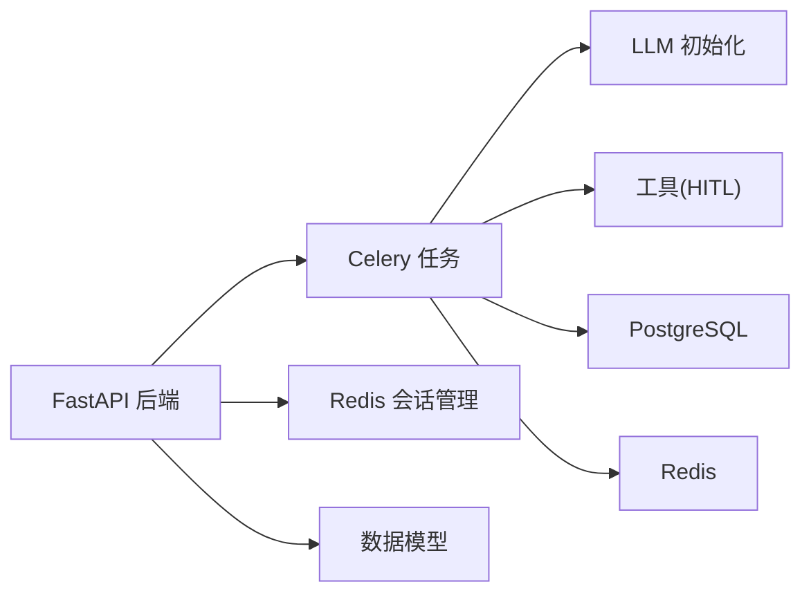

# 异步执行流程

<cite>
**本文引用的文件**
- [01_backendServer.py](file://01_backendServer.py)
- [utils/tasks.py](file://utils/tasks.py)
- [utils/redis.py](file://utils/redis.py)
- [utils/config.py](file://utils/config.py)
- [utils/models.py](file://utils/models.py)
- [utils/tools.py](file://utils/tools.py)
- [utils/llms.py](file://utils/llms.py)
- [README.md](file://README.md)
</cite>

## 目录
1. [简介](#简介)
2. [项目结构](#项目结构)
3. [核心组件](#核心组件)
4. [架构总览](#架构总览)
5. [详细组件分析](#详细组件分析)
6. [依赖关系分析](#依赖关系分析)
7. [性能考量](#性能考量)
8. [故障排查指南](#故障排查指南)
9. [结论](#结论)
10. [附录](#附录)

## 简介
本文件面向“Agent任务异步执行流程”的完整说明，覆盖从任务提交到结果返回的全链路。重点解释两个核心任务：
- invoke_agent_task：首次提交智能体任务，构建ReAct Agent、加载短期与长期记忆、调用模型与工具，并处理中断或完成。
- resume_agent_task：恢复被中断的任务，基于LangGraph检查点继续执行，支持人类在环（HITL）反馈。

同时涵盖会话状态跟踪、任务状态管理、数据库连接池管理、Redis会话管理器、日志与监控等工程化要点。

## 项目结构
- 后端服务入口：FastAPI应用提供REST接口，负责接收请求、创建/恢复任务、维护会话与任务状态。
- 异步任务：Celery任务封装invoke_agent_task与resume_agent_task，使用PostgreSQL作为短期记忆检查点与长期记忆存储，Redis用于会话与任务状态缓存。
- 工具与LLM：统一抽象工具注册与人工审查（HITL），多厂商大模型接入。
- 配置与数据模型：集中配置项与Pydantic数据模型，保证前后端契约一致。

图表来源
- [01_backendServer.py:84-130](file://01_backendServer.py#L84-L130)
- [utils/tasks.py:319-451](file://utils/tasks.py#L319-L451)
- [utils/tasks.py:455-559](file://utils/tasks.py#L455-L559)
- [utils/redis.py:37-493](file://utils/redis.py#L37-L493)
- [utils/llms.py:70-138](file://utils/llms.py#L70-L138)
- [utils/tools.py:37-175](file://utils/tools.py#L37-L175)

章节来源
- [README.md:1-199](file://README.md#L1-L199)

## 核心组件
- FastAPI后端：暴露/invoke与/resume等接口，初始化资源（Redis会话管理器、PostgreSQL连接池、短期记忆Checkpointer、长期记忆Store）。
- Celery任务：
  - invoke_agent_task：创建ReAct Agent，组装消息，读取长期记忆，调用模型与工具，处理中断/完成，更新会话与任务状态。
  - resume_agent_task：基于thread_id恢复执行，注入Command进行HITL反馈。
- Redis会话管理器：维护用户-会话-任务的多维状态，提供查询、更新、清理能力。
- 工具与HITL：为工具添加人工审查，支持accept/reject/edit/response四种类型。
- LLM适配：统一获取不同厂商的Chat模型与Embedding。

章节来源
- [01_backendServer.py:84-130](file://01_backendServer.py#L84-L130)
- [utils/tasks.py:319-451](file://utils/tasks.py#L319-L451)
- [utils/tasks.py:455-559](file://utils/tasks.py#L455-L559)
- [utils/redis.py:37-493](file://utils/redis.py#L37-L493)
- [utils/tools.py:37-175](file://utils/tools.py#L37-L175)
- [utils/llms.py:70-138](file://utils/llms.py#L70-L138)

## 架构总览
下图展示一次完整的异步执行流程：前端调用后端接口，后端将任务投递至Celery；Worker中创建ReAct Agent，通过PostgreSQL短期记忆检查点与长期记忆Store维持上下文；工具调用可触发HITL中断；最终结果写回Redis并返回给前端轮询。

图表来源
- [01_backendServer.py:133-173](file://01_backendServer.py#L133-L173)
- [01_backendServer.py:176-237](file://01_backendServer.py#L176-L237)
- [utils/tasks.py:319-451](file://utils/tasks.py#L319-L451)
- [utils/tasks.py:455-559](file://utils/tasks.py#L455-L559)
- [utils/redis.py:37-493](file://utils/redis.py#L37-L493)

## 详细组件分析

### 任务提交与恢复接口（FastAPI）
- /agent/invoke
  - 校验/创建会话，设置任务状态为pending，投递invoke_agent_task。
  - 立即返回task_id供前端轮询。
- /agent/resume
  - 校验会话存在且状态为interrupted，更新为running，构造command_data并投递resume_agent_task。
  - 设置任务状态为pending。

图表来源
- [01_backendServer.py:133-173](file://01_backendServer.py#L133-L173)

章节来源
- [01_backendServer.py:133-173](file://01_backendServer.py#L133-L173)
- [01_backendServer.py:176-237](file://01_backendServer.py#L176-L237)

### invoke_agent_task：首次执行流程
- 参数处理：user_id、session_id、task_id、query、system_prompt。
- 会话状态：更新为running，记录last_query与时间戳。
- 数据库连接池：每次任务内创建AsyncConnectionPool，确保隔离与资源释放。
- 短期记忆：初始化AsyncPostgresSaver(checkpointer)，以thread_id=task_id维护节点状态。
- 长期记忆：通过store读取用户命名空间下的记忆内容，拼接到system_message。
- ReAct Agent：create_react_agent(model, tools, pre_model_hook, checkpointer, store)。
- 消息预处理：trimmed_messages_hook限制消息token数量，避免上下文过大。
- 执行与结果：agent.ainvoke后解析消息，process_agent_result统一处理中断/完成，filter_last_human_conversation筛选最近一轮对话。
- 状态更新：根据结果更新会话与任务状态（completed/interrupted/error）。

图表来源
- [utils/tasks.py:319-451](file://utils/tasks.py#L319-L451)

章节来源
- [utils/tasks.py:319-451](file://utils/tasks.py#L319-L451)

### resume_agent_task：恢复执行流程
- 参数：user_id、session_id、task_id、command_data（包含response_type与可选args）。
- 资源准备：同invoke流程，创建连接池、checkpointer、store、LLM与工具。
- 恢复执行：使用Command(resume=command_data)传入agent.ainvoke，基于thread_id恢复LangGraph状态。
- 结果处理：与invoke一致，统一处理中断/完成，更新状态。

图表来源
- [utils/tasks.py:455-559](file://utils/tasks.py#L455-L559)

章节来源
- [utils/tasks.py:455-559](file://utils/tasks.py#L455-L559)

### ReAct智能体的创建与调用
- 工具注册：get_tools()聚合自定义工具与MCP工具，并通过add_human_in_the_loop包装，实现HITL。
- 消息预处理：trimmed_messages_hook对messages做token裁剪，策略为保留最近消息。
- 系统提示词：默认system_message可由前端传入；若存在长期记忆则自动拼接。
- 执行：create_react_agent装配model、tools、hook、checkpointer、store；ainvoke时传入thread_id绑定会话上下文。

图表来源
- [utils/tools.py:37-175](file://utils/tools.py#L37-L175)
- [utils/tasks.py:367-397](file://utils/tasks.py#L367-L397)
- [utils/tasks.py:492-505](file://utils/tasks.py#L492-L505)

章节来源
- [utils/tools.py:37-175](file://utils/tools.py#L37-L175)
- [utils/tasks.py:367-397](file://utils/tasks.py#L367-L397)
- [utils/tasks.py:492-505](file://utils/tasks.py#L492-L505)

### 状态更新机制（会话与任务）
- 会话状态：idle/running/interrupted/completed/error，由RedisSessionManager维护，键格式session:user_id:session_id:task_id。
- 任务状态：set_task_status持久化task_id与status，并绑定到user_id与session_id映射。
- 清理策略：cleanup_user_tasks/cleanup_all_tasks定期清理过期或无效条目，保持一致性。
- 查询接口：/agent/status、/agent/tasks等提供实时状态查询。

图表来源
- [utils/redis.py:65-144](file://utils/redis.py#L65-L144)
- [utils/redis.py:392-442](file://utils/redis.py#L392-L442)

章节来源
- [utils/redis.py:65-144](file://utils/redis.py#L65-L144)
- [utils/redis.py:392-442](file://utils/redis.py#L392-L442)

### 短期记忆检查点与长期记忆存储
- 短期记忆：AsyncPostgresSaver以thread_id为单位保存节点状态，支持断点续跑与HITL恢复。
- 长期记忆：AsyncPostgresStore按namespace=(memories,user_id)存储用户偏好等信息，读取后拼入system_message。
- 写入长期记忆：/agent/write/longterm接口支持外部写入。

章节来源
- [01_backendServer.py:94-110](file://01_backendServer.py#L94-L110)
- [utils/tasks.py:87-134](file://utils/tasks.py#L87-L134)
- [01_backendServer.py:44-80](file://01_backendServer.py#L44-L80)

### 数据库连接池管理
- 服务启动：lifespan中创建AsyncConnectionPool并打开，注入checkpointer与store。
- 任务内：每个任务独立创建连接池，避免跨任务共享导致的并发问题，finally中关闭。
- 配置：min_size/max_size控制连接规模，autocommit与prepare_threshold优化性能。

章节来源
- [01_backendServer.py:94-110](file://01_backendServer.py#L94-L110)
- [utils/tasks.py:351-361](file://utils/tasks.py#L351-L361)
- [utils/tasks.py:476-486](file://utils/tasks.py#L476-L486)

### 工具注册与HITL
- 工具来源：自定义工具（book_hotel、multiply）与MCP工具（如高德地图）。
- HITL包装：add_human_in_the_loop为每个工具增加人工审查，支持accept/reject/edit/response。
- 执行路径：当工具被调用时，先中断等待用户输入，再决定是否执行原始工具。

章节来源
- [utils/tools.py:37-175](file://utils/tools.py#L37-L175)

### 消息预处理与系统提示词
- 消息修剪：trimmed_messages_hook限制消息token数量，策略为保留最近消息，降低上下文成本。
- 系统提示词：默认提示词可由前端传入；若存在长期记忆，自动拼接至system_message。

章节来源
- [utils/tasks.py:66-85](file://utils/tasks.py#L66-L85)
- [utils/tasks.py:376-391](file://utils/tasks.py#L376-L391)

## 依赖关系分析
- FastAPI依赖：
  - utils.tasks：Celery任务定义与执行逻辑。
  - utils.redis：会话与任务状态管理。
  - utils.models：请求/响应数据模型。
  - utils.config：配置常量。
- Celery任务依赖：
  - utils.llms：LLM初始化。
  - utils.tools：工具与HITL。
  - langgraph：ReAct Agent、Checkpointer、Store、interrupt/Command。
  - psycopg_pool：异步PostgreSQL连接池。
  - redis.asyncio：异步Redis客户端。

图表来源
- [01_backendServer.py:14-18](file://01_backendServer.py#L14-L18)
- [utils/tasks.py:1-18](file://utils/tasks.py#L1-L18)
- [utils/redis.py:1-10](file://utils/redis.py#L1-L10)
- [utils/models.py:1-97](file://utils/models.py#L1-L97)

章节来源
- [01_backendServer.py:14-18](file://01_backendServer.py#L14-L18)
- [utils/tasks.py:1-18](file://utils/tasks.py#L1-L18)

## 性能考量
- 连接池大小：根据并发量调整min_size/max_size，避免连接耗尽或过多开销。
- 消息修剪：合理设置max_tokens与策略，减少LLM上下文成本。
- 任务并行：Celery worker数量与队列吞吐需匹配硬件与下游服务容量。
- 长期记忆检索：按需检索与缓存，避免频繁全量扫描。
- 超时与重试：LLM调用设置timeout与max_retries，提升鲁棒性。

[本节为通用指导，不直接分析具体文件]

## 故障排查指南
- 常见问题定位
  - 任务未执行：检查Celery worker是否启动，broker（Redis）是否可达。
  - 会话不存在：确认/user_id/session_id/task_id是否正确，查看Redis键是否存在。
  - 无法恢复：/agent/resume仅允许interrupted状态的会话恢复，否则抛出400错误。
  - 工具调用失败：查看HITL日志与工具实现，确认参数与权限。
- 日志与监控
  - 应用日志：ConcurrentRotatingFileHandler输出到logfile/app.log，便于回溯。
  - 任务日志：任务内部打印关键步骤，结合Redis状态与PostgreSQL检查点定位问题。
  - 健康检查：/system/info、/agent/active/sessionid/{user_id}、/agent/tasks/{user_id}/{session_id}、/agent/status/{user_id}/{session_id}/{task_id}。

章节来源
- [01_backendServer.py:21-40](file://01_backendServer.py#L21-L40)
- [utils/tasks.py:21-40](file://utils/tasks.py#L21-L40)
- [utils/redis.py:246-341](file://utils/redis.py#L246-L341)

## 结论
本项目通过FastAPI+Celery+LangGraph构建了生产级Agent服务，具备：
- 异步任务调度与状态管理
- 短期记忆检查点与长期记忆存储
- 工具调用与人类在环（HITL）
- 多厂商LLM接入与可扩展工具生态

开发者可依据本文的流程与排障建议，快速理解与优化任务执行性能。

[本节为总结，不直接分析具体文件]

## 附录
- 运行方式：参考README中的Docker部署与命令，确保PostgreSQL与Redis可用，启动Celery worker与后端服务。
- 扩展建议：
  - 增加更多工具与MCP Server
  - 调整消息修剪策略与上下文长度
  - 引入分布式追踪与指标采集

章节来源
- [README.md:111-192](file://README.md#L111-L192)