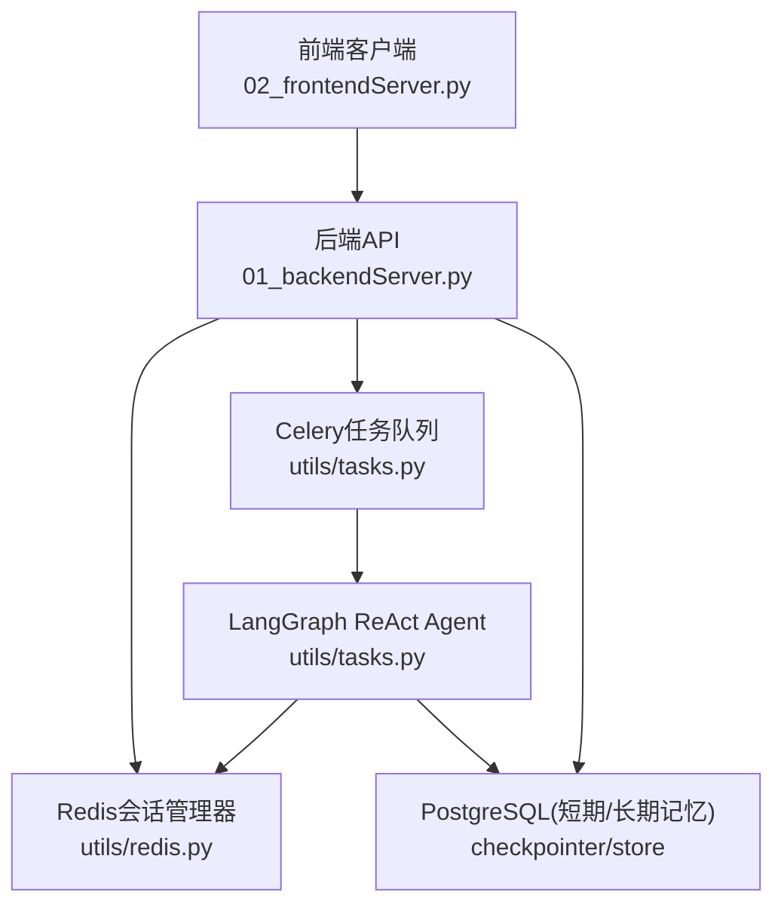
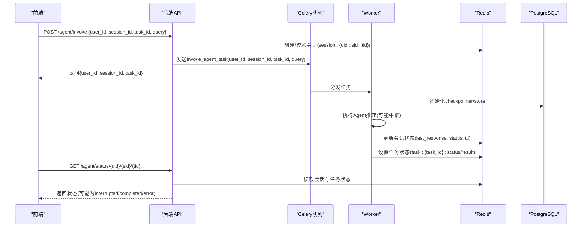
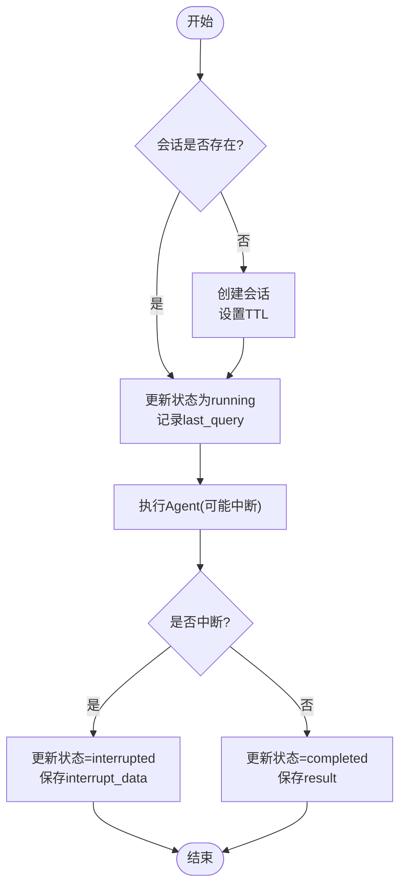
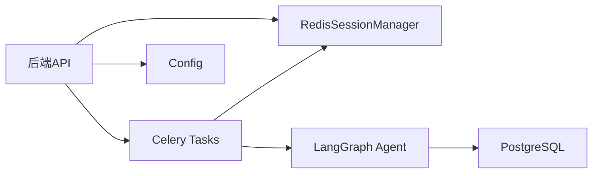

# 会话管理系统

<cite>
**本文引用的文件**
- [01_backendServer.py](file://01_backendServer.py)
- [02_frontendServer.py](file://02_frontendServer.py)
- [utils/redis.py](file://utils/redis.py)
- [utils/config.py](file://utils/config.py)
- [utils/models.py](file://utils/models.py)
- [utils/tasks.py](file://utils/tasks.py)
- [README.md](file://README.md)
</cite>

## 目录
1. [简介](#简介)
2. [项目结构](#项目结构)
3. [核心组件](#核心组件)
4. [架构总览](#架构总览)
5. [详细组件分析](#详细组件分析)
6. [依赖关系分析](#依赖关系分析)
7. [性能考量](#性能考量)
8. [故障排查指南](#故障排查指南)
9. [结论](#结论)
10. [附录：API与配置示例](#附录api与配置示例)

## 简介
本系统提供多用户、多会话的 Agent 智能体服务，支持异步任务调度、人类在环（HITL）中断恢复、短期记忆（PostgreSQL Checkpointer）与长期记忆（PostgreSQL Store），并使用 Redis 进行会话状态与任务状态的持久化与缓存。通过 Redis 的过期机制实现会话 TTL 管理，结合 Celery 异步任务队列，实现客户端与服务端之间的会话同步与故障恢复。

## 项目结构
- 后端服务：FastAPI 应用，暴露会话管理与 Agent 调用接口，初始化 Redis、PostgreSQL 连接池与 LangGraph 检查点/存储。
- 前端演示：基于 Rich 的命令行交互，封装对后端的 HTTP 调用，实现会话创建、查询、恢复与历史会话切换。
- 会话管理：RedisSessionManager 封装 Redis 操作，维护用户-会话-任务的映射与过期策略。
- 任务执行：Celery Worker 执行 invoke_agent_task 与 resume_agent_task，驱动 LangGraph ReAct Agent 运行并更新会话状态。
- 配置：统一配置类集中管理数据库、Redis、TTL、Broker 等参数。
- 数据模型：Pydantic 模型定义请求与响应结构，确保前后端契约一致。

图表来源
- [01_backendServer.py:84-130](file://01_backendServer.py#L84-L130)
- [utils/redis.py:37-103](file://utils/redis.py#L37-L103)
- [utils/tasks.py:318-451](file://utils/tasks.py#L318-L451)
- [utils/tasks.py:454-559](file://utils/tasks.py#L454-L559)

章节来源
- [README.md:1-35](file://README.md#L1-L35)
- [01_backendServer.py:84-130](file://01_backendServer.py#L84-L130)
- [utils/config.py:1-34](file://utils/config.py#L1-L34)

## 核心组件
- 会话管理器（RedisSessionManager）：负责会话创建、更新、查询、删除，以及任务状态绑定与清理。
- 后端API：提供会话与任务相关的REST接口，协调会话生命周期与任务调度。
- 任务执行器（Celery Tasks）：异步执行Agent推理与恢复，更新会话状态与任务结果。
- 数据模型（Pydantic Models）：定义请求/响应结构，保证一致性。
- 配置（Config）：集中管理Redis、DB、TTL、Broker等参数。

章节来源
- [utils/redis.py:37-493](file://utils/redis.py#L37-L493)
- [01_backendServer.py:132-414](file://01_backendServer.py#L132-L414)
- [utils/tasks.py:318-559](file://utils/tasks.py#L318-L559)
- [utils/models.py:1-97](file://utils/models.py#L1-L97)
- [utils/config.py:1-34](file://utils/config.py#L1-L34)

## 架构总览
系统采用“API + 异步任务 + 持久化”的分层架构：
- 前端通过HTTP调用后端API发起Agent任务或恢复中断。
- 后端将任务投递到Celery队列，立即返回task_id供前端轮询状态。
- Worker执行Agent推理，使用LangGraph Checkpointer/Store管理短期/长期记忆，并通过RedisSessionManager更新会话状态。
- Redis作为会话与任务状态的缓存与持久化介质，支持TTL自动过期与失效清理。

图表来源
- [01_backendServer.py:132-173](file://01_backendServer.py#L132-L173)
- [utils/tasks.py:318-451](file://utils/tasks.py#L318-L451)
- [utils/redis.py:392-442](file://utils/redis.py#L392-L442)

## 详细组件分析

### 会话生命周期管理
- 创建会话：当首次收到用户请求时，若指定session_id不存在则创建新会话，写入Redis并建立用户-会话-任务映射，设置TTL。
- 状态跟踪：每次Agent执行前将状态置为running，执行完成后根据结果更新为completed/interrupted/error，并记录last_query、last_response、last_updated。
- 过期处理：会话与任务均设置TTL；定期清理无效任务，移除孤立映射与空集合。
- 恢复机制：前端检测到interrupted状态时调用/resume接口，服务端校验状态并投递resume任务，Worker使用Command(resume=...)恢复执行。

图表来源
- [01_backendServer.py:132-173](file://01_backendServer.py#L132-L173)
- [utils/tasks.py:195-264](file://utils/tasks.py#L195-L264)
- [utils/redis.py:65-144](file://utils/redis.py#L65-L144)

章节来源
- [01_backendServer.py:132-173](file://01_backendServer.py#L132-L173)
- [utils/redis.py:65-144](file://utils/redis.py#L65-L144)
- [utils/tasks.py:195-264](file://utils/tasks.py#L195-L264)

### Redis中的会话数据结构设计
- 键命名规范
  - 会话数据：session:{user_id}:{session_id}:{task_id} -> JSON对象
  - 用户会话集合：user_sessions:{user_id} -> Set<session_id:task_id>
  - 会话任务映射：task_mapping:{user_id}:{session_id} -> Set<task_id>
  - 任务状态：task:{task_id} -> JSON对象{task_id, status, result, error, user_id, session_id}
- SessionData字段含义
  - session_id：会话唯一标识
  - task_id：任务唯一标识
  - status：会话当前状态（idle/running/completed/error/interrupted）
  - last_response：最近一次Agent响应（包含result或interrupt_data）
  - last_query：最近一次用户查询
  - last_updated：最后更新时间戳
- TTL策略
  - 会话默认TTL由SESSION_TIMEOUT控制，可通过update_session传入自定义ttl覆盖
  - 任务状态TTL由TASK_TTL控制，用于任务结果与状态缓存

章节来源
- [utils/redis.py:57-103](file://utils/redis.py#L57-L103)
- [utils/redis.py:392-442](file://utils/redis.py#L392-L442)
- [utils/config.py:18-26](file://utils/config.py#L18-L26)

### 会话状态的持久化策略与缓存机制
- 持久化
  - 会话状态与任务状态均持久化至Redis，具备原子性与高吞吐
  - 短期记忆（聊天历史）与长期记忆（用户偏好）持久化至PostgreSQL，分别通过Checkpointer与Store管理
- 缓存机制
  - Redis作为会话与任务状态的热点缓存，减少DB压力
  - 通过TTL自动过期与cleanup逻辑保持数据一致性
  - 任务结果过滤（仅保留最近一次完整对话）以减少冗余

章节来源
- [01_backendServer.py:84-130](file://01_backendServer.py#L84-L130)
- [utils/tasks.py:318-451](file://utils/tasks.py#L318-L451)
- [utils/tasks.py:267-315](file://utils/tasks.py#L267-L315)

### 客户端与服务端的会话同步机制
- 前端在启动时获取系统信息，尝试恢复最近会话或新建会话
- 前端轮询状态接口以获取最新会话状态，支持自动等待running状态完成
- 中断恢复流程：前端识别interrupted状态，调用/resume提交用户决策，服务端校验并继续执行
- 历史会话管理：前端可列出用户所有session_id与task_id，选择历史会话或任务继续

章节来源
- [02_frontendServer.py:324-497](file://02_frontendServer.py#L324-L497)
- [02_frontendServer.py:671-800](file://02_frontendServer.py#L671-L800)
- [01_backendServer.py:175-237](file://01_backendServer.py#L175-L237)

### 故障恢复的实现原理
- 客户端故障恢复：重启后通过/user/active/sessionid接口获取最近会话，若存在则恢复；否则新建会话
- 服务端故障恢复：LangGraph Checkpointer持久化节点状态，Worker崩溃后可从断点恢复执行
- 任务级恢复：任务状态存储在Redis，前端通过task_id轮询获取最终结果或错误信息

章节来源
- [02_frontendServer.py:671-800](file://02_frontendServer.py#L671-L800)
- [utils/tasks.py:318-451](file://utils/tasks.py#L318-L451)
- [utils/tasks.py:454-559](file://utils/tasks.py#L454-L559)

## 依赖关系分析
- 后端API依赖RedisSessionManager进行会话管理，依赖Celery任务队列进行异步执行
- 任务执行依赖LangGraph ReAct Agent、PostgreSQL Checkpointer/Store、LLM与工具
- 配置集中管理Redis、DB、TTL、Broker等参数，便于环境切换与扩展

图表来源
- [01_backendServer.py:84-130](file://01_backendServer.py#L84-L130)
- [utils/tasks.py:318-451](file://utils/tasks.py#L318-L451)
- [utils/config.py:1-34](file://utils/config.py#L1-L34)

章节来源
- [01_backendServer.py:84-130](file://01_backendServer.py#L84-L130)
- [utils/tasks.py:318-451](file://utils/tasks.py#L318-L451)
- [utils/config.py:1-34](file://utils/config.py#L1-L34)

## 性能考量
- 使用异步Redis客户端与连接池，提升并发读写性能
- 会话与任务状态TTL合理设置，避免内存膨胀与脏数据累积
- 消息修剪（trimmed_messages_hook）限制上下文长度，降低LLM调用成本
- 任务结果过滤仅保留最近一次完整对话，减少Redis存储与网络传输开销
- 建议监控Redis命中率、任务队列积压、PostgreSQL连接池使用情况

[本节为通用性能指导，不直接分析具体文件]

## 故障排查指南
- 常见问题
  - 会话不存在：检查session_key是否存在，确认TTL未过期
  - 任务状态异常：查看task:{task_id}状态，确认Worker是否正常消费
  - 中断无法恢复：确认会话状态为interrupted且last_response包含interrupt_data
  - 长时间running：检查是否有其他客户端占用或Worker阻塞
- 日志定位
  - 后端与Redis模块均输出详细日志，关注创建/更新/删除与会话状态变更
  - 任务执行日志包含Agent输入输出与错误堆栈

章节来源
- [utils/redis.py:246-341](file://utils/redis.py#L246-L341)
- [utils/tasks.py:420-451](file://utils/tasks.py#L420-L451)
- [utils/tasks.py:528-559](file://utils/tasks.py#L528-L559)

## 结论
本会话管理系统通过Redis实现高效的多用户多会话状态管理，结合Celery与LangGraph实现异步任务调度与中断恢复，利用PostgreSQL完成短期与长期记忆持久化。系统设计清晰、可扩展性强，适合生产级Agent服务场景。开发者可基于现有API与配置快速集成与扩展会话管理功能。

[本节为总结性内容，不直接分析具体文件]

## 附录：API与配置示例

### 会话管理API
- 异步运行Agent
  - 方法：POST
  - 路径：/agent/invoke
  - 请求体：{user_id, session_id, task_id, query, system_message}
  - 响应：{user_id, session_id, task_id}
- 恢复中断
  - 方法：POST
  - 路径：/agent/resume
  - 请求体：{user_id, session_id, task_id, response_type, args}
  - 响应：{user_id, session_id, task_id}
- 获取系统信息
  - 方法：GET
  - 路径：/system/info
  - 响应：{sessions_count, active_users}
- 获取活跃会话ID
  - 方法：GET
  - 路径：/agent/active/sessionid/{user_id}
  - 响应：{active_session_id}
- 获取用户所有会话ID
  - 方法：GET
  - 路径：/agent/sessionids/{user_id}
  - 响应：{session_ids}
- 获取会话任务列表
  - 方法：GET
  - 路径：/agent/tasks/{user_id}/{session_id}
  - 响应：{task_ids}
- 获取会话状态
  - 方法：GET
  - 路径：/agent/status/{user_id}/{session_id}/{task_id}
  - 响应：{user_id, session_id, task_id, status, message, last_query, last_updated, last_response}
- 写入长期记忆
  - 方法：POST
  - 路径：/agent/write/longterm
  - 请求体：{user_id, memory_info}
  - 响应：{status, memory_id, message}
- 删除会话
  - 方法：DELETE
  - 路径：/agent/session/{user_id}/{session_id}
  - 响应：{status, message}
- 删除任务
  - 方法：DELETE
  - 路径：/agent/task/{user_id}/{session_id}/{task_id}
  - 响应：{status, message}

章节来源
- [01_backendServer.py:132-414](file://01_backendServer.py#L132-L414)

### 配置选项
- Redis
  - REDIS_HOST, REDIS_PORT, REDIS_DB
  - SESSION_TIMEOUT：会话默认TTL
  - TASK_TTL：任务状态TTL
- PostgreSQL
  - DB_URI：数据库连接串
  - MIN_SIZE, MAX_SIZE：连接池大小
- 服务
  - HOST, PORT：API服务地址与端口
  - CELERY_BROKER_URL：Celery消息代理URL
  - LLM_TYPE：大模型类型

章节来源
- [utils/config.py:1-34](file://utils/config.py#L1-L34)