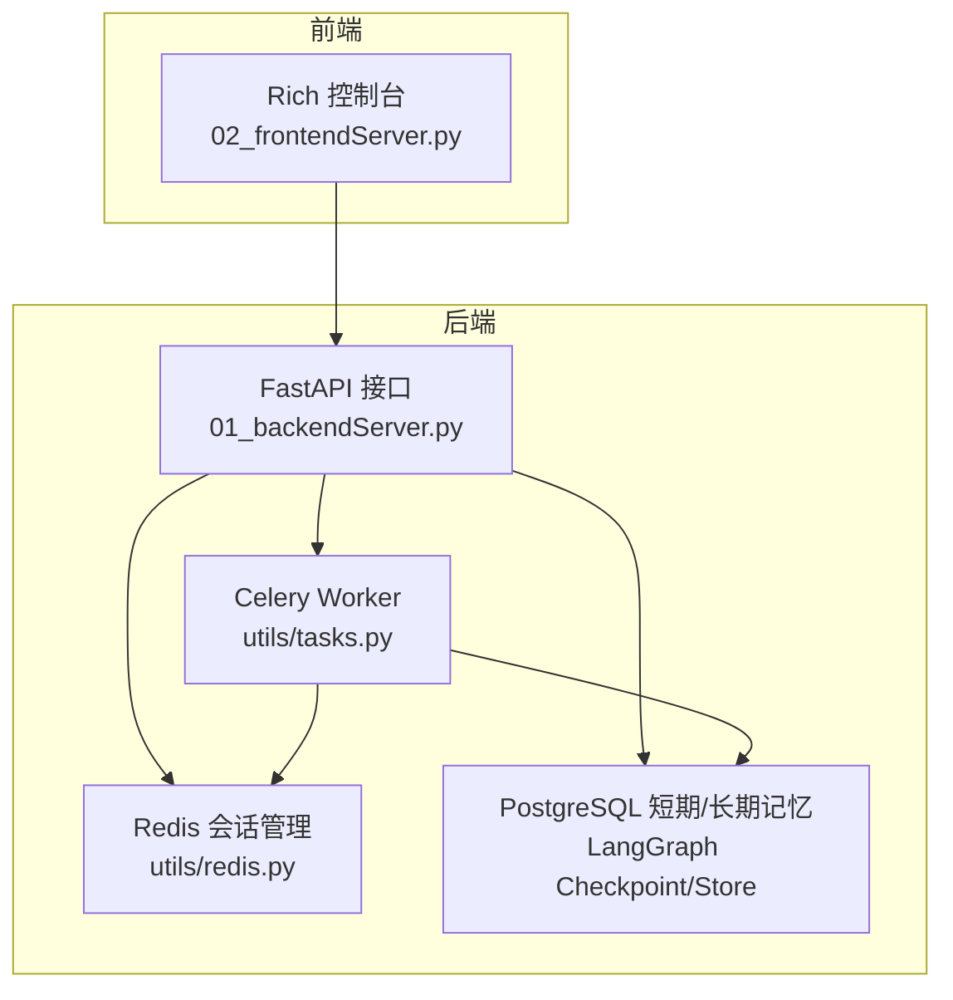
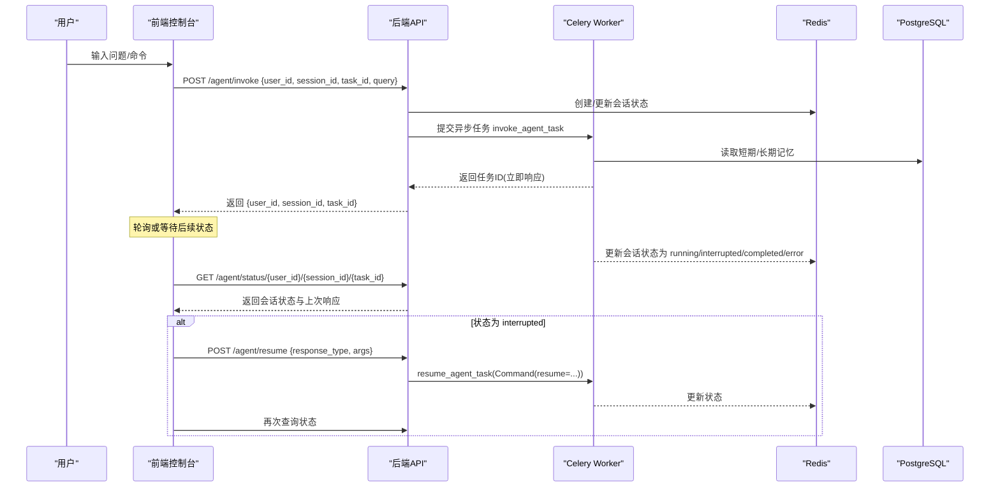
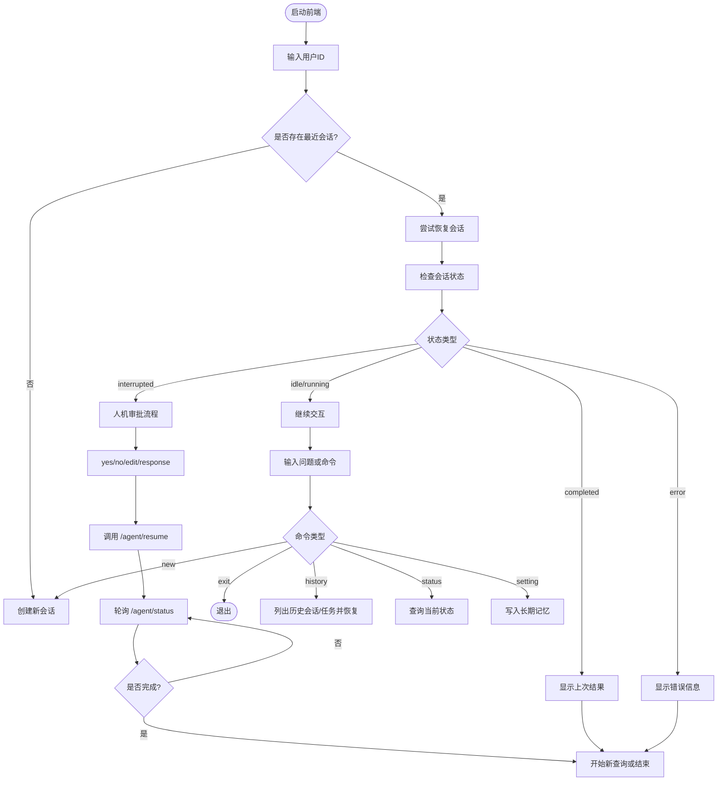
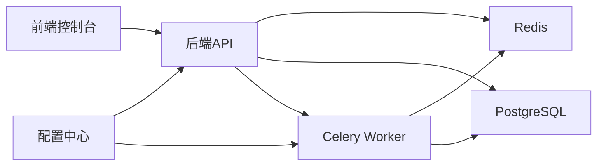

# 前端交互界面

<cite>
**本文引用的文件**
- [02_frontendServer.py](file://02_frontendServer.py)
- [01_backendServer.py](file://01_backendServer.py)
- [utils/config.py](file://utils/config.py)
- [utils/redis.py](file://utils/redis.py)
- [utils/models.py](file://utils/models.py)
- [utils/tasks.py](file://utils/tasks.py)
- [README.md](file://README.md)
</cite>

## 目录
1. [简介](#简介)
2. [项目结构](#项目结构)
3. [核心组件](#核心组件)
4. [架构总览](#架构总览)
5. [详细组件分析](#详细组件分析)
6. [依赖关系分析](#依赖关系分析)
7. [性能与体验优化](#性能与体验优化)
8. [故障排查指南](#故障排查指南)
9. [结论](#结论)
10. [附录：命令速查与使用示例](#附录命令速查与使用示例)

## 简介
本文件面向使用基于 Rich 库构建的控制台前端界面的用户，系统性地说明人机协作 Agent 交互流程、界面布局、功能模块、命令使用方法（status、new、exit、history、setting 等）、会话管理（历史查看、恢复、切换）以及界面定制与扩展方法。目标是帮助用户高效、安全地使用前端界面完成 Agent 交互任务。

## 项目结构
本项目由前后端两部分组成：
- 前端控制台：基于 Rich 库实现，提供交互式命令行界面，负责用户输入、状态展示、中断审批、会话管理等。
- 后端服务：FastAPI 提供 REST API，封装异步任务调度（Celery）、Redis 会话状态管理、PostgreSQL 短期记忆与长期记忆存储。

图表来源
- [02_frontendServer.py:1-800](file://02_frontendServer.py#L1-L800)
- [01_backendServer.py:132-424](file://01_backendServer.py#L132-L424)
- [utils/redis.py:37-493](file://utils/redis.py#L37-L493)
- [utils/tasks.py:318-564](file://utils/tasks.py#L318-L564)

章节来源
- [README.md:1-199](file://README.md#L1-L199)
- [02_frontendServer.py:1-800](file://02_frontendServer.py#L1-L800)
- [01_backendServer.py:132-424](file://01_backendServer.py#L132-L424)

## 核心组件
- 前端控制台（Rich）：负责主题样式、面板展示、进度条、提示输入、命令解析、与后端 API 交互、会话恢复与中断处理。
- 后端 FastAPI：暴露 /agent/invoke、/agent/resume、/system/info、/agent/status、/agent/sessionids、/agent/active/sessionid、/agent/write/longterm、删除会话/任务等接口。
- Redis 会话管理器：维护多用户多会话的状态、任务映射、过期清理、活跃会话查询等。
- Celery 任务：异步执行 Agent 调用与恢复，更新会话状态与任务结果。
- PostgreSQL：短期记忆（LangGraph Checkpointer）与长期记忆（LangGraph Store）。

章节来源
- [02_frontendServer.py:1-800](file://02_frontendServer.py#L1-L800)
- [01_backendServer.py:132-424](file://01_backendServer.py#L132-L424)
- [utils/redis.py:37-493](file://utils/redis.py#L37-L493)
- [utils/tasks.py:318-564](file://utils/tasks.py#L318-L564)

## 架构总览
前端通过 HTTP 请求与后端交互，后端将耗时任务交由 Celery 异步执行，并使用 Redis 持久化会话状态，使用 PostgreSQL 管理短期/长期记忆。Agent 运行过程中可能触发“工具调用中断”，前端需进行人机审批或参数调整。

图表来源
- [02_frontendServer.py:50-107](file://02_frontendServer.py#L50-L107)
- [01_backendServer.py:132-237](file://01_backendServer.py#L132-L237)
- [utils/tasks.py:318-564](file://utils/tasks.py#L318-L564)
- [utils/redis.py:37-493](file://utils/redis.py#L37-L493)

## 详细组件分析

### 前端控制台（Rich）
- 主题与面板：自定义主题（info/warning/success/error/heading/highlight），使用 Panel、Markdown、Progress 增强可读性与交互反馈。
- 主循环与命令：
  - 支持命令：exit（退出）、new（新建会话）、history（历史会话恢复）、status（查看状态）、setting（偏好设置/写入长期记忆）。
  - 自动恢复：启动时尝试获取最近一次会话并恢复；若存在中断则进入人机审批流程。
- 人机协作（HITL）：
  - 当 Agent 需要工具调用审批时，前端显示中断消息与工具参数，并提供 yes/no/edit/response 选项。
  - edit 模式允许用户以 JSON 形式修改工具参数；response 模式可直接反馈信息而不调用工具。
- 会话管理：
  - 获取用户所有会话 ID，选择历史会话后获取其任务列表，可恢复特定任务或在新任务中继续。
  - 支持删除当前会话。
- 长期记忆：
  - 通过 setting 命令调用写入长期记忆接口，便于个性化配置与偏好保存。

图表来源
- [02_frontendServer.py:672-800](file://02_frontendServer.py#L672-L800)
- [02_frontendServer.py:500-558](file://02_frontendServer.py#L500-L558)
- [02_frontendServer.py:325-497](file://02_frontendServer.py#L325-L497)

章节来源
- [02_frontendServer.py:1-800](file://02_frontendServer.py#L1-L800)

### 后端 API（FastAPI）
- 主要接口：
  - /agent/invoke：接收用户问题，创建或确认会话，提交异步任务，立即返回任务ID。
  - /agent/resume：恢复被中断的 Agent 运行，支持 accept/reject/edit/response 四种响应类型。
  - /system/info：获取系统内全部会话统计与活跃用户。
  - /agent/status/{user_id}/{session_id}/{task_id}：查询指定任务的会话状态与上次响应。
  - /agent/sessionids/{user_id}：获取用户的所有会话ID。
  - /agent/active/sessionid/{user_id}：获取用户最近一次更新的会话ID。
  - /agent/write/longterm：写入用户长期记忆。
  - 删除会话/任务接口：用于清理无效数据。
- 状态流转：idle → running → interrupted/completed/error，支持恢复与重试。

章节来源
- [01_backendServer.py:132-424](file://01_backendServer.py#L132-L424)

### Redis 会话管理
- 数据结构：
  - session:{user_id}:{session_id}:{task_id}：存储会话状态、上次查询、上次响应、更新时间等。
  - user_sessions:{user_id}：集合，记录该用户下的 session_id:task_id 条目。
  - task_mapping:{user_id}:{session_id}：集合，记录某会话下的所有任务ID。
  - task:{task_id}：任务状态与结果。
- 能力：
  - 创建/更新/删除会话与任务。
  - 清理过期与无效任务。
  - 查询活跃会话、任务状态、用户会话列表等。

章节来源
- [utils/redis.py:37-493](file://utils/redis.py#L37-L493)

### Celery 任务（Agent 执行与恢复）
- invoke_agent_task：
  - 初始化数据库连接池、短期/长期记忆、语言模型与工具。
  - 构造 ReAct Agent，调用 ainvoke，处理结果（中断或完成），更新会话与任务状态。
- resume_agent_task：
  - 使用 Command(resume=command_data) 恢复中断点，继续执行直至完成或再次中断。
- 结果过滤：
  - filter_last_human_conversation 仅保留最近一次人类对话及后续消息，减少冗余。

章节来源
- [utils/tasks.py:318-564](file://utils/tasks.py#L318-L564)

### 数据模型
- AgentRequest：用户ID、会话ID、任务ID、查询、系统提示词。
- InterruptResponse：恢复请求，包含 response_type 与可选 args。
- AgentResponse：标准化响应，包含状态、时间戳、结果或中断数据。
- SystemInfoResponse、SessionInfoResponse、TaskInfoResponse、ActiveSessionInfoResponse、SessionStatusResponse：各类查询与状态响应。

章节来源
- [utils/models.py:1-97](file://utils/models.py#L1-L97)

## 依赖关系分析
- 前端依赖后端 API，通过 requests 发起 HTTP 请求。
- 后端依赖 Redis 进行会话状态管理，依赖 PostgreSQL 进行短期/长期记忆存储。
- 后端通过 Celery 将耗时任务异步化，Worker 进程执行 Agent 逻辑。
- 配置集中管理于 utils/config.py，包括数据库、Redis、Celery、LLM 类型、服务端口等。

图表来源
- [02_frontendServer.py:1-800](file://02_frontendServer.py#L1-L800)
- [01_backendServer.py:132-424](file://01_backendServer.py#L132-L424)
- [utils/config.py:1-34](file://utils/config.py#L1-L34)
- [utils/redis.py:37-493](file://utils/redis.py#L37-L493)
- [utils/tasks.py:318-564](file://utils/tasks.py#L318-L564)

章节来源
- [utils/config.py:1-34](file://utils/config.py#L1-L34)

## 性能与体验优化
- 异步任务：使用 Celery 将 Agent 执行异步化，避免阻塞前端交互。
- 会话超时与清理：Redis 会话与任务均设置 TTL，定期清理无效数据，降低内存占用。
- 消息修剪：对短期记忆中的聊天历史进行 token 限制，控制上下文大小，提升响应速度与稳定性。
- 长轮询与进度反馈：前端在等待会话完成时使用 Progress 展示进度，提升用户体验。
- 建议：
  - 合理设置 Redis TTL 与 Celery 任务超时，避免资源泄漏。
  - 根据业务场景调整消息修剪策略，平衡上下文完整性与性能。
  - 在高并发场景下，增加 Celery Worker 数量与 Redis 连接池大小。

[本节为通用指导，不直接分析具体文件]

## 故障排查指南
- 无法获取系统信息：检查后端服务是否启动、网络连通性、API_BASE_URL 配置是否正确。
- 会话不存在或状态异常：
  - 使用 status 命令查看当前任务状态。
  - 检查 Redis 中对应键是否存在，必要时清理无效任务。
- 中断无法恢复：
  - 确认 /agent/resume 的请求格式正确（response_type 与 args）。
  - 检查后端日志与 Worker 状态，确认任务队列正常。
- 长期记忆写入失败：
  - 检查 PostgreSQL 连接与权限。
  - 确认用户存在且命名空间正确。
- 常见问题：
  - 客户端意外退出后恢复：重新输入用户ID，系统将自动恢复最近会话。
  - 服务端故障恢复：LangGraph Checkpoint 会保存节点状态，重启后可继续执行。

章节来源
- [02_frontendServer.py:325-497](file://02_frontendServer.py#L325-L497)
- [01_backendServer.py:132-424](file://01_backendServer.py#L132-L424)
- [utils/redis.py:246-341](file://utils/redis.py#L246-L341)

## 结论
本前端控制台基于 Rich 提供了直观、易用的交互界面，结合后端的异步任务调度与会话管理能力，实现了完整的人机协作 Agent 工作流。通过命令操作、会话恢复、中断审批等功能，用户可以高效地进行智能体交互，并在复杂场景中灵活调整参数或直接反馈。配合合理的配置与优化策略，系统具备良好的可扩展性与稳定性。

[本节为总结，不直接分析具体文件]

## 附录：命令速查与使用示例
- status：查看当前会话状态，包括任务ID、状态、上次查询与响应。适用于故障恢复与调试。
- new：创建新会话，开启全新任务。
- exit：退出当前会话并结束程序。
- history：列出用户的历史会话与任务，可选择恢复特定会话或任务。
- setting：打开偏好设置，支持写入长期记忆内容，便于个性化配置。

使用示例（参考 README 测试流程）：
- 输入 'yes' 接受工具调用。
- 输入 'no' 拒绝工具调用。
- 输入 'edit' 并传入 JSON 参数以调整工具参数。
- 输入 'response' 并传入文本以不调用工具直接反馈。

章节来源
- [README.md:121-183](file://README.md#L121-L183)
- [02_frontendServer.py:739-800](file://02_frontendServer.py#L739-L800)
- [02_frontendServer.py:500-558](file://02_frontendServer.py#L500-L558)