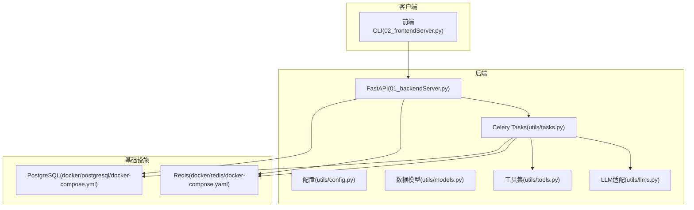
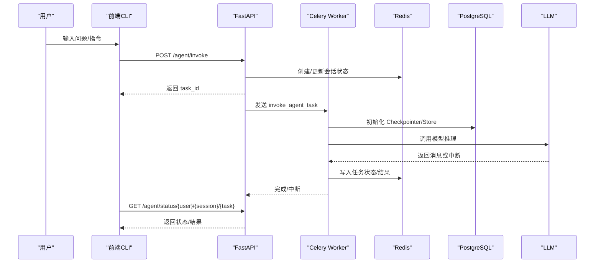
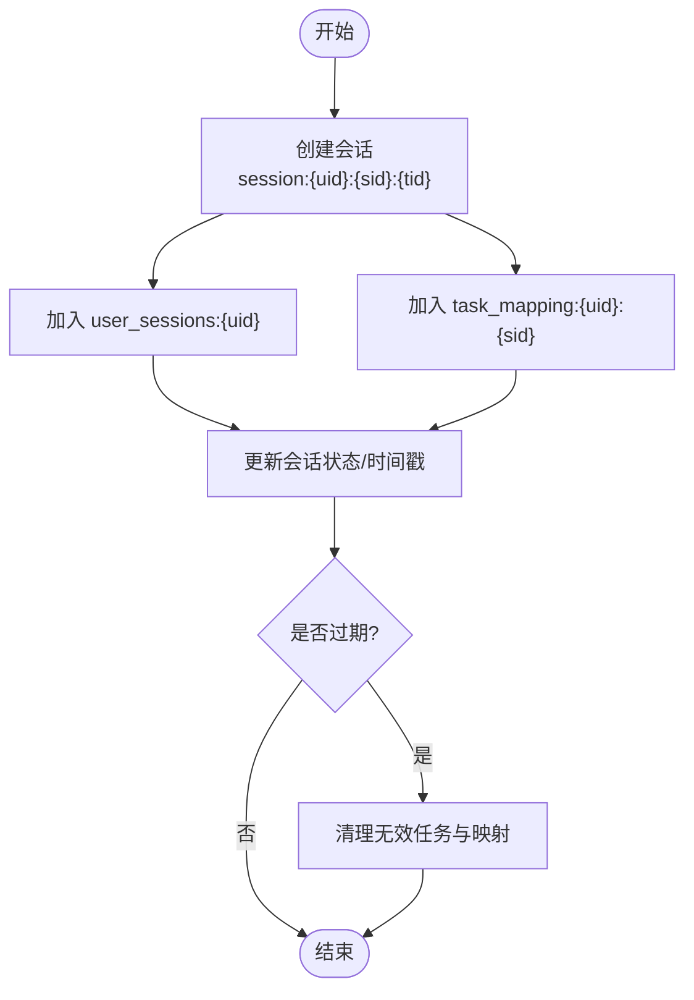
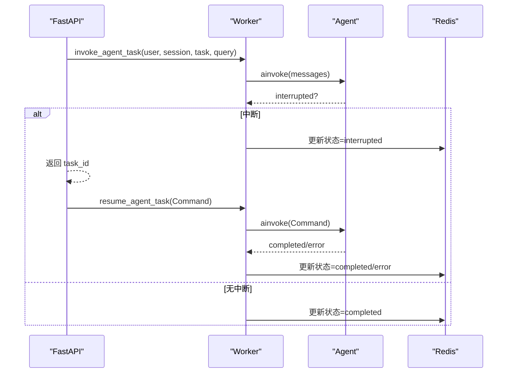
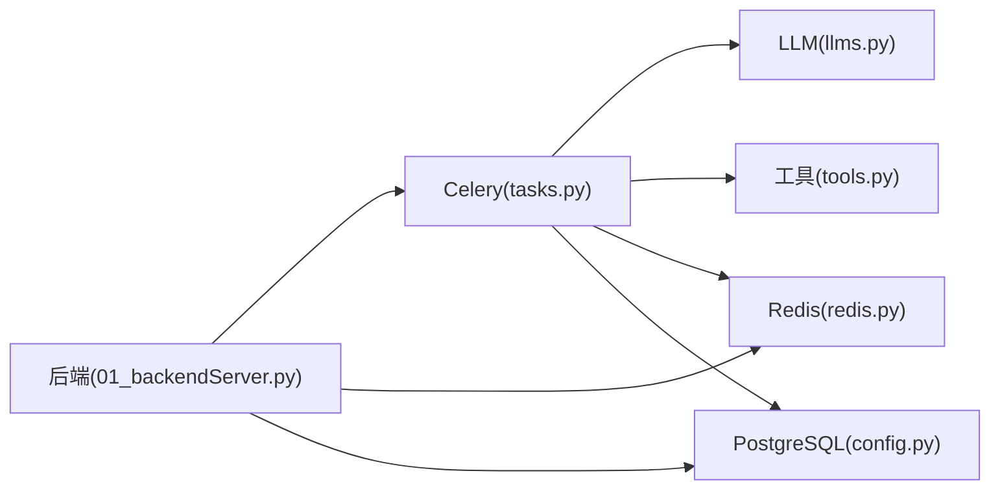

# 快速开始

<cite>
**本文引用的文件**
- [README.md](file://README.md)
- [01_backendServer.py](file://01_backendServer.py)
- [02_frontendServer.py](file://02_frontendServer.py)
- [utils/config.py](file://utils/config.py)
- [utils/redis.py](file://utils/redis.py)
- [utils/tasks.py](file://utils/tasks.py)
- [utils/models.py](file://utils/models.py)
- [utils/llms.py](file://utils/llms.py)
- [utils/tools.py](file://utils/tools.py)
- [docker/postgresql/docker-compose.yml](file://docker/postgresql/docker-compose.yml)
- [docker/redis/docker-compose.yaml](file://docker/redis/docker-compose.yaml)
</cite>

## 目录
1. [简介](#简介)
2. [项目结构](#项目结构)
3. [核心组件](#核心组件)
4. [架构总览](#架构总览)
5. [详细组件分析](#详细组件分析)
6. [依赖关系分析](#依赖关系分析)
7. [性能与扩展性](#性能与扩展性)
8. [故障排查指南](#故障排查指南)
9. [结论](#结论)
10. [附录：常用命令与配置参考](#附录常用命令与配置参考)

## 简介
本指南面向首次接触 ReAct Agent 服务的用户，目标是在最短时间内完成环境准备、服务部署与基本测试。你将学会：
- 使用 Docker 启动 PostgreSQL 与 Redis
- 创建 Python 虚拟环境并安装依赖
- 配置数据库、Redis、LLM 等关键参数
- 启动 Celery Worker、后端 FastAPI 服务与前端交互界面
- 进行基础功能验证与常见问题排查

## 项目结构
本项目采用前后端分离与异步任务队列的架构：
- 后端 API（FastAPI）提供智能体调用、会话管理、状态查询等接口
- 前端 CLI（Rich）用于交互式演示与调试
- Celery Worker 负责异步执行智能体任务
- 短期记忆通过 PostgreSQL Checkpointer 持久化，长期记忆通过 PostgreSQL Store 存储
- 会话状态与任务状态由 Redis 管理，支持过期与清理
- LLM 适配层支持 OpenAI、通义千问、本地 Ollama 等多种模型

图表来源
- [01_backendServer.py:84-130](file://01_backendServer.py#L84-L130)
- [02_frontendServer.py:29-78](file://02_frontendServer.py#L29-L78)
- [utils/tasks.py:43-63](file://utils/tasks.py#L43-L63)
- [utils/config.py:13-33](file://utils/config.py#L13-L33)
- [docker/postgresql/docker-compose.yml:4-22](file://docker/postgresql/docker-compose.yml#L4-L22)
- [docker/redis/docker-compose.yaml:5-28](file://docker/redis/docker-compose.yaml#L5-L28)

章节来源
- [README.md:55-193](file://README.md#L55-L193)

## 核心组件
- 后端服务（FastAPI）：定义 RESTful 接口，处理请求、维护会话状态、调度 Celery 任务
- 任务队列（Celery）：异步执行智能体推理、中断恢复、结果回写
- 会话与任务存储（Redis）：键空间设计包含 session、task_mapping、task 等，支持 TTL 与自动清理
- 短期记忆（PostgreSQL Checkpointer）：保存 LangGraph 节点状态，支持断点续跑
- 长期记忆（PostgreSQL Store）：按命名空间存储用户偏好等信息，可被系统提示词注入
- LLM 适配层：统一封装不同厂商模型，支持环境变量配置
- 工具集：内置自定义工具与 MCP 工具，支持人工审查（HITL）

章节来源
- [01_backendServer.py:132-424](file://01_backendServer.py#L132-L424)
- [utils/tasks.py:318-564](file://utils/tasks.py#L318-L564)
- [utils/redis.py:37-493](file://utils/redis.py#L37-L493)
- [utils/llms.py:31-151](file://utils/llms.py#L31-L151)
- [utils/tools.py:37-175](file://utils/tools.py#L37-L175)

## 架构总览
下图展示了从前端发起请求到后端调度任务、访问存储与 LLM 的完整流程。

图表来源
- [01_backendServer.py:132-174](file://01_backendServer.py#L132-L174)
- [utils/tasks.py:318-451](file://utils/tasks.py#L318-L451)
- [utils/redis.py:65-144](file://utils/redis.py#L65-L144)
- [utils/llms.py:70-138](file://utils/llms.py#L70-L138)

## 详细组件分析

### 环境与依赖准备
- 使用 Conda 创建 Python 3.11 虚拟环境
- 安装指定版本的 langchain、langgraph、fastapi、redis、celery 等依赖
- 建议使用 README 中列出的版本以避免兼容性问题

章节来源
- [README.md:73-97](file://README.md#L73-L97)

### 基础设施部署（Docker）
- 启动 PostgreSQL：进入 docker/postgresql 目录执行 docker-compose up -d
- 启动 Redis：进入 docker/redis 目录执行 docker-compose up -d
- 默认端口：PostgreSQL 5432，Redis 6379

章节来源
- [README.md:112-118](file://README.md#L112-L118)
- [docker/postgresql/docker-compose.yml:4-22](file://docker/postgresql/docker-compose.yml#L4-L22)
- [docker/redis/docker-compose.yaml:5-28](file://docker/redis/docker-compose.yaml#L5-L28)

### 初始化配置
- 数据库连接：通过环境变量 DB_URI 覆盖默认值，默认指向本地 PostgreSQL
- Redis 连接：默认 localhost:6379，db=0，会话超时与 TTL 在配置类中设置
- LLM 类型：默认 qwen，可通过环境变量 DASHSCOPE_API_KEY 配置；也支持 openai、ollama 等
- 日志：默认输出到 logfile/app.log，支持轮转与保留数量

章节来源
- [utils/config.py:13-33](file://utils/config.py#L13-L33)
- [utils/llms.py:31-57](file://utils/llms.py#L31-L57)

### 启动服务步骤
- 启动 Celery Worker：celery -A 01_backendServer.celery_app worker --loglevel=info
- 启动后端服务：python 01_backendServer.py
- 启动前端交互界面：python 02_frontendServer.py
- 建议顺序：先启动 Redis 与 PostgreSQL，再启动 Celery，最后启动后端与前端

章节来源
- [README.md:187-193](file://README.md#L187-L193)
- [01_backendServer.py:418-424](file://01_backendServer.py#L418-L424)
- [utils/tasks.py:43-63](file://utils/tasks.py#L43-L63)

### 基本测试流程
- 运行前端后，输入用户 ID，系统将尝试恢复最近会话或新建会话
- 输入问题后，后端将异步执行任务并返回 task_id
- 前端会轮询状态，若遇到中断则引导用户选择 accept/reject/edit/response
- 完成后显示最终回答

章节来源
- [02_frontendServer.py:671-800](file://02_frontendServer.py#L671-L800)
- [README.md:121-193](file://README.md#L121-L193)

### 会话与任务状态管理（Redis）
- 键空间设计：
  - session:{user_id}:{session_id}:{task_id}：会话详情
  - user_sessions:{user_id}：用户所有 session_id:task_id 集合
  - task_mapping:{user_id}:{session_id}：会话内所有 task_id 集合
  - task:{task_id}：任务状态与结果
- 支持 TTL 与自动清理，避免脏数据累积

图表来源
- [utils/redis.py:65-144](file://utils/redis.py#L65-L144)
- [utils/redis.py:247-341](file://utils/redis.py#L247-L341)

章节来源
- [utils/redis.py:65-493](file://utils/redis.py#L65-L493)

### 智能体执行与中断恢复（Celery + LangGraph）
- 初始调用：invoke_agent_task 创建 ReAct Agent，读取长期记忆，执行推理
- 中断处理：当工具调用需要人工审批时，返回 interrupted 状态，前端引导用户决策
- 恢复调用：resume_agent_task 使用 Command(resume=...) 继续执行

图表来源
- [utils/tasks.py:318-451](file://utils/tasks.py#L318-L451)
- [utils/tasks.py:455-564](file://utils/tasks.py#L455-L564)
- [01_backendServer.py:175-237](file://01_backendServer.py#L175-L237)

章节来源
- [utils/tasks.py:318-564](file://utils/tasks.py#L318-L564)
- [01_backendServer.py:132-237](file://01_backendServer.py#L132-L237)

### 工具与人工审查（HITL）
- 工具包装：为每个工具添加人工审查逻辑，支持 accept/reject/edit/response
- 内置工具：book_hotel、multiply；可扩展 MCP 工具
- 前端交互：根据中断信息展示工具名称与参数，引导用户决策

章节来源
- [utils/tools.py:37-175](file://utils/tools.py#L37-L175)
- [02_frontendServer.py:499-558](file://02_frontendServer.py#L499-L558)

## 依赖关系分析
- 后端依赖：FastAPI、uvicorn、psycopg_pool、langgraph-checkpoint-postgres、langgraph-store-postgres、redis、celery
- 任务依赖：LangChain/LangGraph、LLM 适配层、工具集、Redis 会话管理
- 存储依赖：PostgreSQL（短期/长期记忆）、Redis（会话/任务状态）
- 外部依赖：OpenAI/通义千问/Ollama 等 LLM 服务

图表来源
- [01_backendServer.py:132-424](file://01_backendServer.py#L132-L424)
- [utils/tasks.py:318-564](file://utils/tasks.py#L318-L564)
- [utils/config.py:13-33](file://utils/config.py#L13-L33)

章节来源
- [utils/config.py:13-33](file://utils/config.py#L13-L33)
- [utils/tasks.py:318-564](file://utils/tasks.py#L318-L564)

## 性能与扩展性
- 连接池：PostgreSQL 使用 AsyncConnectionPool，控制最小/最大连接数
- 会话 TTL：合理设置会话与任务 TTL，避免内存膨胀
- 消息修剪：预模型钩子对历史消息进行 token 限制，降低上下文开销
- 水平扩展：Celery Worker 可多进程/多线程扩展，Redis 与 PostgreSQL 可独立扩容

[本节为通用指导，不直接分析具体文件]

## 故障排查指南
- 无法连接 PostgreSQL
  - 检查容器是否启动成功，端口 5432 是否监听
  - 确认 DB_URI 中的用户名、密码、数据库名与容器一致
  - 查看后端日志 logfile/app.log 中的初始化错误
- 无法连接 Redis
  - 检查容器是否启动成功，端口 6379 是否监听
  - 确认 Redis 主机、端口、DB 号与配置一致
  - 使用 redis-cli ping 验证连通性
- LLM 调用失败
  - 检查对应环境变量（如 OPENAI_API_KEY、DASHSCOPE_API_KEY）是否正确
  - 确认 base_url 与模型名称匹配
  - 查看 llms.py 初始化日志与异常堆栈
- 任务未执行或状态不更新
  - 确认 Celery Worker 已启动且能消费队列
  - 检查 Redis 中 task:{task_id} 是否存在与过期时间
  - 查看 tasks.py 中的错误处理与日志
- 前端无法获取系统信息
  - 确认后端服务已启动且端口 8001 可访问
  - 检查网络与防火墙设置

章节来源
- [01_backendServer.py:84-124](file://01_backendServer.py#L84-L124)
- [utils/tasks.py:420-451](file://utils/tasks.py#L420-L451)
- [utils/llms.py:70-151](file://utils/llms.py#L70-L151)
- [utils/redis.py:247-341](file://utils/redis.py#L247-L341)

## 结论
通过本指南，你可以在本地快速搭建并运行 ReAct Agent 服务，完成从环境准备、服务启动到基本测试的全流程。建议在稳定运行后逐步扩展工具集、调整会话 TTL 与连接池参数，并根据业务需求选择合适的 LLM 提供商。

[本节为总结，不直接分析具体文件]

## 附录：常用命令与配置参考
- 启动 PostgreSQL：docker compose -f docker/postgresql/docker-compose.yml up -d
- 启动 Redis：docker compose -f docker/redis/docker-compose.yaml up -d
- 启动 Celery Worker：celery -A 01_backendServer.celery_app worker --loglevel=info
- 启动后端：python 01_backendServer.py
- 启动前端：python 02_frontendServer.py
- 关键配置项（可在 utils/config.py 或环境变量中调整）
  - DB_URI：PostgreSQL 连接串
  - REDIS_HOST/REDIS_PORT/REDIS_DB：Redis 连接参数
  - LLM_TYPE：模型类型（openai/qwen/oneapi/ollama）
  - HOST/PORT：后端监听地址与端口

章节来源
- [utils/config.py:13-33](file://utils/config.py#L13-L33)
- [README.md:112-193](file://README.md#L112-L193)