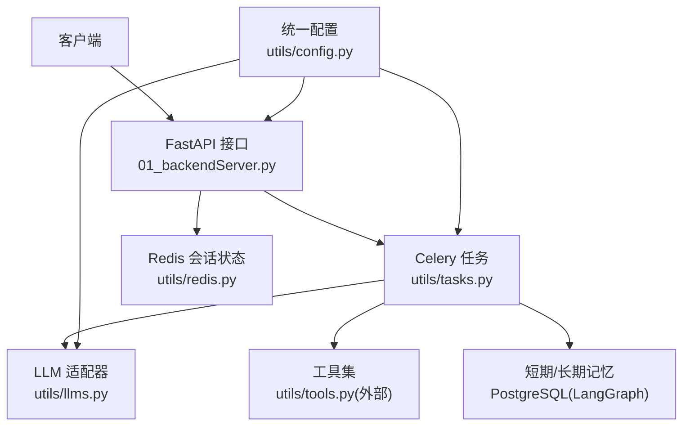
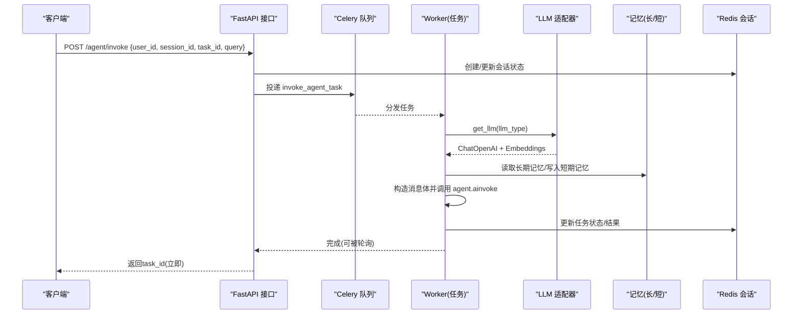
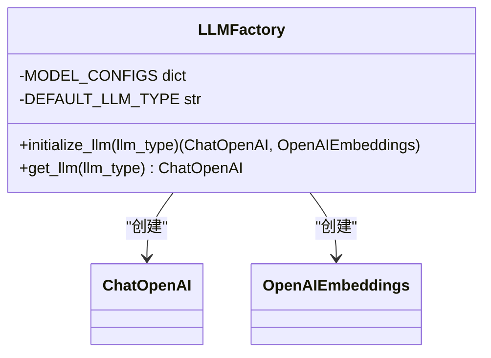
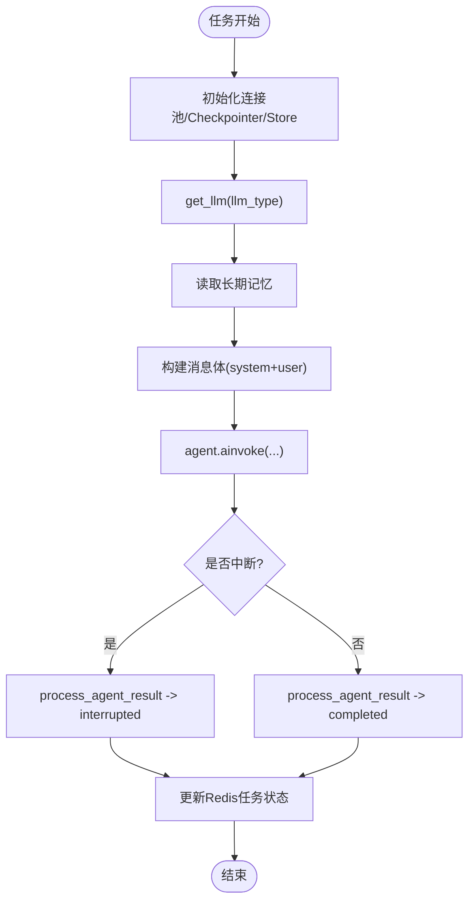
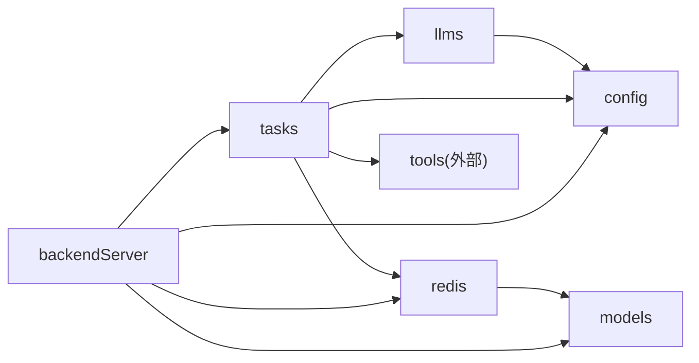

# LLM适配器开发

<cite>
**本文引用的文件**
- [utils/llms.py](file://utils/llms.py)
- [utils/config.py](file://utils/config.py)
- [utils/tasks.py](file://utils/tasks.py)
- [utils/models.py](file://utils/models.py)
- [utils/redis.py](file://utils/redis.py)
- [01_backendServer.py](file://01_backendServer.py)
- [README.md](file://README.md)
</cite>

## 目录
1. [简介](#简介)
2. [项目结构](#项目结构)
3. [核心组件](#核心组件)
4. [架构总览](#架构总览)
5. [详细组件分析](#详细组件分析)
6. [依赖关系分析](#依赖关系分析)
7. [性能与监控](#性能与监控)
8. [故障排查指南](#故障排查指南)
9. [结论](#结论)
10. [附录：新LLM提供商集成示例](#附录：新llm提供商集成示例)

## 简介
本项目基于FastAPI、LangGraph与Celery构建生产级Agent服务，支持多会话、异步任务调度、短期/长期记忆、工具调用与人工审查（HITL），并内置对OpenAI、通义千问、Ollama等LLM的适配能力。本文聚焦“LLM适配器开发”主题，系统讲解当前实现中的工厂模式与策略思想、如何扩展新的LLM提供商、现有支持的实现方式、消息格式转换、流式响应处理思路、重试与错误处理、以及性能优化与监控方法，帮助开发者高效集成新的LLM服务。

## 项目结构
- 后端入口与服务生命周期管理：[01_backendServer.py](file://01_backendServer.py)
- LLM适配器与配置：[utils/llms.py](file://utils/llms.py)、[utils/config.py](file://utils/config.py)
- 异步任务与Agent编排：[utils/tasks.py](file://utils/tasks.py)
- 数据模型定义：[utils/models.py](file://utils/models.py)
- Redis会话与状态管理：[utils/redis.py](file://utils/redis.py)
- 项目说明与运行指引：[README.md](file://README.md)

图表来源
- [01_backendServer.py:84-130](file://01_backendServer.py#L84-L130)
- [utils/tasks.py:319-451](file://utils/tasks.py#L319-L451)
- [utils/llms.py:70-119](file://utils/llms.py#L70-L119)
- [utils/config.py:4-34](file://utils/config.py#L4-L34)

章节来源
- [01_backendServer.py:84-130](file://01_backendServer.py#L84-L130)
- [utils/config.py:4-34](file://utils/config.py#L4-L34)

## 核心组件
- LLM适配器层：集中管理不同LLM提供商的配置与实例化，提供统一的初始化与获取接口，具备默认回退与异常封装。
- 任务编排层：通过Celery将Agent执行放入后台任务，结合LangGraph的ReAct Agent进行推理与工具调用。
- 会话与状态层：使用Redis维护用户会话、任务状态与过期清理；使用PostgreSQL作为LangGraph的短期记忆Checkpointer与长期记忆Store。
- 数据模型层：标准化请求/响应结构，便于前后端契约一致。

章节来源
- [utils/llms.py:31-119](file://utils/llms.py#L31-L119)
- [utils/tasks.py:319-451](file://utils/tasks.py#L319-L451)
- [utils/redis.py:37-490](file://utils/redis.py#L37-L490)
- [utils/models.py:7-96](file://utils/models.py#L7-L96)

## 架构总览
整体采用“API网关 + 异步任务队列 + LLM适配器 + 记忆存储”的分层架构。API负责接收请求、校验与会话管理；Celery Worker负责实际Agent执行；LLM适配器屏蔽不同厂商差异；记忆层保证上下文持久化与恢复。

图表来源
- [01_backendServer.py:133-173](file://01_backendServer.py#L133-L173)
- [utils/tasks.py:319-451](file://utils/tasks.py#L319-L451)
- [utils/llms.py:70-119](file://utils/llms.py#L70-L119)
- [utils/redis.py:65-144](file://utils/redis.py#L65-L144)

## 详细组件分析

### LLM适配器与工厂/策略模式
- 工厂模式体现：
  - 通过MODEL_CONFIGS字典集中管理各LLM提供商的配置（base_url、api_key、chat_model、embedding_model）。
  - initialize_llm根据传入的llm_type选择对应配置并创建ChatOpenAI与OpenAIEmbeddings实例，对外暴露统一接口get_llm。
- 策略思想体现：
  - 通过切换llm_type即可在不同提供商之间切换策略，无需修改上层调用逻辑。
  - 特殊处理（如Ollama）在工厂内部完成，对调用方透明。
- 默认回退与错误处理：
  - get_llm在初始化失败时尝试回退到默认类型，提升鲁棒性。
  - 自定义异常LLMInitializationError用于统一错误语义。

图表来源
- [utils/llms.py:31-119](file://utils/llms.py#L31-L119)

章节来源
- [utils/llms.py:31-119](file://utils/llms.py#L31-L119)
- [utils/config.py:28-30](file://utils/config.py#L28-L30)

### 任务编排与Agent执行
- Celery任务：
  - invoke_agent_task：接收用户查询，组装系统提示词（含长期记忆），调用LangGraph ReAct Agent执行，处理中断或最终结果，更新Redis任务状态。
  - resume_agent_task：处理人工审查（HITL）恢复流程，继续执行Agent。
- 消息修剪：
  - trimmed_messages_hook限制历史消息token数量，避免上下文过大。
- 结果处理：
  - process_agent_result统一封装中断/完成/错误三种状态，并更新会话状态。
  - filter_last_human_conversation筛选最近一次完整对话片段，便于前端展示。

图表来源
- [utils/tasks.py:67-85](file://utils/tasks.py#L67-L85)
- [utils/tasks.py:195-264](file://utils/tasks.py#L195-L264)
- [utils/tasks.py:319-451](file://utils/tasks.py#L319-L451)

章节来源
- [utils/tasks.py:67-85](file://utils/tasks.py#L67-L85)
- [utils/tasks.py:195-264](file://utils/tasks.py#L195-L264)
- [utils/tasks.py:319-451](file://utils/tasks.py#L319-L451)

### 会话与状态管理（Redis）
- 数据结构：
  - session:{user_id}:{session_id}:{task_id} 保存会话详情（状态、最后查询、最后响应、更新时间）。
  - user_sessions:{user_id} 集合记录该用户的所有session_id:task_id。
  - task_mapping:{user_id}:{session_id} 记录会话下的所有task_id。
  - task:{task_id} 记录任务状态与结果。
- 功能：
  - 创建/更新/删除会话与任务。
  - 清理过期任务与无效映射。
  - 查询用户活跃会话、任务状态列表等。

章节来源
- [utils/redis.py:37-490](file://utils/redis.py#L37-L490)

### 数据模型（Pydantic）
- 请求/响应模型：
  - AgentRequest：用户ID、会话ID、任务ID、问题、系统提示词。
  - InterruptResponse：HITL反馈类型与参数。
  - AgentResponse：会话ID、任务ID、状态、时间戳、消息/结果/中断数据。
  - SystemInfoResponse、SessionInfoResponse、TaskInfoResponse、ActiveSessionInfoResponse、SessionStatusResponse：各类查询与状态返回。

章节来源
- [utils/models.py:7-96](file://utils/models.py#L7-L96)

## 依赖关系分析
- 模块耦合：
  - backendServer依赖tasks、models、config、redis。
  - tasks依赖llms、tools、models、redis、config。
  - llms依赖config与环境变量。
  - redis依赖config、models。
- 外部依赖：
  - LangChain/LangGraph：ReAct Agent、Checkpointer、Store。
  - FastAPI/Uvicorn：Web服务。
  - Celery/Redis：异步任务与消息代理。
  - PostgreSQL：短期/长期记忆持久化。

图表来源
- [01_backendServer.py:1-19](file://01_backendServer.py#L1-L19)
- [utils/tasks.py:1-18](file://utils/tasks.py#L1-L18)
- [utils/llms.py:1-6](file://utils/llms.py#L1-L6)
- [utils/redis.py:1-10](file://utils/redis.py#L1-L10)

章节来源
- [01_backendServer.py:1-19](file://01_backendServer.py#L1-L19)
- [utils/tasks.py:1-18](file://utils/tasks.py#L1-L18)

## 性能与监控
- 超时与重试：
  - LLM初始化时设置timeout与max_retries，增强网络波动下的稳定性。
- 上下文裁剪：
  - 通过trimmed_messages_hook限制历史消息token数量，降低延迟与成本。
- 连接池：
  - PostgreSQL使用AsyncConnectionPool，减少连接开销。
- 日志与审计：
  - 使用ConcurrentRotatingFileHandler按大小轮转日志，便于线上排障。
- 监控建议：
  - 在任务执行前后记录耗时、token用量、错误码与重试次数。
  - 对Redis键空间进行定期巡检，确保无脏数据堆积。
  - 对LLM提供商的可用性进行健康检查与熔断降级（例如切换到默认提供商）。

章节来源
- [utils/llms.py:95-102](file://utils/llms.py#L95-L102)
- [utils/tasks.py:67-85](file://utils/tasks.py#L67-L85)
- [01_backendServer.py:21-40](file://01_backendServer.py#L21-L40)
- [utils/redis.py:246-341](file://utils/redis.py#L246-L341)

## 故障排查指南
- LLM初始化失败：
  - 检查环境变量（OPENAI_API_KEY、DASHSCOPE_API_KEY）与base_url是否正确。
  - 查看日志中LLMInitializationError的具体原因。
- 任务执行异常：
  - 检查Redis会话是否存在且状态正确。
  - 检查PostgreSQL连接池是否正常打开。
  - 查看任务状态与last_response中的错误信息。
- 会话/任务清理：
  - 使用cleanup_user_tasks/cleanup_all_tasks清理过期数据。
  - 核对task_mapping与user_sessions的一致性。

章节来源
- [utils/llms.py:114-119](file://utils/llms.py#L114-L119)
- [utils/tasks.py:420-446](file://utils/tasks.py#L420-L446)
- [utils/redis.py:246-341](file://utils/redis.py#L246-L341)

## 结论
本项目以工厂模式集中管理LLM提供商配置，并通过策略思想实现无缝切换；借助Celery与LangGraph完成异步、可恢复的Agent执行；通过Redis与PostgreSQL实现会话与记忆管理。按照本文提供的扩展方法与最佳实践，开发者可以快速集成新的LLM服务，并在生产环境中获得稳定、可观测、易维护的能力。

## 附录：新LLM提供商集成示例
以下以新增一个名为“custom”的LLM提供商为例，说明从配置到调用的完整步骤。

- 步骤1：在适配器中添加配置
  - 在MODEL_CONFIGS中增加“custom”条目，包含base_url、api_key、chat_model、embedding_model。
  - 若需要特殊处理（如Ollama的环境变量覆盖），可在initialize_llm中增加分支。

- 步骤2：统一获取接口
  - 保持get_llm不变，上层通过Config.LLM_TYPE或直接传入llm_type获取实例。
  - 如需默认回退，可在get_llm中增加对新类型的容错逻辑。

- 步骤3：认证配置
  - 通过环境变量注入api_key与base_url，避免硬编码敏感信息。
  - 对于本地或私有部署，确保网络可达与证书配置正确。

- 步骤4：请求封装与重试
  - 利用ChatOpenAI的timeout与max_retries参数实现基础重试。
  - 如需更复杂的重试策略（指数退避、特定错误码重试），可在外层包装调用函数。

- 步骤5：消息格式转换
  - 保持LangChain消息格式（system/user/assistant/tool）不变，由适配器统一处理。
  - 若新提供商要求不同字段，可在适配器层做映射转换。

- 步骤6：流式响应处理
  - 当前实现为一次性返回结果。如需流式输出，可在任务中改用streaming接口，并将增量内容写入Redis或WebSocket推送给前端。
  - 注意流式场景下的中断与错误处理，确保状态一致性。

- 步骤7：测试与验证
  - 使用最小用例验证初始化、调用、错误回退与日志输出。
  - 压测评估延迟、吞吐与资源占用，调整timeout、max_retries与上下文裁剪策略。

章节来源
- [utils/llms.py:31-119](file://utils/llms.py#L31-L119)
- [utils/config.py:28-30](file://utils/config.py#L28-L30)
- [utils/tasks.py:319-451](file://utils/tasks.py#L319-L451)