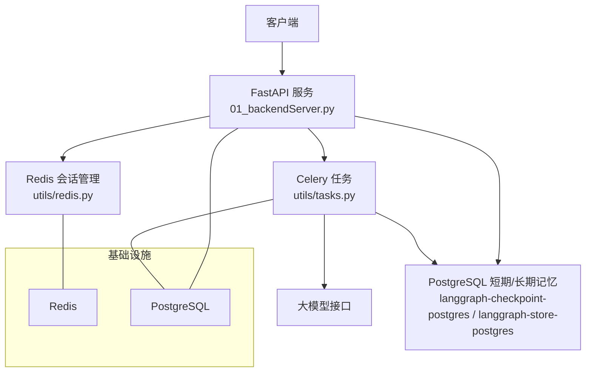
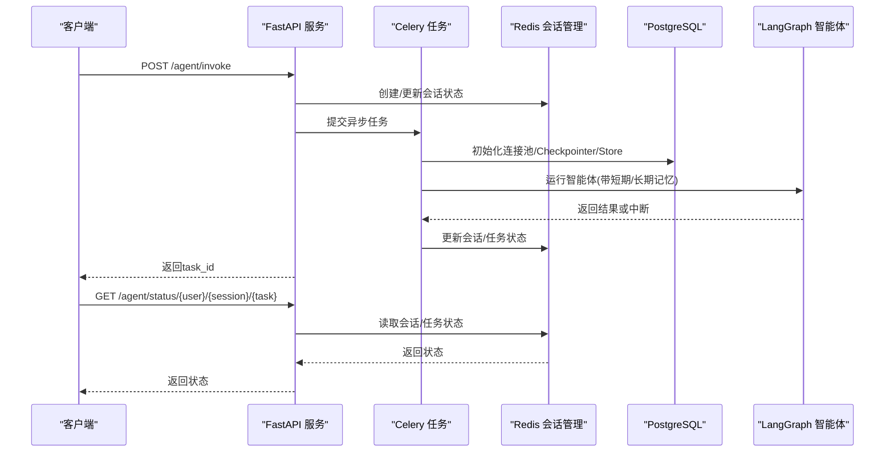
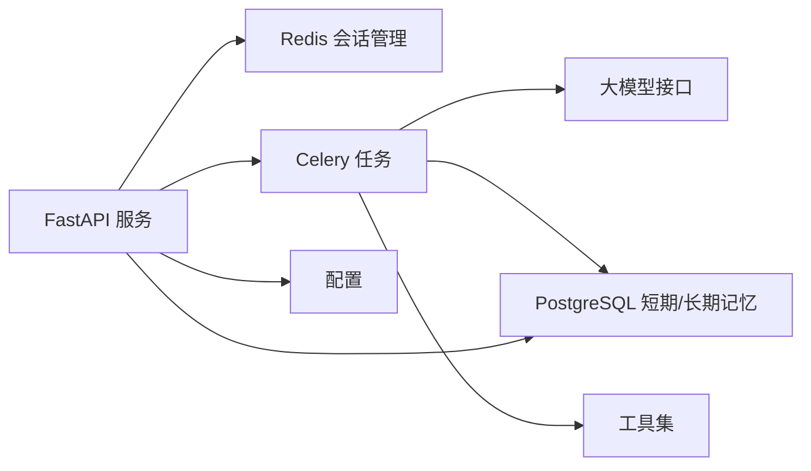

# 存储适配器开发

<cite>
**本文引用的文件**
- [01_backendServer.py](file://01_backendServer.py)
- [utils/config.py](file://utils/config.py)
- [utils/models.py](file://utils/models.py)
- [utils/redis.py](file://utils/redis.py)
- [utils/tasks.py](file://utils/tasks.py)
- [docker/postgresql/docker-compose.yml](file://docker/postgresql/docker-compose.yml)
- [README.md](file://README.md)
</cite>

## 目录
1. [简介](#简介)
2. [项目结构](#项目结构)
3. [核心组件](#核心组件)
4. [架构总览](#架构总览)
5. [详细组件分析](#详细组件分析)
6. [依赖关系分析](#依赖关系分析)
7. [性能与调优](#性能与调优)
8. [故障排查指南](#故障排查指南)
9. [结论](#结论)
10. [附录：扩展存储适配器的实践](#附录：扩展存储适配器的实践)

## 简介
本指南面向需要扩展系统存储能力的开发者，重点说明当前系统中短期记忆（PostgreSQL）与长期记忆的存储架构、会话状态在Redis中的实现方式，以及存储适配器的设计模式与扩展点。文档涵盖数据库连接管理、数据模型映射、查询优化、新增存储后端、数据迁移、备份恢复、并发控制与事务处理、性能调优与监控等主题，帮助开发者快速、安全地扩展系统的存储能力。

## 项目结构
本项目采用分层组织：
- 服务入口与生命周期管理：FastAPI应用启动、资源初始化与清理
- 配置中心：统一配置项（数据库、Redis、任务队列、LLM类型等）
- 数据模型：Pydantic模型定义请求/响应结构
- 会话状态存储：基于Redis的异步会话管理器
- 任务执行：Celery异步任务，调用LangGraph智能体，使用PostgreSQL作为短期记忆检查点与长期记忆存储
- 容器化部署：PostgreSQL与Redis通过Docker Compose提供

图表来源
- [01_backendServer.py:84-123](file://01_backendServer.py#L84-L123)
- [utils/redis.py:37-103](file://utils/redis.py#L37-L103)
- [utils/tasks.py:319-451](file://utils/tasks.py#L319-L451)
- [docker/postgresql/docker-compose.yml:1-25](file://docker/postgresql/docker-compose.yml#L1-L25)

章节来源
- [01_backendServer.py:84-123](file://01_backendServer.py#L84-L123)
- [utils/config.py:1-34](file://utils/config.py#L1-L34)
- [README.md:1-199](file://README.md#L1-L199)

## 核心组件
- 配置模块：集中管理数据库连接串、连接池大小、Redis参数、TTL、任务队列地址等
- 数据模型：统一的请求/响应结构，便于序列化与校验
- Redis会话管理器：维护用户-会话-任务的关联关系、会话状态、任务状态、过期策略与清理逻辑
- PostgreSQL短期/长期记忆：通过LangGraph提供的AsyncPostgresSaver与AsyncPostgresStore，分别承担短期记忆的检查点持久化与长期记忆的键值存储
- Celery任务：异步执行智能体推理，读写短期/长期记忆并更新会话与任务状态

章节来源
- [utils/config.py:1-34](file://utils/config.py#L1-L34)
- [utils/models.py:1-97](file://utils/models.py#L1-L97)
- [utils/redis.py:37-493](file://utils/redis.py#L37-L493)
- [01_backendServer.py:84-123](file://01_backendServer.py#L84-L123)
- [utils/tasks.py:319-560](file://utils/tasks.py#L319-L560)

## 架构总览
系统在启动时创建数据库连接池，并初始化短期记忆Checkpointer与长期记忆Store；同时初始化Redis会话管理器用于会话与任务状态管理。Celery任务在执行过程中复用或新建连接池，调用LangGraph智能体，并通过PostgreSQL进行短期/长期记忆存取，最终将结果写回Redis以支持查询与恢复。

图表来源
- [01_backendServer.py:132-173](file://01_backendServer.py#L132-L173)
- [01_backendServer.py:316-344](file://01_backendServer.py#L316-L344)
- [utils/tasks.py:319-451](file://utils/tasks.py#L319-L451)
- [utils/redis.py:65-144](file://utils/redis.py#L65-L144)

## 详细组件分析

### 短期记忆（PostgreSQL Checkpointer）
- 作用：持久化LangGraph工作流的节点状态与消息历史，支持断点续跑与人类介入（HITL）
- 初始化：在服务生命周期中创建AsyncConnectionPool，并注入到AsyncPostgresSaver
- 使用：在Celery任务中为每个线程（thread_id=task_id）创建独立的checkpointer上下文，确保多会话隔离
- 关键点：
  - 连接池参数：最小/最大连接数、自动提交、预编译阈值
  - 线程隔离：通过configurable.thread_id区分不同会话的工作流状态
  - 修剪策略：通过pre_model_hook对消息进行裁剪，控制上下文长度

章节来源
- [01_backendServer.py:94-109](file://01_backendServer.py#L94-L109)
- [utils/tasks.py:351-374](file://utils/tasks.py#L351-L374)
- [utils/tasks.py:476-499](file://utils/tasks.py#L476-L499)

### 长期记忆（PostgreSQL Store）
- 作用：按命名空间存储用户的长期信息（如偏好、历史摘要），供系统提示词动态拼接
- 初始化：与服务同级的AsyncPostgresStore实例，共享同一连接池
- 使用：
  - 写入：在API层根据user_id生成命名空间与唯一key，存入结构化value
  - 读取：在任务中搜索该命名空间内容，拼接到system_message
- 关键点：
  - 命名空间设计：("memories", user_id)
  - 查询与过滤：支持空查询获取全部条目，服务端组装字符串
  - 错误处理：查询失败返回HTTP 500

章节来源
- [01_backendServer.py:43-80](file://01_backendServer.py#L43-L80)
- [01_backendServer.py:347-374](file://01_backendServer.py#L347-L374)
- [utils/tasks.py:87-134](file://utils/tasks.py#L87-L134)

### 会话状态（Redis）
- 作用：维护用户-会话-任务的关联、会话状态机（idle/running/completed/error/interrupted）、任务状态与最近响应
- 数据结构：
  - session:{user_id}:{session_id}:{task_id}：JSON序列化会话详情
  - user_sessions:{user_id}：集合，记录session_id:task_id
  - task_mapping:{user_id}:{session_id}：集合，记录task_id
  - task:{task_id}：任务状态与结果快照
- 功能：
  - 创建/更新/删除会话与任务
  - 查询用户活跃会话、会话任务列表、任务状态
  - 清理过期/无效数据（扫描+一致性校验）
  - TTL控制：会话与任务均支持过期时间
- 关键点：
  - 异步操作：基于redis.asyncio
  - 幂等性：存在性检查后再操作
  - 一致性：清理流程保证集合与实体的一致性

章节来源
- [utils/redis.py:37-493](file://utils/redis.py#L37-L493)
- [01_backendServer.py:132-173](file://01_backendServer.py#L132-L173)
- [01_backendServer.py:316-344](file://01_backendServer.py#L316-L344)

### 数据模型映射
- Pydantic模型定义了请求与响应的结构，确保前后端契约一致
- 在Redis中，AgentResponse等对象会被序列化为字典进行存储，并在读取时尝试反序列化为模型对象
- 好处：类型校验、可维护性强、易于扩展字段

章节来源
- [utils/models.py:1-97](file://utils/models.py#L1-L97)
- [utils/redis.py:77-93](file://utils/redis.py#L77-L93)
- [utils/redis.py:369-390](file://utils/redis.py#L369-L390)

### 连接管理与事务
- 连接池：psycopg_pool.AsyncConnectionPool，支持最小/最大连接数、自动提交、预编译阈值
- 事务：当前代码未显式开启事务，但可通过pool上下文或SQL包装实现事务边界
- 并发：Celery worker与FastAPI事件循环并发执行，Redis与PostgreSQL各自具备高并发能力
- 建议：对关键写路径增加事务封装与重试机制，提升一致性

章节来源
- [01_backendServer.py:94-101](file://01_backendServer.py#L94-L101)
- [utils/tasks.py:351-357](file://utils/tasks.py#L351-L357)
- [utils/tasks.py:476-482](file://utils/tasks.py#L476-L482)

## 依赖关系分析
- FastAPI服务依赖：
  - Redis会话管理器（utils/redis.py）
  - Celery任务（utils/tasks.py）
  - 配置（utils/config.py）
  - LangGraph短期/长期记忆（通过PostgreSQL）
- Celery任务依赖：
  - 大模型接口（utils/llms.py）
  - 工具集（utils/tools.py）
  - Redis会话管理器
  - PostgreSQL连接池与LangGraph存储

图表来源
- [01_backendServer.py:84-123](file://01_backendServer.py#L84-L123)
- [utils/tasks.py:319-451](file://utils/tasks.py#L319-L451)
- [utils/config.py:1-34](file://utils/config.py#L1-L34)

章节来源
- [01_backendServer.py:84-123](file://01_backendServer.py#L84-L123)
- [utils/tasks.py:319-451](file://utils/tasks.py#L319-L451)
- [utils/config.py:1-34](file://utils/config.py#L1-L34)

## 性能与调优
- 连接池调优
  - 调整MIN_SIZE/MAX_SIZE以适应并发峰值
  - 启用autocommit减少事务开销
  - 设置prepare_threshold优化重复SQL
- Redis调优
  - 合理设置SESSION_TIMEOUT与TTL，避免内存膨胀
  - 使用scan_iter进行惰性清理，降低阻塞风险
  - 关注键空间分布，避免热点键
- PostgreSQL调优
  - 调整max_connections与共享内存参数
  - 对频繁访问的表建立索引（如按user_id、namespace、key）
  - 定期VACUUM/ANALYZE维护统计信息
- 任务队列
  - Celery worker数量与CPU核数匹配
  - 任务序列化使用JSON，注意payload大小
- 监控指标
  - 连接池使用率、等待时间
  - Redis命中率、内存使用、慢查询
  - PostgreSQL锁等待、慢查询、连接数
  - Celery队列堆积、任务耗时、失败率

[本节为通用指导，不直接分析具体文件]

## 故障排查指南
- 初始化失败
  - 检查数据库连接串、端口、认证信息
  - 确认Redis可达且DB号正确
  - 查看日志输出定位异常堆栈
- 会话不存在
  - 检查user_id是否存在于user_sessions集合
  - 检查task_mapping是否包含对应task_id
  - 清理无效任务后重试
- 任务状态异常
  - 检查Redis中task:{task_id}是否存在
  - 检查Celery worker是否正常运行
  - 查看任务执行日志与错误信息
- 长期记忆写入失败
  - 检查命名空间与key格式
  - 确认PostgreSQL可用性与权限
  - 捕获并记录异常详情

章节来源
- [01_backendServer.py:113-123](file://01_backendServer.py#L113-L123)
- [utils/redis.py:247-341](file://utils/redis.py#L247-L341)
- [utils/tasks.py:420-446](file://utils/tasks.py#L420-L446)

## 结论
本系统通过Redis管理会话与任务状态，PostgreSQL承载短期与长期记忆，结合Celery实现异步任务调度，形成了可扩展、高可用的存储架构。开发者可在现有基础上扩展新的存储后端、优化查询与连接管理、完善事务与监控，以满足更复杂的业务需求。

[本节为总结，不直接分析具体文件]

## 附录：扩展存储适配器的实践

### 新增存储后端（以替换短期记忆为例）
- 目标：在不改动上层API的前提下，替换或新增短期记忆后端
- 步骤：
  - 抽象接口：定义统一的checkpointer接口（保存/恢复状态、列出线程、清理）
  - 实现新后端：基于目标存储（如MongoDB、SQLite）实现接口
  - 注入替换：在服务生命周期中根据配置选择后端实例
  - 兼容测试：验证多会话隔离、断点续跑、HITL恢复
- 注意事项：
  - 保持thread_id语义一致
  - 确保幂等与一致性
  - 提供迁移脚本与回滚方案

[本节为概念性指导，不直接分析具体文件]

### 数据迁移与版本兼容
- 迁移策略：
  - 增量迁移：按版本号逐步变更schema
  - 双写过渡：新旧并存，逐步切换读路径
  - 回滚预案：保留旧数据与索引，支持快速回退
- 实施要点：
  - 使用事务包裹批量迁移
  - 灰度发布与A/B测试
  - 监控迁移耗时与错误率

[本节为概念性指导，不直接分析具体文件]

### 备份与恢复
- 短期记忆（PostgreSQL）：
  - 定期pg_dump或物理备份
  - 基于时间点恢复（PITR）
- 长期记忆（PostgreSQL Store）：
  - 按命名空间导出/导入
  - 校验数据完整性
- 会话状态（Redis）：
  - AOF/RDB持久化
  - 冷备与热备结合
  - 恢复后清理无效会话

[本节为概念性指导，不直接分析具体文件]

### 自定义存储适配器示例（连接池、事务、并发）
- 连接池配置：
  - 设置最小/最大连接数
  - 启用自动提交与预编译
  - 配置超时与重试
- 事务处理：
  - 使用上下文管理器包裹写路径
  - 失败回滚与补偿
- 并发控制：
  - 使用分布式锁避免竞态
  - 限流与背压保护
- 监控与日志：
  - 记录关键指标与错误
  - 接入APM与告警

[本节为概念性指导，不直接分析具体文件]

### 会话状态存储在Redis的实现与扩展
- 当前实现：
  - 会话数据JSON序列化，支持TTL
  - 集合维护用户-会话-任务关系
  - 清理流程保证一致性
- 扩展方法：
  - 增加会话元数据字段（如优先级、标签）
  - 引入分片与集群模式提升容量
  - 增加审计日志与访问统计

章节来源
- [utils/redis.py:65-144](file://utils/redis.py#L65-L144)
- [utils/redis.py:247-341](file://utils/redis.py#L247-L341)
- [utils/redis.py:369-442](file://utils/redis.py#L369-L442)