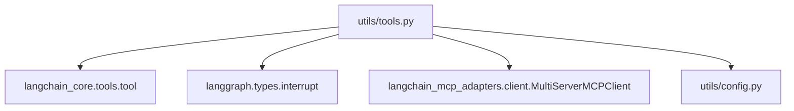
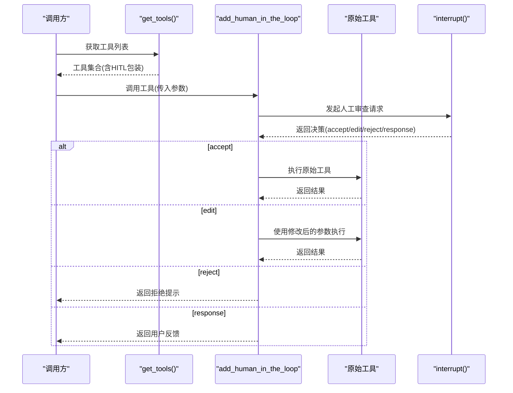
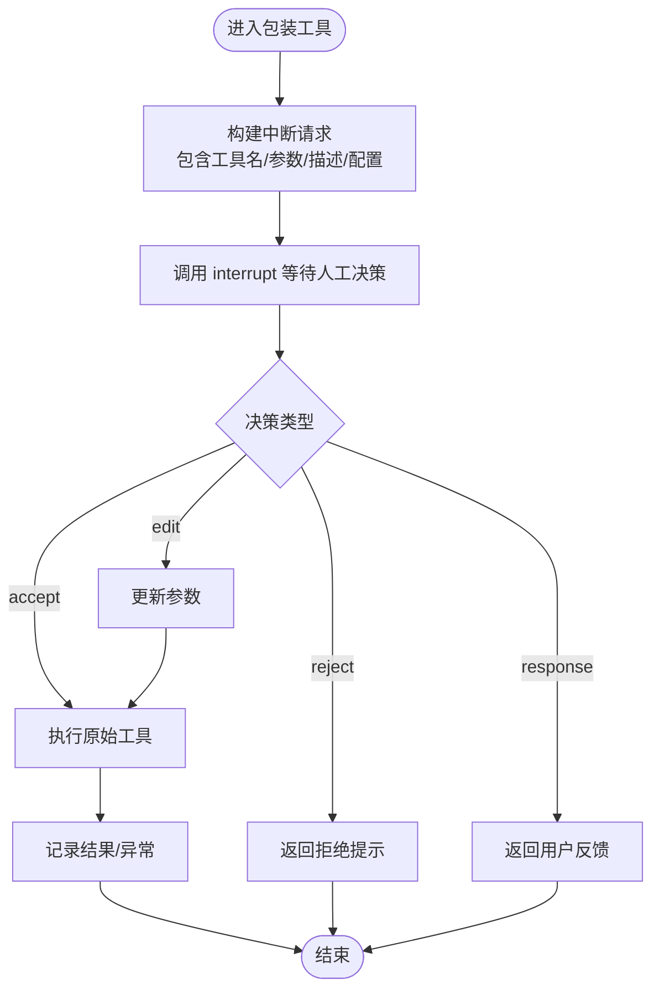
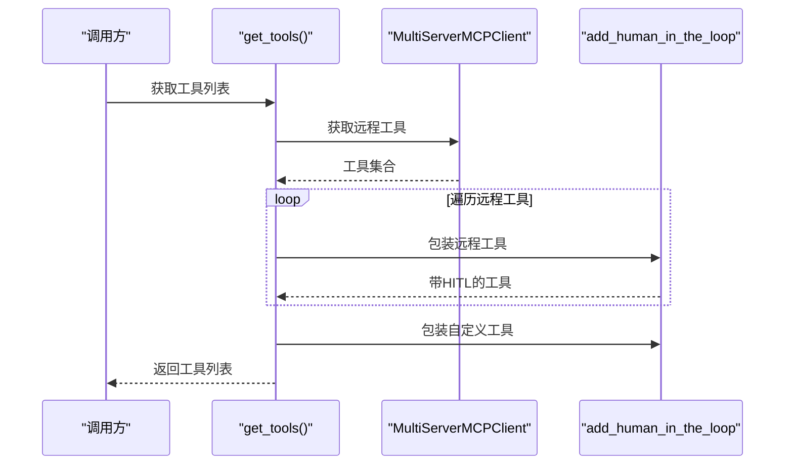
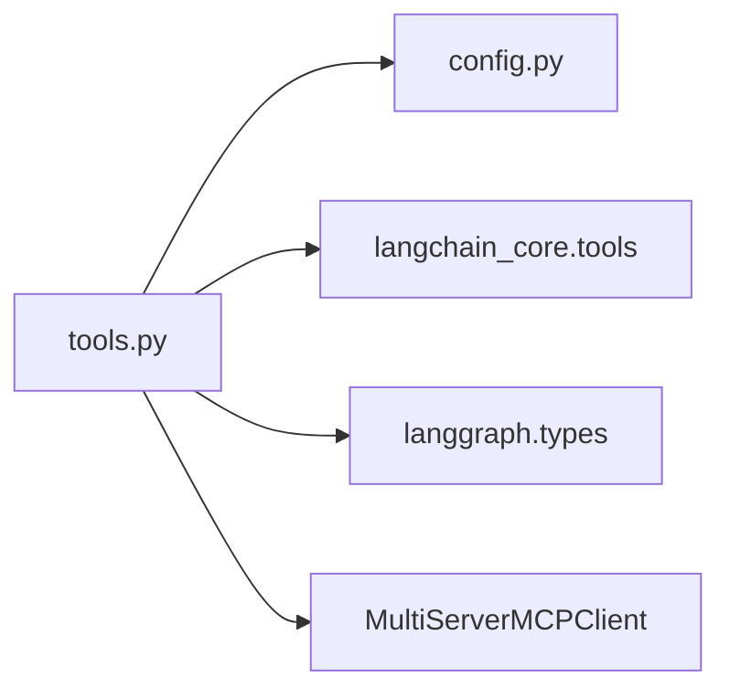

# 工具插件开发

<cite>
**本文引用的文件**
- [utils/tools.py](file://utils/tools.py)
- [utils/config.py](file://utils/config.py)
- [README.md](file://README.md)
</cite>

## 目录
1. [简介](#简介)
2. [项目结构](#项目结构)
3. [核心组件](#核心组件)
4. [架构总览](#架构总览)
5. [详细组件分析](#详细组件分析)
6. [依赖关系分析](#依赖关系分析)
7. [性能考虑](#性能考虑)
8. [故障排查指南](#故障排查指南)
9. [结论](#结论)
10. [附录](#附录)

## 简介
本指南面向希望扩展系统“工具能力”的开发者，聚焦于如何基于 @tool 装饰器创建自定义工具、如何为工具添加人工审查（Human-in-the-Loop, HITL）机制、如何注册与发现工具，以及如何测试与调试。内容基于仓库中的工具实现与示例，提供从简单计算器到复杂业务工具的完整开发路径。

## 项目结构
本项目将工具相关逻辑集中在 utils/tools.py，配置集中在 utils/config.py，并在 README.md 中提供了功能说明与测试流程。整体组织清晰：
- utils/tools.py：定义工具装饰器使用方式、HITL 包装器、工具注册与发现函数 get_tools()
- utils/config.py：集中管理日志、数据库、缓存等配置项
- README.md：描述系统能力、测试步骤与示例工具

图表来源
- [utils/tools.py:1-175](file://utils/tools.py#L1-L175)
- [utils/config.py:1-34](file://utils/config.py#L1-L34)

章节来源
- [utils/tools.py:1-175](file://utils/tools.py#L1-L175)
- [utils/config.py:1-34](file://utils/config.py#L1-L34)
- [README.md:1-199](file://README.md#L1-L199)

## 核心组件
- 工具装饰器 @tool：用于声明式定义工具，自动提取参数类型注解与返回值类型，生成工具元数据（名称、描述、参数模式），并支持异步函数。
- 人工审查包装器 add_human_in_the_loop：对任意可调用对象或 BaseTool 进行包装，在工具执行前发起中断请求，等待人工决策（接受/编辑/拒绝/直接响应）。
- 工具注册与发现 get_tools：聚合自定义工具与 MCP Server 提供的工具，统一注入 HITL 能力后返回工具列表。

章节来源
- [utils/tools.py:37-118](file://utils/tools.py#L37-L118)
- [utils/tools.py:121-175](file://utils/tools.py#L121-L175)

## 架构总览
下图展示了工具从定义到被 Agent 调用的关键路径，包括 HITL 中断与执行分支。

图表来源
- [utils/tools.py:37-118](file://utils/tools.py#L37-L118)
- [utils/tools.py:121-175](file://utils/tools.py#L121-L175)

## 详细组件分析

### 使用 @tool 装饰器创建自定义工具
- 函数定义规范
  - 使用 @tool("工具名", description="...") 装饰异步函数或同步函数。
  - 参数建议使用 Python 类型注解（如 str、float、int），以便自动生成参数模式。
  - 返回值建议明确类型注解，便于框架推断与校验。
- 异步支持
  - 推荐使用 async def，内部通过 await 调用外部服务或 I/O 操作。
- 错误处理
  - 建议在工具内部捕获异常并返回友好的错误信息，或在更上层统一处理。
- 日志记录
  - 可通过模块级 logger 记录关键步骤与结果，便于追踪问题。

章节来源
- [utils/tools.py:121-151](file://utils/tools.py#L121-L151)

### 人工审查（HITL）机制：add_human_in_the_loop
- 作用
  - 为任意工具增加“执行前人工审批”能力，支持四种响应类型：接受、编辑、拒绝、直接响应。
- 输入与输出
  - 输入：可调用对象或 BaseTool；可选 HumanInterruptConfig。
  - 输出：新的 BaseTool（或可调用对象），具备中断与决策分支逻辑。
- 执行流程
  - 构造中断请求，包含工具名、参数、描述与配置。
  - 调用 interrupt 阻塞等待人工决策。
  - 根据决策类型执行不同分支：
    - accept：调用原始工具并返回结果。
    - edit：用用户修改后的参数重新调用原始工具。
    - reject：返回拒绝提示。
    - response：直接返回用户反馈。
- 日志与异常
  - 记录每次中断响应与工具执行结果。
  - 捕获工具执行异常并记录错误日志。

图表来源
- [utils/tools.py:37-118](file://utils/tools.py#L37-L118)

章节来源
- [utils/tools.py:37-118](file://utils/tools.py#L37-L118)

### 工具注册与发现：get_tools()
- 功能
  - 聚合自定义工具与 MCP Server 提供的工具，统一注入 HITL 能力后返回工具列表。
- 实现要点
  - 在函数内定义本地工具（如酒店预定、乘法计算）。
  - 通过 MultiServerMCPClient 连接外部 MCP Server 并获取其工具集。
  - 对每个工具调用 add_human_in_the_loop 包装，确保统一的人机协作体验。
  - 追加自定义工具（部分已包装，部分未包装）并返回列表。

图表来源
- [utils/tools.py:121-175](file://utils/tools.py#L121-L175)

章节来源
- [utils/tools.py:121-175](file://utils/tools.py#L121-L175)

### 完整的工具开发示例
- 简单计算器工具
  - 使用 @tool 装饰器定义一个异步函数，接收两个浮点数参数，返回乘积字符串。
  - 适合验证参数类型标注与返回值处理是否正确。
- 复杂业务工具（模拟酒店预定）
  - 使用 @tool 装饰器定义异步函数，接收酒店名称参数，返回预定成功消息。
  - 可结合外部服务（如订单系统）实现真实业务逻辑。
- 接入 MCP 工具
  - 通过 MultiServerMCPClient 获取第三方工具，并使用 add_human_in_the_loop 包装，使其具备 HITL 能力。

章节来源
- [utils/tools.py:121-175](file://utils/tools.py#L121-L175)
- [README.md:121-165](file://README.md#L121-L165)

## 依赖关系分析
- 内部依赖
  - utils/tools.py 依赖 utils/config.py 的日志配置常量。
- 外部依赖
  - langchain_core.tools：@tool 装饰器与 BaseTool 抽象。
  - langgraph.types：interrupt 与 Command，用于人机协作中断。
  - langchain_mcp_adapters.client：MultiServerMCPClient，用于拉取远程工具。
- 耦合与内聚
  - 工具定义与 HITL 包装解耦，便于复用与扩展。
  - 工具注册与发现集中在 get_tools()，提高内聚性。

图表来源
- [utils/tools.py:1-175](file://utils/tools.py#L1-L175)
- [utils/config.py:1-34](file://utils/config.py#L1-L34)

章节来源
- [utils/tools.py:1-175](file://utils/tools.py#L1-L175)
- [utils/config.py:1-34](file://utils/config.py#L1-L34)

## 性能考虑
- 异步优先：工具函数推荐采用 async def，避免阻塞事件循环。
- 日志轮转：使用 ConcurrentRotatingFileHandler 控制日志文件大小与保留数量，避免磁盘占用过高。
- 批量包装：对大量远程工具进行包装时，注意并发与资源限制，必要时分批处理。
- 超时与重试：对外部服务调用应设置合理超时与重试策略，提升鲁棒性。

[本节为通用指导，不直接分析具体文件]

## 故障排查指南
- 常见问题
  - 工具未被发现：检查 get_tools() 是否正确返回工具列表，确认是否对工具进行了包装。
  - HITL 无响应：确认 interrupt 调用是否被正确触发，检查前端或交互层是否处理了中断请求。
  - 参数类型错误：检查函数参数类型注解是否与调用方一致。
- 日志定位
  - 查看 logfile/app.log，关注工具调用前后的日志与异常堆栈。
  - 利用 add_human_in_the_loop 中的日志输出，快速定位中断响应与执行分支。
- 调试技巧
  - 在工具内部打印关键变量，逐步缩小问题范围。
  - 使用最小化用例复现问题，例如仅调用 multiply 工具。

章节来源
- [utils/tools.py:14-34](file://utils/tools.py#L14-L34)
- [utils/tools.py:37-118](file://utils/tools.py#L37-L118)
- [utils/config.py:1-34](file://utils/config.py#L1-L34)

## 结论
通过 @tool 装饰器与 add_human_in_the_loop 包装器，开发者可以便捷地创建具备人机协作能力的工具，并通过 get_tools() 统一注册与发现。结合日志与调试手段，能够快速定位与解决问题，保障工具的稳定运行与持续扩展。

[本节为总结性内容，不直接分析具体文件]

## 附录
- 测试流程参考
  - 启动后端与前端服务，按照 README 的步骤测试 HITL 对工具请求的人类反馈。
  - 使用示例工具 book_hotel 与 multiply 验证参数传递与返回结果。
- 扩展建议
  - 为新业务领域编写专用工具，遵循参数类型注解与异步最佳实践。
  - 对敏感或高风险操作启用 HITL，确保人工审批流程。

章节来源
- [README.md:121-165](file://README.md#L121-L165)