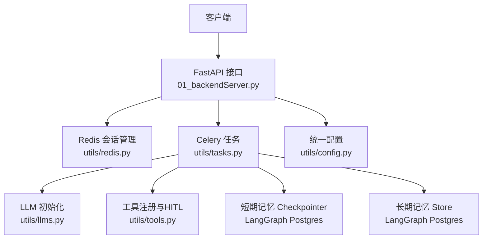
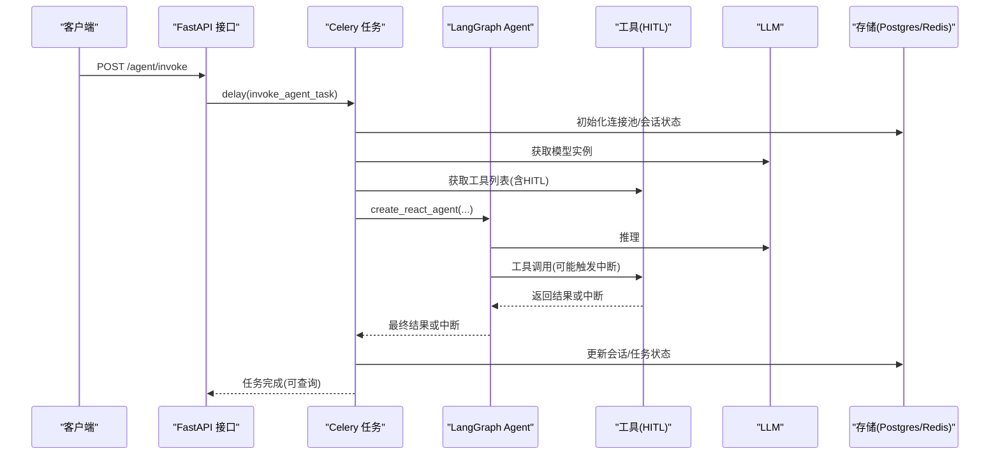
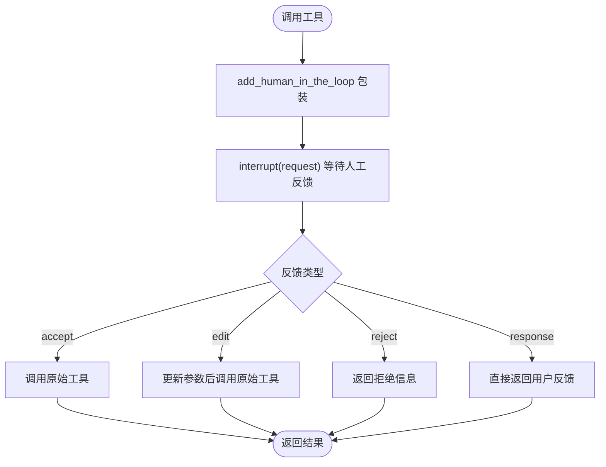
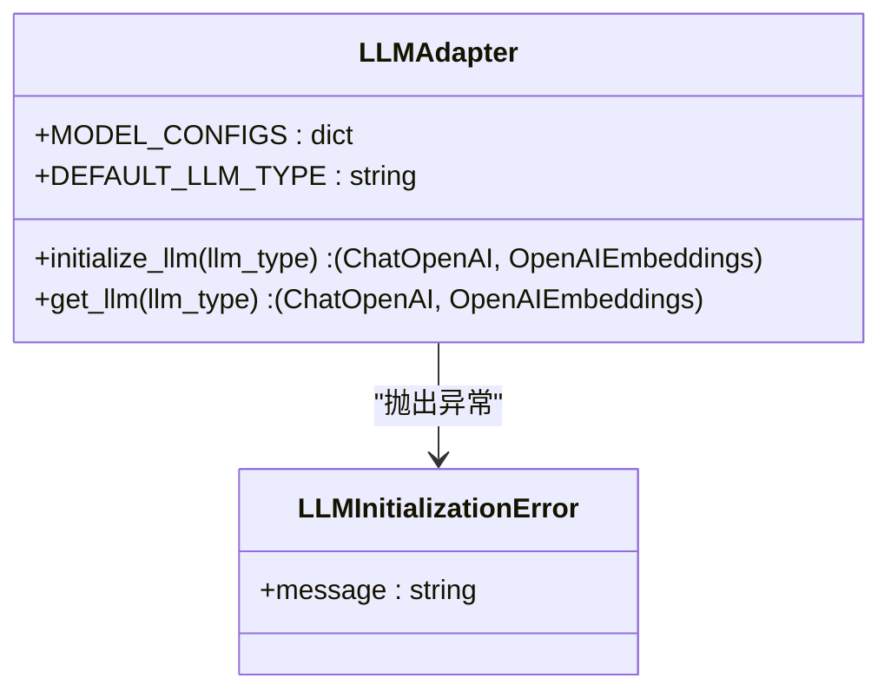
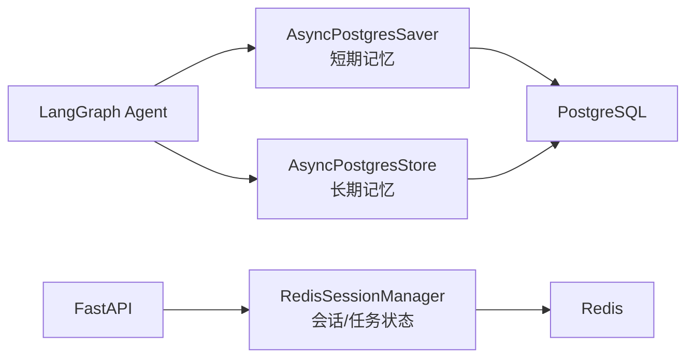
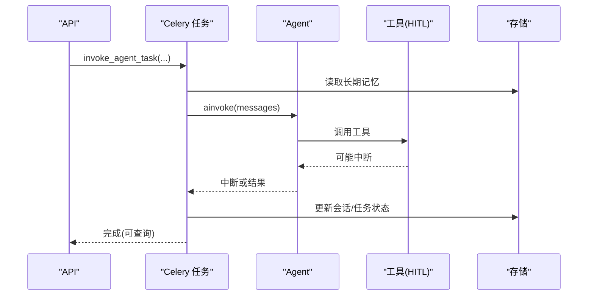
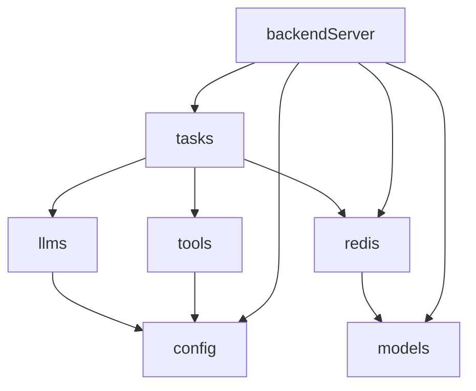

# 扩展开发指南

<cite>
**本文引用的文件**
- [README.md](file://README.md)
- [01_backendServer.py](file://01_backendServer.py)
- [utils/config.py](file://utils/config.py)
- [utils/llms.py](file://utils/llms.py)
- [utils/tools.py](file://utils/tools.py)
- [utils/models.py](file://utils/models.py)
- [utils/redis.py](file://utils/redis.py)
- [utils/tasks.py](file://utils/tasks.py)
</cite>

## 目录
1. [简介](#简介)
2. [项目结构](#项目结构)
3. [核心组件](#核心组件)
4. [架构总览](#架构总览)
5. [详细组件分析](#详细组件分析)
6. [依赖关系分析](#依赖关系分析)
7. [性能与可扩展性](#性能与可扩展性)
8. [故障排查指南](#故障排查指南)
9. [结论](#结论)
10. [附录：扩展清单与最佳实践](#附录：扩展清单与最佳实践)

## 简介
本指南面向希望扩展本系统的开发者，覆盖插件系统、工具插件、LLM适配器、存储适配器等扩展点。重点说明如何：
- 使用 @tool 装饰器编写自定义工具，并集成人工审查（HITL）
- 接入新的 LLM 提供商，实现适配器配置与调用封装
- 扩展存储适配器（短期记忆 Checkpointer、长期记忆 Store）
- 遵循规范与最佳实践，完成测试与发布

该系统基于 FastAPI + LangGraph ReAct Agent，支持多厂商 LLM、Redis 会话状态、PostgreSQL 短期/长期记忆持久化，以及 Celery 异步任务队列。

## 项目结构
- API 入口与生命周期管理：后端服务启动、连接池初始化、会话管理器注入
- 任务编排：Celery 任务负责实际执行 Agent 流程，包括消息修剪、工具调用、结果处理
- 工具系统：内置工具、MCP 工具、人工审查包装
- LLM 适配：统一初始化 ChatOpenAI/OpenAIEmbeddings，支持多厂商配置
- 存储层：PostgreSQL 短期记忆（Checkpointer）、长期记忆（Store），Redis 会话状态
- 数据模型：Pydantic 模型定义请求/响应结构

图表来源
- [01_backendServer.py:84-130](file://01_backendServer.py#L84-L130)
- [utils/tasks.py:318-451](file://utils/tasks.py#L318-L451)
- [utils/llms.py:70-119](file://utils/llms.py#L70-L119)
- [utils/tools.py:121-175](file://utils/tools.py#L121-L175)
- [utils/config.py:4-34](file://utils/config.py#L4-L34)

章节来源
- [README.md:1-38](file://README.md#L1-L38)
- [01_backendServer.py:84-130](file://01_backendServer.py#L84-L130)

## 核心组件
- 配置中心：集中管理日志、数据库、Redis、Celery、LLM类型等常量
- LLM 适配器：统一初始化聊天与嵌入模型，支持多厂商切换
- 工具系统：@tool 装饰器定义工具，add_human_in_the_loop 包装为可中断工具，get_tools 聚合工具列表
- 存储适配：PostgreSQL 短期记忆（AsyncPostgresSaver）与长期记忆（AsyncPostgresStore），Redis 会话状态
- 任务编排：Celery 任务 invoke_agent_task/resume_agent_task 驱动 Agent 运行、中断恢复、结果处理
- 数据模型：AgentRequest/InterruptResponse/AgentResponse 等 Pydantic 模型

章节来源
- [utils/config.py:4-34](file://utils/config.py#L4-L34)
- [utils/llms.py:31-119](file://utils/llms.py#L31-L119)
- [utils/tools.py:37-175](file://utils/tools.py#L37-L175)
- [utils/redis.py:37-493](file://utils/redis.py#L37-L493)
- [utils/tasks.py:66-564](file://utils/tasks.py#L66-L564)
- [utils/models.py:7-97](file://utils/models.py#L7-L97)

## 架构总览
系统采用“API 层 + 任务队列 + Agent 工作流”的分层架构：
- API 层接收请求，创建或校验会话，将任务投递到 Celery
- 任务层构建 Agent（ReAct），加载工具、LLM、短期/长期记忆，执行推理与工具调用
- 存储层通过 PostgreSQL 和 Redis 提供持久化与会话状态管理
- 工具层支持自定义工具与 MCP 工具，并通过 HITL 进行人工审查

图表来源
- [01_backendServer.py:132-173](file://01_backendServer.py#L132-L173)
- [utils/tasks.py:318-451](file://utils/tasks.py#L318-L451)
- [utils/tools.py:121-175](file://utils/tools.py#L121-L175)
- [utils/llms.py:70-119](file://utils/llms.py#L70-L119)

## 详细组件分析

### 工具插件扩展（@tool 与 HITL）
- 工具定义：使用 @tool 装饰器声明工具名称、描述与参数；函数体实现业务逻辑
- 人工审查：通过 add_human_in_the_loop 将任意工具包装为支持 accept/edit/reject/response 四种审查类型的工具
- 工具聚合：get_tools 从 MCP Server 拉取工具，并为每个工具添加 HITL；同时追加自定义工具

图表来源
- [utils/tools.py:37-118](file://utils/tools.py#L37-L118)
- [utils/tools.py:121-175](file://utils/tools.py#L121-L175)

开发与集成要点
- 在 get_tools 中新增 @tool 装饰的函数，并在末尾 append 到工具列表
- 如需对第三方工具也启用 HITL，可通过 add_human_in_the_loop 包裹
- 参数验证由 LangChain 自动根据函数签名生成 args_schema，确保类型安全
- 日志记录建议统一使用模块级 logger，便于追踪工具调用链

章节来源
- [utils/tools.py:37-175](file://utils/tools.py#L37-L175)

### LLM 适配器扩展（新提供商接入）
- 配置扩展：在 MODEL_CONFIGS 中添加新提供商的配置项（base_url、api_key、chat_model、embedding_model）
- 初始化逻辑：initialize_llm 根据 llm_type 选择配置并创建 ChatOpenAI/OpenAIEmbeddings 实例
- 默认回退：get_llm 在失败时尝试默认类型，提升鲁棒性

图表来源
- [utils/llms.py:31-119](file://utils/llms.py#L31-L119)

接入步骤
- 在 utils/llms.py 的 MODEL_CONFIGS 中新增条目
- 若需特殊处理（如本地 Ollama），参考 ollama 分支设置必要环境变量
- 通过 Config.LLM_TYPE 切换默认提供商
- 建议在外部配置中通过环境变量注入敏感信息（如 api_key）

章节来源
- [utils/llms.py:31-119](file://utils/llms.py#L31-L119)
- [utils/config.py:28-30](file://utils/config.py#L28-L30)

### 存储适配器扩展（短期/长期记忆）
- 短期记忆：使用 AsyncPostgresSaver 作为 Checkpointer，保存 Agent 节点状态，支持断点续跑
- 长期记忆：使用 AsyncPostgresStore 读写用户偏好等长期信息，命名空间隔离
- Redis：维护会话状态、任务状态、过期策略，支持故障恢复

图表来源
- [01_backendServer.py:94-110](file://01_backendServer.py#L94-L110)
- [utils/tasks.py:351-374](file://utils/tasks.py#L351-L374)
- [utils/redis.py:37-493](file://utils/redis.py#L37-L493)

优化建议
- 合理设置连接池大小（MIN_SIZE/MAX_SIZE）以平衡并发与资源占用
- 定期清理无效会话与任务映射，避免内存膨胀
- 对长上下文场景使用 trimmed_messages_hook 控制消息长度

章节来源
- [utils/tasks.py:66-86](file://utils/tasks.py#L66-L86)
- [utils/tasks.py:351-374](file://utils/tasks.py#L351-L374)
- [utils/redis.py:246-341](file://utils/redis.py#L246-L341)

### 任务编排与中断恢复
- 初始调用：invoke_agent_task 构建 Agent，读取长期记忆，执行推理与工具调用
- 中断恢复：resume_agent_task 通过 Command(resume=command_data) 继续执行
- 结果处理：process_agent_result 统一处理中断与最终结果，更新会话与任务状态

图表来源
- [utils/tasks.py:318-451](file://utils/tasks.py#L318-L451)
- [utils/tasks.py:455-559](file://utils/tasks.py#L455-L559)
- [01_backendServer.py:175-237](file://01_backendServer.py#L175-L237)

章节来源
- [utils/tasks.py:318-559](file://utils/tasks.py#L318-L559)
- [01_backendServer.py:132-237](file://01_backendServer.py#L132-L237)

## 依赖关系分析
- 模块耦合
  - backendServer 依赖 tasks、models、config、redis
  - tasks 依赖 llms、tools、config、redis、models
  - tools 依赖 config、langchain_core、langgraph、MCP 客户端
  - llms 依赖 config、langchain_openai
  - redis 依赖 models、config
- 外部依赖
  - LangGraph、LangChain、FastAPI、Celery、Redis、PostgreSQL

图表来源
- [01_backendServer.py:1-18](file://01_backendServer.py#L1-L18)
- [utils/tasks.py:1-18](file://utils/tasks.py#L1-L18)
- [utils/tools.py:1-12](file://utils/tools.py#L1-L12)
- [utils/llms.py:1-6](file://utils/llms.py#L1-L6)
- [utils/redis.py:1-10](file://utils/redis.py#L1-L10)

章节来源
- [01_backendServer.py:1-18](file://01_backendServer.py#L1-L18)
- [utils/tasks.py:1-18](file://utils/tasks.py#L1-L18)

## 性能与可扩展性
- 连接池与超时：数据库连接池大小与超时影响吞吐与稳定性，建议按负载调优
- 消息修剪：trimmed_messages_hook 控制上下文长度，降低 Token 消耗
- 工具并行：MCP 工具与自定义工具可并行调用，注意限流与错误重试
- 会话清理：定期清理无效会话与任务映射，避免 Redis 膨胀
- 异步任务：Celery Worker 数量与队列容量需匹配峰值负载

[本节为通用指导，不直接分析具体文件]

## 故障排查指南
- LLM 初始化失败：检查 MODEL_CONFIGS 与环境变量，确认 base_url/api_key/model 正确
- 工具调用异常：查看 HITL 包装中的异常捕获与日志，确认参数与权限
- 存储连接失败：检查 PostgreSQL/Redis 连接串与网络连通性
- 会话状态不一致：核对 Redis 键结构与 TTL，确保清理逻辑正常
- 任务失败：查看 Celery Worker 日志与任务状态，定位错误堆栈

章节来源
- [utils/llms.py:114-119](file://utils/llms.py#L114-L119)
- [utils/tools.py:83-115](file://utils/tools.py#L83-L115)
- [utils/redis.py:246-341](file://utils/redis.py#L246-L341)
- [utils/tasks.py:420-451](file://utils/tasks.py#L420-L451)

## 结论
本系统提供了清晰的扩展点：
- 工具插件：通过 @tool 与 HITL 快速扩展能力
- LLM 适配器：通过配置与初始化逻辑接入新提供商
- 存储适配器：通过 Postgres 与 Redis 实现短期/长期记忆与会话管理
遵循本文规范与最佳实践，可有效扩展系统功能并确保稳定运行。

[本节为总结，不直接分析具体文件]

## 附录：扩展清单与最佳实践

### 自定义工具开发清单
- 在 utils/tools.py 中使用 @tool 定义函数，明确参数类型与描述
- 如需人工审查，使用 add_human_in_the_loop 包装
- 在 get_tools 中注册工具，确保顺序与优先级
- 参数验证由 LangChain 自动生成，无需手动校验
- 记录关键日志，便于问题定位

章节来源
- [utils/tools.py:121-175](file://utils/tools.py#L121-L175)

### 新 LLM 提供商接入清单
- 在 MODEL_CONFIGS 中添加配置项
- 必要时设置环境变量（如 OPENAI_API_KEY、DASHSCOPE_API_KEY）
- 通过 Config.LLM_TYPE 切换默认提供商
- 测试不同模型的兼容性与性能

章节来源
- [utils/llms.py:31-119](file://utils/llms.py#L31-L119)
- [utils/config.py:28-30](file://utils/config.py#L28-L30)

### 存储适配器扩展清单
- 短期记忆：使用 AsyncPostgresSaver，确保连接池与事务配置正确
- 长期记忆：使用 AsyncPostgresStore，按命名空间隔离数据
- Redis：维护会话与任务状态，设置合理 TTL 与清理策略
- 查询优化：减少扫描范围，利用集合与索引

章节来源
- [01_backendServer.py:94-110](file://01_backendServer.py#L94-L110)
- [utils/tasks.py:351-374](file://utils/tasks.py#L351-L374)
- [utils/redis.py:246-341](file://utils/redis.py#L246-L341)

### 测试与发布
- 单元测试：针对工具函数与 LLM 初始化逻辑编写用例
- 集成测试：模拟 Agent 调用流程，验证中断恢复与状态更新
- 性能测试：压测高并发下的连接池与队列处理能力
- 发布流程：版本化配置与依赖，灰度发布与回滚策略

[本节为通用指导，不直接分析具体文件]