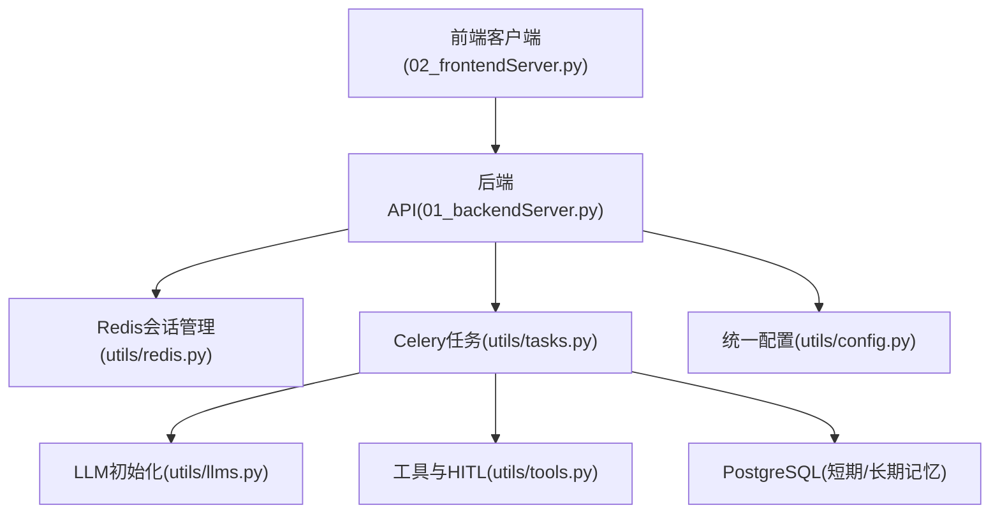
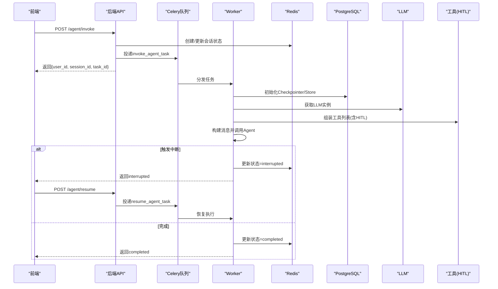
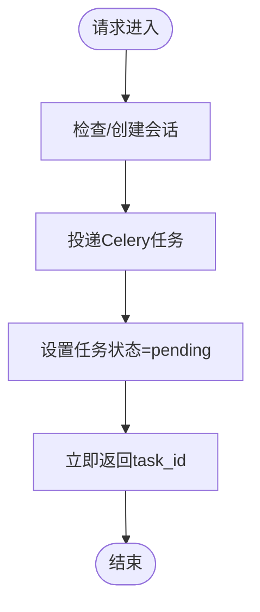
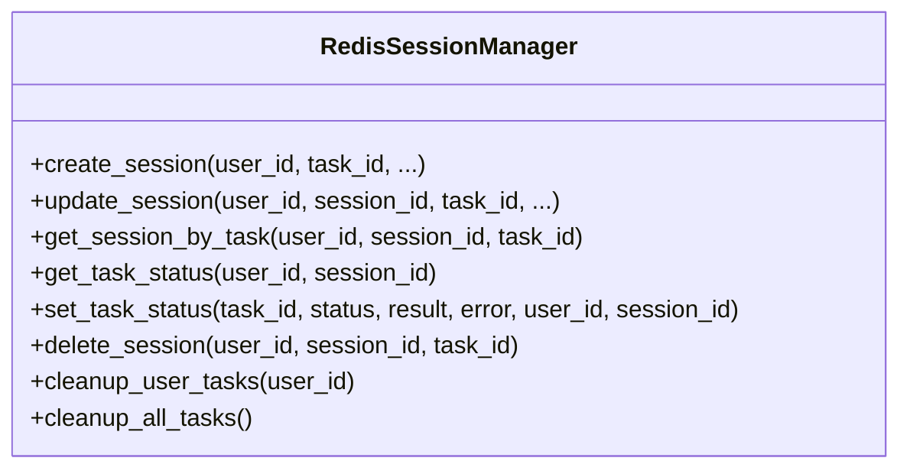
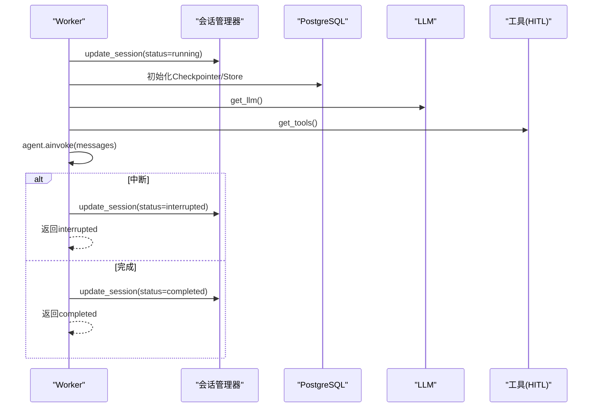
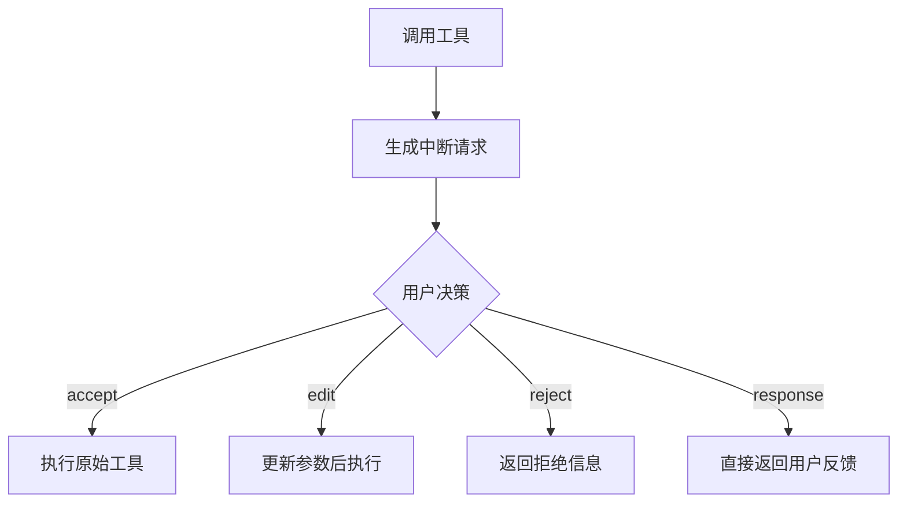
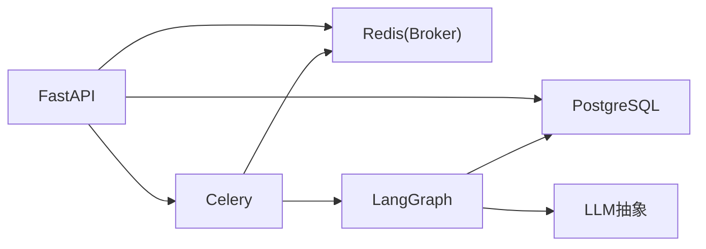

# 扩展最佳实践

<cite>
**本文引用的文件**
- [README.md](file://README.md)
- [01_backendServer.py](file://01_backendServer.py)
- [02_frontendServer.py](file://02_frontendServer.py)
- [utils/config.py](file://utils/config.py)
- [utils/llms.py](file://utils/llms.py)
- [utils/models.py](file://utils/models.py)
- [utils/redis.py](file://utils/redis.py)
- [utils/tasks.py](file://utils/tasks.py)
- [utils/tools.py](file://utils/tools.py)
</cite>

## 目录
1. [引言](#引言)
2. [项目结构](#项目结构)
3. [核心组件](#核心组件)
4. [架构总览](#架构总览)
5. [详细组件分析](#详细组件分析)
6. [依赖关系分析](#依赖关系分析)
7. [性能与可扩展性](#性能与可扩展性)
8. [测试策略](#测试策略)
9. [文档编写规范](#文档编写规范)
10. [部署与发布流程](#部署与发布流程)
11. [安全考虑](#安全考虑)
12. [故障排查指南](#故障排查指南)
13. [结论](#结论)

## 引言
本指南基于当前代码库，面向“扩展开发”的编码规范、测试策略、文档要求、部署发布流程、安全与性能优化等方面，提供可落地的最佳实践。目标是确保扩展具备高质量、可维护性与可演进能力，同时与现有后端服务（FastAPI + Celery + LangGraph）和前端交互保持一致风格。

## 项目结构
- 后端入口：FastAPI 应用与生命周期管理、异步任务调度、会话与状态管理、长期记忆写入等。
- 前端入口：Rich 控制台客户端，负责与后端 API 交互、会话恢复、中断处理与结果展示。
- 工具与配置：统一配置、LLM 初始化、数据模型定义、Redis 会话管理、Celery 任务、工具注册与人工审查。
- 运行环境：PostgreSQL（短期记忆检查点与长期记忆存储）、Redis（会话与任务状态缓存）、Celery Worker（异步执行）。

**图示来源**
- [01_backendServer.py:84-130](file://01_backendServer.py#L84-L130)
- [utils/redis.py:37-103](file://utils/redis.py#L37-L103)
- [utils/tasks.py:318-451](file://utils/tasks.py#L318-L451)
- [utils/llms.py:70-119](file://utils/llms.py#L70-L119)
- [utils/tools.py:37-118](file://utils/tools.py#L37-L118)
- [utils/config.py:4-34](file://utils/config.py#L4-L34)

**章节来源**
- [README.md:1-199](file://README.md#L1-L199)
- [01_backendServer.py:1-424](file://01_backendServer.py#L1-L424)
- [02_frontendServer.py:1-860](file://02_frontendServer.py#L1-L860)

## 核心组件
- 配置中心：集中管理日志、数据库连接池、Redis、Celery、LLM类型与API端口等。
- 会话与状态：基于 Redis 的多用户多会话管理，支持创建、更新、查询、清理与删除。
- 异步任务：通过 Celery 将智能体调用与恢复逻辑异步化，提升吞吐与响应速度。
- LLM 抽象：统一初始化不同厂商或本地模型的聊天与嵌入能力，并支持超时与重试。
- 工具与HITL：为工具添加人工审查，支持接受、拒绝、编辑参数或直接反馈。
- 数据模型：使用 Pydantic 定义请求与响应结构，保证接口契约一致性。

**章节来源**
- [utils/config.py:4-34](file://utils/config.py#L4-L34)
- [utils/redis.py:37-493](file://utils/redis.py#L37-L493)
- [utils/tasks.py:43-63](file://utils/tasks.py#L43-L63)
- [utils/llms.py:31-119](file://utils/llms.py#L31-L119)
- [utils/tools.py:37-175](file://utils/tools.py#L37-L175)
- [utils/models.py:7-97](file://utils/models.py#L7-L97)

## 架构总览
系统采用前后端分离与异步任务解耦的架构：
- 前端通过 HTTP 调用后端 API，快速获得 task_id 并轮询状态。
- 后端在生命周期中初始化 Redis、PostgreSQL 连接池、Checkpointer 与 Store。
- Celery Worker 执行智能体调用与恢复，结合 LangGraph 的 Checkpoint/Store 实现短期/长期记忆。
- 工具层通过 HITL 机制引入人工审批，增强可控性与安全性。

**图示来源**
- [01_backendServer.py:132-237](file://01_backendServer.py#L132-L237)
- [utils/tasks.py:318-559](file://utils/tasks.py#L318-L559)
- [utils/redis.py:65-144](file://utils/redis.py#L65-L144)
- [utils/llms.py:70-119](file://utils/llms.py#L70-L119)
- [utils/tools.py:37-118](file://utils/tools.py#L37-L118)

## 详细组件分析

### 后端API与生命周期
- 生命周期函数负责初始化 Redis 会话管理器、PostgreSQL 连接池、Checkpointer 与 Store，并在关闭时释放资源。
- API 路由包括：
  - 异步调用智能体：/agent/invoke
  - 恢复被中断的智能体：/agent/resume
  - 系统信息与会话管理：/system/info、/agent/active/sessionid/{user_id}、/agent/sessionids/{user_id}、/agent/tasks/{user_id}/{session_id}、/agent/status/{user_id}/{session_id}/{task_id}
  - 长期记忆写入：/agent/write/longterm
  - 会话与任务删除：/agent/session/{user_id}/{session_id}、/agent/task/{user_id}/{session_id}/{task_id}

**图示来源**
- [01_backendServer.py:132-173](file://01_backendServer.py#L132-L173)

**章节来源**
- [01_backendServer.py:84-130](file://01_backendServer.py#L84-L130)
- [01_backendServer.py:132-414](file://01_backendServer.py#L132-L414)

### 会话与状态管理（Redis）
- 数据结构：
  - session:{user_id}:{session_id}:{task_id}：会话详情（状态、上次查询、上次响应、更新时间）
  - user_sessions:{user_id}：用户所有 session_id:task_id 集合
  - task_mapping:{user_id}:{session_id}：会话内所有 task_id 集合
  - task:{task_id}：任务状态（status、result、error、绑定用户与会话）
- 关键方法：
  - create_session/update_session/get_session_by_task/get_task_status/delete_session
  - cleanup_user_tasks/cleanup_all_tasks：定期清理过期与无效数据
  - set_task_status/get_single_task_status：任务级状态读写

**图示来源**
- [utils/redis.py:37-493](file://utils/redis.py#L37-L493)

**章节来源**
- [utils/redis.py:37-493](file://utils/redis.py#L37-L493)

### 异步任务与智能体执行（Celery + LangGraph）
- invoke_agent_task：
  - 更新会话状态为 running
  - 初始化 PostgreSQL 连接池、Checkpointer、Store
  - 获取 LLM 与工具列表（含 HITL）
  - 读取长期记忆并拼接至 system_message
  - 调用 Agent.ainvoke，解析消息并处理结果（中断/完成）
  - 更新会话与任务状态
- resume_agent_task：
  - 使用 Command(resume=command_data) 恢复执行
  - 同样进行消息解析与结果处理
- 结果过滤：filter_last_human_conversation 仅保留最近一次完整对话

**图示来源**
- [utils/tasks.py:318-451](file://utils/tasks.py#L318-L451)
- [utils/tasks.py:455-559](file://utils/tasks.py#L455-L559)

**章节来源**
- [utils/tasks.py:66-85](file://utils/tasks.py#L66-L85)
- [utils/tasks.py:194-264](file://utils/tasks.py#L194-L264)
- [utils/tasks.py:266-316](file://utils/tasks.py#L266-L316)
- [utils/tasks.py:318-559](file://utils/tasks.py#L318-L559)

### 工具与人工审查（HITL）
- add_human_in_the_loop：为任意工具包装成带中断逻辑的工具，支持 accept/edit/reject/response 四种响应类型。
- get_tools：聚合自定义工具与 MCP Server 工具，并为每个工具注入 HITL。

**图示来源**
- [utils/tools.py:37-118](file://utils/tools.py#L37-L118)

**章节来源**
- [utils/tools.py:37-175](file://utils/tools.py#L37-L175)

### 前端交互与状态恢复
- 前端封装了与后端 API 的交互函数，支持：
  - 获取系统信息、调用智能体、恢复中断、查询会话与任务状态、写入长期记忆、删除会话/任务
- 主循环支持命令：exit/new/history/setting，自动检测并恢复历史会话或中断状态。

**章节来源**
- [02_frontendServer.py:33-232](file://02_frontendServer.py#L33-L232)
- [02_frontendServer.py:324-497](file://02_frontendServer.py#L324-L497)
- [02_frontendServer.py:559-668](file://02_frontendServer.py#L559-L668)
- [02_frontendServer.py:671-860](file://02_frontendServer.py#L671-L860)

## 依赖关系分析
- FastAPI 作为 Web 框架，提供路由与生命周期管理。
- Celery 作为任务队列，使用 Redis 作为 Broker。
- LangGraph 提供 ReAct Agent、Checkpointer（短期记忆）与 Store（长期记忆）。
- PostgreSQL 用于持久化短期/长期记忆。
- Redis 用于会话与任务状态的缓存与协调。
- LLM 抽象层支持多种提供商与本地模型。

**图示来源**
- [01_backendServer.py:126-130](file://01_backendServer.py#L126-L130)
- [utils/tasks.py:43-63](file://utils/tasks.py#L43-L63)
- [utils/llms.py:70-119](file://utils/llms.py#L70-L119)

**章节来源**
- [utils/config.py:13-34](file://utils/config.py#L13-L34)
- [utils/tasks.py:43-63](file://utils/tasks.py#L43-L63)

## 性能与可扩展性
- 连接池与超时：
  - PostgreSQL 使用 AsyncConnectionPool，配置 min_size/max_size，避免频繁建连。
  - LLM 调用设置 timeout 与 max_retries，提高鲁棒性。
- 会话与任务 TTL：
  - Redis 会话与任务均设置过期时间，防止内存泄漏。
- 消息修剪：
  - 使用 trim_messages 限制上下文长度，控制 token 消耗。
- 异步与并行：
  - Celery 将耗时操作移出请求线程，提升并发能力。
- 建议：
  - 根据负载调整连接池大小与 Worker 数量。
  - 对高频工具调用增加缓存层（如 Redis 缓存热点结果）。
  - 监控 LLM 调用延迟与错误率，动态降级或切换模型。

[本节为通用指导，不直接分析具体文件]

## 测试策略
- 单元测试：
  - 针对工具函数（如 multiply、book_hotel）与数据处理函数（如 filter_last_human_conversation）编写用例，验证输入输出与边界条件。
  - 针对 Redis 会话管理器的关键方法进行 Mock 测试，覆盖创建、更新、查询、清理与删除路径。
- 集成测试：
  - 启动本地 PostgreSQL 与 Redis，验证后端 API 的 /agent/invoke、/agent/resume、/system/info 等端到端流程。
  - 验证 Celery Worker 能正确消费任务并完成会话状态流转。
- 性能测试：
  - 使用压测工具模拟多用户并发调用，评估连接池、Worker 数量与 LLM 限流策略。
  - 监控 Redis 内存与键空间，确保 TTL 生效且无泄漏。
- 建议：
  - 使用 pytest 组织测试套件，按模块划分。
  - 对 LLM 调用进行 Mock，避免真实网络开销。
  - 对 Redis 与 PostgreSQL 使用测试容器，隔离环境。

[本节为通用指导，不直接分析具体文件]

## 文档编写规范
- API 文档：
  - 使用 OpenAPI/Swagger 自动生成接口说明，包含请求/响应模型、状态码与示例。
  - 明确每个接口的用途、参数约束与错误场景。
- 使用说明：
  - 提供前后端启动步骤、环境变量配置、Docker 服务启动方式。
  - 给出典型交互流程与命令说明（如 new、history、status、exit）。
- 故障排查：
  - 记录常见错误（如连接失败、任务超时、模型不可用）及解决步骤。
  - 提供日志位置与关键日志字段说明。
- 版本与兼容性：
  - 记录依赖版本锁定策略，升级前进行兼容性回归测试。
  - 对破坏性变更提供迁移指南。

[本节为通用指导，不直接分析具体文件]

## 部署与发布流程
- 版本管理：
  - 使用 Git 分支策略（main/develop/feature），提交前进行代码审查与自动化测试。
- 依赖管理：
  - 固定第三方库版本，使用 requirements 或 pip.sh 脚本安装。
  - 敏感信息（API Key、DB URI）通过环境变量注入，不入库。
- 兼容性检查：
  - 在 CI 中运行单元测试与集成测试，确保依赖升级不影响功能。
- 发布流程：
  - 构建镜像（可选），部署到目标环境，启动 FastAPI 与 Celery Worker。
  - 健康检查与灰度发布，逐步放量。
- 回滚策略：
  - 保留上一版本镜像或代码快照，出现问题快速回滚。

**章节来源**
- [README.md:73-99](file://README.md#L73-L99)
- [pip.sh:1-14](file://pip.sh#L1-L14)

## 安全考虑
- 输入验证：
  - 使用 Pydantic 模型校验请求参数，防止非法输入。
- 权限控制：
  - 对用户 ID、会话 ID 与任务 ID 进行归属校验，避免越权访问。
- 敏感信息保护：
  - 密钥与连接串通过环境变量管理，不在代码中硬编码。
  - 日志脱敏，避免记录敏感内容。
- 工具调用安全：
  - HITL 机制确保敏感工具调用需人工批准。
  - 对 MCP 工具与服务端通信进行鉴权与限流。
- 建议：
  - 启用 HTTPS 与 CORS 白名单。
  - 对外部服务调用增加超时与重试上限，防止雪崩。

**章节来源**
- [utils/models.py:7-97](file://utils/models.py#L7-L97)
- [utils/tools.py:37-118](file://utils/tools.py#L37-L118)
- [utils/config.py:13-34](file://utils/config.py#L13-L34)

## 故障排查指南
- 常见问题：
  - 连接失败：检查 PostgreSQL 与 Redis 服务是否启动，环境变量是否正确。
  - 任务未执行：确认 Celery Worker 已启动并订阅队列。
  - 模型不可用：检查 LLM 提供商配置与网络连通性。
- 日志定位：
  - 查看应用日志文件，关注初始化、任务执行与异常堆栈。
- 会话恢复：
  - 若会话处于 interrupted 状态，调用 /agent/resume 并提供正确的 response_type 与 args。
- 建议：
  - 增加健康检查端点，便于运维监控。
  - 对关键路径增加告警（如 LLM 超时、Redis 连接失败）。

**章节来源**
- [01_backendServer.py:21-40](file://01_backendServer.py#L21-L40)
- [utils/tasks.py:420-446](file://utils/tasks.py#L420-L446)
- [utils/tasks.py:528-554](file://utils/tasks.py#L528-L554)

## 结论
本指南围绕扩展开发的编码规范、测试策略、文档要求、部署发布、安全与性能等方面提供了系统化建议。通过遵循这些实践，可以显著提升扩展的质量、可维护性与可演进能力，同时确保与现有后端服务与前端交互的一致性。建议在团队内推广这些规范，并结合实际业务持续优化。