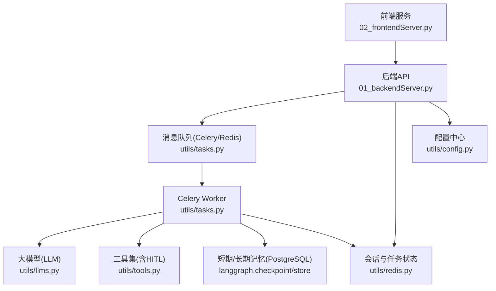
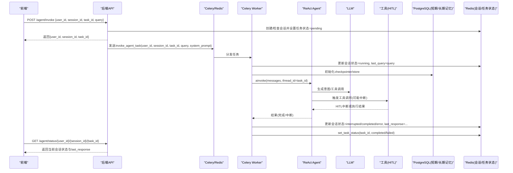
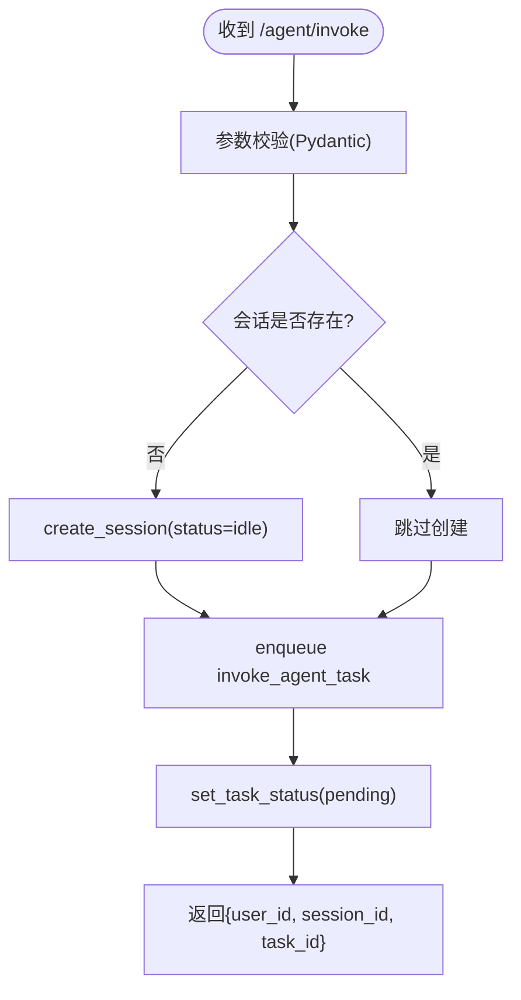
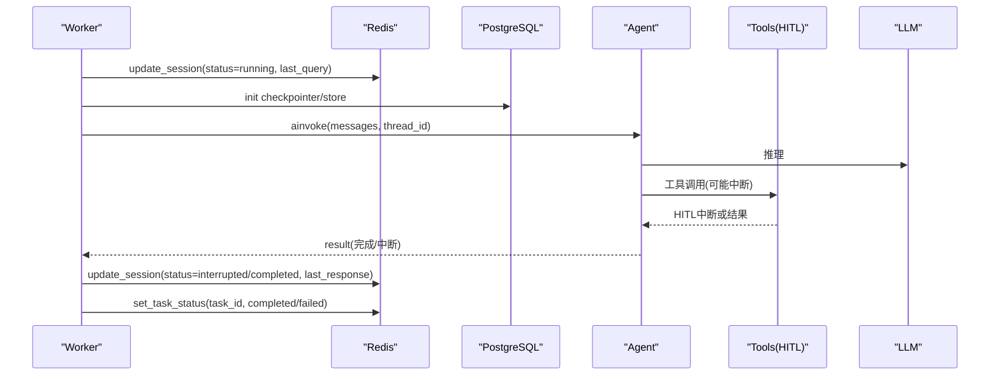
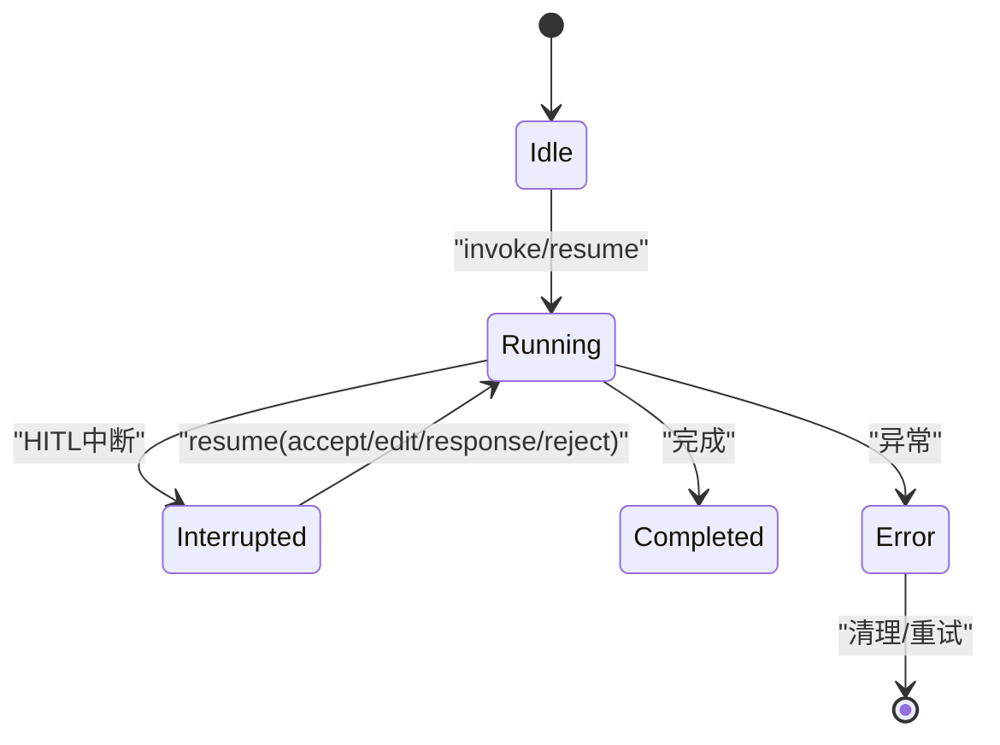
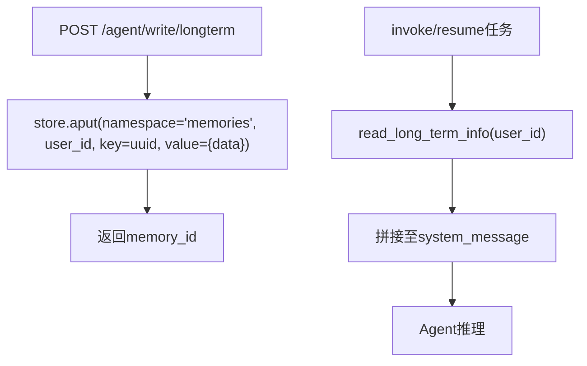
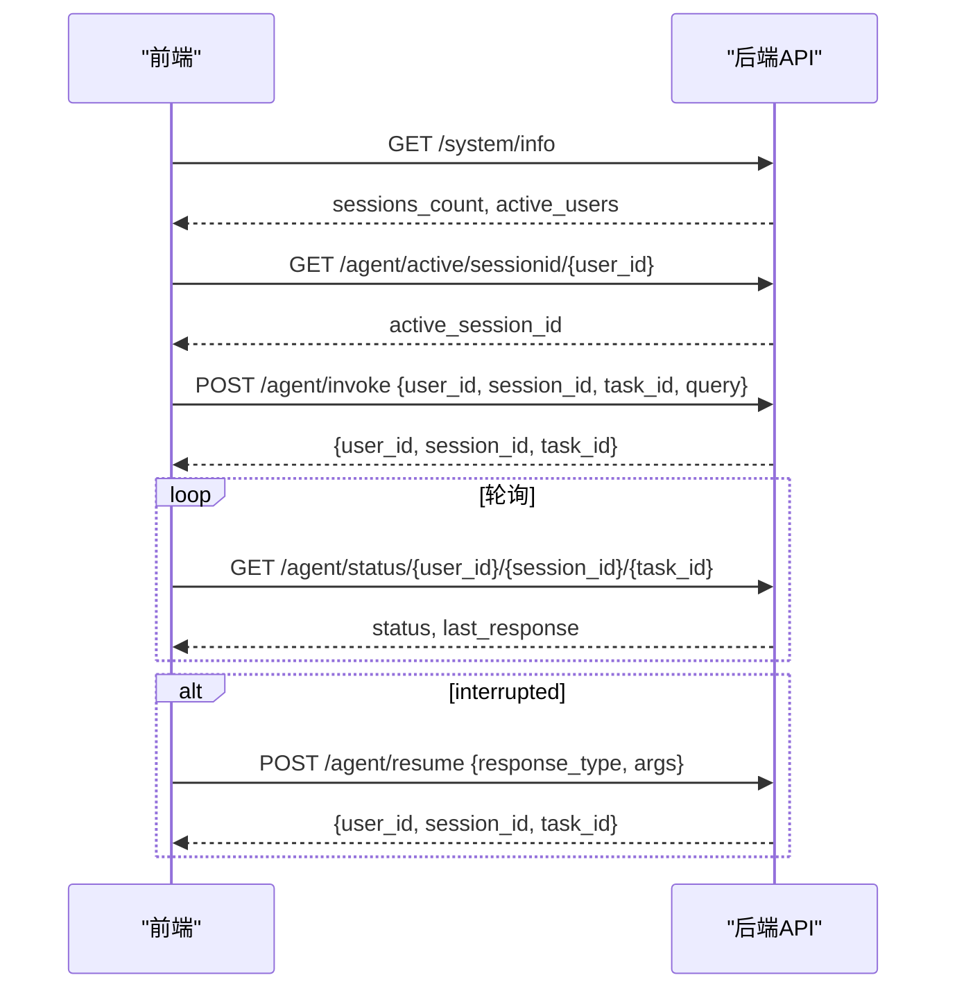
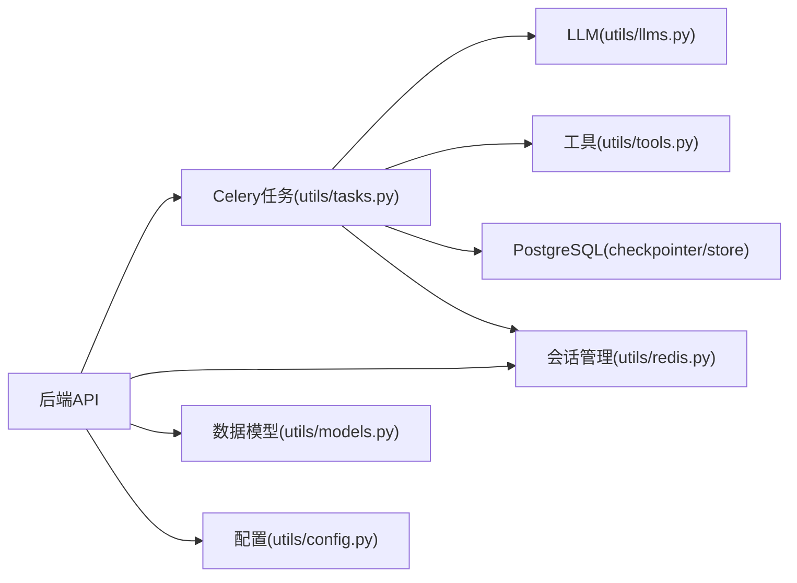

# 数据流设计

<cite>
**本文引用的文件**
- [01_backendServer.py](file://01_backendServer.py)
- [02_frontendServer.py](file://02_frontendServer.py)
- [utils/config.py](file://utils/config.py)
- [utils/tasks.py](file://utils/tasks.py)
- [utils/redis.py](file://utils/redis.py)
- [utils/models.py](file://utils/models.py)
- [utils/tools.py](file://utils/tools.py)
- [utils/llms.py](file://utils/llms.py)
- [README.md](file://README.md)
</cite>

## 目录
1. [引言](#引言)
2. [项目结构](#项目结构)
3. [核心组件](#核心组件)
4. [架构总览](#架构总览)
5. [详细组件分析](#详细组件分析)
6. [依赖关系分析](#依赖关系分析)
7. [性能考虑](#性能考虑)
8. [故障排查指南](#故障排查指南)
9. [结论](#结论)
10. [附录](#附录)

## 引言
本文件面向ReAct Agent服务的数据流设计，目标是清晰描述从前端请求到后端执行、任务调度、Agent运行、结果返回与持久化的完整链路；说明会话状态、任务状态、记忆数据的流转；解释异步任务机制（入队、执行、状态更新、结果持久化）；并提供数据流图与状态转换图，帮助读者理解不同类型数据的生命周期与管理策略。

## 项目结构
系统由前后端两部分组成：
- 前端服务：提供交互式命令行界面，负责发起API调用、轮询状态、处理中断交互。
- 后端服务：基于FastAPI暴露REST接口，使用Celery进行异步任务调度，LangGraph构建ReAct Agent，PostgreSQL作为短期记忆（checkpointer）与长期记忆（store），Redis用于会话与任务状态管理。

图表来源
- [01_backendServer.py:84-130](file://01_backendServer.py#L84-L130)
- [01_backendServer.py:132-173](file://01_backendServer.py#L132-L173)
- [utils/tasks.py:43-63](file://utils/tasks.py#L43-L63)
- [utils/tasks.py:318-451](file://utils/tasks.py#L318-L451)
- [utils/redis.py:37-103](file://utils/redis.py#L37-L103)
- [utils/config.py:13-33](file://utils/config.py#L13-L33)

章节来源
- [README.md:1-39](file://README.md#L1-L39)
- [01_backendServer.py:84-130](file://01_backendServer.py#L84-L130)
- [utils/config.py:13-33](file://utils/config.py#L13-L33)

## 核心组件
- FastAPI后端：定义REST接口，负责接收请求、参数校验、创建/恢复会话、将任务投递至Celery、立即返回任务ID。
- Celery任务：异步执行Agent推理，维护会话状态，读写短期/长期记忆，处理中断与最终结果。
- Redis会话管理器：维护用户-会话-任务的映射、会话状态、任务状态，支持过期清理与一致性保障。
- LangGraph ReAct Agent：结合LLM与工具，支持Human-in-the-Loop（HITL）中断，具备短期记忆（checkpointer）与长期记忆（store）。
- 工具层：内置自定义工具与MCP工具，统一通过HITL包装，支持accept/edit/reject/response四种响应类型。
- 配置模块：集中管理数据库、Redis、Celery、LLM等配置项。

章节来源
- [01_backendServer.py:132-173](file://01_backendServer.py#L132-L173)
- [utils/tasks.py:318-451](file://utils/tasks.py#L318-L451)
- [utils/redis.py:37-103](file://utils/redis.py#L37-L103)
- [utils/tools.py:37-118](file://utils/tools.py#L37-L118)
- [utils/config.py:13-33](file://utils/config.py#L13-L33)

## 架构总览
下图展示从前端到后端的端到端数据流，包括异步任务入队、执行、状态更新与结果持久化。

图表来源
- [01_backendServer.py:132-173](file://01_backendServer.py#L132-L173)
- [01_backendServer.py:316-344](file://01_backendServer.py#L316-L344)
- [utils/tasks.py:318-451](file://utils/tasks.py#L318-L451)
- [utils/redis.py:106-144](file://utils/redis.py#L106-L144)
- [utils/redis.py:392-415](file://utils/redis.py#L392-L415)

## 详细组件分析

### 请求处理与API层
- 入口：POST /agent/invoke
  - 校验请求体（Pydantic模型），提取user_id、session_id、task_id、query、system_message。
  - 若会话不存在则创建，设置初始状态为idle。
  - 将任务投递至Celery（invoke_agent_task.delay），并设置任务状态为pending。
  - 立即返回{user_id, session_id, task_id}，实现“快速返回+异步执行”。
- 恢复接口：POST /agent/resume
  - 校验会话存在且状态为interrupted。
  - 构造command_data（包含response_type与可选args），投递resume_agent_task。
  - 设置任务状态为pending，返回任务标识。
- 查询接口：GET /agent/status/{user_id}/{session_id}/{task_id}
  - 读取Redis中的会话状态与last_response，返回给前端用于轮询。

图表来源
- [01_backendServer.py:132-173](file://01_backendServer.py#L132-L173)
- [utils/redis.py:65-103](file://utils/redis.py#L65-L103)

章节来源
- [01_backendServer.py:132-173](file://01_backendServer.py#L132-L173)
- [01_backendServer.py:176-237](file://01_backendServer.py#L176-L237)
- [01_backendServer.py:316-344](file://01_backendServer.py#L316-L344)
- [utils/models.py:7-18](file://utils/models.py#L7-L18)
- [utils/models.py:44-54](file://utils/models.py#L44-L54)

### 异步任务执行与Agent运行
- 任务入队：后端通过Celery将任务发送至Redis Broker，Worker进程消费任务。
- 执行流程：
  - 初始化Redis会话管理器，更新会话状态为running，记录last_query。
  - 建立PostgreSQL连接池，初始化AsyncPostgresSaver（短期记忆）与AsyncPostgresStore（长期记忆）。
  - 获取LLM实例与工具列表（含HITL包装的工具）。
  - 调用agent.ainvoke，传入messages与thread_id=task_id。
  - 解析消息，处理结果：
    - 若__interrupt__存在：封装为interrupted响应，更新会话状态为interrupted，保存last_response。
    - 否则：封装为completed响应，更新会话状态为completed，保存last_response。
  - 更新任务状态为completed/failed，并绑定到用户与会话。
- 恢复执行：resume_agent_task使用Command(resume=command_data)继续执行被中断的Agent。

图表来源
- [utils/tasks.py:318-451](file://utils/tasks.py#L318-L451)
- [utils/tasks.py:455-559](file://utils/tasks.py#L455-L559)
- [utils/redis.py:106-144](file://utils/redis.py#L106-L144)
- [utils/redis.py:392-415](file://utils/redis.py#L392-L415)

章节来源
- [utils/tasks.py:318-451](file://utils/tasks.py#L318-L451)
- [utils/tasks.py:455-559](file://utils/tasks.py#L455-L559)
- [utils/llms.py:70-138](file://utils/llms.py#L70-L138)
- [utils/tools.py:37-118](file://utils/tools.py#L37-L118)

### 会话状态与任务状态管理
- 存储结构（Redis）：
  - session:{user_id}:{session_id}:{task_id}：会话数据（status、last_query、last_response、last_updated）。
  - user_sessions:{user_id}：集合，记录该用户的所有session_id:task_id。
  - task_mapping:{user_id}:{session_id}：集合，记录会话下的所有task_id。
  - task:{task_id}：任务状态（status、result、error、user_id、session_id）。
- 关键操作：
  - create_session：创建会话并建立映射，设置TTL。
  - update_session：更新会话字段并刷新TTL。
  - set_task_status：写入任务状态并绑定到用户与会话。
  - cleanup_user_tasks/cleanup_all_tasks：定期清理过期/无效数据。
- 状态机（会话）：
  - idle → running → interrupted → (resume) → running → completed
  - idle → running → error
  - 错误路径：error可被清理或人工干预。

图表来源
- [utils/redis.py:65-103](file://utils/redis.py#L65-L103)
- [utils/redis.py:106-144](file://utils/redis.py#L106-L144)
- [utils/redis.py:392-415](file://utils/redis.py#L392-L415)
- [utils/tasks.py:195-264](file://utils/tasks.py#L195-L264)

章节来源
- [utils/redis.py:65-103](file://utils/redis.py#L65-L103)
- [utils/redis.py:106-144](file://utils/redis.py#L106-L144)
- [utils/redis.py:392-415](file://utils/redis.py#L392-L415)
- [utils/tasks.py:195-264](file://utils/tasks.py#L195-L264)

### 记忆数据流转（短期与长期）
- 短期记忆（Checkpointer）：
  - 使用AsyncPostgresSaver按thread_id=task_id维护对话历史，支持断点续跑。
  - 在任务执行前初始化，并在Agent推理过程中自动持久化节点状态。
- 长期记忆（Store）：
  - 使用AsyncPostgresStore以命名空间(memories, user_id)存储用户偏好等信息。
  - 任务执行时读取并拼接到system_message中，增强上下文。
- 数据流：
  - 写入：/agent/write/longterm → write_long_term_info → store.aput(namespace, key, value)。
  - 读取：read_long_term_info → store.asearch(namespace, query) → 拼接至system_message。

图表来源
- [01_backendServer.py:44-80](file://01_backendServer.py#L44-L80)
- [utils/tasks.py:87-134](file://utils/tasks.py#L87-L134)
- [utils/tasks.py:376-385](file://utils/tasks.py#L376-L385)

章节来源
- [01_backendServer.py:44-80](file://01_backendServer.py#L44-L80)
- [utils/tasks.py:87-134](file://utils/tasks.py#L87-L134)
- [utils/tasks.py:376-385](file://utils/tasks.py#L376-L385)

### 前端交互与状态轮询
- 前端职责：
  - 调用/agent/invoke获取task_id。
  - 轮询/agent/status获取会话状态与last_response。
  - 当状态为interrupted时，根据中断数据提示用户选择accept/edit/response/reject，并调用/agent/resume恢复。
  - 支持历史会话恢复与新会话创建。
- 交互流程：
  - 启动时获取系统信息，尝试恢复最近会话。
  - 主循环中处理用户输入，必要时进入中断处理分支。

图表来源
- [02_frontendServer.py:34-107](file://02_frontendServer.py#L34-L107)
- [02_frontendServer.py:159-193](file://02_frontendServer.py#L159-L193)
- [02_frontendServer.py:325-497](file://02_frontendServer.py#L325-L497)

章节来源
- [02_frontendServer.py:34-107](file://02_frontendServer.py#L34-L107)
- [02_frontendServer.py:159-193](file://02_frontendServer.py#L159-L193)
- [02_frontendServer.py:325-497](file://02_frontendServer.py#L325-L497)

## 依赖关系分析
- 后端API依赖：
  - utils.tasks：Celery任务定义与执行逻辑。
  - utils.redis：会话与任务状态管理。
  - utils.models：请求/响应数据模型。
  - utils.config：配置项。
- Worker依赖：
  - utils.llms：LLM初始化与获取。
  - utils.tools：工具注册与HITL包装。
  - langgraph：ReAct Agent、checkpointer、store。
- 外部依赖：
  - PostgreSQL：短期记忆（checkpointer）与长期记忆（store）。
  - Redis：消息代理（Celery Broker）与会话/任务状态缓存。

图表来源
- [01_backendServer.py:132-173](file://01_backendServer.py#L132-L173)
- [utils/tasks.py:318-451](file://utils/tasks.py#L318-L451)
- [utils/redis.py:37-103](file://utils/redis.py#L37-L103)
- [utils/models.py:7-97](file://utils/models.py#L7-L97)
- [utils/config.py:13-33](file://utils/config.py#L13-L33)

章节来源
- [01_backendServer.py:132-173](file://01_backendServer.py#L132-L173)
- [utils/tasks.py:318-451](file://utils/tasks.py#L318-L451)
- [utils/redis.py:37-103](file://utils/redis.py#L37-L103)
- [utils/models.py:7-97](file://utils/models.py#L7-L97)
- [utils/config.py:13-33](file://utils/config.py#L13-L33)

## 性能考虑
- 异步解耦：API立即返回task_id，避免阻塞；Worker独立执行Agent推理，提升吞吐。
- 连接池：PostgreSQL使用AsyncConnectionPool，减少连接开销。
- 记忆修剪：pre_model_hook对消息进行裁剪，控制token数量，降低LLM调用成本。
- TTL与清理：Redis键设置TTL，定期清理无效会话与任务，防止内存膨胀。
- 工具限流：HITL引入人工审批，避免高频工具调用造成资源压力。

[本节为通用指导，不直接分析具体文件]

## 故障排查指南
- 常见问题定位：
  - 会话不存在：检查Redis键session:{user_id}:{session_id}:{task_id}是否存在，确认TTL是否过期。
  - 任务未执行：检查Celery Worker是否启动，Broker（Redis）是否可达。
  - 中断无法恢复：确认会话状态为interrupted，且/agent/resume携带正确的response_type与args。
  - 长期记忆写入失败：检查PostgreSQL连接与store权限。
- 日志与调试：
  - 查看logfile/app.log，关注初始化、任务入队、执行、状态更新等关键日志。
  - 使用/agent/status轮询，观察last_response与last_updated变化。
- 恢复策略：
  - 客户端故障：重启后通过/agent/status恢复中断会话。
  - 服务端故障：LangGraph checkpointer保证节点状态可恢复。

章节来源
- [01_backendServer.py:176-237](file://01_backendServer.py#L176-L237)
- [utils/tasks.py:420-449](file://utils/tasks.py#L420-L449)
- [utils/redis.py:246-341](file://utils/redis.py#L246-L341)
- [README.md:171-192](file://README.md#L171-L192)

## 结论
本数据流设计通过FastAPI+Celery+LangGraph的组合，实现了高可用、可扩展的ReAct Agent服务。前端与后端解耦，异步任务确保低延迟响应；Redis与PostgreSQL分别承担会话状态与记忆持久化；HITL机制保障工具调用的可控性。整体架构清晰、职责分明，便于后续扩展与维护。

[本节为总结性内容，不直接分析具体文件]

## 附录
- 关键API清单：
  - POST /agent/invoke：提交新任务。
  - POST /agent/resume：恢复中断任务。
  - GET /agent/status/{user_id}/{session_id}/{task_id}：查询会话状态。
  - GET /system/info：系统信息。
  - POST /agent/write/longterm：写入长期记忆。
  - DELETE /agent/session/{user_id}/{session_id}：删除会话。
  - DELETE /agent/task/{user_id}/{session_id}/{task_id}：删除任务。
- 数据模型：
  - AgentRequest、InterruptResponse、AgentResponse、SystemInfoResponse、SessionInfoResponse、TaskInfoResponse、ActiveSessionInfoResponse、SessionStatusResponse。

章节来源
- [01_backendServer.py:132-414](file://01_backendServer.py#L132-L414)
- [utils/models.py:7-97](file://utils/models.py#L7-L97)