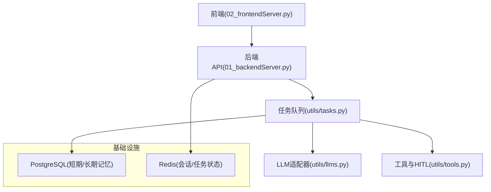
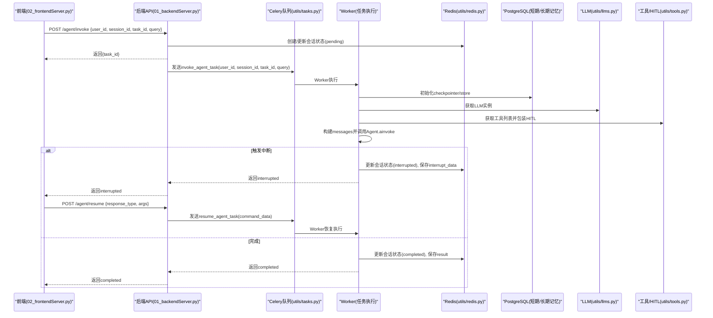
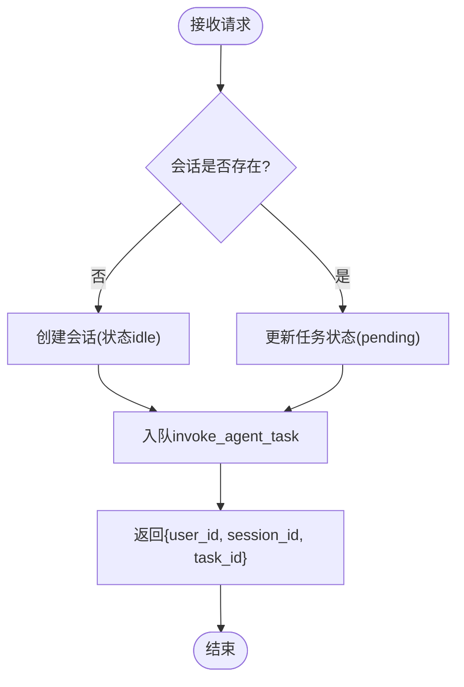
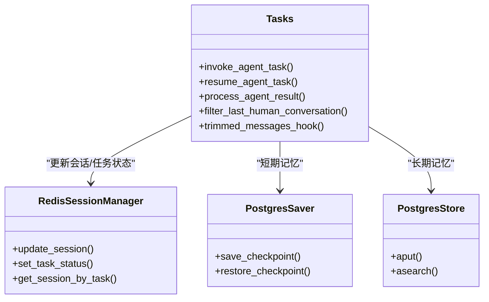
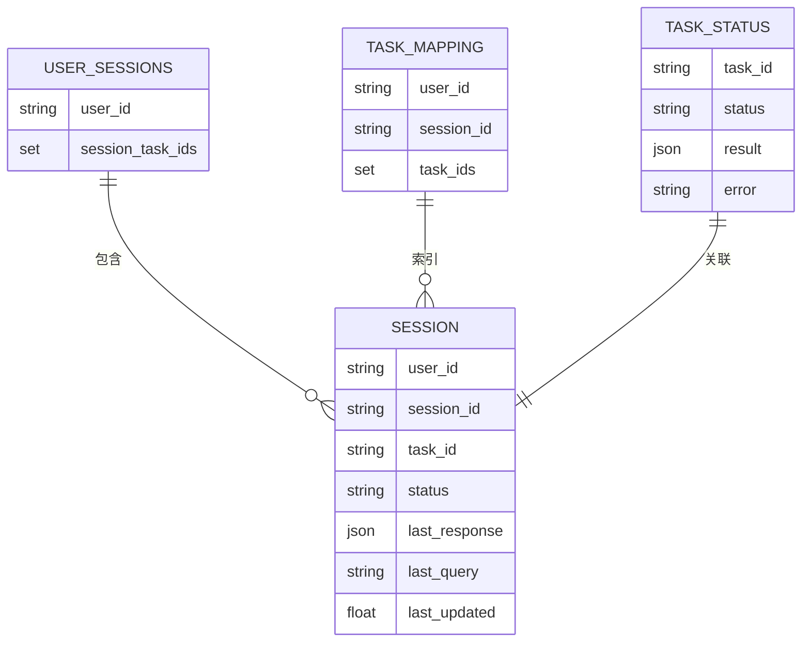
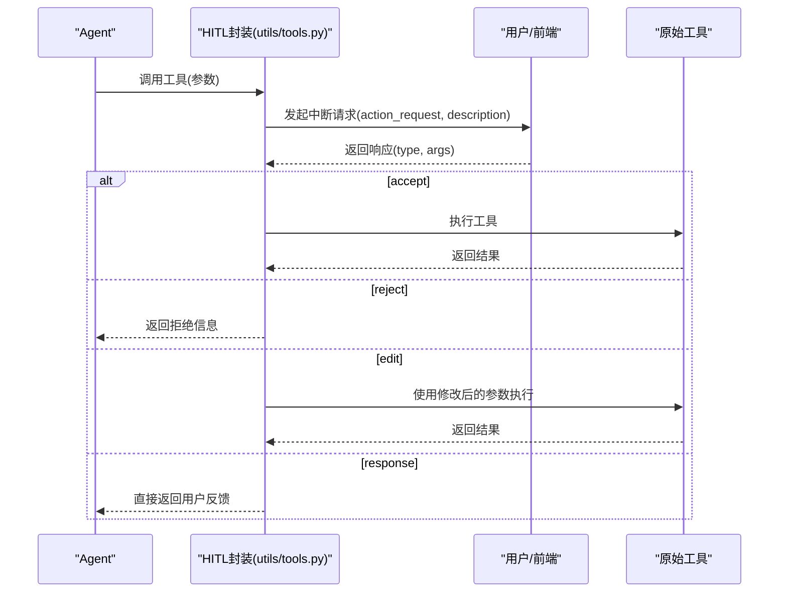
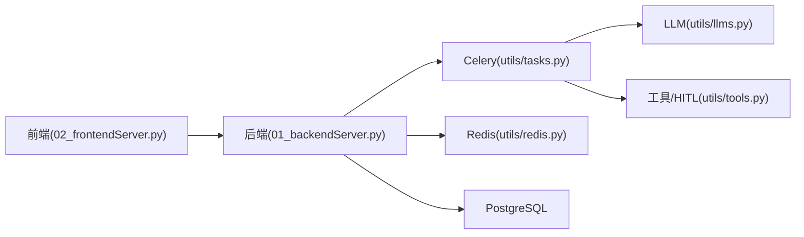

# 架构设计

<cite>
**本文引用的文件**
- [01_backendServer.py](file://01_backendServer.py)
- [02_frontendServer.py](file://02_frontendServer.py)
- [utils/config.py](file://utils/config.py)
- [utils/models.py](file://utils/models.py)
- [utils/tasks.py](file://utils/tasks.py)
- [utils/redis.py](file://utils/redis.py)
- [utils/tools.py](file://utils/tools.py)
- [utils/llms.py](file://utils/llms.py)
- [docker/postgresql/docker-compose.yml](file://docker/postgresql/docker-compose.yml)
- [docker/redis/docker-compose.yaml](file://docker/redis/docker-compose.yaml)
- [README.md](file://README.md)
</cite>

## 目录
1. [简介](#简介)
2. [项目结构](#项目结构)
3. [核心组件](#核心组件)
4. [架构总览](#架构总览)
5. [详细组件分析](#详细组件分析)
6. [依赖关系分析](#依赖关系分析)
7. [性能与可扩展性](#性能与可扩展性)
8. [故障恢复与容错](#故障恢复与容错)
9. [排障指南](#排障指南)
10. [结论](#结论)

## 简介
本系统是一个基于 ReAct Agent 的异步任务驱动服务，采用前后端分离、微服务化与事件驱动架构。后端使用 FastAPI 暴露 REST API，通过 Celery + Redis 实现异步任务调度；使用 PostgreSQL 作为短期记忆（LangGraph Checkpointer）和长期记忆（LangGraph Store）的持久化存储；使用 Redis 管理会话状态、任务状态与过期清理；前端提供 Rich 控制台交互界面，支持多用户、多会话、历史恢复与人工审查（HITL）。

该设计实现了：
- 前后端分离：前端通过 HTTP 调用后端接口，解耦 UI 与业务逻辑。
- 微服务化：后端服务可独立部署扩展，数据库与缓存通过容器编排。
- 事件驱动：Celery 将耗时任务从请求线程中剥离，提升吞吐与响应速度。
- 会话与状态管理：Redis 负责会话与任务状态，PostgreSQL 负责检查点与长期记忆。
- HITL 工具审批：对工具调用进行人工审核，支持接受、拒绝、编辑参数或直接反馈。

**章节来源**
- [README.md:1-39](file://README.md#L1-L39)

## 项目结构
- 后端入口：01_backendServer.py（FastAPI 应用、路由、生命周期）
- 前端入口：02_frontendServer.py（Rich CLI 客户端，调用后端 API）
- 配置：utils/config.py（统一配置项）
- 数据模型：utils/models.py（Pydantic 请求/响应模型）
- 任务队列：utils/tasks.py（Celery 任务、ReAct Agent 执行、结果处理）
- 会话管理：utils/redis.py（RedisSessionManager，会话/任务状态、过期清理）
- 工具与HITL：utils/tools.py（自定义工具、MCP 工具、HITL 封装）
- LLM 适配：utils/llms.py（多厂商模型初始化）
- 基础设施：docker/postgresql 与 docker/redis（PostgreSQL 与 Redis 容器编排）

**图表来源**
- [01_backendServer.py:84-130](file://01_backendServer.py#L84-L130)
- [02_frontendServer.py:29-78](file://02_frontendServer.py#L29-L78)
- [utils/tasks.py:43-63](file://utils/tasks.py#L43-L63)
- [utils/redis.py:37-103](file://utils/redis.py#L37-L103)
- [utils/llms.py:70-112](file://utils/llms.py#L70-L112)
- [utils/tools.py:121-175](file://utils/tools.py#L121-L175)

**章节来源**
- [01_backendServer.py:1-424](file://01_backendServer.py#L1-L424)
- [02_frontendServer.py:1-860](file://02_frontendServer.py#L1-L860)
- [utils/config.py:1-34](file://utils/config.py#L1-L34)
- [utils/models.py:1-97](file://utils/models.py#L1-L97)
- [utils/tasks.py:1-564](file://utils/tasks.py#L1-L564)
- [utils/redis.py:1-493](file://utils/redis.py#L1-L493)
- [utils/tools.py:1-175](file://utils/tools.py#L1-L175)
- [utils/llms.py:1-151](file://utils/llms.py#L1-L151)
- [docker/postgresql/docker-compose.yml:1-25](file://docker/postgresql/docker-compose.yml#L1-L25)
- [docker/redis/docker-compose.yaml:1-38](file://docker/redis/docker-compose.yaml#L1-L38)

## 核心组件
- FastAPI 后端：提供 /agent/invoke、/agent/resume、/system/info、/agent/status 等接口，负责会话创建、任务入队、状态查询与长期记忆写入。
- Celery 任务队列：异步执行 Agent 推理与工具调用，支持中断恢复。
- Redis 会话管理：维护 user/session/task 三维状态、任务状态映射、过期清理与活跃会话追踪。
- PostgreSQL 存储：短期记忆（Checkpointer）用于节点状态恢复；长期记忆（Store）用于用户偏好等持久信息。
- LLM 适配层：统一接入 OpenAI、通义千问、本地 Ollama 等模型。
- 工具与 HITL：自定义工具与 MCP 工具，统一包装为带人工审查的工具。

**章节来源**
- [01_backendServer.py:132-414](file://01_backendServer.py#L132-L414)
- [utils/tasks.py:318-559](file://utils/tasks.py#L318-L559)
- [utils/redis.py:37-493](file://utils/redis.py#L37-L493)
- [utils/llms.py:70-138](file://utils/llms.py#L70-L138)
- [utils/tools.py:37-175](file://utils/tools.py#L37-L175)

## 架构总览
系统采用“前后端分离 + 微服务 + 事件驱动”的组合架构：
- 前端通过 HTTP 调用后端 API，立即获得 task_id，随后轮询或等待中断回调。
- 后端将耗时推理与工具调用放入 Celery 队列，Worker 进程异步执行。
- 会话与任务状态保存在 Redis，具备 TTL 自动清理能力。
- 短期记忆（LangGraph Checkpointer）与长期记忆（LangGraph Store）均持久化到 PostgreSQL。
- LLM 与工具通过抽象层接入，便于扩展不同厂商与第三方服务。

**图表来源**
- [01_backendServer.py:132-237](file://01_backendServer.py#L132-L237)
- [utils/tasks.py:318-559](file://utils/tasks.py#L318-L559)
- [utils/redis.py:65-144](file://utils/redis.py#L65-L144)
- [utils/llms.py:70-112](file://utils/llms.py#L70-L112)
- [utils/tools.py:37-118](file://utils/tools.py#L37-L118)

## 详细组件分析

### FastAPI 后端（01_backendServer.py）
- 生命周期管理：启动时初始化 Redis 会话管理器、PostgreSQL 连接池、Checkpointer 与 Store；关闭时释放资源。
- 主要接口：
  - /agent/invoke：校验/创建会话，设置 pending 状态，入队 invoke_agent_task，立即返回 task_id。
  - /agent/resume：校验会话存在且处于 interrupted，更新为 running，入队 resume_agent_task。
  - /system/info：返回系统会话总数与活跃用户会话。
  - /agent/active/sessionid/{user_id}：返回最近活跃会话 ID。
  - /agent/sessionids/{user_id}：返回用户所有会话 ID。
  - /agent/tasks/{user_id}/{session_id}：返回会话下所有任务 ID 及状态。
  - /agent/status/{user_id}/{session_id}/{task_id}：返回会话任务状态详情。
  - /agent/write/longterm：写入用户长期记忆。
  - 删除会话/任务接口：按 user_id、session_id、task_id 维度删除。

**图表来源**
- [01_backendServer.py:132-173](file://01_backendServer.py#L132-L173)

**章节来源**
- [01_backendServer.py:84-130](file://01_backendServer.py#L84-L130)
- [01_backendServer.py:132-414](file://01_backendServer.py#L132-L414)

### Celery 任务与 ReAct Agent（utils/tasks.py）
- 任务定义：
  - invoke_agent_task：初始化 Redis SessionManager、PostgreSQL 连接池、Checkpointer、Store、LLM、Tools；构造 messages；调用 agent.ainvoke；处理结果（中断/完成），更新 Redis 会话与任务状态。
  - resume_agent_task：使用 Command(resume=command_data) 恢复中断流程，后续处理同 invoke。
- 消息修剪：pre_model_hook 使用 trim_messages 控制上下文长度。
- 结果处理：process_agent_result 统一封装 AgentResponse，区分 interrupted/completed/error，并更新会话状态。
- 过滤对话：filter_last_human_conversation 仅保留最近一次 human 及其后续消息，减少冗余。

**图表来源**
- [utils/tasks.py:66-85](file://utils/tasks.py#L66-L85)
- [utils/tasks.py:194-264](file://utils/tasks.py#L194-L264)
- [utils/tasks.py:318-451](file://utils/tasks.py#L318-L451)
- [utils/tasks.py:455-559](file://utils/tasks.py#L455-L559)

**章节来源**
- [utils/tasks.py:1-564](file://utils/tasks.py#L1-L564)

### Redis 会话管理（utils/redis.py）
- 数据结构：
  - session:{user_id}:{session_id}:{task_id}：会话数据（status、last_query、last_response、last_updated）。
  - user_sessions:{user_id}：集合，记录 {session_id}:{task_id}。
  - task_mapping:{user_id}:{session_id}：集合，记录 task_id。
  - task:{task_id}：任务状态（status、result、error、user_id、session_id）。
- 功能：
  - create_session/update_session/delete_session：CRUD 会话。
  - set_task_status/get_task_status：任务状态管理与查询。
  - cleanup_user_tasks/cleanup_all_tasks：定期清理过期键与无效映射。
  - get_user_active_session_id：按 last_updated 选择最近活跃会话。

**图表来源**
- [utils/redis.py:56-103](file://utils/redis.py#L56-L103)
- [utils/redis.py:392-442](file://utils/redis.py#L392-L442)
- [utils/redis.py:246-341](file://utils/redis.py#L246-L341)

**章节来源**
- [utils/redis.py:1-493](file://utils/redis.py#L1-L493)

### 工具与 HITL（utils/tools.py）
- 工具注册：
  - 自定义工具：book_hotel、multiply。
  - MCP 工具：通过 MultiServerMCPClient 接入高德地图等外部工具。
- HITL 封装：add_human_in_the_loop 将工具包装为带 interrupt 的流程，支持 accept/reject/edit/response 四种响应类型。
- 工具装配：get_tools 返回带 HITL 的工具列表供 Agent 使用。

**图表来源**
- [utils/tools.py:37-118](file://utils/tools.py#L37-L118)
- [utils/tools.py:121-175](file://utils/tools.py#L121-L175)

**章节来源**
- [utils/tools.py:1-175](file://utils/tools.py#L1-L175)

### LLM 适配（utils/llms.py）
- 多厂商支持：openai、oneapi、qwen、ollama，通过 MODEL_CONFIGS 集中管理 base_url、api_key、模型名。
- 初始化：initialize_llm 创建 ChatOpenAI 与 OpenAIEmbeddings，支持超时与重试；get_llm 提供默认回退机制。
- 环境变量：敏感配置通过环境变量注入，避免硬编码。

**章节来源**
- [utils/llms.py:1-151](file://utils/llms.py#L1-L151)

### 前端交互（02_frontendServer.py）
- 功能：调用后端 API 发起/恢复 Agent 任务，展示会话状态、中断提示、最终结果；支持 new/history/exit 命令；自动恢复中断会话。
- 交互流：根据状态机处理 idle/running/interrupted/completed/error，必要时轮询等待状态变化。

**章节来源**
- [02_frontendServer.py:1-860](file://02_frontendServer.py#L1-L860)

## 依赖关系分析
- 后端依赖：
  - FastAPI/Uvicorn：HTTP 服务。
  - Celery/Redis：异步任务队列与消息代理。
  - LangGraph：ReAct Agent、Checkpointer、Store。
  - psycopg_pool：PostgreSQL 异步连接池。
  - Pydantic：数据模型校验。
- 外部依赖：
  - PostgreSQL：短期/长期记忆持久化。
  - Redis：会话/任务状态与过期清理。
  - LLM 提供商：OpenAI、通义千问、Ollama 等。

**图表来源**
- [01_backendServer.py:132-414](file://01_backendServer.py#L132-L414)
- [utils/tasks.py:318-559](file://utils/tasks.py#L318-L559)
- [utils/redis.py:37-493](file://utils/redis.py#L37-L493)
- [utils/llms.py:70-138](file://utils/llms.py#L70-L138)
- [utils/tools.py:121-175](file://utils/tools.py#L121-L175)

**章节来源**
- [utils/config.py:1-34](file://utils/config.py#L1-L34)
- [docker/postgresql/docker-compose.yml:1-25](file://docker/postgresql/docker-compose.yml#L1-L25)
- [docker/redis/docker-compose.yaml:1-38](file://docker/redis/docker-compose.yaml#L1-L38)

## 性能与可扩展性
- 异步任务：Celery 将耗时推理与工具调用从请求线程中剥离，提高并发与响应速度。
- 连接池：PostgreSQL 使用 AsyncConnectionPool，减少连接开销。
- 会话 TTL：Redis 会话与任务状态设置 TTL，自动清理无效数据，降低内存占用。
- 消息修剪：trim_messages 限制上下文 token 数量，控制 LLM 输入成本。
- 水平扩展：
  - 增加 Celery Worker 数量提升吞吐。
  - 独立部署 Redis/PG 集群，读写分离与分片。
  - 多 LLM 提供商切换，负载均衡与降级策略。

[本节为通用指导，不直接分析具体文件]

## 故障恢复与容错
- 客户端故障恢复：前端在启动时检查会话状态，若为 interrupted 则自动恢复中断点。
- 服务端故障恢复：LangGraph Checkpointer 持久化节点状态，支持断点续跑。
- 任务失败处理：Worker 捕获异常，更新会话状态为 error，并记录错误信息。
- 数据一致性：Redis 会话与任务状态原子更新，PostgreSQL 保证检查点与长期记忆一致性。
- 健康检查：Docker Compose 为 PG/Redis 配置健康检查，确保服务可用性。

**章节来源**
- [02_frontendServer.py:324-497](file://02_frontendServer.py#L324-L497)
- [utils/tasks.py:420-451](file://utils/tasks.py#L420-L451)
- [utils/tasks.py:528-559](file://utils/tasks.py#L528-L559)
- [docker/postgresql/docker-compose.yml:17-22](file://docker/postgresql/docker-compose.yml#L17-L22)
- [docker/redis/docker-compose.yaml:19-25](file://docker/redis/docker-compose.yaml#L19-L25)

## 排障指南
- 无法连接 Redis：
  - 检查端口 6379 是否开放，容器是否运行。
  - 确认 Config.REDIS_HOST/PORT/DB 配置正确。
- PostgreSQL 连接失败：
  - 检查 DB_URI、用户名密码、端口 5432。
  - 查看连接池大小 MIN_SIZE/MAX_SIZE 是否合理。
- 任务未执行：
  - 确认 Celery Worker 已启动，Broker 指向 Redis。
  - 检查日志输出，定位异常堆栈。
- 会话状态异常：
  - 使用 /agent/status 查询当前状态。
  - 检查 Redis 键是否过期或被清理。
- LLM 初始化失败：
  - 检查环境变量 OPENAI_API_KEY/DASHSCOPE_API_KEY。
  - 尝试切换到默认 LLM 类型。

**章节来源**
- [utils/config.py:13-33](file://utils/config.py#L13-L33)
- [01_backendServer.py:84-123](file://01_backendServer.py#L84-L123)
- [utils/tasks.py:420-451](file://utils/tasks.py#L420-L451)
- [utils/llms.py:114-138](file://utils/llms.py#L114-L138)

## 结论
本系统以 FastAPI 为核心，结合 Celery 异步任务、Redis 会话管理、PostgreSQL 记忆持久化与多厂商 LLM 适配，构建了高可用、可扩展的 ReAct Agent 服务。通过 HITL 机制保障工具调用的安全性与可控性，前端提供友好的交互体验与自动恢复能力。整体架构清晰、职责分明，适合在生产环境中部署与扩展。

[本节为总结性内容，不直接分析具体文件]