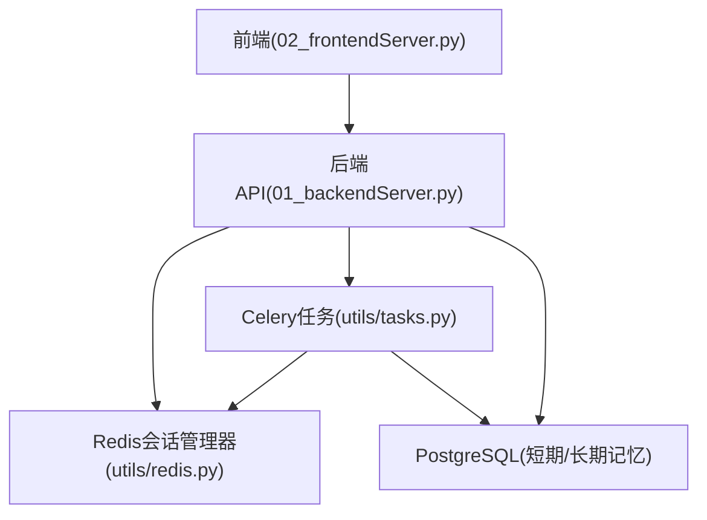
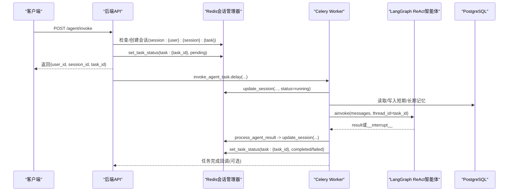
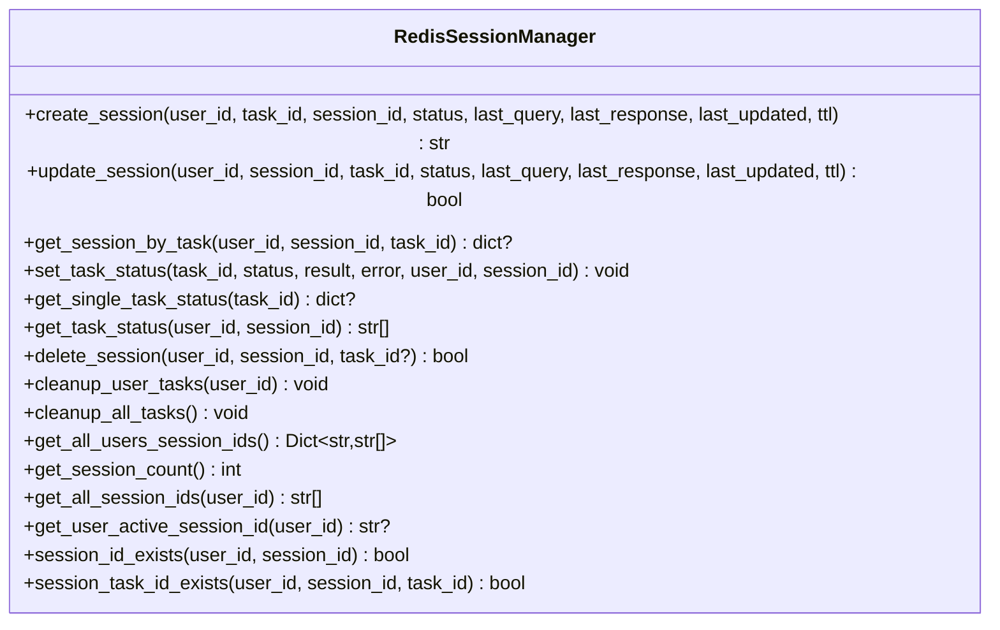
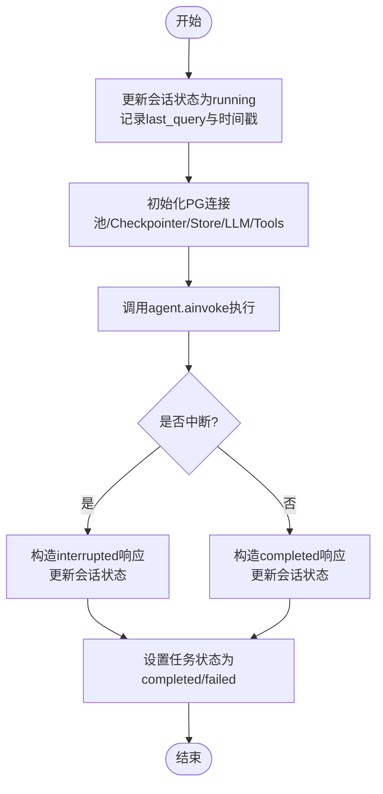
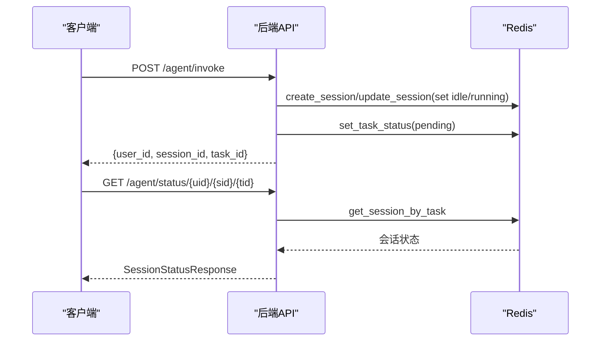
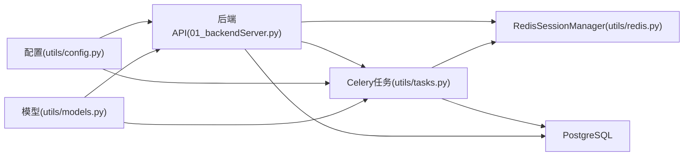
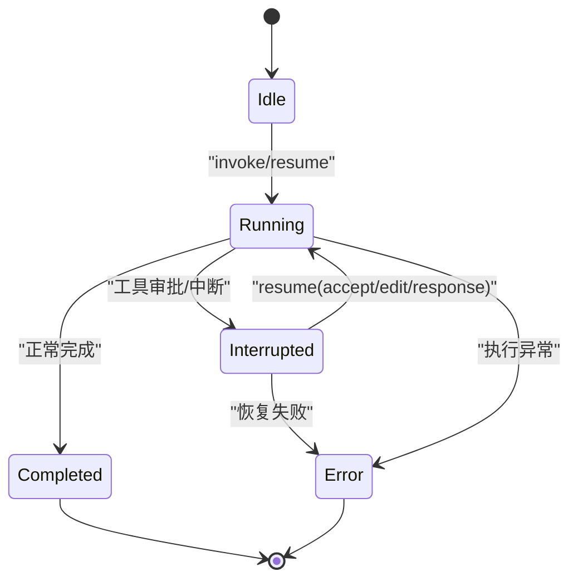

# 状态管理

<cite>
**本文引用的文件**
- [utils/redis.py](file://utils/redis.py)
- [utils/tasks.py](file://utils/tasks.py)
- [01_backendServer.py](file://01_backendServer.py)
- [02_frontendServer.py](file://02_frontendServer.py)
- [utils/config.py](file://utils/config.py)
- [utils/models.py](file://utils/models.py)
</cite>

## 目录
1. [简介](#简介)
2. [项目结构](#项目结构)
3. [核心组件](#核心组件)
4. [架构总览](#架构总览)
5. [详细组件分析](#详细组件分析)
6. [依赖关系分析](#依赖关系分析)
7. [性能与一致性](#性能与一致性)
8. [故障排查指南](#故障排查指南)
9. [结论](#结论)
10. [附录：键值命名规范与数据结构示例](#附录键值命名规范与数据结构示例)

## 简介
本文件面向ReAct Agent服务的“状态管理”主题，聚焦会话状态、任务状态、用户状态的统一管理机制。重点说明Redis中的数据结构设计、键值命名规范、持久化策略、过期机制、一致性保证，以及状态变更的触发条件与处理逻辑（会话创建、任务执行、状态更新等）。文档同时提供状态机图与数据结构示例，帮助开发者理解端到端的状态流转。

## 项目结构
- 后端API服务：FastAPI应用负责接收请求、调度异步任务、维护会话与任务状态。
- 异步任务：基于Celery的任务，调用LangGraph ReAct智能体执行，并在执行过程中读写Redis与PostgreSQL。
- Redis状态层：集中管理会话、任务、用户索引及过期策略。
- 配置中心：集中管理Redis、数据库、Celery、模型类型等参数。
- 前端演示：模拟客户端交互，展示状态查询与恢复流程。

图表来源
- [01_backendServer.py:84-130](file://01_backendServer.py#L84-L130)
- [utils/tasks.py:318-451](file://utils/tasks.py#L318-L451)
- [utils/redis.py:37-493](file://utils/redis.py#L37-L493)

章节来源
- [01_backendServer.py:84-130](file://01_backendServer.py#L84-L130)
- [utils/config.py:18-26](file://utils/config.py#L18-L26)

## 核心组件
- RedisSessionManager：封装所有Redis操作，包括会话CRUD、任务状态绑定、用户索引维护、清理过期数据等。
- Celery任务：invoke_agent_task与resume_agent_task，驱动智能体执行并更新会话与任务状态。
- FastAPI路由：暴露会话与任务状态查询、创建、删除、恢复等接口。
- 配置与模型：统一的配置项与Pydantic模型，确保序列化一致性与可验证性。

章节来源
- [utils/redis.py:37-493](file://utils/redis.py#L37-L493)
- [utils/tasks.py:318-564](file://utils/tasks.py#L318-L564)
- [01_backendServer.py:132-414](file://01_backendServer.py#L132-L414)
- [utils/config.py:18-26](file://utils/config.py#L18-L26)
- [utils/models.py:27-95](file://utils/models.py#L27-L95)

## 架构总览
系统采用“API + 异步任务 + Redis状态层 + PostgreSQL记忆存储”的分层架构。会话与任务状态以JSON形式存储在Redis中，通过集合维护用户-会话-任务的映射关系；任务执行由Celery Worker异步完成，执行前后均会更新Redis中的会话与任务状态。

图表来源
- [01_backendServer.py:132-173](file://01_backendServer.py#L132-L173)
- [utils/tasks.py:318-451](file://utils/tasks.py#L318-L451)
- [utils/redis.py:65-144](file://utils/redis.py#L65-L144)

## 详细组件分析

### Redis会话管理器（RedisSessionManager）
- 会话键设计：session:{user_id}:{session_id}:{task_id}，值为JSON对象，包含会话ID、任务ID、状态、最近查询、最近响应、最后更新时间等字段。
- 用户索引：user_sessions:{user_id}集合，保存session_id:task_id条目，便于快速枚举用户活跃会话。
- 会话-任务映射：task_mapping:{user_id}:{session_id}集合，保存该会话下的所有task_id，支持按会话维度查询任务列表。
- 任务状态：task:{task_id}，保存任务ID、状态、结果、错误信息、关联的用户与会话ID。
- 过期策略：会话与映射使用会话超时TTL；任务状态使用TASK_TTL；清理时自动回收无效条目。
- 清理机制：cleanup_user_tasks与cleanup_all_tasks在查询前主动清理过期/无效条目，保证集合与实体的一致性。

图表来源
- [utils/redis.py:37-493](file://utils/redis.py#L37-L493)

章节来源
- [utils/redis.py:65-144](file://utils/redis.py#L65-L144)
- [utils/redis.py:147-166](file://utils/redis.py#L147-L166)
- [utils/redis.py:168-215](file://utils/redis.py#L168-L215)
- [utils/redis.py:247-341](file://utils/redis.py#L247-L341)
- [utils/redis.py:344-476](file://utils/redis.py#L344-L476)

### 任务执行与状态更新（Celery任务）
- invoke_agent_task：
  - 将会话状态置为running，记录last_query与时间戳。
  - 初始化PostgreSQL连接池、短期记忆Checkpointer、长期记忆Store、获取LLM与工具。
  - 调用agent.ainvoke执行，解析消息并处理结果。
  - 根据结果更新会话状态（completed/interrupted/error），并设置任务状态为completed/failed。
- resume_agent_task：
  - 针对中断场景，使用Command(resume=command_data)恢复执行。
  - 同样更新会话与任务状态。

图表来源
- [utils/tasks.py:318-451](file://utils/tasks.py#L318-L451)
- [utils/tasks.py:455-564](file://utils/tasks.py#L455-L564)

章节来源
- [utils/tasks.py:318-451](file://utils/tasks.py#L318-L451)
- [utils/tasks.py:455-564](file://utils/tasks.py#L455-L564)

### 后端API与状态流
- /agent/invoke：若会话不存在则创建，设置任务状态为pending，立即返回任务标识。
- /agent/resume：校验会话存在且状态为interrupted，更新为running，提交恢复任务。
- /system/info、/agent/sessionids、/agent/tasks、/agent/status：提供会话与任务状态查询能力。
- 删除接口：支持删除会话或特定任务。

图表来源
- [01_backendServer.py:132-173](file://01_backendServer.py#L132-L173)
- [01_backendServer.py:239-344](file://01_backendServer.py#L239-L344)
- [utils/redis.py:65-144](file://utils/redis.py#L65-L144)

章节来源
- [01_backendServer.py:132-173](file://01_backendServer.py#L132-L173)
- [01_backendServer.py:175-237](file://01_backendServer.py#L175-L237)
- [01_backendServer.py:239-344](file://01_backendServer.py#L239-L344)
- [01_backendServer.py:376-414](file://01_backendServer.py#L376-L414)

### 前端交互与状态恢复
- 支持查询系统信息、发起新任务、恢复中断任务、查看会话与任务状态。
- 对运行中会话进行轮询等待，直至状态变化。
- 对中断会话，引导用户选择accept/reject/edit/response，并调用恢复接口继续执行。

章节来源
- [02_frontendServer.py:33-232](file://02_frontendServer.py#L33-L232)
- [02_frontendServer.py:324-497](file://02_frontendServer.py#L324-L497)
- [02_frontendServer.py:499-668](file://02_frontendServer.py#L499-L668)

## 依赖关系分析
- 后端API依赖RedisSessionManager进行状态存取，依赖Celery任务执行智能体逻辑。
- 任务模块依赖RedisSessionManager更新会话与任务状态，依赖PostgreSQL进行短期/长期记忆存取。
- 配置模块集中管理Redis、数据库、Celery、模型类型等参数，供各模块共享。
- 模型模块定义请求/响应结构，确保序列化与校验一致性。

图表来源
- [01_backendServer.py:84-130](file://01_backendServer.py#L84-L130)
- [utils/tasks.py:318-451](file://utils/tasks.py#L318-L451)
- [utils/redis.py:37-493](file://utils/redis.py#L37-L493)
- [utils/config.py:18-26](file://utils/config.py#L18-L26)
- [utils/models.py:27-95](file://utils/models.py#L27-L95)

章节来源
- [utils/config.py:18-26](file://utils/config.py#L18-L26)
- [utils/models.py:27-95](file://utils/models.py#L27-L95)

## 性能与一致性
- 过期机制：
  - 会话与映射使用SESSION_TIMEOUT/TTL控制存活时间，避免僵尸数据。
  - 任务状态使用TASK_TTL控制，防止长时间残留。
- 一致性保证：
  - 每次查询前调用cleanup_user_tasks/cleanup_all_tasks清理无效条目，保持集合与实体一致。
  - 任务状态与会话状态在任务执行前后分别更新，确保状态同步。
- 性能考虑：
  - 使用Redis集合进行用户-会话-任务的多维索引，查询复杂度低。
  - 异步执行智能体任务，减少阻塞；连接池复用数据库连接。
- 建议优化：
  - 对高频查询可增加缓存层或使用Lua脚本批量清理。
  - 合理调整TTL与清理频率，平衡内存占用与数据新鲜度。

章节来源
- [utils/redis.py:247-341](file://utils/redis.py#L247-L341)
- [utils/config.py:18-26](file://utils/config.py#L18-L26)

## 故障排查指南
- 常见错误：
  - 会话不存在：检查user_sessions与task_mapping集合是否被清理，确认TTL是否过短。
  - 任务状态异常：核对任务执行路径是否正确更新set_task_status与update_session。
  - 中断恢复失败：确认会话状态为interrupted，且携带完整interrupt_data。
- 日志定位：
  - 关注RedisSessionManager与任务模块的日志输出，定位具体步骤失败点。
- 回滚策略：
  - 任务失败时，会话状态置error，任务状态置failed，便于前端提示与重试。

章节来源
- [utils/redis.py:105-144](file://utils/redis.py#L105-L144)
- [utils/tasks.py:420-451](file://utils/tasks.py#L420-L451)
- [utils/tasks.py:528-564](file://utils/tasks.py#L528-L564)

## 结论
本状态管理方案通过Redis集中管理会话与任务状态，结合Celery异步执行与PostgreSQL记忆存储，实现了高并发、可扩展的ReAct Agent服务。键值命名规范清晰，过期与清理机制完善，状态机覆盖idle/running/completed/interrupted/error等关键状态，满足多用户多会话多任务场景的需求。

## 附录：键值命名规范与数据结构示例

### 键值命名规范
- 会话实体：session:{user_id}:{session_id}:{task_id}
- 用户会话集合：user_sessions:{user_id}（元素为session_id:task_id）
- 会话任务映射：task_mapping:{user_id}:{session_id}（元素为task_id）
- 任务状态：task:{task_id}

章节来源
- [utils/redis.py:65-144](file://utils/redis.py#L65-L144)
- [utils/redis.py:392-416](file://utils/redis.py#L392-L416)

### 会话数据结构示例（JSON）
- 键：session:{user_id}:{session_id}:{task_id}
- 值字段：
  - session_id: 字符串
  - task_id: 字符串
  - status: 字符串（idle/running/completed/error/interrupted）
  - last_response: 对象（AgentResponse序列化）
  - last_query: 字符串
  - last_updated: 数值（时间戳）

章节来源
- [utils/redis.py:65-103](file://utils/redis.py#L65-L103)
- [utils/models.py:27-41](file://utils/models.py#L27-L41)

### 任务状态数据结构示例（JSON）
- 键：task:{task_id}
- 值字段：
  - task_id: 字符串
  - status: 字符串（pending/running/completed/failed）
  - result: 对象（可选）
  - error: 字符串（可选）
  - user_id: 字符串（可选）
  - session_id: 字符串（可选）

章节来源
- [utils/redis.py:392-416](file://utils/redis.py#L392-L416)

### 状态机图

图表来源
- [utils/redis.py:65-144](file://utils/redis.py#L65-L144)
- [utils/tasks.py:318-451](file://utils/tasks.py#L318-L451)
- [utils/tasks.py:455-564](file://utils/tasks.py#L455-L564)