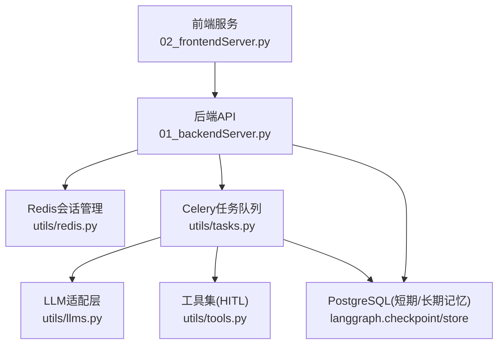
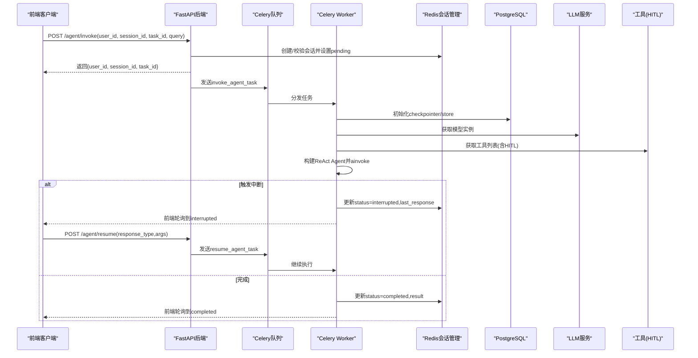
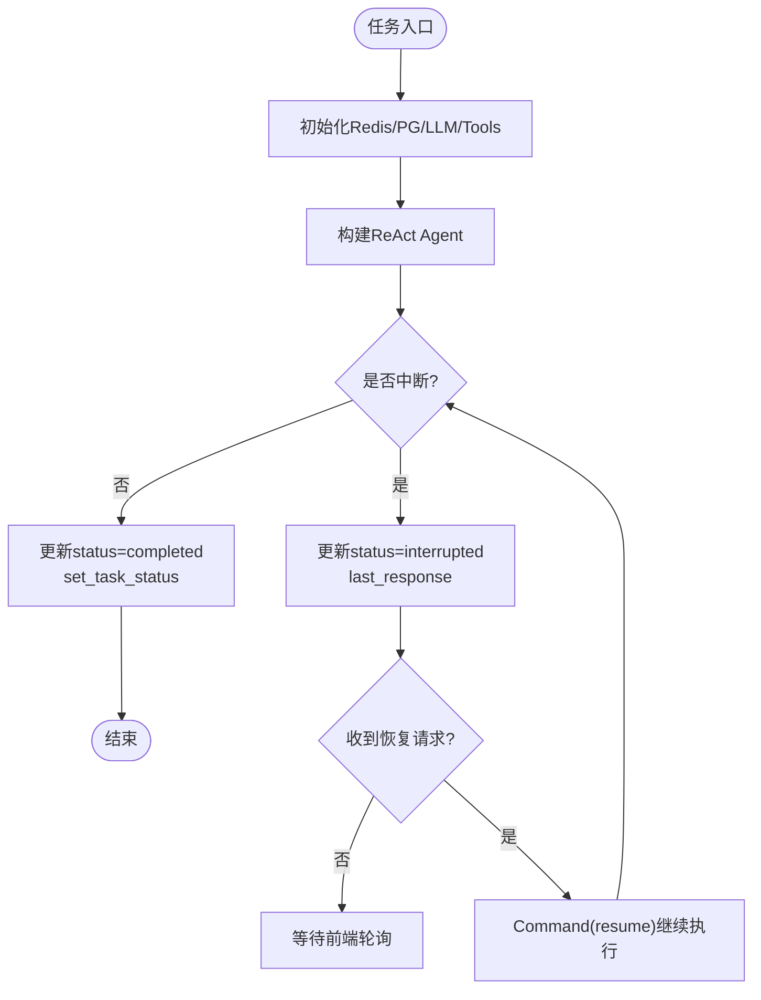
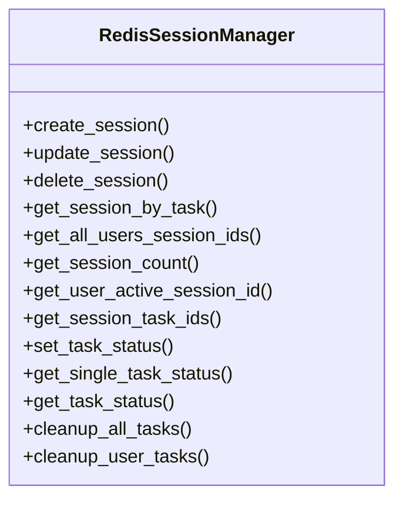
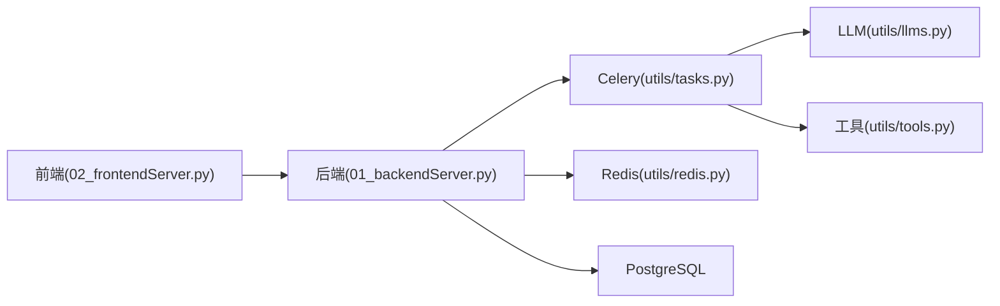
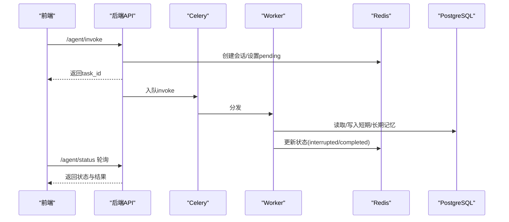

# 系统概览

<cite>
**本文引用的文件**
- [01_backendServer.py](file://01_backendServer.py)
- [02_frontendServer.py](file://02_frontendServer.py)
- [utils/config.py](file://utils/config.py)
- [utils/redis.py](file://utils/redis.py)
- [utils/tasks.py](file://utils/tasks.py)
- [utils/models.py](file://utils/models.py)
- [utils/llms.py](file://utils/llms.py)
- [utils/tools.py](file://utils/tools.py)
- [docker/postgresql/docker-compose.yml](file://docker/postgresql/docker-compose.yml)
- [docker/redis/docker-compose.yaml](file://docker/redis/docker-compose.yaml)
- [README.md](file://README.md)
</cite>

## 目录
1. [简介](#简介)
2. [项目结构](#项目结构)
3. [核心组件](#核心组件)
4. [架构总览](#架构总览)
5. [详细组件分析](#详细组件分析)
6. [依赖关系分析](#依赖关系分析)
7. [性能与可扩展性](#性能与可扩展性)
8. [故障排查指南](#故障排查指南)
9. [结论](#结论)
10. [附录：API与数据流](#附录api与数据流)

## 简介
本系统是一个基于 ReAct 架构的 Agent 服务，采用前后端分离、微服务化与事件驱动的设计理念，提供高并发、可扩展、可恢复的智能体交互能力。后端使用 FastAPI 暴露 REST API，Celery 作为异步任务队列执行智能体推理与工具调用，Redis 负责会话状态与任务状态管理，PostgreSQL 用于短期记忆（检查点）与长期记忆（持久化存储）。前端通过 Rich 控制台演示客户端交互，支持 Human-in-the-Loop（HITL）人工审查、多会话管理与历史会话恢复。

设计目标包括：
- 高并发：异步 I/O + Celery Worker 并行处理
- 可扩展性：LLM 多厂商接入、工具动态扩展、会话独立隔离
- 容错性：会话与任务状态持久化、中断恢复、过期清理
- 可观测性：统一日志、结构化响应、状态查询接口

**章节来源**
- [README.md:1-39](file://README.md#L1-L39)

## 项目结构
- 后端服务：FastAPI 应用，定义会话管理、任务调度、状态查询等接口
- 前端服务：Rich 控制台客户端，模拟用户交互与状态轮询
- 配置中心：集中管理数据库、Redis、Celery、LLM 等配置
- 任务层：Celery 任务封装 ReAct Agent 执行流程（含 HITL 中断与恢复）
- 存储层：Redis 会话与任务状态；PostgreSQL 短期/长期记忆
- 模型与工具：LLM 初始化、工具注册与 HITL 包装

**图表来源**
- [01_backendServer.py:84-130](file://01_backendServer.py#L84-L130)
- [utils/tasks.py:319-451](file://utils/tasks.py#L319-L451)
- [utils/redis.py:37-103](file://utils/redis.py#L37-L103)
- [utils/llms.py:70-112](file://utils/llms.py#L70-L112)
- [utils/tools.py:37-118](file://utils/tools.py#L37-L118)

**章节来源**
- [01_backendServer.py:1-424](file://01_backendServer.py#L1-L424)
- [02_frontendServer.py:1-860](file://02_frontendServer.py#L1-L860)
- [utils/config.py:1-34](file://utils/config.py#L1-L34)

## 核心组件
- FastAPI 后端：提供 /agent/invoke、/agent/resume、/agent/status、/system/info 等接口，负责会话创建、任务入队、状态查询与长期记忆写入
- Celery 任务：invoke_agent_task 与 resume_agent_task 分别处理首次调用与中断恢复，封装 ReAct Agent 执行、消息修剪、结果处理与状态更新
- Redis 会话管理：维护 user/session/task 三维状态、任务映射、过期清理与健康检查
- PostgreSQL 存储：短期记忆（checkpointer）保存节点状态，长期记忆（store）按命名空间持久化用户偏好等
- LLM 适配：统一抽象 OpenAI/Qwen/Ollama 等模型，支持环境变量与默认回退
- 工具与 HITL：为每个工具注入人工审查，支持 accept/edit/reject/response 四种策略

**章节来源**
- [01_backendServer.py:132-394](file://01_backendServer.py#L132-L394)
- [utils/tasks.py:319-559](file://utils/tasks.py#L319-L559)
- [utils/redis.py:37-493](file://utils/redis.py#L37-L493)
- [utils/llms.py:70-138](file://utils/llms.py#L70-L138)
- [utils/tools.py:37-175](file://utils/tools.py#L37-L175)

## 架构总览
系统采用“前后端分离 + 微服务 + 事件驱动”的组合模式：
- 前后端分离：前端通过 HTTP 调用后端 API，解耦交互与业务逻辑
- 微服务化：后端按职责拆分为 API 层、任务层、存储层，便于独立扩展与维护
- 事件驱动：通过 Celery 将耗时任务异步化，提升吞吐与响应速度；Redis 作为轻量消息代理与会话总线

**图表来源**
- [01_backendServer.py:132-237](file://01_backendServer.py#L132-L237)
- [utils/tasks.py:319-559](file://utils/tasks.py#L319-L559)
- [utils/redis.py:65-143](file://utils/redis.py#L65-L143)
- [utils/tools.py:37-118](file://utils/tools.py#L37-L118)

## 详细组件分析

### FastAPI 后端服务
- 生命周期管理：在 lifespan 中初始化 Redis 会话管理器、PostgreSQL 连接池、短期/长期记忆存储
- 关键接口：
  - /agent/invoke：校验/创建会话，入队 invoke_agent_task，立即返回 task_id
  - /agent/resume：校验中断状态，入队 resume_agent_task，继续执行
  - /agent/status/{user}/{session}/{task}：查询会话与任务状态
  - /system/info：统计活跃会话与用户
  - /agent/write/longterm：写入用户长期记忆
  - 会话/任务删除接口：清理无效或废弃资源
- 错误处理：对不存在、非法状态等返回明确 HTTP 状态码与消息

**章节来源**
- [01_backendServer.py:84-130](file://01_backendServer.py#L84-L130)
- [01_backendServer.py:132-394](file://01_backendServer.py#L132-L394)

### Celery 异步任务与 ReAct Agent
- 任务定义：
  - invoke_agent_task：初始化存储与 LLM，构造 ReAct Agent，执行 ainvoke，处理结果（中断/完成），更新会话与任务状态
  - resume_agent_task：接收 Command(resume=command_data)，恢复执行
- 消息修剪：pre_model_hook 限制上下文 token 数量，避免超限
- 结果处理：process_agent_result 统一封装中断与完成响应，filter_last_human_conversation 提取最近一次完整对话
- 异常处理：捕获异常并更新会话状态为 error，记录失败原因

**图表来源**
- [utils/tasks.py:319-451](file://utils/tasks.py#L319-L451)
- [utils/tasks.py:455-559](file://utils/tasks.py#L455-L559)

**章节来源**
- [utils/tasks.py:66-135](file://utils/tasks.py#L66-L135)
- [utils/tasks.py:195-315](file://utils/tasks.py#L195-L315)
- [utils/tasks.py:319-559](file://utils/tasks.py#L319-L559)

### Redis 会话管理
- 数据结构：
  - session:{user_id}:{session_id}:{task_id}：会话详情（状态、最后查询/响应、更新时间）
  - user_sessions:{user_id}：用户所有 session_id:task_id 集合
  - task_mapping:{user_id}:{session_id}：会话内所有 task_id 集合
  - task:{task_id}：任务状态（status/result/error）
- 功能：
  - 创建/更新/删除会话与任务
  - 查询用户活跃会话、会话任务列表、任务状态
  - 自动清理过期/无效任务（cleanup_all_tasks/cleanup_user_tasks）
- TTL 控制：会话与任务均设置过期时间，防止内存泄漏

**图表来源**
- [utils/redis.py:37-493](file://utils/redis.py#L37-L493)

**章节来源**
- [utils/redis.py:37-493](file://utils/redis.py#L37-L493)

### PostgreSQL 短期/长期记忆
- 短期记忆：AsyncPostgresSaver 作为 LangGraph checkpointer，保存节点状态以实现断点续跑
- 长期记忆：AsyncPostgresStore 以命名空间存储用户偏好等信息，支持搜索与拼接
- 连接池：psycopg_pool 管理连接，提高并发性能

**章节来源**
- [01_backendServer.py:94-110](file://01_backendServer.py#L94-L110)
- [utils/tasks.py:351-374](file://utils/tasks.py#L351-L374)
- [utils/tasks.py:87-135](file://utils/tasks.py#L87-L135)

### LLM 适配层
- 多厂商支持：OpenAI、OneAPI、Qwen、Ollama，通过 MODEL_CONFIGS 统一管理
- 默认回退：当指定类型初始化失败时尝试默认类型
- 超时与重试：配置 timeout 与 max_retries，增强稳定性

**章节来源**
- [utils/llms.py:31-138](file://utils/llms.py#L31-L138)

### 工具与 HITL
- 工具包装：add_human_in_the_loop 为任意工具注入中断，支持 accept/edit/reject/response
- 内置工具：book_hotel、multiply；外部工具：通过 MCP Server 动态加载（如高德地图）
- 安全与可控：所有工具调用需经人工审批，降低误用风险

**章节来源**
- [utils/tools.py:37-175](file://utils/tools.py#L37-L175)

### 前端服务
- 交互流程：发起调用、轮询状态、处理中断、恢复执行、显示结果
- 会话恢复：自动检测 interrupted/running/completed 状态并做相应处理
- 命令支持：new、exit、history、setting 等便捷操作

**章节来源**
- [02_frontendServer.py:50-232](file://02_frontendServer.py#L50-L232)
- [02_frontendServer.py:324-497](file://02_frontendServer.py#L324-L497)
- [02_frontendServer.py:499-668](file://02_frontendServer.py#L499-L668)
- [02_frontendServer.py:671-860](file://02_frontendServer.py#L671-L860)

## 依赖关系分析
- 后端依赖：
  - FastAPI/Uvicorn：HTTP 服务
  - Celery/Redis：异步任务与消息代理
  - psycopg_pool/PostgreSQL：数据库连接与持久化
  - LangGraph/LangChain：ReAct Agent 框架与消息处理
- 前端依赖：
  - requests：HTTP 客户端
  - rich：终端 UI 渲染

**图表来源**
- [01_backendServer.py:1-424](file://01_backendServer.py#L1-L424)
- [utils/tasks.py:1-564](file://utils/tasks.py#L1-L564)
- [utils/redis.py:1-493](file://utils/redis.py#L1-L493)
- [utils/llms.py:1-151](file://utils/llms.py#L1-L151)
- [utils/tools.py:1-175](file://utils/tools.py#L1-L175)
- [02_frontendServer.py:1-860](file://02_frontendServer.py#L1-L860)

**章节来源**
- [utils/config.py:13-33](file://utils/config.py#L13-L33)

## 性能与可扩展性
- 高并发：
  - FastAPI 异步 I/O 提升吞吐
  - Celery Worker 并行执行任务，避免阻塞
  - PostgreSQL 连接池减少连接开销
- 可扩展性：
  - LLM 多厂商接入，易于替换与扩展
  - 工具动态加载，支持第三方 MCP Server
  - 会话与任务隔离，支持多用户多会话
- 容错性：
  - 会话与任务状态持久化，支持故障恢复
  - 中断机制允许人工介入，降低自动化风险
  - 过期清理避免资源泄漏

[本节为通用指导，不直接分析具体文件]

## 故障排查指南
- 常见问题：
  - 会话不存在：检查 /agent/status 返回 not_found，确认 user_id/session_id/task_id 是否正确
  - 非中断状态无法恢复：/agent/resume 要求 status=interrupted，否则返回 400
  - 任务失败：查看 Redis 中 task:{task_id} 的 error 字段与日志
- 定位方法：
  - 查看 logfile/app.log 中的错误堆栈
  - 检查 Redis 键是否存在与 TTL 是否合理
  - 验证 PostgreSQL 连接池与表结构是否就绪
- 恢复步骤：
  - 对于 interrupted 会话，调用 /agent/resume 并提供正确的 response_type 与 args
  - 清理无效任务：调用 cleanup_all_tasks 或等待自动清理

**章节来源**
- [01_backendServer.py:176-237](file://01_backendServer.py#L176-L237)
- [utils/redis.py:246-341](file://utils/redis.py#L246-L341)
- [utils/tasks.py:420-451](file://utils/tasks.py#L420-L451)
- [utils/tasks.py:528-559](file://utils/tasks.py#L528-L559)

## 结论
本系统通过 FastAPI + Celery + Redis + PostgreSQL 的组合，实现了高并发、可扩展、可恢复的 ReAct Agent 服务。前后端分离与事件驱动的设计使系统具备良好的可维护性与演进能力。HITL 机制增强了安全性与可控性，适合生产环境部署。建议在生产中结合监控与告警，进一步优化资源使用与错误率。

[本节为总结性内容，不直接分析具体文件]

## 附录：API与数据流
- 主要接口：
  - POST /agent/invoke：提交查询，返回 task_id
  - POST /agent/resume：恢复中断，返回 task_id
  - GET /agent/status/{user}/{session}/{task}：查询会话状态
  - GET /system/info：系统信息
  - POST /agent/write/longterm：写入长期记忆
  - DELETE /agent/session/{user}/{session}：删除会话
  - DELETE /agent/task/{user}/{session}/{task}：删除任务
- 数据流：
  - 前端 -> 后端 -> Celery -> Worker -> LLM/Tools -> Redis/PG -> 前端轮询

**图表来源**
- [01_backendServer.py:132-394](file://01_backendServer.py#L132-L394)
- [utils/tasks.py:319-559](file://utils/tasks.py#L319-L559)
- [utils/redis.py:65-143](file://utils/redis.py#L65-L143)

**章节来源**
- [utils/models.py:7-96](file://utils/models.py#L7-L96)
- [docker/postgresql/docker-compose.yml:1-25](file://docker/postgresql/docker-compose.yml#L1-L25)
- [docker/redis/docker-compose.yaml:1-38](file://docker/redis/docker-compose.yaml#L1-L38)