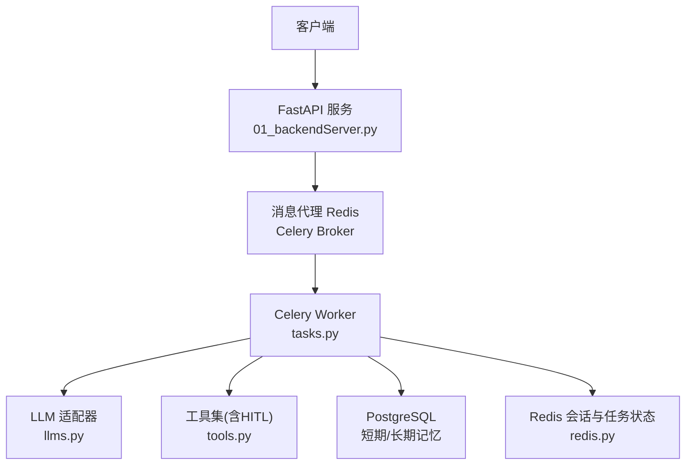
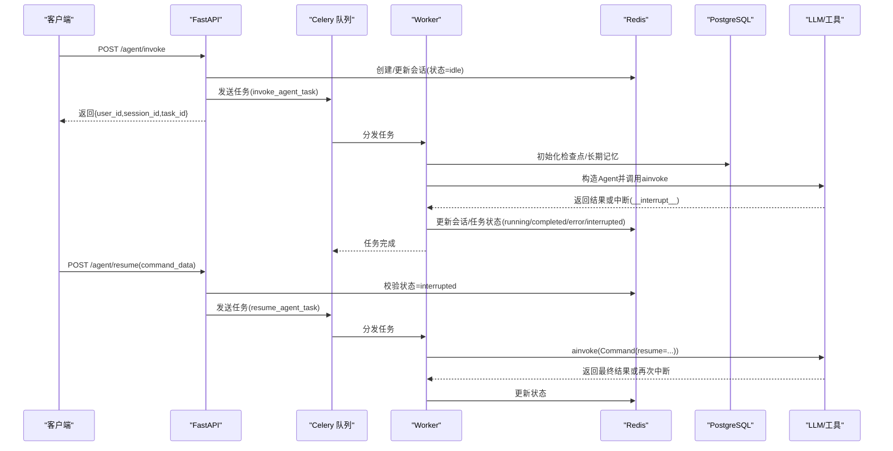
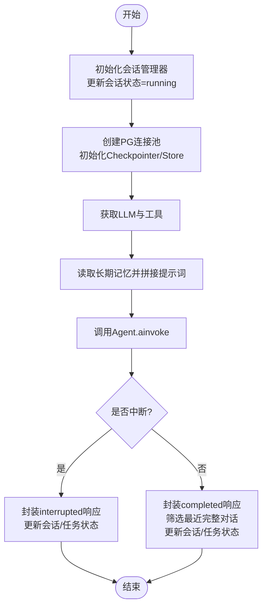
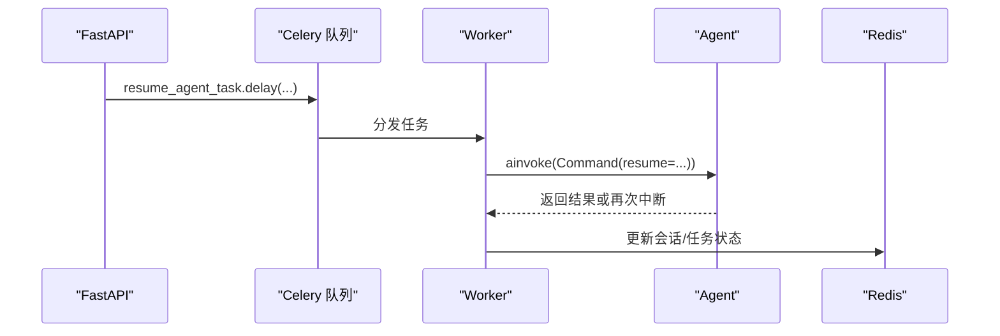
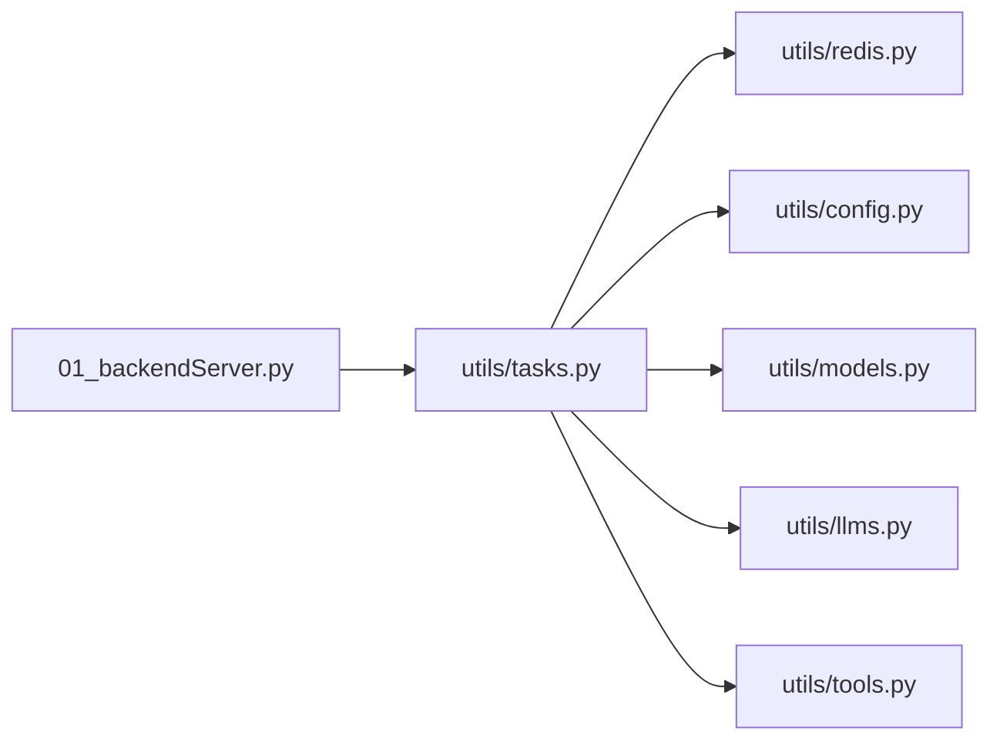

# 任务调度组件

<cite>
**本文引用的文件**
- [utils/tasks.py](file://utils/tasks.py)
- [utils/config.py](file://utils/config.py)
- [utils/redis.py](file://utils/redis.py)
- [01_backendServer.py](file://01_backendServer.py)
- [utils/models.py](file://utils/models.py)
- [utils/llms.py](file://utils/llms.py)
- [utils/tools.py](file://utils/tools.py)
- [README.md](file://README.md)
</cite>

## 目录
1. [简介](#简介)
2. [项目结构](#项目结构)
3. [核心组件](#核心组件)
4. [架构总览](#架构总览)
5. [详细组件分析](#详细组件分析)
6. [依赖关系分析](#依赖关系分析)
7. [性能与可靠性](#性能与可靠性)
8. [故障排查指南](#故障排查指南)
9. [结论](#结论)
10. [附录：扩展新任务类型](#附录：扩展新任务类型)

## 简介
本组件基于 Celery + FastAPI + LangGraph，提供异步化的智能体（Agent）任务调度能力。通过消息队列将“调用智能体”和“恢复被中断的智能体”两类任务解耦到独立 Worker 执行，实现高并发、可恢复、可观测的 Agent 服务。系统使用 Redis 作为消息代理与会话状态存储，PostgreSQL 用于短期记忆检查点与长期记忆存储，支持 Human-in-the-Loop（HITL）人工审查工具调用。

## 项目结构
- API 层：FastAPI 暴露 /agent/invoke、/agent/resume 等接口，负责参数校验、会话创建、任务入队与状态管理。
- 任务层：Celery 任务定义 invoke_agent_task、resume_agent_task，封装异步执行逻辑、结果处理与状态更新。
- 存储层：RedisSessionManager 维护用户会话、任务状态映射；PostgreSQL 用于 LangGraph 检查点与长期记忆。
- 配置层：统一配置类集中管理数据库、Redis、Celery、LLM 等参数。
- 模型层：Pydantic 数据模型规范请求与响应结构。
- 工具与LLM：工具注册与 HITL 包装，LLM 初始化与多厂商适配。

图表来源
- [01_backendServer.py:132-237](file://01_backendServer.py#L132-L237)
- [utils/tasks.py:43-63](file://utils/tasks.py#L43-L63)
- [utils/redis.py:37-103](file://utils/redis.py#L37-L103)
- [utils/llms.py:70-119](file://utils/llms.py#L70-L119)
- [utils/tools.py:121-175](file://utils/tools.py#L121-L175)

章节来源
- [01_backendServer.py:1-424](file://01_backendServer.py#L1-L424)
- [utils/tasks.py:1-564](file://utils/tasks.py#L1-L564)
- [utils/config.py:1-34](file://utils/config.py#L1-L34)
- [utils/redis.py:1-493](file://utils/redis.py#L1-L493)
- [utils/models.py:1-97](file://utils/models.py#L1-L97)
- [utils/llms.py:1-151](file://utils/llms.py#L1-L151)
- [utils/tools.py:1-175](file://utils/tools.py#L1-L175)
- [README.md:1-199](file://README.md#L1-L199)

## 核心组件
- Celery 应用与任务
  - 在 tasks.py 中创建 Celery 实例并配置序列化、时区等；定义两个核心任务：invoke_agent_task、resume_agent_task。
- 会话与任务状态管理
  - RedisSessionManager 提供会话创建/更新/查询、任务状态绑定与清理、过期策略等。
- API 路由
  - /agent/invoke：提交新任务，立即返回 task_id，后台异步执行。
  - /agent/resume：恢复被中断的任务，传入命令数据继续执行。
  - 其他查询接口：获取会话、任务状态、系统信息等。
- 模型与配置
  - Pydantic 模型统一输入输出；Config 集中管理所有运行时配置。
- 工具与LLM
  - 工具通过 add_human_in_the_loop 包装，支持 accept/edit/reject/response 四种人类反馈；LLM 支持多厂商接入。

章节来源
- [utils/tasks.py:43-63](file://utils/tasks.py#L43-L63)
- [utils/tasks.py:318-451](file://utils/tasks.py#L318-L451)
- [utils/tasks.py:455-559](file://utils/tasks.py#L455-L559)
- [utils/redis.py:37-493](file://utils/redis.py#L37-L493)
- [01_backendServer.py:132-237](file://01_backendServer.py#L132-L237)
- [utils/models.py:1-97](file://utils/models.py#L1-L97)
- [utils/config.py:1-34](file://utils/config.py#L1-L34)
- [utils/tools.py:37-118](file://utils/tools.py#L37-L118)
- [utils/llms.py:70-119](file://utils/llms.py#L70-L119)

## 架构总览
整体采用“API 入队 + Worker 执行”的异步模式：
- 客户端调用 /agent/invoke，后端创建或复用会话，将任务推送到 Celery 队列，并记录任务为 pending。
- Worker 消费任务，构建 LangGraph ReAct Agent，读取长期记忆，执行对话，处理中断或完成，更新会话与任务状态。
- 若 Agent 触发 HITL 中断，前端可通过 /agent/resume 提交人类反馈，Worker 以 Command(resume=...) 恢复执行。

图表来源
- [01_backendServer.py:132-237](file://01_backendServer.py#L132-L237)
- [utils/tasks.py:318-451](file://utils/tasks.py#L318-L451)
- [utils/tasks.py:455-559](file://utils/tasks.py#L455-L559)
- [utils/redis.py:65-144](file://utils/redis.py#L65-L144)
- [utils/redis.py:392-442](file://utils/redis.py#L392-L442)

## 详细组件分析

### 任务定义与队列配置
- Celery 实例化与配置
  - 设置 broker 为 Redis URL，序列化格式为 JSON，时区 Asia/Shanghai，启用 UTC。
- 任务装饰器
  - @celery_app.task 标记 invoke_agent_task、resume_agent_task 为可调度任务。
- 日志
  - 使用 ConcurrentRotatingFileHandler 按大小轮转写入 logfile/app.log。

章节来源
- [utils/tasks.py:21-63](file://utils/tasks.py#L21-L63)
- [utils/config.py:13-26](file://utils/config.py#L13-L26)

### 核心任务：invoke_agent_task
职责
- 接收 user_id、session_id、task_id、query、system_prompt。
- 初始化 Redis 会话管理器，更新会话状态为 running。
- 建立 PostgreSQL 连接池，初始化短期记忆检查点与长期记忆存储。
- 获取 LLM 与工具列表，构建 ReAct Agent。
- 读取用户长期记忆并拼接到 system_message。
- 调用 agent.ainvoke(messages)，解析消息，处理结果（完成或中断）。
- 更新会话与任务状态，返回标准化响应。

关键流程

图表来源
- [utils/tasks.py:318-451](file://utils/tasks.py#L318-L451)
- [utils/redis.py:65-144](file://utils/redis.py#L65-L144)
- [utils/redis.py:392-442](file://utils/redis.py#L392-L442)

错误处理与重试
- 捕获异常后构造 error 响应，更新会话状态为 error，任务状态为 failed，并抛出异常以便 Celery 记录失败。
- 当前未显式配置重试策略（如 retry_backoff），可在 Celery 配置中按需添加。

超时处理
- LLM 初始化时设置了 timeout 与 max_retries，有助于避免长时间阻塞。
- 任务级超时可通过 Celery 配置 task_time_limit 控制（仓库未显式设置）。

章节来源
- [utils/tasks.py:318-451](file://utils/tasks.py#L318-L451)
- [utils/llms.py:70-119](file://utils/llms.py#L70-L119)

### 核心任务：resume_agent_task
职责
- 接收 user_id、session_id、task_id、command_data。
- 重建 Agent 上下文（检查点/长期记忆），使用 Command(resume=command_data) 恢复执行。
- 解析消息与结果，处理中断或完成，更新会话与任务状态。

恢复流程

图表来源
- [utils/tasks.py:455-559](file://utils/tasks.py#L455-L559)
- [01_backendServer.py:175-237](file://01_backendServer.py#L175-L237)

章节来源
- [utils/tasks.py:455-559](file://utils/tasks.py#L455-L559)
- [01_backendServer.py:175-237](file://01_backendServer.py#L175-L237)

### 任务与 Agent 执行引擎交互
- 参数传递
  - invoke：messages=[system,user]，thread_id=task_id。
  - resume：Command(resume=command_data)，thread_id=task_id。
- 结果回调
  - process_agent_result 统一封装 completed/interrupted/error 三种状态，并持久化到 Redis。
- 异常处理
  - 任务内 try/except 捕获异常，更新状态为 error/failed，并抛出异常由 Celery 记录。
- 会话一致性
  - 每次操作前清理无效任务（cleanup_user_tasks/cleanup_all_tasks），确保状态一致。

章节来源
- [utils/tasks.py:194-264](file://utils/tasks.py#L194-L264)
- [utils/tasks.py:318-451](file://utils/tasks.py#L318-L451)
- [utils/tasks.py:455-559](file://utils/tasks.py#L455-L559)
- [utils/redis.py:246-341](file://utils/redis.py#L246-L341)

### 任务监控与调试
- 任务状态查询
  - GET /agent/status/{user_id}/{session_id}/{task_id} 返回会话状态、上次查询、更新时间、上次响应。
  - GET /agent/tasks/{user_id}/{session_id} 返回该会话下所有任务的 ID 与状态。
- 执行日志分析
  - 统一写入 logfile/app.log，包含任务生命周期、错误堆栈、工具调用详情。
- 性能监控建议
  - 关注 LLM 调用耗时、工具调用次数、消息修剪策略对 token 的影响。
  - 结合 Redis 键空间扫描与任务 TTL，评估会话与任务的生命周期。

章节来源
- [01_backendServer.py:315-344](file://01_backendServer.py#L315-L344)
- [01_backendServer.py:294-313](file://01_backendServer.py#L294-L313)
- [utils/tasks.py:21-40](file://utils/tasks.py#L21-L40)
- [utils/redis.py:417-442](file://utils/redis.py#L417-L442)

## 依赖关系分析
- 模块耦合
  - tasks.py 依赖 config、redis、models、llms、tools，形成任务执行的核心链路。
  - redis.py 提供会话与任务状态管理能力，被 tasks 与 API 共同使用。
  - API 层仅负责编排与状态落库，不直接执行业务逻辑，保持低耦合。
- 外部依赖
  - Celery 与 Redis 作为消息代理与会话存储。
  - PostgreSQL 用于 LangGraph 检查点与长期记忆。
  - LLM 适配器支持多厂商，便于切换与扩展。

图表来源
- [01_backendServer.py:1-424](file://01_backendServer.py#L1-L424)
- [utils/tasks.py:1-564](file://utils/tasks.py#L1-L564)

章节来源
- [01_backendServer.py:1-424](file://01_backendServer.py#L1-L424)
- [utils/tasks.py:1-564](file://utils/tasks.py#L1-L564)

## 性能与可靠性
- 并发与吞吐
  - 通过 Celery Worker 并行消费任务，提升吞吐；Redis 作为轻量消息代理适合中等规模场景。
- 资源管理
  - PostgreSQL 连接池最小/最大连接数可控；Redis 会话与任务均设置 TTL，避免内存泄漏。
- 可靠性
  - 任务失败会记录错误并更新状态；LLM 调用具备超时与重试；HITL 中断支持恢复。
- 优化建议
  - 根据负载调整 Worker 数量与并发度。
  - 合理设置任务超时与重试退避策略。
  - 定期清理无效会话与任务，减少 Redis 压力。

[本节为通用指导，无需具体文件引用]

## 故障排查指南
- 常见问题定位
  - 任务未执行：检查 Celery Worker 是否启动，Broker 是否可达。
  - 会话不存在：确认 /agent/invoke 已创建会话，且 session_id/task_id 正确。
  - 无法恢复：确认会话状态为 interrupted，否则 /agent/resume 会拒绝。
- 日志与状态
  - 查看 logfile/app.log 中的错误堆栈与工具调用日志。
  - 通过 /agent/status 与 /agent/tasks 接口观察状态流转。
- 数据一致性
  - 使用 cleanup 相关方法确保无效任务被清理，避免脏数据。

章节来源
- [utils/tasks.py:420-446](file://utils/tasks.py#L420-L446)
- [utils/tasks.py:528-554](file://utils/tasks.py#L528-L554)
- [01_backendServer.py:175-237](file://01_backendServer.py#L175-L237)
- [utils/redis.py:246-341](file://utils/redis.py#L246-L341)

## 结论
本组件通过 Celery 将 Agent 执行从 API 中解耦，实现了高可用、可扩展的异步任务调度。借助 Redis 与会话状态管理、PostgreSQL 的记忆持久化、以及 HITL 的人类介入机制，系统能够稳定支撑复杂的多轮对话与工具调用场景。配合完善的日志与状态查询接口，便于运维监控与问题定位。

[本节为总结性内容，无需具体文件引用]

## 附录：扩展新任务类型
步骤
- 新增任务函数
  - 在 utils/tasks.py 中定义新的 @celery_app.task 函数，遵循现有任务的结构：初始化会话管理器、处理业务逻辑、更新会话与任务状态、异常处理。
- 暴露 API
  - 在 01_backendServer.py 中添加路由，接收请求参数，调用 .delay() 入队，并设置任务初始状态为 pending。
- 配置与模型
  - 如需新参数，扩展 models.py 中的请求/响应模型；必要时在 config.py 增加配置项。
- 测试与监控
  - 启动 Celery Worker 与 API，验证任务执行与状态流转；通过日志与状态接口进行验证。

参考路径
- 任务定义示例：[utils/tasks.py:318-451](file://utils/tasks.py#L318-L451)、[utils/tasks.py:455-559](file://utils/tasks.py#L455-L559)
- API 入队示例：[01_backendServer.py:132-173](file://01_backendServer.py#L132-L173)、[01_backendServer.py:175-237](file://01_backendServer.py#L175-L237)
- 模型定义示例：[utils/models.py:7-54](file://utils/models.py#L7-L54)
- 配置示例：[utils/config.py:13-26](file://utils/config.py#L13-L26)

[本节为扩展指南，无需额外图表]