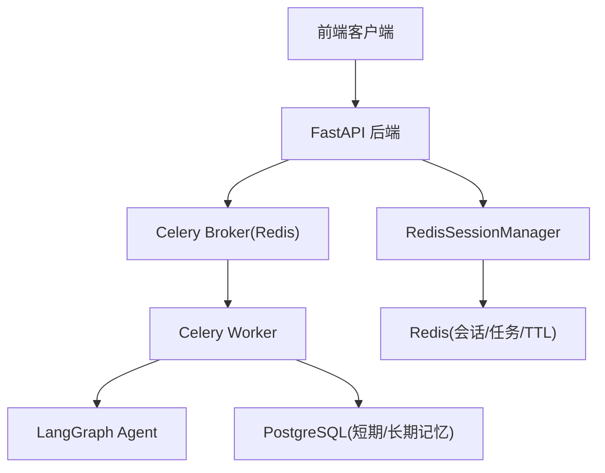
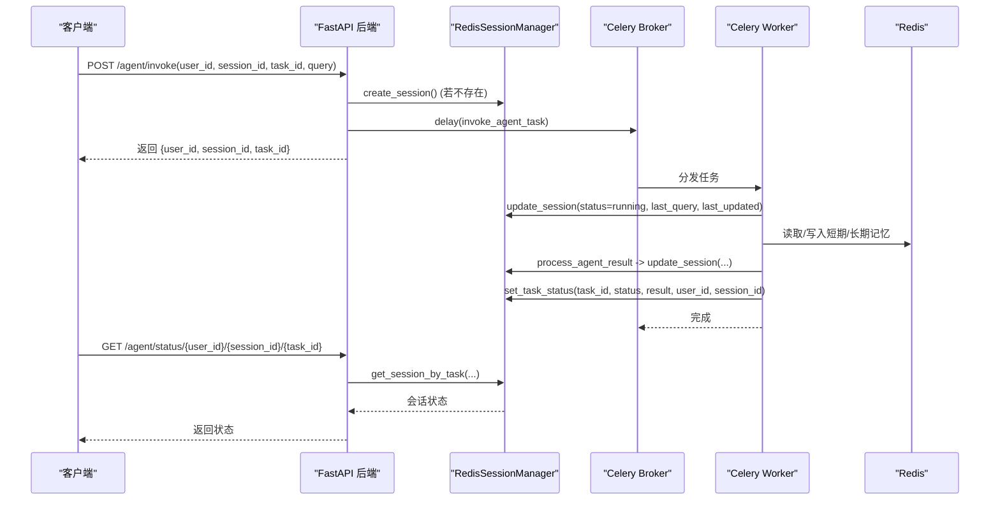
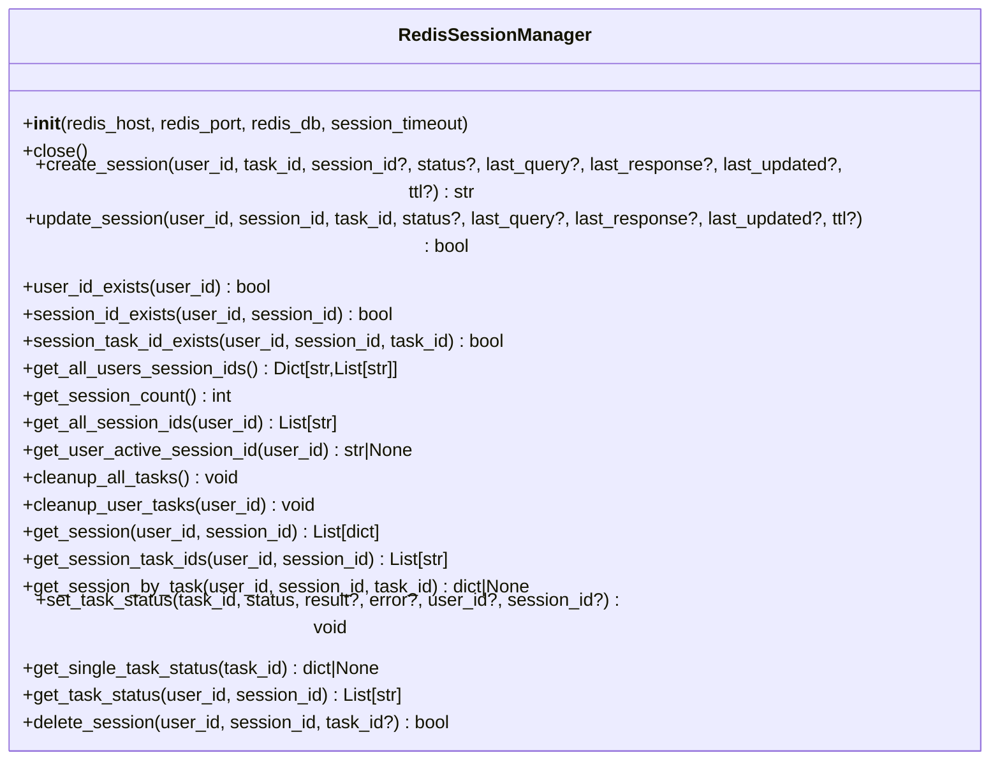
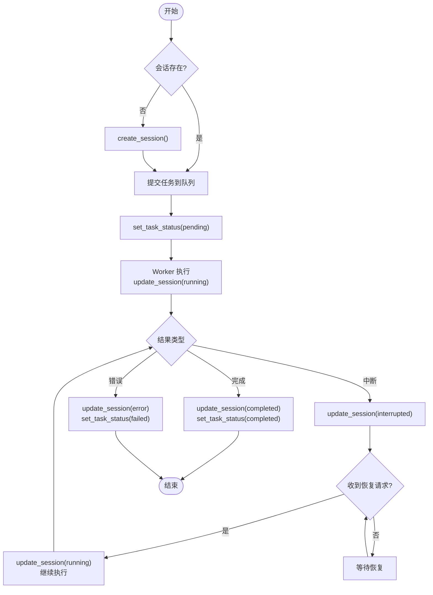
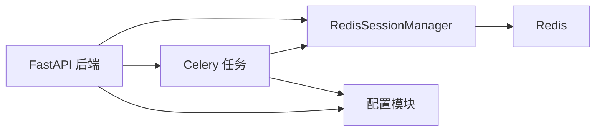

# 会话管理组件

<cite>
**本文引用的文件**
- [utils/redis.py](file://utils/redis.py)
- [utils/tasks.py](file://utils/tasks.py)
- [utils/config.py](file://utils/config.py)
- [01_backendServer.py](file://01_backendServer.py)
- [02_frontendServer.py](file://02_frontendServer.py)
- [utils/models.py](file://utils/models.py)
</cite>

## 目录
1. [简介](#简介)
2. [项目结构](#项目结构)
3. [核心组件](#核心组件)
4. [架构总览](#架构总览)
5. [详细组件分析](#详细组件分析)
6. [依赖关系分析](#依赖关系分析)
7. [性能与内存优化](#性能与内存优化)
8. [故障排查指南](#故障排查指南)
9. [结论](#结论)
10. [附录：使用示例与常见问题](#附录使用示例与常见问题)

## 简介
本组件基于 Redis 实现多用户、多会话、多任务的智能体会话管理。通过键空间设计、集合索引与 TTL 过期机制，提供会话的创建、更新、删除、状态查询、任务绑定与清理等能力；并与 Celery 异步任务系统结合，支撑智能体的调用与恢复流程。文档重点说明：
- 会话数据结构设计与多用户隔离
- 会话生命周期管理与 TTL 自动过期
- 会话与任务的关联（任务ID绑定、状态跟踪、数据隔离）
- SessionManager（RedisSessionManager）的核心功能
- 并发访问控制、数据一致性保证与故障恢复
- 最佳实践与常见问题解决方案

## 项目结构
- 后端服务：FastAPI 暴露 REST API，负责会话校验、任务调度、状态返回
- 会话管理：RedisSessionManager 封装 Redis 操作，维护会话与任务映射
- 任务执行：Celery 任务 invoke_agent_task / resume_agent_task 驱动智能体执行并更新会话与任务状态
- 配置中心：统一配置项（Redis、数据库、TTL、日志等）
- 前端演示：命令行客户端模拟交互，展示会话恢复与中断处理

图表来源
- [01_backendServer.py:84-130](file://01_backendServer.py#L84-L130)
- [utils/tasks.py:319-451](file://utils/tasks.py#L319-L451)
- [utils/redis.py:37-490](file://utils/redis.py#L37-L490)
- [utils/config.py:18-26](file://utils/config.py#L18-L26)

章节来源
- [01_backendServer.py:84-130](file://01_backendServer.py#L84-L130)
- [utils/config.py:18-26](file://utils/config.py#L18-L26)

## 核心组件
- RedisSessionManager：会话与任务管理的核心类，提供会话 CRUD、状态查询、任务绑定、清理等能力
- FastAPI 路由：对外暴露会话与任务相关接口，协调会话存在性检查、任务入队、状态返回
- Celery 任务：invoke_agent_task 与 resume_agent_task 负责智能体执行、结果处理与会话/任务状态更新
- 配置模块：集中管理 Redis、数据库、TTL、日志等参数

章节来源
- [utils/redis.py:37-490](file://utils/redis.py#L37-L490)
- [01_backendServer.py:132-414](file://01_backendServer.py#L132-L414)
- [utils/tasks.py:319-559](file://utils/tasks.py#L319-L559)
- [utils/config.py:4-34](file://utils/config.py#L4-L34)

## 架构总览
- 多用户隔离：以 user_id 为维度组织键空间，所有会话与任务均带 user_id 前缀或归属集合
- 多会话支持：每个 session_id 可包含多个 task_id，形成“会话-任务”一对多关系
- 多任务并行：同一会话内可并发执行多个任务，各自独立的状态与结果
- 状态同步：会话状态与任务状态分别存储并通过映射集合保持一致性
- TTL 管理：会话与任务均设置过期时间，配合定期清理保持内存整洁

图表来源
- [01_backendServer.py:132-173](file://01_backendServer.py#L132-L173)
- [utils/tasks.py:319-451](file://utils/tasks.py#L319-L451)
- [utils/redis.py:65-144](file://utils/redis.py#L65-L144)
- [utils/redis.py:392-442](file://utils/redis.py#L392-L442)

## 详细组件分析

### RedisSessionManager：会话与任务管理
- 关键职责
  - 会话创建：create_session 生成/接收 session_id，持久化会话数据到 Redis，建立 user_sessions 与 task_mapping 索引
  - 会话更新：update_session 增量更新状态、查询、响应与更新时间，刷新 TTL
  - 会话查询：get_session/get_session_by_task 获取会话详情，自动清理无效条目
  - 任务绑定：set_task_status 将任务状态与结果持久化，并绑定到用户与会话映射
  - 任务查询：get_task_status/get_single_task_status 获取任务状态列表或单个任务状态
  - 清理机制：cleanup_user_tasks/cleanup_all_tasks 清理过期/无效会话与任务，释放资源
  - 删除操作：delete_session 支持按任务或整会话删除，维护索引一致性

- 数据结构与键空间
  - 会话数据键：session:{user_id}:{session_id}:{task_id}，JSON 序列化，含 session_id、task_id、status、last_response、last_query、last_updated
  - 用户会话集合：user_sessions:{user_id}，元素为 "session_id:task_id"
  - 会话任务映射：task_mapping:{user_id}:{session_id}，元素为 task_id
  - 任务状态键：task:{task_id}，JSON 序列化，含 task_id、status、result、error、user_id、session_id

- TTL 与过期策略
  - 会话默认 TTL：SESSION_TIMEOUT（可通过 create/update 指定覆盖）
  - 任务状态 TTL：TASK_TTL（固定）
  - 每次更新会话时刷新 TTL，确保活跃会话不被误删
  - 清理函数在查询前主动清理无效条目，避免脏数据

- 并发与一致性
  - 读写分离：会话与任务状态分键存储，降低热点冲突
  - 原子性：单条 Redis 命令保证基本原子性；复杂逻辑通过顺序调用与索引维护保证最终一致
  - 幂等性：create_session 允许传入 session_id，避免重复创建；update_session 先读后写，注意并发场景下需业务层重试

图表来源
- [utils/redis.py:37-490](file://utils/redis.py#L37-L490)

章节来源
- [utils/redis.py:65-144](file://utils/redis.py#L65-L144)
- [utils/redis.py:147-215](file://utils/redis.py#L147-L215)
- [utils/redis.py:246-341](file://utils/redis.py#L246-L341)
- [utils/redis.py:343-442](file://utils/redis.py#L343-L442)
- [utils/redis.py:444-476](file://utils/redis.py#L444-L476)

### 会话生命周期管理
- 创建：API 层检查是否存在，不存在则创建；任务入队后立即设置任务状态为 pending
- 运行：Worker 启动后将会话状态更新为 running，记录 last_query 与 last_updated
- 完成/错误：根据智能体结果更新为 completed/error，并持久化结果或错误信息
- 中断：当智能体需要人工干预时，状态标记为 interrupted，等待 resume 请求
- 恢复：resume_agent 接口校验状态为 interrupted，更新为 running，继续执行
- 删除：支持按任务或整会话删除，清理索引与数据

图表来源
- [01_backendServer.py:132-237](file://01_backendServer.py#L132-L237)
- [utils/tasks.py:319-559](file://utils/tasks.py#L319-L559)
- [utils/redis.py:65-144](file://utils/redis.py#L65-L144)
- [utils/redis.py:392-442](file://utils/redis.py#L392-L442)

章节来源
- [01_backendServer.py:132-237](file://01_backendServer.py#L132-L237)
- [utils/tasks.py:319-559](file://utils/tasks.py#L319-L559)

### 会话与任务的关联关系
- 任务ID绑定：set_task_status 将 task_id 与 user_id、session_id 绑定，便于后续查询与清理
- 状态跟踪：任务状态独立存储于 task:{task_id}，会话状态存储于 session:{...}，两者通过映射集合关联
- 数据隔离：所有键均以 user_id 为维度隔离，避免跨用户数据泄露
- 查询接口：get_task_status 返回当前会话下的任务 ID 与状态拼接列表，便于前端轮询

章节来源
- [utils/redis.py:392-442](file://utils/redis.py#L392-L442)
- [01_backendServer.py:294-313](file://01_backendServer.py#L294-L313)

### TTL 管理机制
- 会话 TTL：默认 SESSION_TIMEOUT，可在 create/update 时自定义 TTL
- 任务 TTL：TASK_TTL，用于任务状态数据的自动清理
- 刷新策略：每次更新会话都会刷新 TTL，确保活跃会话存活
- 清理策略：查询前调用 cleanup_user_tasks/cleanup_all_tasks 清理过期条目，防止脏数据影响统计与查询

章节来源
- [utils/config.py:18-26](file://utils/config.py#L18-L26)
- [utils/redis.py:65-144](file://utils/redis.py#L65-L144)
- [utils/redis.py:246-341](file://utils/redis.py#L246-L341)

### 并发访问控制与数据一致性
- 并发安全：Redis 单线程模型保证命令原子性；复杂操作通过顺序调用与索引维护保证最终一致
- 幂等设计：create_session 支持传入 session_id，避免重复创建；update_session 先读后写，建议上层加锁或重试
- 一致性保障：会话与任务状态分离存储，通过映射集合关联；清理函数保证索引与数据的一致性
- 故障恢复：任务失败会更新为 failed，会话更新为 error；前端可据此提示并重试

章节来源
- [utils/redis.py:105-144](file://utils/redis.py#L105-L144)
- [utils/redis.py:246-341](file://utils/redis.py#L246-L341)
- [utils/tasks.py:420-446](file://utils/tasks.py#L420-L446)

## 依赖关系分析
- FastAPI 后端依赖 RedisSessionManager 进行会话与任务管理
- Celery 任务依赖 RedisSessionManager 更新会话与任务状态
- 配置模块集中管理 Redis、数据库、TTL 等参数
- 前端演示通过 HTTP 调用后端 API，展示会话恢复与中断处理

图表来源
- [01_backendServer.py:84-130](file://01_backendServer.py#L84-L130)
- [utils/tasks.py:319-559](file://utils/tasks.py#L319-L559)
- [utils/config.py:4-34](file://utils/config.py#L4-L34)

章节来源
- [01_backendServer.py:84-130](file://01_backendServer.py#L84-L130)
- [utils/tasks.py:319-559](file://utils/tasks.py#L319-L559)
- [utils/config.py:4-34](file://utils/config.py#L4-L34)

## 性能与内存优化
- 键空间设计：会话与任务分离存储，减少大对象竞争
- 集合索引：user_sessions 与 task_mapping 提升查询效率
- TTL 过期：自动清理过期数据，避免内存泄漏
- 批量清理：cleanup_all_tasks 与 cleanup_user_tasks 按需清理，降低扫描开销
- 连接池：数据库连接池复用连接，减少握手开销

章节来源
- [utils/redis.py:246-341](file://utils/redis.py#L246-L341)
- [01_backendServer.py:94-102](file://01_backendServer.py#L94-L102)

## 故障排查指南
- 会话不存在：检查 user_id、session_id、task_id 是否正确；确认是否已创建会话
- 任务状态异常：查看任务状态键 task:{task_id} 是否存在；检查 Worker 是否正常消费
- 清理不及时：手动调用 cleanup_user_tasks/cleanup_all_tasks 清理脏数据
- 超时问题：调整 SESSION_TIMEOUT 与 TASK_TTL；检查 Redis 连接与网络
- 中断恢复失败：确认会话状态为 interrupted；检查 resume 请求参数是否正确

章节来源
- [utils/redis.py:147-215](file://utils/redis.py#L147-L215)
- [utils/redis.py:246-341](file://utils/redis.py#L246-L341)
- [01_backendServer.py:176-237](file://01_backendServer.py#L176-L237)

## 结论
本会话管理组件通过 Redis 实现了多用户、多会话、多任务的高效管理，具备完整的生命周期管理能力与 TTL 自动过期机制。结合 Celery 异步任务，支撑智能体的调用与恢复流程。通过合理的键空间设计与索引维护，保证了数据一致性与性能。建议在生产环境中结合监控与告警，持续优化 TTL 与清理策略，确保系统稳定运行。

## 附录：使用示例与常见问题

### 使用示例
- 创建会话并提交任务：调用 /agent/invoke，传入 user_id、session_id、task_id、query
- 查询会话状态：调用 /agent/status/{user_id}/{session_id}/{task_id}
- 恢复中断会话：调用 /agent/resume，传入 user_id、session_id、task_id、response_type、args
- 删除会话或任务：调用 /agent/session/{user_id}/{session_id} 或 /agent/task/{user_id}/{session_id}/{task_id}

章节来源
- [01_backendServer.py:132-414](file://01_backendServer.py#L132-L414)
- [02_frontendServer.py:51-107](file://02_frontendServer.py#L51-L107)

### 常见问题
- 为什么会话被意外删除？检查 TTL 设置与清理逻辑，确认是否长时间无更新
- 为什么任务状态未更新？检查 Worker 是否正常运行，查看任务状态键是否存在
- 如何避免并发冲突？建议在应用层对同一会话的任务加锁或串行化
- 如何监控会话数量？调用 /system/info 获取会话总数与活跃用户

章节来源
- [utils/redis.py:246-341](file://utils/redis.py#L246-L341)
- [01_backendServer.py:239-251](file://01_backendServer.py#L239-L251)