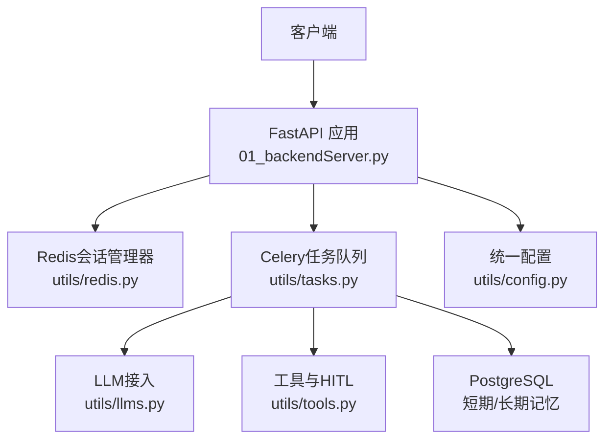
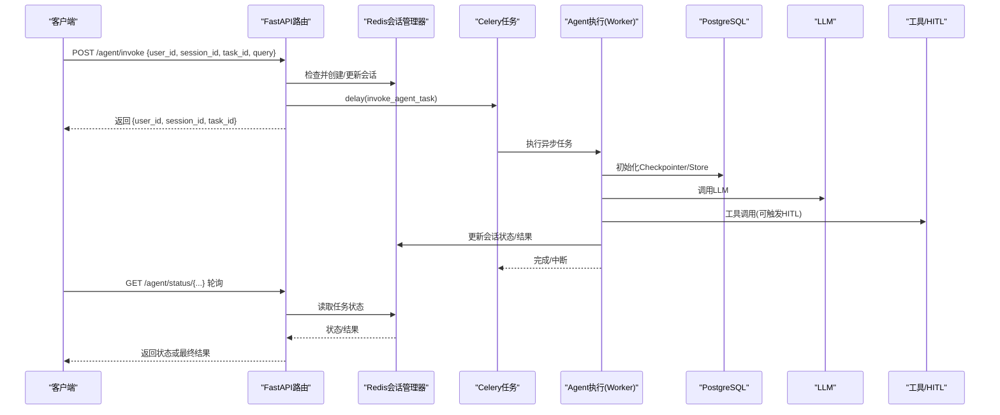
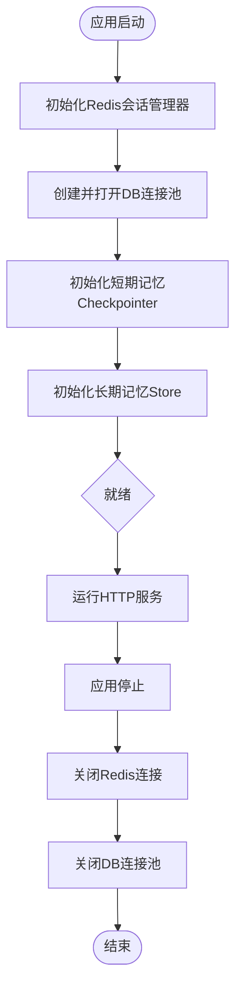
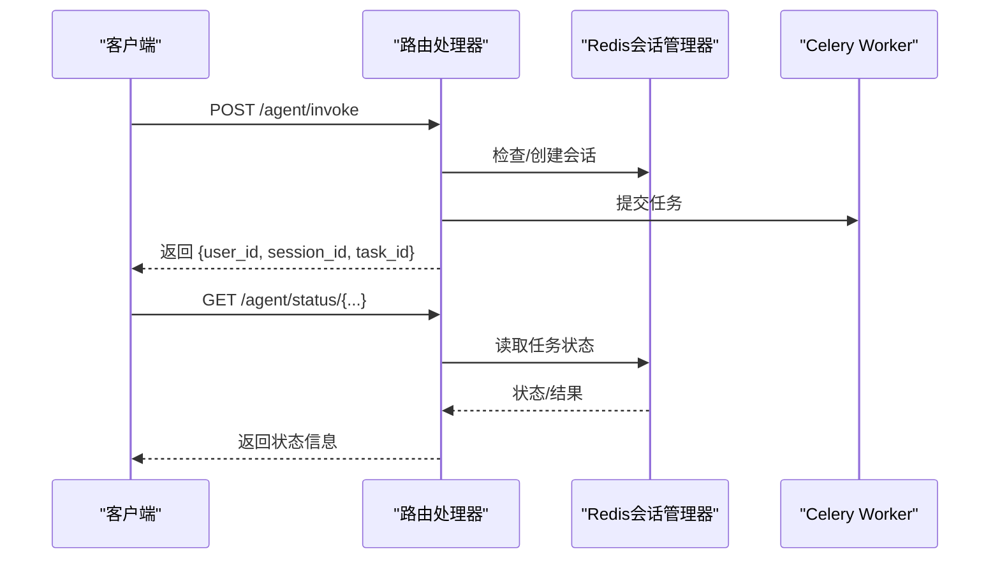
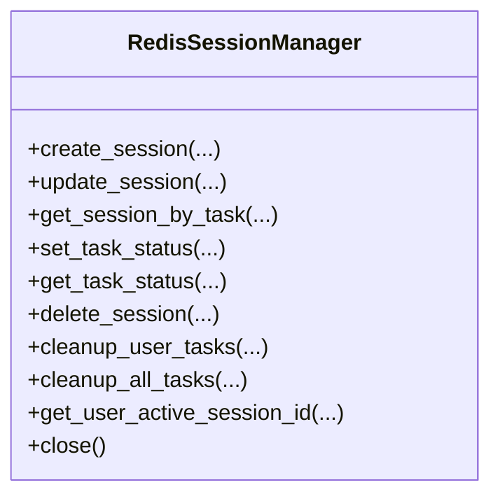
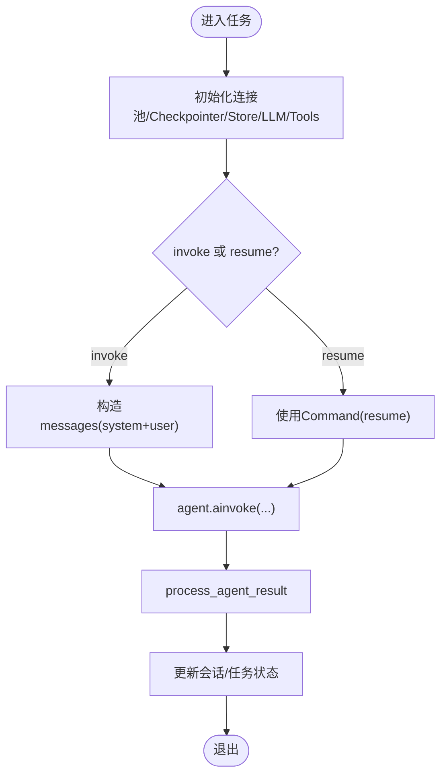
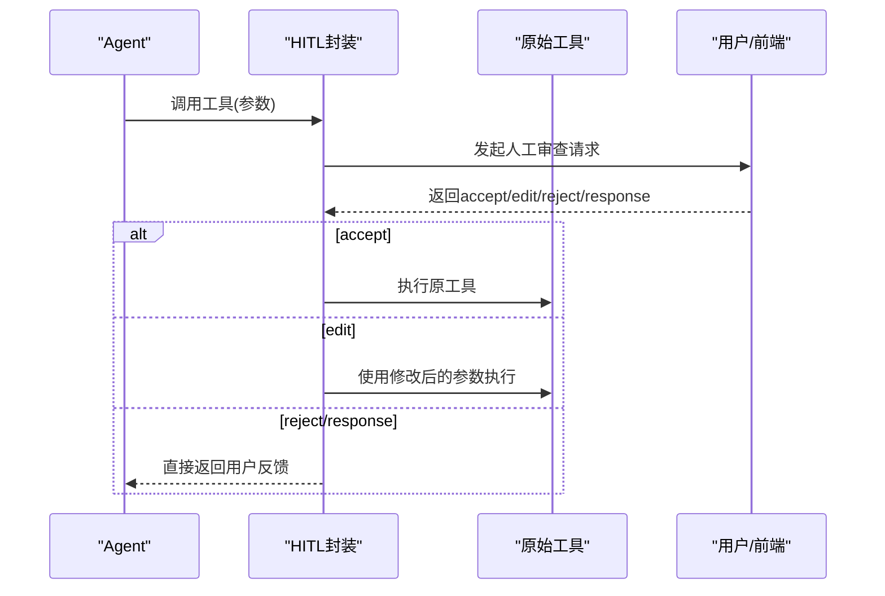
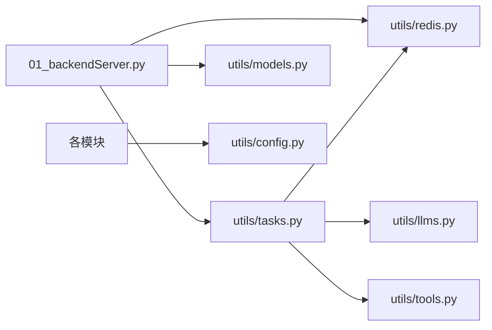

# 后端服务组件

<cite>
**本文引用的文件**
- [01_backendServer.py](file://01_backendServer.py)
- [utils/config.py](file://utils/config.py)
- [utils/redis.py](file://utils/redis.py)
- [utils/models.py](file://utils/models.py)
- [utils/tasks.py](file://utils/tasks.py)
- [utils/tools.py](file://utils/tools.py)
- [utils/llms.py](file://utils/llms.py)
- [README.md](file://README.md)
</cite>

## 目录
1. [简介](#简介)
2. [项目结构](#项目结构)
3. [核心组件](#核心组件)
4. [架构总览](#架构总览)
5. [详细组件分析](#详细组件分析)
6. [依赖关系分析](#依赖关系分析)
7. [性能考量](#性能考量)
8. [故障排查指南](#故障排查指南)
9. [结论](#结论)
10. [附录：API端点与扩展实践](#附录api端点与扩展实践)

## 简介
本组件基于 FastAPI 构建，提供异步的 Agent 智能体后端服务。系统支持多用户、多会话、任务状态管理；通过 Redis 维护会话与任务状态，使用 PostgreSQL 作为短期记忆（Checkpointer）与长期记忆（Store）的持久化存储；借助 Celery 将耗时任务异步化执行；集成 LangGraph ReAct Agent、工具调用与 Human-in-the-Loop（HITL）人工审查机制；并提供统一的配置、模型接入与日志记录能力。

## 项目结构
- 应用入口与路由：01_backendServer.py
- 配置中心：utils/config.py
- 会话与任务状态：utils/redis.py（RedisSessionManager）
- 数据模型：utils/models.py（Pydantic 请求/响应模型）
- 异步任务与Agent执行：utils/tasks.py（Celery 任务、Agent 编排、结果处理）
- 工具与HITL：utils/tools.py（自定义工具、MCP工具、人工审查封装）
- LLM接入：utils/llms.py（多厂商模型初始化与获取）
- 文档与说明：README.md

图表来源
- [01_backendServer.py:84-130](file://01_backendServer.py#L84-L130)
- [utils/redis.py:37-490](file://utils/redis.py#L37-L490)
- [utils/tasks.py:318-559](file://utils/tasks.py#L318-L559)
- [utils/llms.py:70-138](file://utils/llms.py#L70-L138)
- [utils/tools.py:37-175](file://utils/tools.py#L37-L175)
- [utils/config.py:4-34](file://utils/config.py#L4-L34)

章节来源
- [README.md:1-199](file://README.md#L1-L199)

## 核心组件
- 应用生命周期管理：通过 lifespan 上下文管理器在启动时初始化 Redis 会话管理器、数据库连接池、短期记忆 Checkpointer、长期记忆 Store；在关闭时释放资源。
- 路由处理器：定义多个 RESTful 接口用于触发 Agent 运行、恢复中断、查询会话与任务状态、写入长期记忆、删除会话/任务等。
- 中间件配置：当前未显式注册通用中间件；可通过 FastAPI 的 middleware 机制扩展（见附录）。
- HTTP请求处理流程：从请求进入路由 -> 参数校验（Pydantic）-> 会话存在性检查 -> 提交 Celery 任务 -> 立即返回任务ID -> 前端轮询任务状态或等待中断反馈。
- 数据库连接池：使用 psycopg_pool.AsyncConnectionPool，设置最小/最大连接数与自动提交等参数，并在应用生命周期中打开与关闭。
- Redis会话管理器：封装会话创建、更新、查询、清理、删除以及任务状态绑定与查询，支持 TTL 过期与一致性清理。

章节来源
- [01_backendServer.py:84-130](file://01_backendServer.py#L84-L130)
- [01_backendServer.py:132-414](file://01_backendServer.py#L132-L414)
- [utils/redis.py:37-490](file://utils/redis.py#L37-L490)
- [utils/config.py:13-26](file://utils/config.py#L13-L26)

## 架构总览
整体采用“Web 层 + 任务队列 + 存储层”的分层架构：
- Web 层（FastAPI）负责接收请求、参数校验、路由分发、状态查询与返回。
- 任务层（Celery Worker）负责执行耗时的 Agent 推理、工具调用、HITL 交互与结果持久化。
- 存储层包括：
  - Redis：会话状态、任务状态、索引集合（user_sessions, task_mapping），具备 TTL 与原子操作。
  - PostgreSQL：短期记忆（LangGraph Checkpointer）与长期记忆（LangGraph Store）。
  - LLM 提供商：OpenAI、通义千问、Ollama 等，通过统一接口获取。

图表来源
- [01_backendServer.py:132-173](file://01_backendServer.py#L132-L173)
- [utils/tasks.py:318-451](file://utils/tasks.py#L318-L451)
- [utils/redis.py:65-144](file://utils/redis.py#L65-L144)
- [utils/llms.py:70-138](file://utils/llms.py#L70-L138)
- [utils/tools.py:37-118](file://utils/tools.py#L37-L118)

## 详细组件分析

### 应用生命周期与资源管理
- 启动阶段：
  - 初始化 Redis 会话管理器实例，供后续会话与任务状态管理。
  - 创建并打开 PostgreSQL 异步连接池，配置最小/最大连接数与 autocommit。
  - 初始化短期记忆 Checkpointer（AsyncPostgresSaver）与长期记忆 Store（AsyncPostgresStore）。
- 关闭阶段：
  - 关闭 Redis 会话管理器连接。
  - 关闭数据库连接池，确保资源释放。

图表来源
- [01_backendServer.py:84-123](file://01_backendServer.py#L84-L123)

章节来源
- [01_backendServer.py:84-123](file://01_backendServer.py#L84-L123)
- [utils/config.py:13-26](file://utils/config.py#L13-L26)

### 路由处理器与HTTP请求流程
- 关键接口：
  - POST /agent/invoke：提交新任务，创建/确认会话，入队 invoke_agent_task，立即返回任务ID。
  - POST /agent/resume：恢复被中断的任务，校验状态为 interrupted 后入队 resume_agent_task。
  - GET /system/info：系统级统计（会话总数、活跃用户及会话）。
  - GET /agent/active/sessionid/{user_id}：最近一次更新的会话ID。
  - GET /agent/sessionids/{user_id}：某用户的所有会话ID。
  - GET /agent/tasks/{user_id}/{session_id}：某会话下的所有任务ID与状态。
  - GET /agent/status/{user_id}/{session_id}/{task_id}：具体任务的状态详情。
  - POST /agent/write/longterm：写入用户长期记忆。
  - DELETE /agent/session/{user_id}/{session_id}：删除指定会话。
  - DELETE /agent/task/{user_id}/{session_id}/{task_id}：删除指定任务。
- 参数验证：全部使用 Pydantic 模型进行请求体校验，缺失字段或类型错误由 FastAPI 自动返回 422。
- 错误处理：对不存在会话/任务、非法状态恢复等情况抛出 HTTPException，并记录日志。
- 日志记录：使用 ConcurrentRotatingFileHandler 按大小轮转输出到 logfile/app.log。

图表来源
- [01_backendServer.py:132-414](file://01_backendServer.py#L132-L414)
- [utils/redis.py:392-442](file://utils/redis.py#L392-L442)

章节来源
- [01_backendServer.py:132-414](file://01_backendServer.py#L132-L414)
- [utils/models.py:7-96](file://utils/models.py#L7-L96)

### Redis会话管理器
- 数据结构与键空间：
  - session:{user_id}:{session_id}:{task_id}：会话数据（包含状态、最后查询、最后响应、更新时间）。
  - user_sessions:{user_id}：集合，存储 session_id:task_id 条目。
  - task_mapping:{user_id}:{session_id}：集合，存储 task_id。
  - task:{task_id}：任务状态（status、result、error、绑定信息）。
- 主要能力：
  - 会话创建/更新/查询/删除，带 TTL 控制。
  - 任务状态设置与查询，支持绑定到用户与会话。
  - 清理无效任务（扫描 user_sessions 与 task_mapping，剔除过期会话对应的条目）。
  - 获取用户活跃会话ID（基于 last_updated 时间戳比较）。
- 复杂度与性能：
  - 大多数操作为 O(1) 的 Redis 命令；批量清理使用 scan_iter，避免全量 keys 扫描。
  - 注意在高并发下对同一 key 的频繁更新可能带来竞争，建议结合业务幂等设计。

图表来源
- [utils/redis.py:37-490](file://utils/redis.py#L37-L490)

章节来源
- [utils/redis.py:37-490](file://utils/redis.py#L37-L490)

### 异步任务与Agent执行
- Celery 任务：
  - invoke_agent_task：创建 DB 连接池、初始化 Checkpointer/Store、加载 LLM 与工具、构造消息、调用 agent.ainvoke、处理结果（中断/完成）、更新会话与任务状态。
  - resume_agent_task：以 Command(resume=command_data) 恢复中断，继续执行直至完成或再次中断。
- 结果处理：
  - process_agent_result：统一处理中断与最终结果，更新会话状态与 last_response。
  - filter_last_human_conversation：筛选最近一次完整对话的消息片段，便于前端展示。
- 异常处理：捕获异常并更新会话状态为 error，任务状态为 failed，同时记录错误信息。

图表来源
- [utils/tasks.py:318-451](file://utils/tasks.py#L318-L451)
- [utils/tasks.py:455-559](file://utils/tasks.py#L455-L559)
- [utils/tasks.py:194-264](file://utils/tasks.py#L194-L264)

章节来源
- [utils/tasks.py:318-559](file://utils/tasks.py#L318-L559)

### 工具与Human-in-the-Loop（HITL）
- 工具列表：
  - 自定义工具：book_hotel（模拟酒店预定）、multiply（乘法计算）。
  - MCP 工具：通过 MultiServerMCPClient 接入高德地图等外部工具。
- HITL 封装：
  - add_human_in_the_loop：为任意工具包装成支持人工审查的工具，支持 accept/edit/reject/response 四种响应类型。
  - 当工具被调用时，会触发 interrupt，等待前端或人工输入后再决定是否执行或如何调整参数。

图表来源
- [utils/tools.py:37-118](file://utils/tools.py#L37-L118)
- [utils/tools.py:121-175](file://utils/tools.py#L121-L175)

章节来源
- [utils/tools.py:37-175](file://utils/tools.py#L37-L175)

### LLM接入与配置
- 支持多种 LLM：openai、oneapi、qwen、ollama，通过 MODEL_CONFIGS 集中管理 base_url、api_key、模型名称。
- get_llm：根据配置初始化 ChatOpenAI 与 OpenAIEmbeddings，失败时尝试回退到默认类型。
- 超时与重试：设置 timeout 与 max_retries，提升稳定性。

章节来源
- [utils/llms.py:31-138](file://utils/llms.py#L31-L138)

## 依赖关系分析
- 模块耦合：
  - 路由层依赖 Redis 会话管理器与 Celery 任务；任务层依赖 Redis、PostgreSQL、LLM、工具。
  - 配置集中在 utils/config.py，被各模块引用，降低分散配置带来的不一致风险。
- 外部依赖：
  - Redis：会话与任务状态、索引集合、TTL 管理。
  - PostgreSQL：短期记忆（Checkpointer）与长期记忆（Store）。
  - Celery：异步任务调度，Broker 使用 Redis。
  - LLM：多厂商兼容，统一接口。
- 潜在循环依赖：未发现明显循环导入；模块间通过函数/类解耦。

图表来源
- [01_backendServer.py:1-19](file://01_backendServer.py#L1-L19)
- [utils/tasks.py:1-18](file://utils/tasks.py#L1-L18)
- [utils/redis.py:1-10](file://utils/redis.py#L1-L10)
- [utils/llms.py:1-6](file://utils/llms.py#L1-L6)
- [utils/tools.py:1-12](file://utils/tools.py#L1-L12)
- [utils/models.py:1-4](file://utils/models.py#L1-L4)
- [utils/config.py:1-4](file://utils/config.py#L1-L4)

章节来源
- [01_backendServer.py:1-19](file://01_backendServer.py#L1-L19)
- [utils/tasks.py:1-18](file://utils/tasks.py#L1-L18)
- [utils/redis.py:1-10](file://utils/redis.py#L1-L10)
- [utils/llms.py:1-6](file://utils/llms.py#L1-L6)
- [utils/tools.py:1-12](file://utils/tools.py#L1-L12)
- [utils/models.py:1-4](file://utils/models.py#L1-L4)
- [utils/config.py:1-4](file://utils/config.py#L1-L4)

## 性能考量
- 连接池与并发：
  - 使用 AsyncConnectionPool 管理 PostgreSQL 连接，合理设置 min_size/max_size 以平衡资源占用与吞吐。
  - Redis 操作均为 O(1)，但需避免在大集合上频繁遍历；清理逻辑已使用 scan_iter。
- 任务队列：
  - 将耗时推理与工具调用放入 Celery Worker，减轻 Web 进程压力，提高响应速度。
  - 建议监控 Broker 与 Worker 队列长度，必要时水平扩展 Worker。
- 记忆修剪：
  - 使用 trim_messages 限制消息 token 数量，避免上下文过大导致延迟与成本上升。
- 缓存与TTL：
  - Redis 会话与任务状态均设置 TTL，防止内存泄漏；可根据业务调整 TTL。
- 日志与IO：
  - 使用 ConcurrentRotatingFileHandler 按大小轮转日志，避免单文件过大影响 IO。
- 建议：
  - 对高频查询接口增加本地缓存（如短时效字典）以减少 Redis 压力。
  - 对 LLM 调用增加限流与熔断策略，避免雪崩。
  - 对长任务引入进度回调或事件推送（WebSocket/SSE）替代轮询。

[本节为通用性能指导，不直接分析具体文件]

## 故障排查指南
- 常见问题定位：
  - 会话/任务不存在：检查 Redis 键是否存在，确认 TTL 是否过期；查看清理逻辑是否误删。
  - 任务状态异常：查看 Worker 日志与 Redis 中的 task:{task_id} 内容，确认是否发生异常并更新为 failed。
  - 数据库连接问题：检查连接池是否成功打开，PostgreSQL 是否可达；关注连接数是否耗尽。
  - LLM 调用失败：核对模型配置与密钥，观察 get_llm 的回退逻辑是否生效。
  - HITL 无响应：确认前端是否正确处理中断并返回 response_type；检查工具封装是否触发 interrupt。
- 日志位置：logfile/app.log，可按级别过滤错误与警告。
- 快速自检步骤：
  - 启动服务后调用 /system/info，确认 Redis 与数据库可用。
  - 调用 /agent/invoke 后轮询 /agent/status，观察状态流转（pending -> running -> completed/error/interrupted）。
  - 若中断，调用 /agent/resume 传入正确的 response_type 与 args，观察恢复流程。

章节来源
- [01_backendServer.py:21-40](file://01_backendServer.py#L21-L40)
- [utils/redis.py:246-341](file://utils/redis.py#L246-L341)
- [utils/tasks.py:420-449](file://utils/tasks.py#L420-L449)
- [utils/llms.py:114-138](file://utils/llms.py#L114-L138)

## 结论
该后端服务以 FastAPI 为核心，结合 Redis、PostgreSQL、Celery 与 LangGraph 构建了高可用的 Agent 智能体平台。通过清晰的生命周期管理、健壮的会话与任务状态管理、灵活的 LLM 接入与 HITL 机制，满足了复杂人机协作场景的需求。建议在现有基础上进一步完善中间件体系、监控告警与弹性伸缩策略，以提升系统的可观测性与鲁棒性。

[本节为总结性内容，不直接分析具体文件]

## 附录：API端点与扩展实践

### API端点清单与行为
- POST /agent/invoke
  - 功能：提交新任务，创建/确认会话，入队 invoke_agent_task，立即返回任务ID。
  - 参数：AgentRequest（user_id, session_id, task_id, query, system_message）。
  - 错误：会话不存在时自动创建；其他异常返回 500。
- POST /agent/resume
  - 功能：恢复被中断的任务，校验状态为 interrupted 后入队 resume_agent_task。
  - 参数：InterruptResponse（user_id, session_id, task_id, response_type, args）。
  - 错误：状态非 interrupted 返回 400；不存在返回 404。
- GET /system/info
  - 功能：返回系统内会话总数与活跃用户及其会话ID。
- GET /agent/active/sessionid/{user_id}
  - 功能：返回用户最近一次更新的会话ID。
- GET /agent/sessionids/{user_id}
  - 功能：返回用户的所有会话ID。
- GET /agent/tasks/{user_id}/{session_id}
  - 功能：返回会话下的所有任务ID与状态（格式 task_id:status）。
- GET /agent/status/{user_id}/{session_id}/{task_id}
  - 功能：返回任务状态详情（status、last_query、last_updated、last_response）。
- POST /agent/write/longterm
  - 功能：写入用户长期记忆（namespace memories:user_id）。
  - 错误：用户不存在返回 404；存储失败返回 500。
- DELETE /agent/session/{user_id}/{session_id}
  - 功能：删除指定会话（含其所有任务）。
- DELETE /agent/task/{user_id}/{session_id}/{task_id}
  - 功能：删除指定任务。

章节来源
- [01_backendServer.py:132-414](file://01_backendServer.py#L132-L414)
- [utils/models.py:7-96](file://utils/models.py#L7-L96)

### 扩展新的API端点示例
- 新增端点步骤：
  - 在 01_backendServer.py 中定义新的路由函数，使用 Pydantic 模型进行参数校验。
  - 如需异步处理，调用 Celery 任务（delay/invoke）并立即返回任务ID。
  - 实现状态查询接口以便前端轮询。
  - 添加日志与错误处理，保证可观测性。
- 参考路径：
  - 路由定义与生命周期：[01_backendServer.py:84-130](file://01_backendServer.py#L84-L130)
  - 任务提交与状态更新：[01_backendServer.py:132-173](file://01_backendServer.py#L132-L173)
  - 数据模型定义：[utils/models.py:7-96](file://utils/models.py#L7-L96)

### 添加自定义中间件示例
- 可在 FastAPI 应用中注册中间件，例如：
  - 请求日志中间件：记录请求方法、路径、IP、耗时。
  - 鉴权中间件：校验 Token 或签名。
  - 限流中间件：基于 IP 或用户维度限制请求频率。
- 实现要点：
  - 使用 @app.middleware("http") 装饰器。
  - 在中间件中调用 await call_next(request) 获取响应，并可修改响应头或状态码。
  - 注意异常捕获与日志记录，避免阻塞主流程。
- 参考位置：
  - 应用实例化与生命周期：[01_backendServer.py:126-130](file://01_backendServer.py#L126-L130)

### 最佳实践
- 配置管理：
  - 将敏感信息（API Key、DB URI）通过环境变量注入，避免硬编码。
- 错误处理：
  - 统一异常映射为 HTTPException，保持响应格式一致。
- 可观测性：
  - 结构化日志（包含 user_id、session_id、task_id 等上下文）。
  - 指标采集（请求量、延迟、错误率、队列长度）。
- 可靠性：
  - 对关键操作增加幂等设计（如基于 task_id 的去重）。
  - 对 LLM 与外部工具调用增加重试与超时保护。

[本节为实践指导，不直接分析具体文件]