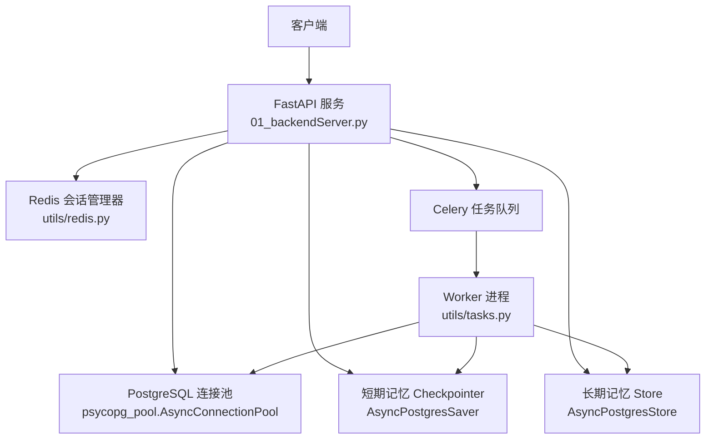
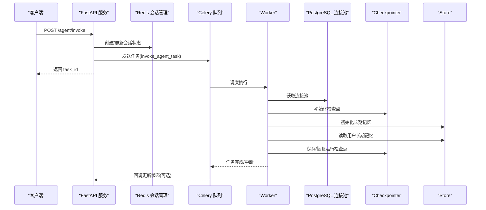
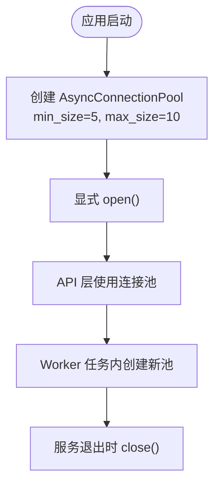
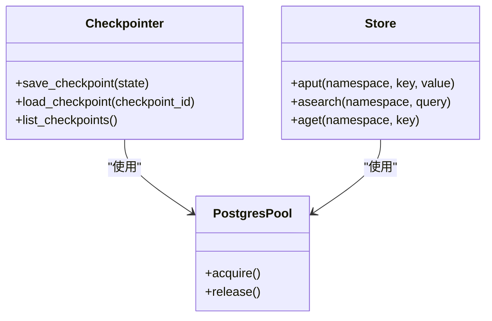
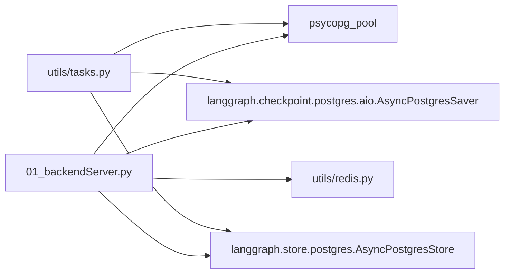

# 存储组件

<cite>
**本文引用的文件**
- [01_backendServer.py](file://01_backendServer.py)
- [utils/config.py](file://utils/config.py)
- [utils/models.py](file://utils/models.py)
- [utils/redis.py](file://utils/redis.py)
- [utils/tasks.py](file://utils/tasks.py)
- [docker/postgresql/docker-compose.yml](file://docker/postgresql/docker-compose.yml)
</cite>

## 目录
1. [简介](#简介)
2. [项目结构](#项目结构)
3. [核心组件](#核心组件)
4. [架构总览](#架构总览)
5. [详细组件分析](#详细组件分析)
6. [依赖关系分析](#依赖关系分析)
7. [性能考虑](#性能考虑)
8. [故障排查指南](#故障排查指南)
9. [结论](#结论)
10. [附录](#附录)

## 简介
本文件面向“数据存储组件”，聚焦于 PostgreSQL 连接池与配置、短期记忆（Checkpointer）与长期记忆（Store）的实现差异与使用场景、数据表结构与实体关系、迁移与版本管理策略、性能调优建议，以及数据安全与访问控制方案。文档基于仓库中后端服务、任务执行与配置文件的实际实现进行说明，并给出可操作的优化与排障建议。

## 项目结构
- 后端服务入口：FastAPI 应用负责初始化数据库连接池、Redis 会话管理器、短期记忆 Checkpointer 与长期记忆 Store，并提供 API 用于智能体调用、状态查询与长期记忆写入。
- 任务执行：Celery Worker 在任务中创建独立的数据库连接池，初始化 Checkpointer 与 Store，构建 ReAct 智能体并执行业务流程。
- 配置中心：集中管理数据库连接串、连接池大小、Redis 参数、TTL 等。
- Redis 会话管理：维护用户-会话-任务的映射与会话状态，提供过期清理与统计能力。
- Docker Compose：定义 PostgreSQL 容器镜像、环境变量、端口映射、卷挂载与最大连接数等运行参数。

图表来源
- [01_backendServer.py:94-110](file://01_backendServer.py#L94-L110)
- [utils/tasks.py:356-374](file://utils/tasks.py#L356-L374)
- [docker/postgresql/docker-compose.yml:4-22](file://docker/postgresql/docker-compose.yml#L4-L22)

章节来源
- [01_backendServer.py:83-123](file://01_backendServer.py#L83-L123)
- [utils/tasks.py:356-374](file://utils/tasks.py#L356-L374)
- [docker/postgresql/docker-compose.yml:1-25](file://docker/postgresql/docker-compose.yml#L1-L25)

## 核心组件
- 数据库连接池：通过 psycopg_pool 的 AsyncConnectionPool 统一管理 PostgreSQL 连接，支持最小/最大连接数、自动提交与预编译阈值等参数。
- 短期记忆（Checkpointer）：基于 LangGraph 的 AsyncPostgresSaver，用于保存智能体运行过程中的检查点（如消息历史、中间状态），支持断点续跑与中断恢复。
- 长期记忆（Store）：基于 LangGraph 的 AsyncPostgresStore，用于持久化跨会话的用户偏好、背景信息等键值型数据，按命名空间组织。
- Redis 会话管理：维护用户-会话-任务的状态与映射，提供 TTL 过期与清理机制，支撑高并发下的快速读写。
- 配置管理：统一封装 DB_URI、连接池大小、Redis 参数、TTL 等常量，便于环境切换与运维调整。

章节来源
- [utils/config.py:13-26](file://utils/config.py#L13-L26)
- [01_backendServer.py:94-110](file://01_backendServer.py#L94-L110)
- [utils/tasks.py:356-374](file://utils/tasks.py#L356-L374)
- [utils/redis.py:37-103](file://utils/redis.py#L37-L103)

## 架构总览
系统采用“API + Worker”的异步架构：
- API 层负责请求接入、会话状态管理与任务入队；
- Worker 层负责实际执行智能体推理、工具调用与状态持久化；
- 短期记忆与长期记忆分别由 Checkpointer 与 Store 承担，均基于 PostgreSQL 持久化；
- Redis 作为会话与任务状态的缓存层，提供低延迟读写与过期清理。

图表来源
- [01_backendServer.py:132-173](file://01_backendServer.py#L132-L173)
- [utils/tasks.py:356-384](file://utils/tasks.py#L356-L384)

## 详细组件分析

### PostgreSQL 连接池管理与配置
- 连接池实例化：在 FastAPI 生命周期中创建 AsyncConnectionPool，设置最小/最大连接数、自动提交与预编译阈值，显式打开并在关闭时释放。
- Worker 内连接池：每个任务上下文独立创建连接池，避免共享状态导致的竞争，提高隔离性与容错性。
- 关键参数：
  - min_size/max_size：控制连接池规模，需结合数据库 max_connections 与业务并发评估。
  - autocommit：默认开启，简化事务语义，但需注意多语句原子性需求。
  - prepare_threshold：预编译阈值，影响 SQL 预编译行为与性能。

图表来源
- [01_backendServer.py:94-102](file://01_backendServer.py#L94-L102)
- [utils/tasks.py:356-361](file://utils/tasks.py#L356-L361)

章节来源
- [01_backendServer.py:94-123](file://01_backendServer.py#L94-L123)
- [utils/tasks.py:356-361](file://utils/tasks.py#L356-L361)
- [utils/config.py:13-16](file://utils/config.py#L13-L16)

### 短期记忆（Checkpointer）与长期记忆（Store）
- 短期记忆（Checkpointer）
  - 作用：保存智能体运行过程中的检查点（如消息序列、工具调用结果、状态快照），支持中断恢复与增量推进。
  - 实现：使用 AsyncPostgresSaver，基于 PostgreSQL 持久化，适合高频、细粒度的状态落盘。
  - 使用场景：长链路推理、工具调用失败重试、对话历史回滚。
- 长期记忆（Store）
  - 作用：持久化跨会话的用户偏好、背景知识等键值型数据，按命名空间组织，便于检索与聚合。
  - 实现：使用 AsyncPostgresStore，提供 aput/asearch 等接口，适合低频、大对象或结构化数据的持久化。
  - 使用场景：用户画像、系统提示词增强、个性化信息注入。

图表来源
- [01_backendServer.py:104-109](file://01_backendServer.py#L104-L109)
- [utils/tasks.py:359-374](file://utils/tasks.py#L359-L374)

章节来源
- [01_backendServer.py:104-109](file://01_backendServer.py#L104-L109)
- [utils/tasks.py:359-374](file://utils/tasks.py#L359-L374)
- [utils/tasks.py:87-134](file://utils/tasks.py#L87-L134)

### 数据表结构与实体关系
- 短期记忆（Checkpointer）
  - 典型字段：checkpoint_id、thread_id、parent_checkpoint_id、checkpoint、metadata、write_ts 等（由 LangGraph 内部表结构决定）。
  - 用途：记录智能体运行时的状态快照与依赖关系，支持回溯与分支。
- 长期记忆（Store）
  - 典型字段：namespace、key、value、created_at、updated_at 等（由 LangGraph 内部表结构决定）。
  - 用途：以命名空间+键的方式存储用户级或系统级持久化数据。
- 会话与任务（Redis）
  - 键模式：session:{user_id}:{session_id}:{task_id}、task_mapping:{user_id}:{session_id}、user_sessions:{user_id}、task:{task_id}。
  - 用途：维护会话状态、任务状态与索引集合，支持 TTL 过期与清理。

```mermaid
erDiagram
CHECKPOINT {
uuid id PK
text thread_id
uuid parent_checkpoint_id FK
jsonb checkpoint
jsonb metadata
timestamp write_ts
}
STORE_ENTRY {
varchar namespace
varchar key
jsonb value
timestamp created_at
timestamp updated_at
}
SESSION_TASK {
varchar user_id
varchar session_id
varchar task_id
varchar status
jsonb last_response
varchar last_query
float last_updated
}
TASK_STATUS {
varchar task_id PK
varchar status
jsonb result
varchar error
varchar user_id
varchar session_id
}
CHECKPOINT ||--o{ CHECKPOINT : "parent -> child"
SESSION_TASK ||--|| TASK_STATUS : "1:1"
```

图表来源
- [utils/redis.py:56-103](file://utils/redis.py#L56-L103)
- [utils/redis.py:392-415](file://utils/redis.py#L392-L415)

章节来源
- [utils/redis.py:56-103](file://utils/redis.py#L56-L103)
- [utils/redis.py:392-415](file://utils/redis.py#L392-L415)

### 数据迁移策略与版本管理
- 现状：代码未包含显式的迁移脚本或版本管理模块，Checkpointer 与 Store 的表结构由 LangGraph 在首次使用时按需初始化。
- 建议：
  - 引入迁移框架（如 Alembic）对 LangGraph 创建的表进行版本化管理，确保 schema 变更可追踪与回滚。
  - 在应用启动阶段校验必要表存在且版本匹配，不匹配则执行迁移。
  - 建立灰度发布与回滚策略，先在新库验证迁移脚本，再在生产执行。
- 备份与恢复：
  - 使用 pg_dump/pg_restore 或云厂商提供的备份工具定期备份。
  - 制定 RPO/RTO 目标，演练恢复流程，确保灾难恢复能力。

章节来源
- [01_backendServer.py:104-109](file://01_backendServer.py#L104-L109)
- [utils/tasks.py:359-374](file://utils/tasks.py#L359-L374)

### 数据库性能调优建议
- 连接池配置
  - 根据并发与数据库资源调整 min_size/max_size，避免连接不足或过多导致上下文切换开销。
  - 合理设置 autocommit 与 prepare_threshold，权衡事务粒度与预编译收益。
- 索引优化
  - 为 Checkpointer 的 thread_id、write_ts 等常用查询列建立索引，提升回溯与列表查询性能。
  - 为 Store 的 namespace、key 建立唯一或复合索引，加速定位与搜索。
- 查询优化
  - 避免全表扫描与大对象频繁序列化；必要时对 value 字段进行分片或归档。
  - 使用分页与限制返回条数，减少网络与内存压力。
- 监控与诊断
  - 启用慢查询日志与锁等待监控，识别热点与瓶颈。
  - 结合连接池指标（活跃连接、等待时间）与数据库负载（CPU、I/O）进行容量规划。

[本节为通用指导，无需特定文件引用]

### 数据安全与访问控制
- SQL 注入防护
  - 使用 ORM/驱动的参数化查询（LangGraph 内部已处理），避免拼接字符串构造 SQL。
  - 对外部输入进行严格校验与白名单过滤。
- 权限控制
  - 数据库账户最小权限原则，仅授予必要表的 DML/DDL 权限。
  - 应用层对用户 ID、命名空间进行鉴权，防止越权访问其他用户数据。
- 传输安全
  - 生产环境启用 TLS，禁用 sslmode=disable；配置证书与密钥管理。
- 审计与合规
  - 开启数据库审计日志，记录敏感操作与异常访问。
  - 对长期记忆中的敏感信息进行脱敏或加密存储。

[本节为通用指导，无需特定文件引用]

## 依赖关系分析
- FastAPI 服务依赖：
  - psycopg_pool.AsyncConnectionPool：数据库连接池。
  - langgraph.checkpoint.postgres.aio.AsyncPostgresSaver：短期记忆。
  - langgraph.store.postgres.AsyncPostgresStore：长期记忆。
  - utils.redis.RedisSessionManager：会话与任务状态。
- Worker 任务依赖：
  - 同上，但在任务上下文中独立创建连接池，保证隔离。

图表来源
- [01_backendServer.py:9-14](file://01_backendServer.py#L9-L14)
- [utils/tasks.py:9-10](file://utils/tasks.py#L9-L10)

章节来源
- [01_backendServer.py:9-14](file://01_backendServer.py#L9-L14)
- [utils/tasks.py:9-10](file://utils/tasks.py#L9-L10)

## 性能考虑
- 连接池与并发
  - 将 max_size 设置为数据库 max_connections 的合理比例，避免耗尽连接。
  - 在高并发下，优先复用连接，减少创建/销毁开销。
- 检查点与存储
  - 控制检查点频率与大小，避免频繁落盘造成 I/O 压力。
  - 对长期记忆进行分桶与归档，降低单表体积。
- Redis 清理
  - 定期执行 cleanup_all_tasks/cleanup_user_tasks，避免脏数据累积。
  - 合理设置 TTL，平衡内存占用与数据可用性。

[本节为通用指导，无需特定文件引用]

## 故障排查指南
- 连接池问题
  - 现象：连接耗尽、超时或拒绝连接。
  - 排查：检查 min_size/max_size、数据库 max_connections、连接泄漏（未正确释放）。
  - 参考：连接池初始化与关闭逻辑。
- 检查点/存储异常
  - 现象：无法恢复检查点、长期记忆读取为空。
  - 排查：确认表结构是否存在、索引是否有效、命名空间是否正确。
  - 参考：Checkpointer 与 Store 的初始化与使用。
- Redis 会话不一致
  - 现象：会话状态丢失或任务映射异常。
  - 排查：检查 TTL、清理逻辑、键命名规范。
  - 参考：RedisSessionManager 的清理与查询方法。

章节来源
- [01_backendServer.py:94-123](file://01_backendServer.py#L94-L123)
- [utils/tasks.py:356-374](file://utils/tasks.py#L356-L374)
- [utils/redis.py:246-341](file://utils/redis.py#L246-L341)

## 结论
本存储组件通过连接池统一管理 PostgreSQL 资源，结合短期记忆与长期记忆满足智能体的运行时状态与跨会话数据需求。Redis 提供高效的会话与任务状态管理，配合合理的迁移策略、性能调优与安全控制，可在生产环境中稳定运行。建议在后续迭代中引入显式迁移框架、完善监控告警与容量规划，进一步提升系统的可维护性与可靠性。

[本节为总结，无需特定文件引用]

## 附录
- 配置项速查
  - DB_URI：数据库连接串，支持环境变量覆盖。
  - MIN_SIZE/MAX_SIZE：连接池最小/最大连接数。
  - REDIS_*：Redis 主机、端口、库号与会话超时。
  - TTL/TASK_TTL：会话与任务过期时间。
- Docker 运行参数
  - postgres:15 镜像，设置用户、密码、数据库与时区。
  - 暴露 5432 端口，挂载数据卷，健康检查与最大连接数配置。

章节来源
- [utils/config.py:13-26](file://utils/config.py#L13-L26)
- [docker/postgresql/docker-compose.yml:4-22](file://docker/postgresql/docker-compose.yml#L4-L22)