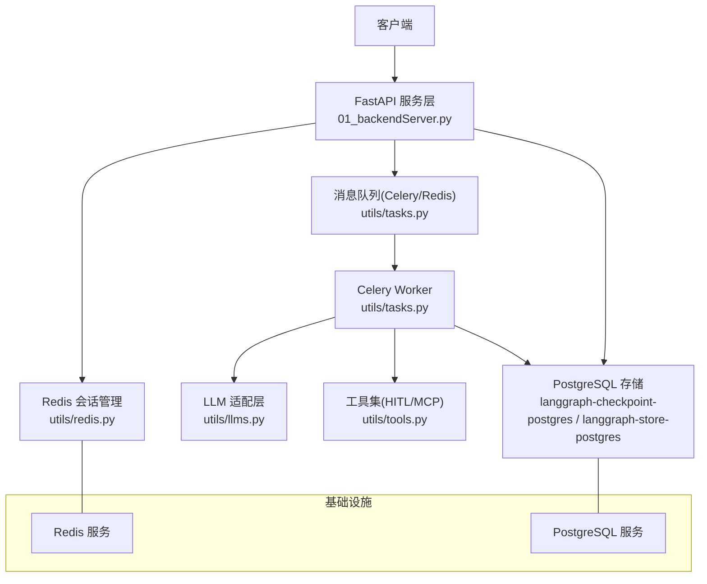
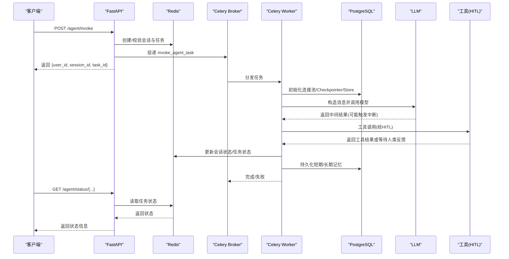
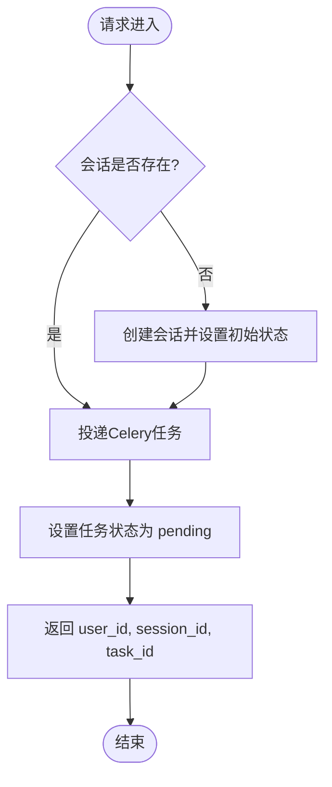
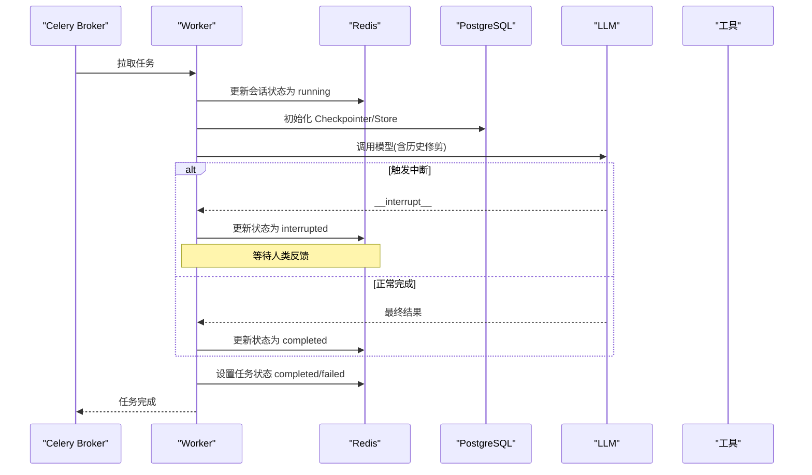
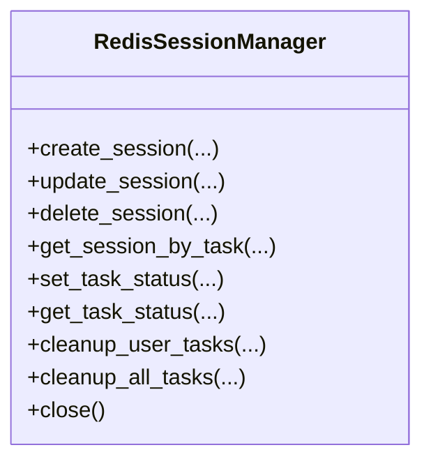
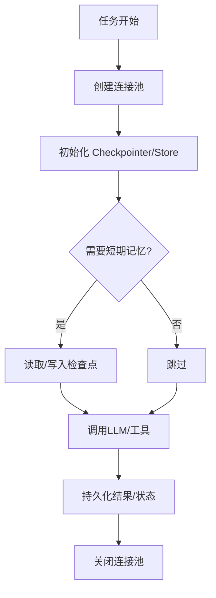
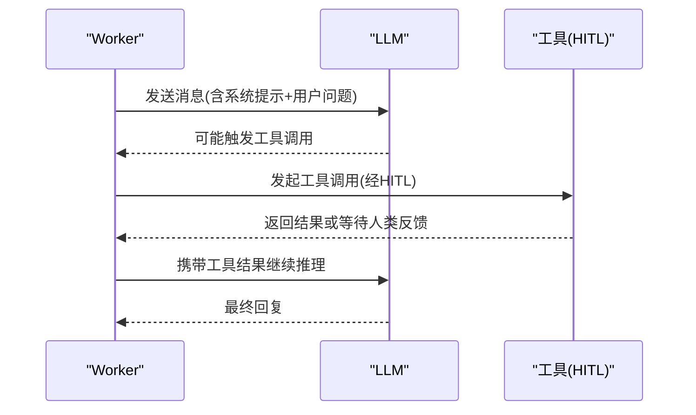
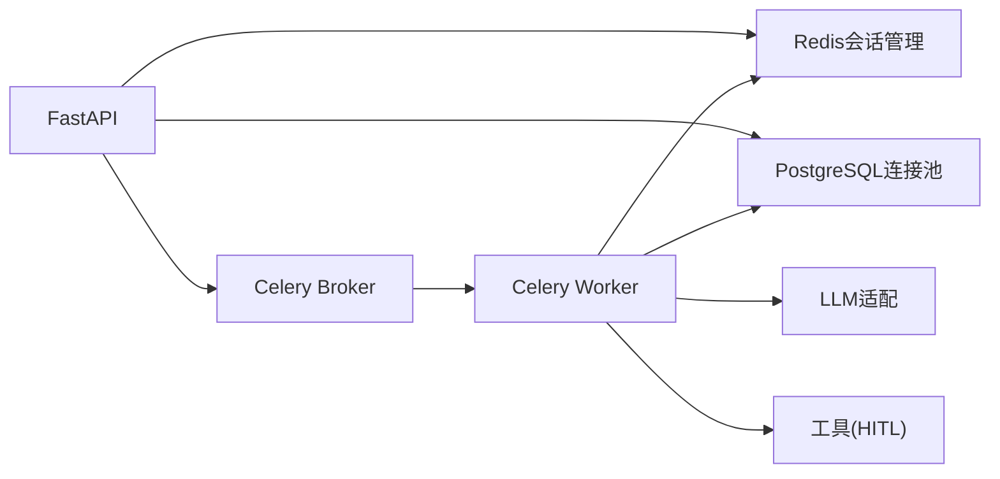

# 组件架构

<cite>
**本文引用的文件**
- [01_backendServer.py](file://01_backendServer.py)
- [utils/config.py](file://utils/config.py)
- [utils/redis.py](file://utils/redis.py)
- [utils/tasks.py](file://utils/tasks.py)
- [utils/models.py](file://utils/models.py)
- [utils/tools.py](file://utils/tools.py)
- [utils/llms.py](file://utils/llms.py)
- [docker/postgresql/docker-compose.yml](file://docker/postgresql/docker-compose.yml)
- [docker/redis/docker-compose.yaml](file://docker/redis/docker-compose.yaml)
- [README.md](file://README.md)
</cite>

## 目录
1. [简介](#简介)
2. [项目结构](#项目结构)
3. [核心组件](#核心组件)
4. [架构总览](#架构总览)
5. [详细组件分析](#详细组件分析)
6. [依赖关系分析](#依赖关系分析)
7. [性能考量](#性能考量)
8. [故障排查指南](#故障排查指南)
9. [结论](#结论)
10. [附录](#附录)

## 简介
本组件架构文档面向ReAct Agent服务的后端实现，围绕FastAPI服务层、Celery任务调度层、Redis会话管理层、PostgreSQL存储层以及LLM与工具集成进行系统化说明。重点阐述各组件职责、生命周期管理、资源初始化、错误处理机制，并通过架构图、时序图与流程图展示数据在组件间的传递过程。

## 项目结构
- 入口服务：FastAPI应用提供HTTP API，负责请求路由、会话校验、任务入队与状态查询。
- 任务执行：Celery Worker异步执行Agent推理、工具调用、记忆读写与状态更新。
- 会话管理：基于Redis的会话与任务状态管理，支持过期清理、多用户多会话。
- 数据存储：PostgreSQL用于短期记忆（检查点）与长期记忆（键值存储）。
- LLM与工具：统一封装不同厂商模型接入；工具包含自定义函数与MCP Server工具，并支持人工审查（HITL）。
- 配置中心：集中管理数据库、Redis、Celery、日志与模型等配置。

图表来源
- [01_backendServer.py:84-130](file://01_backendServer.py#L84-L130)
- [utils/tasks.py:43-63](file://utils/tasks.py#L43-L63)
- [utils/redis.py:37-55](file://utils/redis.py#L37-L55)
- [utils/llms.py:70-119](file://utils/llms.py#L70-L119)
- [utils/tools.py:121-175](file://utils/tools.py#L121-L175)
- [docker/postgresql/docker-compose.yml:4-22](file://docker/postgresql/docker-compose.yml#L4-L22)
- [docker/redis/docker-compose.yaml:5-28](file://docker/redis/docker-compose.yaml#L5-L28)

章节来源
- [README.md:1-39](file://README.md#L1-L39)
- [01_backendServer.py:84-130](file://01_backendServer.py#L84-L130)
- [utils/config.py:4-34](file://utils/config.py#L4-L34)

## 核心组件
- FastAPI 服务层：定义REST接口，维护应用级资源（Redis会话管理器、PostgreSQL连接池、短期/长期记忆），将耗时推理放入Celery任务队列。
- Celery 任务调度层：通过Redis作为Broker，Worker进程执行Agent推理、工具调用、记忆读写，并将结果写回Redis与PostgreSQL。
- Redis 会话管理层：维护用户-会话-任务的映射、任务状态、会话数据与过期策略，提供清理与查询能力。
- PostgreSQL 存储层：通过LangGraph提供的AsyncPostgresSaver与AsyncPostgresStore分别承载短期记忆（检查点）与长期记忆（命名空间键值）。
- LLM 适配层：统一封装OpenAI兼容接口，支持多种模型提供商，具备默认降级与重试配置。
- 工具层：内置自定义工具与MCP Server工具，统一包装为带人工审查（HITL）的工具，支持accept/edit/reject/response四种反馈类型。

章节来源
- [01_backendServer.py:132-414](file://01_backendServer.py#L132-L414)
- [utils/tasks.py:318-559](file://utils/tasks.py#L318-L559)
- [utils/redis.py:37-493](file://utils/redis.py#L37-L493)
- [utils/llms.py:70-139](file://utils/llms.py#L70-L139)
- [utils/tools.py:37-175](file://utils/tools.py#L37-L175)

## 架构总览
系统采用“同步API + 异步任务”的分层架构：
- 前端或外部系统通过FastAPI提交请求，服务层快速创建会话、设置任务状态并返回task_id。
- Celery Worker从队列拉取任务，构建ReAct Agent，加载短期/长期记忆，调用LLM与工具，处理中断与最终结果，更新Redis与PostgreSQL。
- 客户端可轮询任务状态或通过恢复接口继续被中断的任务。

图表来源
- [01_backendServer.py:132-173](file://01_backendServer.py#L132-L173)
- [utils/tasks.py:318-451](file://utils/tasks.py#L318-L451)
- [utils/redis.py:65-144](file://utils/redis.py#L65-L144)
- [utils/llms.py:70-119](file://utils/llms.py#L70-L119)
- [utils/tools.py:37-118](file://utils/tools.py#L37-L118)

## 详细组件分析

### FastAPI 服务层
- 生命周期管理：使用lifespan上下文管理器初始化Redis会话管理器、PostgreSQL连接池、短期记忆Checkpointer与长期记忆Store，并在关闭时释放资源。
- HTTP接口：
  - /agent/invoke：接收用户请求，确保会话存在，投递invoke_agent_task，设置任务状态为pending。
  - /agent/resume：校验会话处于interrupted状态，投递resume_agent_task以恢复执行。
  - /system/info、/agent/active/sessionid/{user_id}、/agent/sessionids/{user_id}、/agent/tasks/{user_id}/{session_id}、/agent/status/{user_id}/{session_id}/{task_id}：查询系统与会话状态。
  - /agent/write/longterm：写入用户长期记忆到PostgreSQL Store。
  - /agent/session/{user_id}/{session_id}、/agent/task/{user_id}/{session_id}/{task_id}：删除会话或任务。
- 错误处理：对不存在与会话状态不合法的情况返回明确的HTTP状态码；异常捕获后记录日志并返回错误响应。

图表来源
- [01_backendServer.py:84-130](file://01_backendServer.py#L84-L130)
- [01_backendServer.py:132-173](file://01_backendServer.py#L132-L173)
- [01_backendServer.py:175-237](file://01_backendServer.py#L175-L237)
- [01_backendServer.py:239-414](file://01_backendServer.py#L239-L414)

章节来源
- [01_backendServer.py:84-414](file://01_backendServer.py#L84-L414)

### Celery 任务调度层
- 任务定义：
  - invoke_agent_task：初始化Redis会话管理器、PostgreSQL连接池、Checkpointer与Store，获取LLM与工具，构造消息并调用ReAct Agent，处理中断与最终结果，更新会话与任务状态。
  - resume_agent_task：基于Command.resume恢复执行，流程与invoke类似。
- 消息序列化与时区：配置JSON序列化、接受内容类型、时区为Asia/Shanghai。
- 资源管理：每个任务内创建独立的连接池与Redis会话管理器，任务结束后关闭连接，避免跨任务共享导致的并发问题。
- 结果处理：统一封装为AgentResponse，区分completed/interrupted/error状态，并过滤最近一次完整对话以便前端展示。

图表来源
- [utils/tasks.py:318-451](file://utils/tasks.py#L318-L451)
- [utils/tasks.py:455-559](file://utils/tasks.py#L455-L559)
- [utils/redis.py:392-442](file://utils/redis.py#L392-L442)

章节来源
- [utils/tasks.py:43-63](file://utils/tasks.py#L43-L63)
- [utils/tasks.py:318-559](file://utils/tasks.py#L318-L559)

### Redis 会话管理层
- 数据结构设计：
  - session:{user_id}:{session_id}:{task_id}：会话数据，包含status、last_query、last_response、last_updated等。
  - user_sessions:{user_id}：集合，记录该用户的所有session_id:task_id。
  - task_mapping:{user_id}:{session_id}：集合，记录会话下的所有task_id。
  - task:{task_id}：任务状态数据，包含status、result、error、user_id、session_id。
- 核心能力：
  - 创建/更新/删除会话与任务。
  - 查询用户活跃会话、会话列表、任务状态。
  - 自动清理过期或无效任务，保持索引一致性。
- 过期策略：会话与任务均设置TTL，防止内存膨胀。

图表来源
- [utils/redis.py:37-493](file://utils/redis.py#L37-L493)

章节来源
- [utils/redis.py:37-493](file://utils/redis.py#L37-L493)

### PostgreSQL 存储层
- 短期记忆：通过AsyncPostgresSaver保存LangGraph节点状态，支持线程级（thread_id=task_id）的检查点恢复。
- 长期记忆：通过AsyncPostgresStore按命名空间(memories, user_id)存取用户偏好等信息，支持搜索与拼接。
- 连接池：使用psycopg_pool.AsyncConnectionPool管理连接，配置最小/最大连接数与自动提交。

图表来源
- [01_backendServer.py:94-110](file://01_backendServer.py#L94-L110)
- [utils/tasks.py:351-374](file://utils/tasks.py#L351-L374)
- [utils/tasks.py:477-499](file://utils/tasks.py#L477-L499)

章节来源
- [01_backendServer.py:94-110](file://01_backendServer.py#L94-L110)
- [utils/tasks.py:351-374](file://utils/tasks.py#L351-L374)
- [utils/tasks.py:477-499](file://utils/tasks.py#L477-L499)

### LLM 与工具层
- LLM适配：统一通过ChatOpenAI/OpenAIEmbeddings对接不同提供商，支持openai/oneapi/qwen/ollama，具备超时与重试配置，并提供默认降级策略。
- 工具与HITL：
  - 自定义工具：book_hotel、multiply。
  - MCP Server工具：高德地图工具通过MultiServerMCPClient获取。
  - HITL包装：为每个工具添加人工审查，支持accept/edit/reject/response四种类型，便于人机协作。
- 消息修剪：pre_model_hook对历史消息进行token级别裁剪，控制上下文长度。

图表来源
- [utils/llms.py:70-139](file://utils/llms.py#L70-L139)
- [utils/tools.py:37-175](file://utils/tools.py#L37-L175)
- [utils/tasks.py:66-85](file://utils/tasks.py#L66-L85)

章节来源
- [utils/llms.py:70-139](file://utils/llms.py#L70-L139)
- [utils/tools.py:37-175](file://utils/tools.py#L37-L175)
- [utils/tasks.py:66-85](file://utils/tasks.py#L66-L85)

## 依赖关系分析
- FastAPI服务依赖：
  - Redis会话管理器：用于会话与任务状态管理。
  - PostgreSQL连接池：用于短期/长期记忆持久化。
  - Celery任务：用于异步执行Agent推理。
- Celery Worker依赖：
  - LLM适配层：根据配置选择模型提供商。
  - 工具层：包含自定义工具与MCP工具，统一包装HITL。
  - Redis与PostgreSQL：读写会话状态与记忆。
- 配置依赖：
  - DB_URI、MIN_SIZE、MAX_SIZE：数据库连接参数。
  - REDIS_*：Redis连接与TTL。
  - CELERY_BROKER_URL：消息队列地址。
  - LLM_TYPE：模型类型。

图表来源
- [utils/config.py:4-34](file://utils/config.py#L4-L34)
- [01_backendServer.py:84-130](file://01_backendServer.py#L84-L130)
- [utils/tasks.py:43-63](file://utils/tasks.py#L43-L63)

章节来源
- [utils/config.py:4-34](file://utils/config.py#L4-L34)
- [01_backendServer.py:84-130](file://01_backendServer.py#L84-L130)
- [utils/tasks.py:43-63](file://utils/tasks.py#L43-L63)

## 性能考量
- 连接池管理：PostgreSQL使用AsyncConnectionPool，合理设置min_size/max_size以降低连接开销。
- 会话与任务TTL：Redis中会话与任务设置过期时间，避免内存泄漏；定期清理无效任务。
- 消息修剪：通过pre_model_hook限制历史消息token数量，降低LLM调用成本。
- 异步执行：将耗时推理放入Celery任务，提升API吞吐与响应速度。
- 模型重试与超时：LLM初始化配置超时与重试次数，增强鲁棒性。

[本节为通用指导，无需特定文件引用]

## 故障排查指南
- 服务启动失败：
  - 检查PostgreSQL与Redis是否运行，端口与凭据是否正确。
  - 确认DB_URI、REDIS_*、CELERY_BROKER_URL配置正确。
- 任务执行失败：
  - 查看Worker日志，定位LLM调用或工具调用异常。
  - 检查Redis中的任务状态与错误信息。
- 会话状态异常：
  - 使用/system/info与/agent/status接口核对状态。
  - 清理无效任务，确保索引一致性。
- 长期记忆写入失败：
  - 检查PostgreSQL连接与权限，确认命名空间与键格式。

章节来源
- [01_backendServer.py:113-123](file://01_backendServer.py#L113-L123)
- [utils/redis.py:246-341](file://utils/redis.py#L246-L341)
- [utils/tasks.py:420-446](file://utils/tasks.py#L420-L446)
- [utils/tasks.py:528-554](file://utils/tasks.py#L528-L554)

## 结论
本架构通过FastAPI提供高可用HTTP接口，结合Celery实现异步任务调度，利用Redis进行会话与任务状态管理，PostgreSQL承载短期与长期记忆，LLM与工具层提供灵活扩展与人机协作能力。整体设计清晰分层、职责明确，具备良好的可扩展性与容错能力。

[本节为总结性内容，无需特定文件引用]

## 附录
- 基础设施部署：
  - PostgreSQL：Docker Compose配置，端口映射与健康检查。
  - Redis：Docker Compose配置，端口映射与持久化卷。
- 环境变量与配置：
  - OPENAI_BASE_URL、OPENAI_API_KEY、DASHSCOPE_API_KEY等。
  - AMAP_MAPS_API_KEY用于MCP工具访问。

章节来源
- [docker/postgresql/docker-compose.yml:4-22](file://docker/postgresql/docker-compose.yml#L4-L22)
- [docker/redis/docker-compose.yaml:5-28](file://docker/redis/docker-compose.yaml#L5-L28)
- [utils/llms.py:31-57](file://utils/llms.py#L31-L57)
- [utils/tools.py:153-164](file://utils/tools.py#L153-L164)