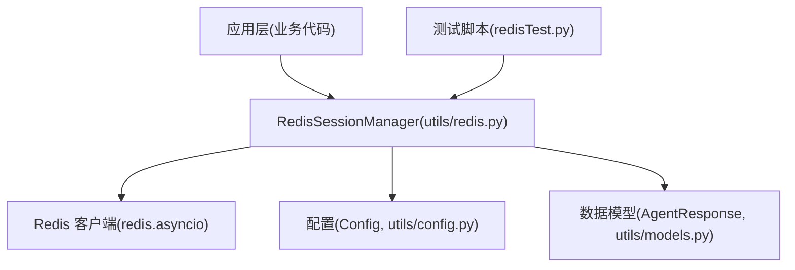
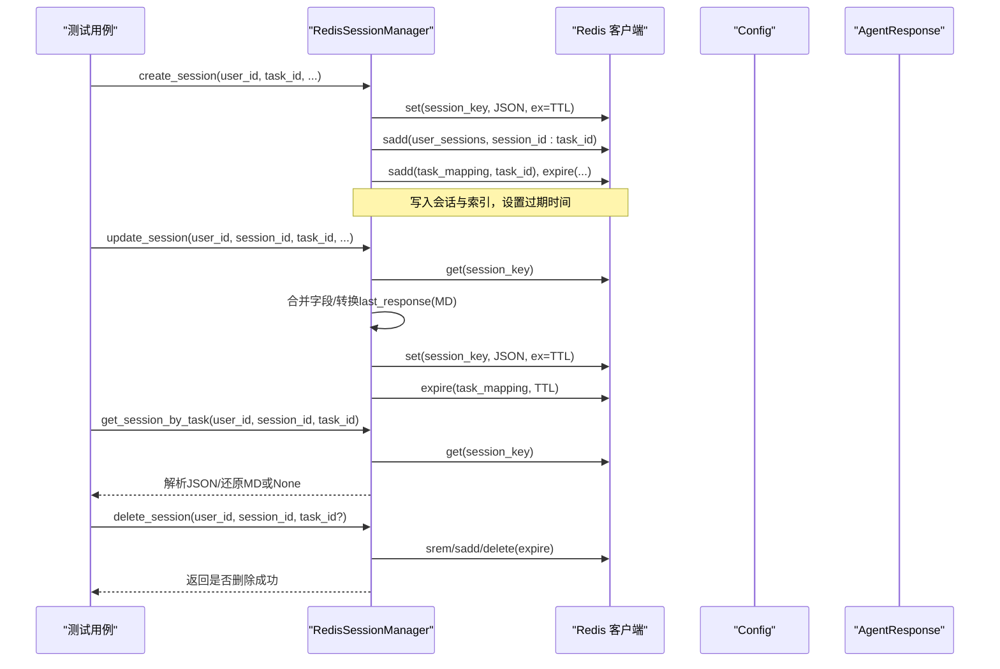
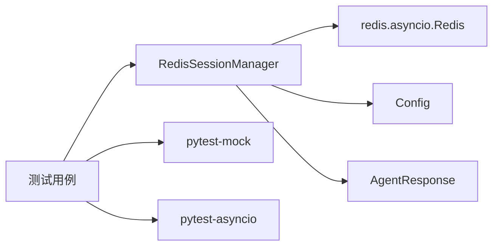

# 单元测试

<cite>
**本文引用的文件**
- [utils/redis.py](file://utils/redis.py)
- [redisTest.py](file://redisTest.py)
- [utils/config.py](file://utils/config.py)
- [utils/models.py](file://utils/models.py)
- [README.md](file://README.md)
</cite>

## 目录
1. [简介](#简介)
2. [项目结构](#项目结构)
3. [核心组件](#核心组件)
4. [架构总览](#架构总览)
5. [详细组件分析](#详细组件分析)
6. [依赖关系分析](#依赖关系分析)
7. [性能与可测性考量](#性能与可测性考量)
8. [故障排查指南](#故障排查指南)
9. [结论](#结论)
10. [附录：测试实践清单](#附录测试实践清单)

## 简介
本指南面向需要为 Redis 会话管理器编写高质量单元测试的开发者。目标包括：
- 设计覆盖创建、更新、查询、删除等关键路径的测试用例
- 使用 Mock 隔离外部 Redis 依赖，确保测试稳定、快速、可重复
- 实现异步测试（基于 pytest-asyncio）
- 配置并生成覆盖率报告
- 提供数据准备与清理的最佳实践
- 帮助团队持续维护高可靠性的测试套件

## 项目结构
本项目包含一个异步 Redis 会话管理器及其配套模型和配置，以及一份示例测试脚本。关键位置如下：
- utils/redis.py：RedisSessionManager 的实现，封装会话生命周期管理、任务状态绑定、清理策略等
- utils/config.py：集中化的配置项（如 Redis 连接参数、TTL、日志等）
- utils/models.py：Pydantic 数据模型（如 AgentResponse），用于序列化/反序列化和类型校验
- redisTest.py：示例测试脚本，演示如何直接运行异步测试流程（非 pytest 框架）

图表来源
- [utils/redis.py:37-490](file://utils/redis.py#L37-L490)
- [utils/config.py:4-34](file://utils/config.py#L4-L34)
- [utils/models.py:27-95](file://utils/models.py#L27-L95)
- [redisTest.py:18-458](file://redisTest.py#L18-L458)

章节来源
- [README.md:112-118](file://README.md#L112-L118)
- [utils/config.py:18-26](file://utils/config.py#L18-L26)

## 核心组件
- RedisSessionManager：提供会话与任务的增删改查、过期控制、一致性清理等能力
- Config：集中管理 Redis、Celery、日志等配置常量
- AgentResponse：会话中 last_response 字段的数据模型，支持 Pydantic 序列化/反序列化

章节来源
- [utils/redis.py:37-490](file://utils/redis.py#L37-L490)
- [utils/config.py:4-34](file://utils/config.py#L4-L34)
- [utils/models.py:27-95](file://utils/models.py#L27-L95)

## 架构总览
下图展示了会话管理的核心调用链与数据流，涵盖创建、更新、查询、删除与清理等关键路径。

图表来源
- [utils/redis.py:65-144](file://utils/redis.py#L65-L144)
- [utils/redis.py:344-390](file://utils/redis.py#L344-L390)
- [utils/redis.py:445-476](file://utils/redis.py#L445-L476)
- [utils/models.py:27-42](file://utils/models.py#L27-L42)

## 详细组件分析

### RedisSessionManager 测试要点
- 初始化与关闭
  - 验证构造参数（host/port/db/TTL）
  - 验证 close() 能正确关闭连接
- 会话创建
  - 未传 session_id 时自动生成 UUID
  - 默认 last_updated 处理
  - TTL 生效（有效 TTL 计算逻辑）
  - user_sessions 集合与 task_mapping 映射同步写入
- 会话更新
  - 仅更新传入字段
  - last_response 支持 Pydantic 对象与字典两种输入
  - 更新后 TTL 刷新
- 存在性检查
  - user_id_exists / session_id_exists / session_task_id_exists
  - 注意内部会先执行清理逻辑，保证结果准确
- 查询接口
  - get_all_users_session_ids / get_session_count / get_all_session_ids
  - get_user_active_session_id（按 last_updated 选择最新）
  - get_session / get_session_by_task（含 last_response 还原）
- 任务状态
  - set_task_status / get_single_task_status / get_task_status
- 清理策略
  - cleanup_all_tasks / cleanup_user_tasks（移除无效条目、空集合清理）
- 删除
  - delete_session（单任务/整会话）

章节来源
- [utils/redis.py:37-490](file://utils/redis.py#L37-L490)

### 测试框架与异步测试
- 推荐框架：pytest + pytest-asyncio
  - 通过装饰器声明异步测试函数
  - 配合 pytest-mock 进行 Mock
  - 通过 fixtures 管理测试夹具（如 Redis 实例、测试数据）
- 异步测试要点
  - 所有涉及 Redis 的操作均为异步，需 await
  - 在测试前后确保清理数据，避免污染
  - 对网络/IO 操作进行 Mock，提升稳定性与速度

章节来源
- [redisTest.py:461-573](file://redisTest.py#L461-L573)

### 测试用例设计建议
- 正向路径
  - 创建会话：验证 key 存在、集合成员正确、TTL 设置
  - 更新会话：验证字段增量更新、TTL 刷新
  - 查询会话：验证数据结构、last_response 还原
  - 删除会话：验证键与集合被清理
- 反向路径
  - 不存在场景：查询/更新/删除不存在的会话应返回预期值
  - 非法参数：边界值、空字符串、超长字符串等
- 并发与一致性
  - 多用户/多会话并发创建与更新
  - 清理逻辑的正确性与幂等性
- 超时与过期
  - TTL 到期后行为验证（可通过缩短 TTL + 延时断言）

### Mock 策略
- 目标：隔离真实 Redis，避免外部依赖影响测试稳定性
- 方式：
  - 使用 pytest-mock 对 RedisSessionManager.redis_client 进行 Mock
  - 针对 set/get/sadd/srem/delete/exists/expire/scan_iter/smembers 等方法打桩
  - 对 AgentResponse 的 model_dump 与构造进行 Mock，简化断言
- 注意事项：
  - 保持与真实 Redis 一致的返回值语义（如布尔、列表、None）
  - 对 scan_iter 等迭代方法，提供可控的迭代结果

### 数据准备与清理最佳实践
- 测试前准备
  - 使用固定 user_id/session_id/task_id 或随机但可追踪的 ID
  - 预置必要索引（user_sessions、task_mapping）以模拟真实环境
- 测试后清理
  - 每个测试用例结束后清理相关键与集合，避免相互干扰
  - 对于全局扫描类方法（如 cleanup_all_tasks），谨慎使用或在 Mock 下验证
- 隔离性
  - 每个测试独立环境，避免共享状态
  - 必要时为不同测试分配不同 Redis DB 或使用命名空间前缀

### 覆盖率统计与报告
- 工具：pytest-cov
- 常用命令
  - 生成 HTML 报告：pytest --cov=utils --cov-report=html
  - 生成 XML 报告（CI 集成）：pytest --cov=utils --cov-report=xml
- 覆盖率目标
  - 行覆盖率 ≥ 80%（建议逐步提升至 90%+）
  - 分支覆盖率关注关键条件分支（TTL、异常路径、空集合）

章节来源
- [README.md:112-118](file://README.md#L112-L118)

## 依赖关系分析
- RedisSessionManager 依赖：
  - redis.asyncio：异步 Redis 客户端
  - Config：统一配置（Redis 地址、TTL 等）
  - AgentResponse：Pydantic 模型，用于 last_response 的序列化/反序列化
- 测试依赖：
  - pytest、pytest-asyncio、pytest-mock、pytest-cov

图表来源
- [utils/redis.py:37-490](file://utils/redis.py#L37-L490)
- [utils/config.py:4-34](file://utils/config.py#L4-L34)
- [utils/models.py:27-95](file://utils/models.py#L27-L95)

章节来源
- [utils/redis.py:37-490](file://utils/redis.py#L37-L490)
- [utils/config.py:4-34](file://utils/config.py#L4-L34)
- [utils/models.py:27-95](file://utils/models.py#L27-L95)

## 性能与可测性考量
- 减少 IO 次数：批量操作尽量合并，避免过多往返
- 合理 TTL：根据业务设定合理的会话与任务 TTL，避免频繁过期导致额外开销
- 清理策略优化：cleanup_* 方法在大表场景下可能较慢，测试中建议使用 Mock 控制迭代规模
- 可测性设计：
  - 将 Redis 客户端注入到管理器中，便于替换为 Mock
  - 暴露最小化 API，隐藏内部细节，降低测试复杂度

[本节为通用指导，不直接分析具体文件]

## 故障排查指南
- 常见问题
  - Redis 连接失败：检查 host/port/db 配置与 Docker 服务状态
  - TTL 未生效：确认 set/expire 调用顺序与参数
  - 数据不一致：检查清理逻辑是否在查询前执行
  - 异步阻塞：确保所有 Redis 调用均使用 await
- 定位手段
  - 开启 DEBUG 日志，观察关键步骤
  - 使用 Redis 客户端查看键空间分布与过期时间
  - 通过 pytest 的 -s 输出调试信息

章节来源
- [utils/redis.py:13-32](file://utils/redis.py#L13-L32)
- [utils/redis.py:246-341](file://utils/redis.py#L246-L341)

## 结论
通过系统化的测试设计与 Mock 策略，可以为 Redis 会话管理器构建稳定、高效、可维护的单元测试体系。结合 pytest-asyncio 与覆盖率工具，能够持续提升代码质量与可靠性。建议在 CI 中集成自动化测试与覆盖率门禁，保障长期演进中的稳定性。

[本节为总结性内容，不直接分析具体文件]

## 附录：测试实践清单
- 基础能力
  - 安装 pytest、pytest-asyncio、pytest-mock、pytest-cov
  - 编写异步测试函数，使用 @pytest.mark.asyncio
  - 使用 fixtures 管理测试数据与资源
- 用例覆盖
  - 创建/更新/查询/删除会话
  - 任务状态设置与查询
  - 存在性检查与活跃会话选择
  - 清理逻辑与边界情况
- Mock 规范
  - 对 Redis 客户端方法进行精确打桩
  - 对 Pydantic 模型序列化/反序列化进行 Mock
- 数据治理
  - 测试前准备、测试后清理
  - 隔离不同测试的环境
- 覆盖率与报告
  - 生成 HTML/XML 报告
  - 设定覆盖率阈值并在 CI 中强制执行

[本节为通用指导，不直接分析具体文件]