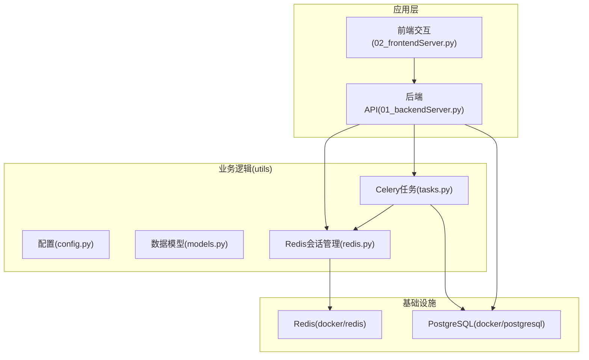
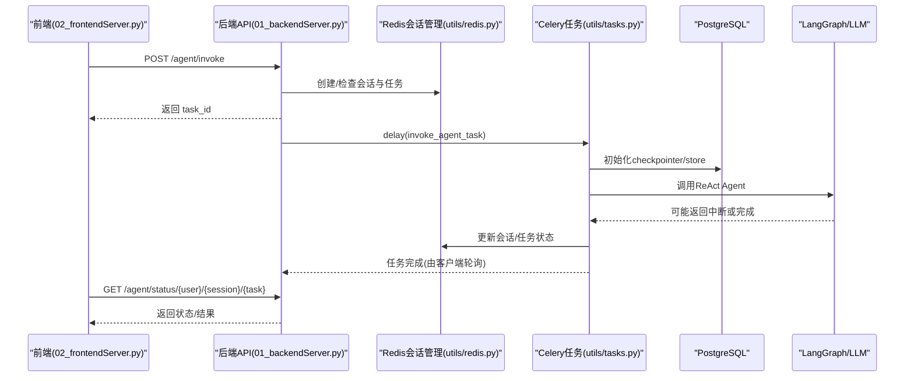
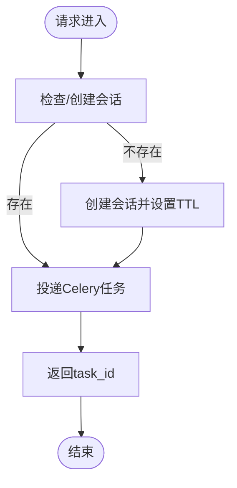
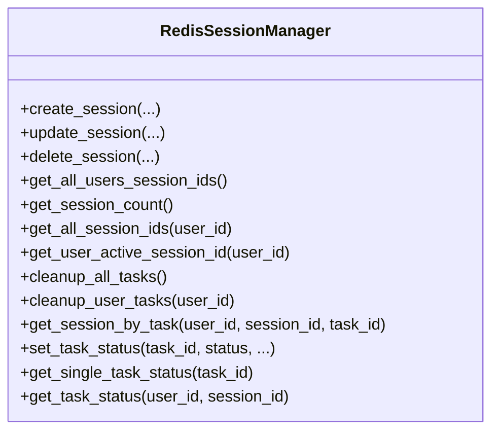
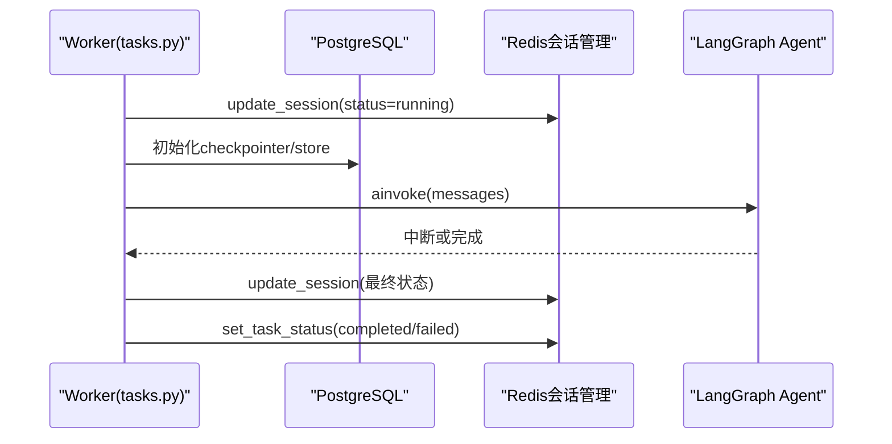
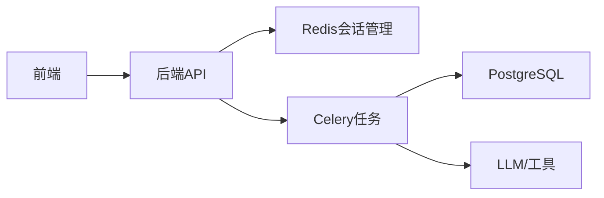

# 测试和调试

<cite>
**本文引用的文件**
- [README.md](file://README.md)
- [01_backendServer.py](file://01_backendServer.py)
- [02_frontendServer.py](file://02_frontendServer.py)
- [redisTest.py](file://redisTest.py)
- [utils/config.py](file://utils/config.py)
- [utils/redis.py](file://utils/redis.py)
- [utils/tasks.py](file://utils/tasks.py)
- [utils/models.py](file://utils/models.py)
- [docker/postgresql/docker-compose.yml](file://docker/postgresql/docker-compose.yml)
- [docker/redis/docker-compose.yaml](file://docker/redis/docker-compose.yaml)
</cite>

## 目录
1. [简介](#简介)
2. [项目结构](#项目结构)
3. [核心组件](#核心组件)
4. [架构总览](#架构总览)
5. [详细组件分析](#详细组件分析)
6. [依赖关系分析](#依赖关系分析)
7. [性能考虑](#性能考虑)
8. [故障排查指南](#故障排查指南)
9. [结论](#结论)
10. [附录](#附录)

## 简介
本指南面向开发者，提供针对该 ReActAgent 项目的系统化测试与调试方法。内容覆盖：
- 单元测试编写（含 Mock、用例设计、覆盖率统计）
- 集成测试策略（API 接口、数据库、Redis）
- 调试技巧（日志分析、断点调试、性能分析）
- 测试环境搭建（数据准备、服务启动）
- 常见问题诊断与解决方案
- 自动化测试与持续集成配置建议

目标是帮助团队高效开展测试与质量保证工作，确保多会话、异步任务、HITL 中断等关键能力稳定可靠。

## 项目结构
本项目采用前后端分离的脚本式工程组织：
- 后端 FastAPI 服务：01_backendServer.py
- 前端交互演示：02_frontendServer.py
- 工具与配置：utils/*（配置、模型、Redis 会话管理、Celery 任务、LLM/工具抽象）
- 基础设施：docker/*（PostgreSQL、Redis）
- 功能说明：README.md

图表来源
- [01_backendServer.py:84-130](file://01_backendServer.py#L84-L130)
- [utils/redis.py:37-103](file://utils/redis.py#L37-L103)
- [utils/tasks.py:318-451](file://utils/tasks.py#L318-L451)
- [docker/postgresql/docker-compose.yml:1-25](file://docker/postgresql/docker-compose.yml#L1-L25)
- [docker/redis/docker-compose.yaml:1-38](file://docker/redis/docker-compose.yaml#L1-L38)

章节来源
- [README.md:111-193](file://README.md#L111-L193)
- [01_backendServer.py:1-424](file://01_backendServer.py#L1-L424)
- [02_frontendServer.py:1-860](file://02_frontendServer.py#L1-L860)

## 核心组件
- 后端 API（FastAPI）：定义会话、任务、系统信息、长期记忆写入等接口；通过生命周期初始化 Redis、PostgreSQL 连接池、短期/长期记忆存储。
- 会话与任务状态（Redis）：以键空间 session:{user}:{session}:{task}、task_mapping、user_sessions 等维护会话与任务状态，支持过期与清理。
- 异步任务（Celery）：invoke_agent_task、resume_agent_task 负责调用 LangGraph ReAct Agent，处理中断与结果，更新会话与任务状态。
- 数据模型（Pydantic）：统一请求/响应结构，便于校验与文档生成。
- 配置（Config）：集中管理 DB、Redis、日志、端口等常量。

章节来源
- [01_backendServer.py:84-130](file://01_backendServer.py#L84-L130)
- [utils/redis.py:37-103](file://utils/redis.py#L37-L103)
- [utils/tasks.py:318-451](file://utils/tasks.py#L318-L451)
- [utils/models.py:7-96](file://utils/models.py#L7-L96)
- [utils/config.py:4-34](file://utils/config.py#L4-L34)

## 架构总览
下图展示了从前端到后端、再到 Redis/PostgreSQL 与 Celery Worker 的完整调用链，以及中断恢复流程。

图表来源
- [01_backendServer.py:132-173](file://01_backendServer.py#L132-L173)
- [utils/tasks.py:318-451](file://utils/tasks.py#L318-L451)
- [utils/redis.py:392-442](file://utils/redis.py#L392-L442)
- [02_frontendServer.py:50-107](file://02_frontendServer.py#L50-L107)

## 详细组件分析

### 后端 API 与生命周期
- 生命周期初始化：在 lifespan 中实例化 Redis 会话管理器、PostgreSQL 连接池、短期记忆 checkpointer、长期记忆 store，并在 finally 中关闭资源。
- 主要接口：
  - /agent/invoke：接收请求，创建/校验会话，投递 Celery 任务，立即返回 task_id。
  - /agent/resume：恢复被中断的任务，校验状态后投递 resume 任务。
  - /system/info、/agent/active/sessionid/{user_id}、/agent/sessionids/{user_id}、/agent/tasks/{user_id}/{session_id}、/agent/status/{user_id}/{session_id}/{task_id}：查询系统与会话状态。
  - /agent/write/longterm：写入用户长期记忆。
  - 删除会话/任务接口：/agent/session/{user_id}/{session_id}、/agent/task/{user_id}/{session_id}/{task_id}。

图表来源
- [01_backendServer.py:132-173](file://01_backendServer.py#L132-L173)
- [01_backendServer.py:176-237](file://01_backendServer.py#L176-L237)
- [utils/redis.py:65-103](file://utils/redis.py#L65-L103)

章节来源
- [01_backendServer.py:84-130](file://01_backendServer.py#L84-L130)
- [01_backendServer.py:132-414](file://01_backendServer.py#L132-L414)

### Redis 会话管理
- 数据结构：
  - session:{user}:{session}:{task}：会话详情（状态、最近查询、最近响应、更新时间）。
  - user_sessions:{user}：集合，记录 {session}:{task}。
  - task_mapping:{user}:{session}：集合，记录 task_id。
  - task:{task_id}：任务状态（status、result/error、绑定 user/session）。
- 关键能力：
  - 创建/更新/删除会话与任务
  - 获取活跃会话、任务列表、任务状态
  - 清理过期/无效任务（按用户或全局）
  - TTL 控制会话与任务过期

图表来源
- [utils/redis.py:37-476](file://utils/redis.py#L37-L476)

章节来源
- [utils/redis.py:37-476](file://utils/redis.py#L37-L476)
- [redisTest.py:18-459](file://redisTest.py#L18-L459)

### Celery 任务与 Agent 执行
- invoke_agent_task：
  - 更新会话为 running，建立 PG 连接池，初始化 checkpointer/store，加载 LLM 与工具，构造消息并调用 agent.ainvoke。
  - 解析消息、处理结果（中断或完成），更新会话与任务状态。
- resume_agent_task：
  - 使用 Command(resume=command_data) 恢复中断，后续流程同 invoke。
- 结果处理：
  - process_agent_result：统一封装 AgentResponse，区分 interrupted/completed/error。
  - filter_last_human_conversation：筛选最近一次人类对话片段用于展示。

图表来源
- [utils/tasks.py:318-451](file://utils/tasks.py#L318-L451)
- [utils/tasks.py:454-559](file://utils/tasks.py#L454-L559)
- [utils/redis.py:392-442](file://utils/redis.py#L392-L442)

章节来源
- [utils/tasks.py:66-134](file://utils/tasks.py#L66-L134)
- [utils/tasks.py:194-315](file://utils/tasks.py#L194-L315)
- [utils/tasks.py:318-559](file://utils/tasks.py#L318-L559)

### 前端交互与状态恢复
- 前端通过 requests 调用后端 API，实现：
  - 发起智能体调用、恢复中断、查询状态、写入长期记忆、删除会话/任务等。
  - 自动检测并恢复中断会话，轮询等待运行完成。
- 显示面板与进度条提升可观测性，便于定位问题。

章节来源
- [02_frontendServer.py:33-233](file://02_frontendServer.py#L33-L233)
- [02_frontendServer.py:324-497](file://02_frontendServer.py#L324-L497)
- [02_frontendServer.py:559-668](file://02_frontendServer.py#L559-L668)

## 依赖关系分析
- 模块耦合：
  - 后端 API 依赖 Redis 会话管理与 Celery 任务。
  - Celery 任务依赖 PostgreSQL（短期/长期记忆）、LLM/工具抽象、Redis 会话管理。
  - 前端仅依赖后端 API。
- 外部依赖：
  - PostgreSQL：持久化短期记忆（checkpointer）与长期记忆（store）。
  - Redis：会话与任务状态缓存、消息代理（Celery broker）。
  - LangGraph/LangChain：构建 ReAct Agent。

图表来源
- [01_backendServer.py:84-130](file://01_backendServer.py#L84-L130)
- [utils/tasks.py:318-451](file://utils/tasks.py#L318-L451)
- [utils/redis.py:37-103](file://utils/redis.py#L37-L103)

章节来源
- [utils/config.py:4-34](file://utils/config.py#L4-L34)
- [utils/models.py:7-96](file://utils/models.py#L7-L96)

## 性能考虑
- 连接池与并发：
  - PostgreSQL 使用 AsyncConnectionPool 管理连接，避免频繁建连开销。
  - Redis 异步客户端减少阻塞。
- 会话与任务 TTL：
  - 合理设置 SESSION_TIMEOUT、TASK_TTL、TTL，防止内存膨胀。
- 消息修剪：
  - trimmed_messages_hook 限制上下文 token 数量，降低 LLM 调用成本。
- 日志轮转：
  - 使用 ConcurrentRotatingFileHandler 控制日志大小与保留数量，避免磁盘占满。

[本节为通用指导，不直接分析具体文件]

## 故障排查指南
- 服务启动失败
  - 检查 PostgreSQL/Redis 是否通过 Docker Compose 正常启动。
  - 核对环境变量与 Config 中的 DB_URI、REDIS_*、CELERY_BROKER_URL。
- 会话/任务状态异常
  - 查看 Redis 键空间是否存在对应 key，确认 TTL 是否过期。
  - 使用 get_session_by_task/get_task_status 等方法验证数据一致性。
- 中断无法恢复
  - 确认会话状态为 interrupted，且 last_response 包含 interrupt_data。
  - 检查 resume_agent_task 是否正确传入 command_data。
- 日志定位
  - 后端与 utils 均输出结构化日志至 logfile/app.log，关注错误堆栈与关键步骤。
- 前端交互问题
  - 检查 API_BASE_URL 与网络连通性，捕获 HTTP 状态码与响应体。

章节来源
- [01_backendServer.py:21-40](file://01_backendServer.py#L21-L40)
- [utils/redis.py:13-32](file://utils/redis.py#L13-L32)
- [utils/tasks.py:21-40](file://utils/tasks.py#L21-L40)
- [docker/postgresql/docker-compose.yml:1-25](file://docker/postgresql/docker-compose.yml#L1-L25)
- [docker/redis/docker-compose.yaml:1-38](file://docker/redis/docker-compose.yaml#L1-L38)

## 结论
通过分层测试与系统化调试，结合 Redis 会话管理、Celery 异步任务与 PostgreSQL 持久化，本项目实现了高可用的多会话、异步执行与 HITL 中断恢复能力。建议在 CI 中引入端到端测试与覆盖率统计，持续保障质量。

[本节为总结，不直接分析具体文件]

## 附录

### 一、测试环境搭建
- 启动数据库与缓存
  - PostgreSQL：进入 docker/postgresql 目录执行 docker-compose up -d。
  - Redis：进入 docker/redis 目录执行 docker-compose up -d。
- 启动服务
  - 启动 Celery Worker：celery -A 01_backendServer.celery_app worker --loglevel=info
  - 启动后端：python 01_backendServer.py
  - 启动前端：python 02_frontendServer.py
- 功能测试参考 README 中的流程，包括 HITL 审批、status/new/exit、故障恢复、动态 TTL、历史会话管理等。

章节来源
- [README.md:111-193](file://README.md#L111-L193)
- [docker/postgresql/docker-compose.yml:1-25](file://docker/postgresql/docker-compose.yml#L1-L25)
- [docker/redis/docker-compose.yaml:1-38](file://docker/redis/docker-compose.yaml#L1-L38)

### 二、单元测试指南（Mock、用例设计、覆盖率）
- 目标范围
  - Redis 会话管理：创建/更新/删除会话、任务状态、清理逻辑。
  - 数据模型：Pydantic 校验与序列化。
  - 工具函数：消息修剪、结果过滤等。
- 推荐框架
  - pytest + pytest-asyncio（异步测试）
  - unittest.mock（Mock Redis/DB/LLM/工具）
  - coverage（覆盖率统计）
- 示例要点
  - 对 Redis 操作进行 Mock，验证键空间变化与 TTL 设置。
  - 对 LLM/工具调用进行 Mock，隔离外部依赖。
  - 覆盖边界条件：会话不存在、任务超时、中断数据缺失等。
  - 使用 fixtures 管理测试数据与连接。
- 覆盖率目标
  - 核心模块行覆盖率 ≥ 80%，分支覆盖率 ≥ 70%。

[本节为通用指导，不直接分析具体文件]

### 三、集成测试策略（API、数据库、Redis）
- API 接口测试
  - 使用 httpx/requests 调用 /agent/invoke、/agent/resume、/agent/status 等接口。
  - 验证状态码、响应结构与字段完整性。
- 数据库测试
  - 使用测试库或临时容器，验证 checkpointer/store 的读写与事务行为。
- Redis 测试
  - 验证会话与任务状态的一致性，TTL 与清理逻辑。
  - 模拟并发场景，验证幂等性与竞态安全。
- 端到端流程
  - 从前到后串联：前端 -> 后端 -> Celery -> 数据库/Redis -> LLM（Mock）。
  - 覆盖中断恢复、故障恢复、历史会话恢复等路径。

[本节为通用指导，不直接分析具体文件]

### 四、调试技巧与方法
- 日志分析
  - 关注 logfile/app.log 中的错误堆栈与关键步骤标记。
  - 结合时间戳与 task_id/session_id 追踪请求链路。
- 断点调试
  - 在后端 API、Celery 任务、Redis 操作处设置断点，观察变量与状态。
- 性能分析
  - 使用 cProfile/py-spy 分析热点函数。
  - 监控 Redis/PG 连接池与慢查询。
- 可视化
  - 使用 Redis-Insight 查看键空间与过期情况。
  - 使用数据库客户端查看短期/长期记忆数据。

章节来源
- [01_backendServer.py:21-40](file://01_backendServer.py#L21-L40)
- [utils/redis.py:13-32](file://utils/redis.py#L13-L32)
- [utils/tasks.py:21-40](file://utils/tasks.py#L21-L40)

### 五、自动化测试与持续集成
- 本地自动化
  - 使用 pytest 收集测试用例，配合 coverage 生成报告。
  - 使用 testcontainers 或本地 Docker 启动依赖服务。
- CI 流水线
  - 安装依赖、启动 Postgres/Redis、运行测试、上传覆盖率报告。
  - 失败时保留日志与产物以便复现。
- 质量门禁
  - 设定最低覆盖率阈值与静态检查规则。
  - 对关键路径（中断恢复、会话管理）增加回归用例。

[本节为通用指导，不直接分析具体文件]

### 六、常见用例与参考路径
- 创建/更新/删除会话与任务
  - 参考：utils/redis.py 的 create_session/update_session/delete_session
- 查询会话与任务状态
  - 参考：utils/redis.py 的 get_session_by_task/get_task_status
- 写入长期记忆
  - 参考：01_backendServer.py 的 write_long_term 与 write_long_term_info
- 中断恢复
  - 参考：01_backendServer.py 的 resume_agent 与 utils/tasks.py 的 resume_agent_task

章节来源
- [utils/redis.py:65-144](file://utils/redis.py#L65-L144)
- [utils/redis.py:444-476](file://utils/redis.py#L444-L476)
- [01_backendServer.py:346-374](file://01_backendServer.py#L346-L374)
- [utils/tasks.py:454-559](file://utils/tasks.py#L454-L559)