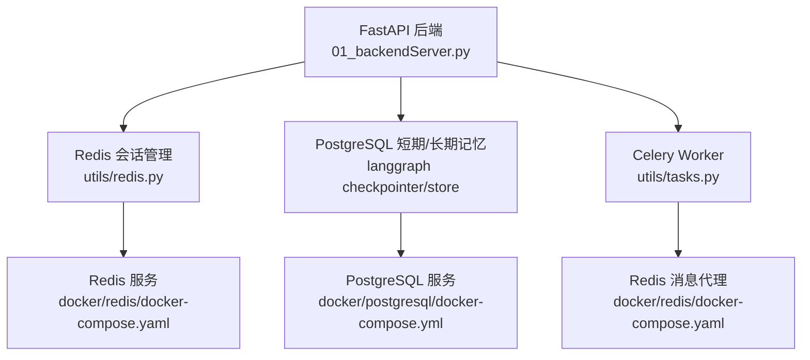
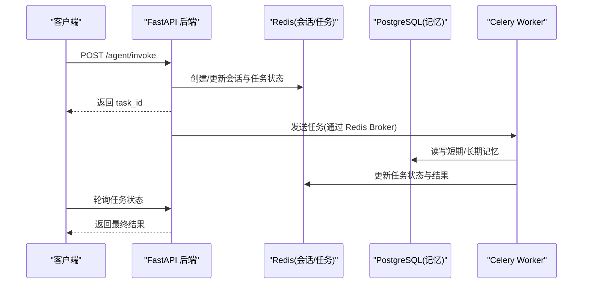

# 测试环境搭建

<cite>
**本文引用的文件**
- [README.md](file://README.md)
- [docker/postgresql/docker-compose.yml](file://docker/postgresql/docker-compose.yml)
- [docker/redis/docker-compose.yaml](file://docker/redis/docker-compose.yaml)
- [utils/config.py](file://utils/config.py)
- [utils/redis.py](file://utils/redis.py)
- [01_backendServer.py](file://01_backendServer.py)
- [utils/tasks.py](file://utils/tasks.py)
- [pip.sh](file://pip.sh)
</cite>

## 目录
1. [简介](#简介)
2. [项目结构](#项目结构)
3. [核心组件](#核心组件)
4. [架构总览](#架构总览)
5. [详细组件分析](#详细组件分析)
6. [依赖与安装管理](#依赖与安装管理)
7. [环境变量与配置管理](#环境变量与配置管理)
8. [测试数据准备](#测试数据准备)
9. [服务启动与停止脚本](#服务启动与停止脚本)
10. [故障排查指南](#故障排查指南)
11. [性能注意事项](#性能注意事项)
12. [结论](#结论)

## 简介
本指南面向开发者，提供从零搭建稳定测试环境的完整步骤。重点包括：
- 使用 Docker Compose 部署 PostgreSQL 与 Redis 测试实例
- 分离开发依赖与测试依赖的安装与管理
- 测试数据的准备与清理策略
- 服务启动/停止的标准化流程（含 Celery Worker）
- 环境变量与配置文件的管理规范
- 常见问题定位与排障方法

目标是让开发者在本地快速、可重复地拉起完整的测试环境，并高效维护。

## 项目结构
仓库采用“容器化基础设施 + Python 应用 + 工具模块”的组织方式：
- docker/postgresql: PostgreSQL 测试数据库的 Compose 配置
- docker/redis: Redis 测试缓存与会话存储的 Compose 配置
- utils: 配置、模型、Redis 会话管理、任务队列等核心逻辑
- 后端服务入口：01_backendServer.py（FastAPI + Celery 集成）
- 前端服务入口：02_frontendServer.py（用于联调演示）
- README.md: 功能说明与基础运行指引
- pip.sh: 依赖安装脚本

图表来源
- [01_backendServer.py:84-123](file://01_backendServer.py#L84-L123)
- [utils/redis.py:37-49](file://utils/redis.py#L37-L49)
- [utils/tasks.py:43-63](file://utils/tasks.py#L43-L63)
- [docker/postgresql/docker-compose.yml:3-22](file://docker/postgresql/docker-compose.yml#L3-L22)
- [docker/redis/docker-compose.yaml:5-28](file://docker/redis/docker-compose.yaml#L5-L28)

章节来源
- [README.md:111-117](file://README.md#L111-L117)

## 核心组件
- 配置中心：统一读取环境变量与默认值，集中管理数据库、Redis、Celery、LLM、服务端口等参数
- 会话与状态存储：基于 Redis 的多用户多会话管理，支持任务状态、过期清理、活跃会话查询
- 持久化存储：PostgreSQL 作为 LangGraph 的短期记忆 Checkpointer 与长期记忆 Store
- 异步任务：Celery Worker 通过 Redis Broker 执行 Agent 推理与工具调用
- 服务入口：FastAPI 暴露 API，生命周期内初始化连接池、Checkpointer、Store 与 Redis 会话管理器

章节来源
- [utils/config.py:4-34](file://utils/config.py#L4-L34)
- [utils/redis.py:37-493](file://utils/redis.py#L37-L493)
- [01_backendServer.py:84-123](file://01_backendServer.py#L84-L123)
- [utils/tasks.py:43-63](file://utils/tasks.py#L43-L63)

## 架构总览
下图展示了测试环境的核心交互关系：客户端请求进入 FastAPI，创建或复用会话，将任务投递到 Celery Worker；Worker 通过 Redis 获取消息，调用 LLM 与工具，并将结果写回 Redis 与 PostgreSQL。

图表来源
- [01_backendServer.py:132-173](file://01_backendServer.py#L132-L173)
- [utils/tasks.py:43-63](file://utils/tasks.py#L43-L63)
- [utils/redis.py:392-442](file://utils/redis.py#L392-L442)

## 详细组件分析

### PostgreSQL 测试数据库
- 镜像与版本：postgres:15
- 容器名：postgres_db
- 环境变量：POSTGRES_USER、POSTGRES_PASSWORD、POSTGRES_DB、时区
- 端口映射：5432
- 数据持久化：pgdata 卷
- 健康检查：pg_isready
- 自定义参数：max_connections=200

建议
- 测试阶段保持默认账号密码，便于快速联调
- 如需隔离测试数据，可在 Compose 中调整 POSTGRES_DB 或使用不同卷名

章节来源
- [docker/postgresql/docker-compose.yml:3-22](file://docker/postgresql/docker-compose.yml#L3-L22)

### Redis 测试实例
- 镜像：redis:latest
- 容器名：redis
- 端口映射：6379
- 数据持久化：redis-data 卷
- 健康检查：redis-cli ping
- 网络：app-network（便于未来扩展）

建议
- 测试环境开启持久化便于调试
- 若仅做临时会话缓存，可关闭持久化以提升性能

章节来源
- [docker/redis/docker-compose.yaml:5-28](file://docker/redis/docker-compose.yaml#L5-L28)

### 会话与任务管理（Redis）
- 会话键模式：session:{user_id}:{session_id}:{task_id}
- 用户会话集合：user_sessions:{user_id}
- 任务映射集合：task_mapping:{user_id}:{session_id}
- 任务状态键：task:{task_id}
- 自动清理：cleanup_user_tasks/cleanup_all_tasks 定期清理过期会话与任务
- 超时控制：会话 TTL 与任务 TTL 由配置决定

关键能力
- 创建/更新/删除会话
- 查询活跃会话与最近一次修改的会话
- 批量统计会话数量与列表
- 设置/查询任务状态，绑定用户与会话

章节来源
- [utils/redis.py:56-103](file://utils/redis.py#L56-L103)
- [utils/redis.py:146-185](file://utils/redis.py#L146-L185)
- [utils/redis.py:246-341](file://utils/redis.py#L246-L341)
- [utils/redis.py:392-442](file://utils/redis.py#L392-L442)

### 后端服务与生命周期
- 生命周期初始化：创建 Redis 会话管理器、PostgreSQL 连接池、LangGraph Checkpointer/Store
- 资源清理：关闭 Redis 连接与数据库连接池
- API 示例：/agent/invoke 创建/校验会话，投递 Celery 任务，立即返回 task_id

章节来源
- [01_backendServer.py:84-123](file://01_backendServer.py#L84-L123)
- [01_backendServer.py:132-173](file://01_backendServer.py#L132-L173)

### 任务队列（Celery）
- Broker：Redis（URL 来自配置）
- Worker 启动：celery -A 01_backendServer.celery_app worker --loglevel=info
- 任务序列化：JSON
- 时区：Asia/Shanghai

章节来源
- [utils/tasks.py:43-63](file://utils/tasks.py#L43-L63)
- [README.md:187-192](file://README.md#L187-L192)

## 依赖与安装管理
- 推荐先按 README 中的固定版本安装，避免不兼容
- 使用 Conda 创建独立虚拟环境
- 使用 pip.sh 快速安装 LangChain/LangGraph/MCP 相关依赖
- 测试阶段建议单独维护 requirements-test.txt 以区分开发与测试依赖

建议
- 将第三方库锁定版本，确保团队一致性
- 使用 venv/conda 隔离环境，避免污染系统 Python

章节来源
- [README.md:73-97](file://README.md#L73-L97)
- [pip.sh:1-14](file://pip.sh#L1-L14)

## 环境变量与配置管理
- 统一配置类：utils/config.py
  - 数据库 URI：DB_URI（默认指向 localhost:5432/postgres）
  - Redis：REDIS_HOST、REDIS_PORT、REDIS_DB、SESSION_TIMEOUT、TTL
  - Celery：CELERY_BROKER_URL（默认 redis://localhost:6379/0）
  - LLM_TYPE、HOST、PORT 等
- 日志路径：logfile/app.log（自动创建）

最佳实践
- 通过环境变量覆盖默认值，避免硬编码敏感信息
- 为不同环境（dev/test/prod）维护 .env 文件或 CI 注入变量
- 变更配置后重启服务生效

章节来源
- [utils/config.py:4-34](file://utils/config.py#L4-L34)

## 测试数据准备
- 会话与任务数据：通过 Redis 会话管理器创建，支持自定义 TTL 与状态
- 历史会话：可通过 API 或测试脚本创建多条会话，验证恢复与查询
- 长期记忆：通过后端接口写入，存储在 PostgreSQL 命名空间下

建议
- 编写轻量测试脚本，批量创建典型用例（成功、失败、中断、恢复）
- 每次测试前执行清理，保证环境干净可复现

章节来源
- [utils/redis.py:56-103](file://utils/redis.py#L56-L103)
- [01_backendServer.py:43-80](file://01_backendServer.py#L43-L80)

## 服务启动与停止脚本
- 启动数据库与缓存
  - 进入 docker/postgresql 目录执行：docker compose up -d
  - 进入 docker/redis 目录执行：docker compose up -d
- 启动后端服务
  - python 01_backendServer.py
- 启动 Celery Worker
  - celery -A 01_backendServer.celery_app worker --loglevel=info
- 启动前端服务（可选）
  - python 02_frontendServer.py
- 停止服务
  - docker compose down（分别在 postgresql 与 redis 目录）
  - Ctrl+C 停止 Python 进程与 Worker

注意
- 确保端口未被占用（5432、6379、8001）
- 首次启动会初始化连接池与存储，等待健康检查通过后再发起请求

章节来源
- [README.md:111-117](file://README.md#L111-L117)
- [README.md:187-192](file://README.md#L187-L192)
- [docker/postgresql/docker-compose.yml:3-22](file://docker/postgresql/docker-compose.yml#L3-L22)
- [docker/redis/docker-compose.yaml:5-28](file://docker/redis/docker-compose.yaml#L5-L28)

## 故障排查指南
常见问题与解决思路
- 无法连接 PostgreSQL
  - 检查容器是否运行、端口是否映射、用户名/密码/数据库名是否正确
  - 查看健康检查日志与 pg_isready 输出
- 无法连接 Redis
  - 检查容器运行状态、端口映射、Broker URL 是否与配置一致
  - 使用 redis-cli ping 验证连通性
- 会话/任务丢失
  - 检查 TTL 是否过短导致提前过期
  - 确认 cleanup 逻辑是否误删，必要时调整清理频率
- 任务未执行或卡住
  - 确认 Celery Worker 已启动且能消费队列
  - 查看 Worker 日志与 Redis 队列长度
- 日志过大
  - 调整日志轮转大小与保留份数，定期归档

定位技巧
- 优先查看 logfile/app.log
- 使用 Docker Desktop 或命令行查看容器日志
- 通过 Redis 键扫描定位会话与任务状态

章节来源
- [utils/config.py:6-11](file://utils/config.py#L6-L11)
- [utils/redis.py:246-341](file://utils/redis.py#L246-L341)
- [docker/postgresql/docker-compose.yml:17-22](file://docker/postgresql/docker-compose.yml#L17-L22)
- [docker/redis/docker-compose.yaml:19-25](file://docker/redis/docker-compose.yaml#L19-L25)

## 性能注意事项
- 合理设置会话 TTL 与任务 TTL，避免频繁重建与内存压力
- 根据并发量调整 PostgreSQL max_connections 与连接池大小
- 测试阶段可关闭 Redis 持久化提升吞吐
- 对长会话场景启用消息修剪，减少上下文长度

[本节为通用指导，无需特定文件引用]

## 结论
通过 Docker Compose 一键拉起 PostgreSQL 与 Redis，配合统一的配置管理与标准化的启动流程，开发者可以快速构建稳定的测试环境。结合会话与任务的自动化清理、合理的 TTL 与连接池配置，以及完善的日志与健康检查，能够显著提升测试效率与问题定位速度。建议在团队内固化本指南的流程与配置，确保环境一致性与可维护性。