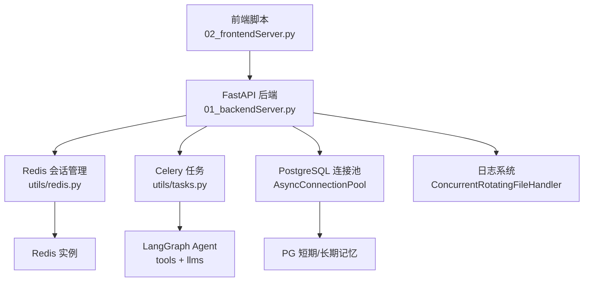
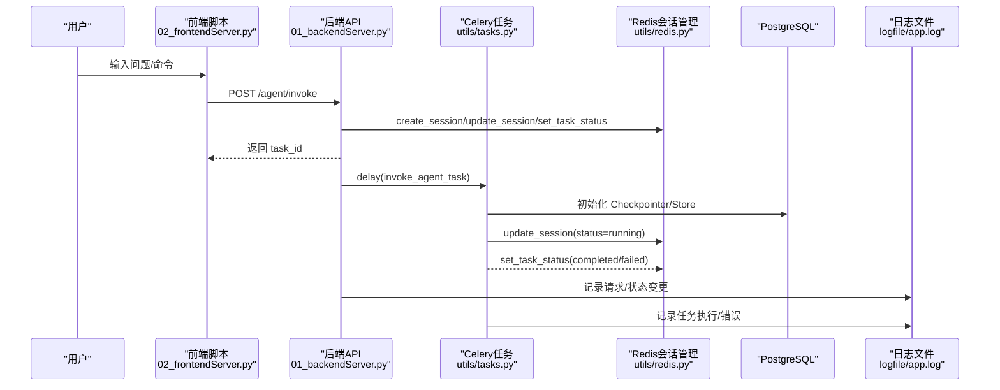
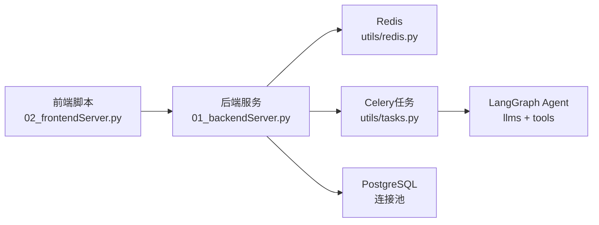

# 调试工具和技巧

<cite>
**本文引用的文件**
- [README.md](file://README.md)
- [01_backendServer.py](file://01_backendServer.py)
- [02_frontendServer.py](file://02_frontendServer.py)
- [utils/config.py](file://utils/config.py)
- [utils/redis.py](file://utils/redis.py)
- [utils/tasks.py](file://utils/tasks.py)
- [utils/models.py](file://utils/models.py)
- [utils/tools.py](file://utils/tools.py)
- [redisTest.py](file://redisTest.py)
</cite>

## 目录
1. [简介](#简介)
2. [项目结构](#项目结构)
3. [核心组件](#核心组件)
4. [架构总览](#架构总览)
5. [详细组件分析](#详细组件分析)
6. [依赖关系分析](#依赖关系分析)
7. [性能考虑](#性能考虑)
8. [故障排查指南](#故障排查指南)
9. [结论](#结论)
10. [附录](#附录)

## 简介
本指南面向开发者，聚焦于在本项目中高效定位与解决问题的调试方法与技巧。内容覆盖：
- Python 调试器使用（pdb、ipdb）在前后端服务中的接入方式
- 日志系统配置与优化（级别、格式、轮转、文件管理）
- 性能分析工具（cProfile、memory_profiler）的集成与使用建议
- Redis 调试技巧（键值查看、内存分析、慢查询监控）
- 前端控制台调试（Rich 输出优化、交互式调试）
- 常见问题诊断与解决方案

## 项目结构
本项目包含后端 FastAPI 服务、Celery 异步任务、Redis 会话状态存储、PostgreSQL 短期/长期记忆存储，以及基于 Rich 的前端交互脚本。关键路径如下：
- 后端入口与服务生命周期：[01_backendServer.py](file://01_backendServer.py)
- 前端交互脚本（Rich 控制台）：[02_frontendServer.py](file://02_frontendServer.py)
- 统一配置（日志、数据库、Redis、LLM、端口等）：[utils/config.py](file://utils/config.py)
- Redis 会话管理与清理逻辑：[utils/redis.py](file://utils/redis.py)
- Celery 任务与智能体执行流程：[utils/tasks.py](file://utils/tasks.py)
- 数据模型定义（请求/响应）：[utils/models.py](file://utils/models.py)
- 工具与人工审查（HITL）封装：[utils/tools.py](file://utils/tools.py)
- Redis 独立测试脚本：[redisTest.py](file://redisTest.py)

图表来源
- [01_backendServer.py:84-130](file://01_backendServer.py#L84-L130)
- [utils/redis.py:37-49](file://utils/redis.py#L37-L49)
- [utils/tasks.py:43-63](file://utils/tasks.py#L43-L63)
- [utils/config.py:4-34](file://utils/config.py#L4-L34)

章节来源
- [README.md:1-199](file://README.md#L1-L199)
- [01_backendServer.py:1-424](file://01_backendServer.py#L1-L424)
- [02_frontendServer.py:1-860](file://02_frontendServer.py#L1-L860)
- [utils/config.py:1-34](file://utils/config.py#L1-L34)
- [utils/redis.py:1-493](file://utils/redis.py#L1-L493)
- [utils/tasks.py:1-564](file://utils/tasks.py#L1-L564)
- [utils/models.py:1-97](file://utils/models.py#L1-L97)
- [utils/tools.py:1-39](file://utils/tools.py#L1-L39)
- [redisTest.py:1-573](file://redisTest.py#L1-L573)

## 核心组件
- 后端服务（FastAPI）：提供 REST API，负责会话创建、任务调度、状态查询、删除等；通过生命周期初始化 Redis、PG 连接池、Checkpointer、Store。
- 异步任务（Celery）：将智能体运行放入后台队列，支持恢复中断的任务。
- Redis 会话管理：维护用户-会话-任务的映射、会话状态、任务状态、过期策略与清理逻辑。
- 日志系统：各模块统一使用 ConcurrentRotatingFileHandler 写入 logfile/app.log，按大小轮转并保留历史文件。
- 前端交互（Rich）：提供美观的控制台输出、进度条、面板展示，便于调试和演示。

章节来源
- [01_backendServer.py:84-130](file://01_backendServer.py#L84-L130)
- [utils/tasks.py:318-451](file://utils/tasks.py#L318-L451)
- [utils/redis.py:37-493](file://utils/redis.py#L37-L493)
- [utils/config.py:4-34](file://utils/config.py#L4-L34)
- [02_frontendServer.py:15-28](file://02_frontendServer.py#L15-L28)

## 架构总览
下图展示了从前端到后端、再到 Redis/PG 的数据流与调用关系，以及日志落盘位置。

图表来源
- [01_backendServer.py:133-173](file://01_backendServer.py#L133-L173)
- [utils/tasks.py:318-451](file://utils/tasks.py#L318-L451)
- [utils/redis.py:65-144](file://utils/redis.py#L65-L144)
- [utils/config.py:4-34](file://utils/config.py#L4-L34)

## 详细组件分析

### 日志系统与调试
- 日志配置要点
  - 统一使用 ConcurrentRotatingFileHandler，按文件大小轮转，保留历史文件数量由配置控制。
  - 日志格式包含时间、模块名、级别、消息，便于检索。
  - 所有模块均设置 logger.setLevel(logging.DEBUG)，确保开发期捕获详细信息。
- 关键位置
  - 后端服务日志：[01_backendServer.py:21-40](file://01_backendServer.py#L21-L40)
  - Redis 模块日志：[utils/redis.py:13-32](file://utils/redis.py#L13-L32)
  - 任务模块日志：[utils/tasks.py:21-40](file://utils/tasks.py#L21-L40)
  - 工具模块日志：[utils/tools.py:14-34](file://utils/tools.py#L14-L34)
- 调试建议
  - 开发阶段保持 DEBUG，生产环境可调整为 INFO/ERROR。
  - 结合 grep 搜索关键字（如“错误”、“异常”、“超时”）快速定位问题。
  - 关注 logfile/app.log 轮转后的历史文件，避免遗漏关键信息。

章节来源
- [01_backendServer.py:21-40](file://01_backendServer.py#L21-L40)
- [utils/redis.py:13-32](file://utils/redis.py#L13-L32)
- [utils/tasks.py:21-40](file://utils/tasks.py#L21-L40)
- [utils/tools.py:14-34](file://utils/tools.py#L14-L34)
- [utils/config.py:6-11](file://utils/config.py#L6-L11)

### Redis 调试技巧
- 键空间与数据结构
  - 会话数据：session:{user_id}:{session_id}:{task_id}
  - 用户会话集合：user_sessions:{user_id}
  - 任务映射：task_mapping:{user_id}:{session_id}
  - 任务状态：task:{task_id}
- 常用操作
  - 查看会话是否存在：exists session:...
  - 获取会话详情：get session:...
  - 列出用户会话：smembers user_sessions:...
  - 查看任务状态：get task:...
  - 扫描全库键：scan_iter("user_sessions:*")
- 内存与慢查询
  - 使用 Redis 客户端或监控工具查看内存占用、键数量、过期键清理情况。
  - 关注 cleanup_all_tasks/cleanup_user_tasks 的执行频率与耗时，避免频繁扫描导致性能下降。
- 参考实现
  - 会话创建/更新/删除：[utils/redis.py:65-144](file://utils/redis.py#L65-L144)、[utils/redis.py:445-476](file://utils/redis.py#L445-L476)
  - 清理逻辑：[utils/redis.py:247-341](file://utils/redis.py#L247-L341)
  - 任务状态绑定：[utils/redis.py:392-425](file://utils/redis.py#L392-L425)

章节来源
- [utils/redis.py:65-144](file://utils/redis.py#L65-L144)
- [utils/redis.py:247-341](file://utils/redis.py#L247-L341)
- [utils/redis.py:392-425](file://utils/redis.py#L392-L425)
- [utils/redis.py:445-476](file://utils/redis.py#L445-L476)

### 前端控制台调试（Rich）
- 主题与面板
  - 自定义主题用于区分 info/warning/success/error，提升可读性。
  - 使用 Panel 展示会话状态、中断提示、最终结果等。
- 进度与交互
  - Progress 用于显示长耗时操作的进度（如写入长期记忆）。
  - Prompt.ask 用于交互式输入（yes/no/edit/response 等）。
- 调试建议
  - 在关键分支打印原始响应（已注释示例），便于对比接口返回结构。
  - 遇到未知状态时，打印完整响应并记录日志，辅助定位。
- 参考实现
  - 主题与控制台初始化：[02_frontendServer.py:15-28](file://02_frontendServer.py#L15-L28)
  - 进度条使用：[02_frontendServer.py:148-151](file://02_frontendServer.py#L148-L151)
  - 会话状态展示与处理：[02_frontendServer.py:236-497](file://02_frontendServer.py#L236-L497)

章节来源
- [02_frontendServer.py:15-28](file://02_frontendServer.py#L15-L28)
- [02_frontendServer.py:148-151](file://02_frontendServer.py#L148-L151)
- [02_frontendServer.py:236-497](file://02_frontendServer.py#L236-L497)

### 异步任务与中断恢复
- 任务流程
  - 后端接收请求后，立即返回 task_id，并将任务投递至 Celery。
  - 任务中更新会话状态为 running，执行智能体，处理结果（完成/中断/错误），更新任务状态。
- 中断恢复
  - 当智能体触发中断时，返回 interrupted 状态，前端根据中断类型进行交互（accept/reject/edit/response）。
  - 恢复调用 resume_agent 接口，重新执行 agent.ainvoke(Command(resume=...))。
- 参考实现
  - 任务定义与执行：[utils/tasks.py:318-451](file://utils/tasks.py#L318-L451)
  - 恢复任务：[utils/tasks.py:455-559](file://utils/tasks.py#L455-L559)
  - 后端恢复接口：[01_backendServer.py:176-237](file://01_backendServer.py#L176-L237)

章节来源
- [utils/tasks.py:318-451](file://utils/tasks.py#L318-L451)
- [utils/tasks.py:455-559](file://utils/tasks.py#L455-L559)
- [01_backendServer.py:176-237](file://01_backendServer.py#L176-L237)

### 数据模型与接口契约
- 请求/响应模型
  - AgentRequest：用户ID、会话ID、任务ID、查询、系统提示词
  - InterruptResponse：恢复中断所需的响应类型与参数
  - AgentResponse：会话ID、任务ID、状态、时间戳、结果/错误/中断数据
  - SystemInfoResponse/SessionInfoResponse/TaskInfoResponse/ActiveSessionInfoResponse/SessionStatusResponse：各类查询与状态返回
- 参考实现
  - 模型定义：[utils/models.py:7-96](file://utils/models.py#L7-L96)
  - 接口使用：[01_backendServer.py:133-414](file://01_backendServer.py#L133-L414)

章节来源
- [utils/models.py:7-96](file://utils/models.py#L7-L96)
- [01_backendServer.py:133-414](file://01_backendServer.py#L133-L414)

## 依赖关系分析
- 模块耦合
  - 后端依赖 Redis 会话管理、Celery 任务、PG 连接池、日志系统。
  - 任务模块依赖 LangGraph Agent、工具、LLM、Redis、PG。
  - 前端脚本依赖后端 API 与 Rich 控制台。
- 外部依赖
  - Redis：会话状态、任务状态、过期清理
  - PostgreSQL：短期记忆（Checkpointer）、长期记忆（Store）
  - Celery：异步任务队列
  - LangChain/LangGraph：Agent 构建与执行
- 潜在风险
  - Redis 键空间膨胀与清理不及时
  - PG 连接池耗尽或查询缓慢
  - Celery Worker 堆积或失败重试风暴

图表来源
- [01_backendServer.py:84-130](file://01_backendServer.py#L84-L130)
- [utils/tasks.py:43-63](file://utils/tasks.py#L43-L63)
- [utils/redis.py:37-49](file://utils/redis.py#L37-L49)

章节来源
- [01_backendServer.py:84-130](file://01_backendServer.py#L84-L130)
- [utils/tasks.py:43-63](file://utils/tasks.py#L43-L63)
- [utils/redis.py:37-49](file://utils/redis.py#L37-L49)

## 性能考虑
- 日志性能
  - 使用 ConcurrentRotatingFileHandler 避免并发写入冲突，按大小轮转减少单文件过大。
  - 开发阶段 DEBUG 可能带来 IO 压力，生产环境建议调整为 INFO/ERROR。
- Redis 性能
  - 避免频繁 scan_iter 全量扫描，必要时分批次或限制范围。
  - 合理设置 TTL，及时清理无效会话与任务，防止内存泄漏。
- 数据库性能
  - 连接池大小（MIN_SIZE/MAX_SIZE）需根据负载调整，避免连接耗尽。
  - 检查点与存储查询应加索引与分页，减少大对象传输。
- 任务队列
  - Celery Worker 数量与并发度需匹配业务峰值，监控队列长度与延迟。
  - 失败任务的重试策略与死信队列需配置，避免无限重试。

[本节为通用指导，不直接分析具体文件]

## 故障排查指南
- 常见问题与定位
  - 会话不存在：检查 user_sessions 与 task_mapping 是否被正确维护；确认 TTL 是否过短。
  - 任务状态异常：查看 task:{task_id} 的状态与错误信息；核对 invoke/resume 接口调用链。
  - 日志缺失：确认日志处理器是否正确挂载，logfile 目录权限与磁盘空间。
  - 前端显示异常：打印原始响应，检查 JSON 结构与字段完整性。
- 调试步骤
  - 启用 DEBUG 日志，复现问题并收集 logfile/app.log。
  - 使用 Redis 客户端查看键空间与过期键，必要时手动清理。
  - 在前端关键分支添加临时打印，验证数据流转。
  - 对 Celery 任务增加 try/except 包裹，记录堆栈与上下文。
- 参考实现
  - 后端异常处理与日志：[01_backendServer.py:176-237](file://01_backendServer.py#L176-L237)
  - 任务异常处理与状态更新：[utils/tasks.py:420-446](file://utils/tasks.py#L420-L446)、[utils/tasks.py:528-554](file://utils/tasks.py#L528-L554)
  - Redis 清理逻辑：[utils/redis.py:247-341](file://utils/redis.py#L247-L341)

章节来源
- [01_backendServer.py:176-237](file://01_backendServer.py#L176-L237)
- [utils/tasks.py:420-446](file://utils/tasks.py#L420-L446)
- [utils/tasks.py:528-554](file://utils/tasks.py#L528-L554)
- [utils/redis.py:247-341](file://utils/redis.py#L247-L341)

## 结论
通过统一的日志体系、健壮的 Redis 会话管理、异步任务与中断恢复机制，以及友好的前端控制台，本项目提供了完善的调试基础。开发者可结合日志、Redis 键空间检查、前端打印与任务状态追踪，快速定位问题。在生产环境中，建议调整日志级别、优化 Redis 清理策略、监控队列与数据库性能，确保系统稳定运行。

[本节为总结，不直接分析具体文件]

## 附录

### Python 调试器使用（pdb/ipdb）
- 在代码中插入断点
  - 使用 pdb：import pdb; pdb.set_trace()
  - 使用 ipdb：import ipdb; ipdb.set_trace()
- 推荐位置
  - 后端接口处理函数入口（如 /agent/invoke、/agent/resume）
  - 任务执行关键步骤（如智能体调用前后、状态更新处）
  - Redis 操作前后（如 create_session、update_session）
- 注意事项
  - 仅在开发环境启用，生产环境移除或禁用
  - 结合日志输出，记录断点处的上下文变量

[本节为通用指导，不直接分析具体文件]

### 性能分析工具（cProfile/memory_profiler）
- cProfile
  - 对关键函数或接口进行性能剖析，生成统计报告
  - 适用于识别 CPU 热点与慢调用
- memory_profiler
  - 逐行分析内存占用，定位内存泄漏或高消耗点
  - 适用于数据处理、序列化/反序列化、大对象处理场景
- 建议
  - 在本地或测试环境运行，避免影响线上服务
  - 结合日志与指标，形成完整的性能基线

[本节为通用指导，不直接分析具体文件]

### Redis 调试清单
- 键值查看
  - exists/get/del 针对 session:/task: 键
  - smembers/scard 查看集合成员与数量
- 内存分析
  - 使用 Redis 监控工具查看内存使用、键数量、过期键清理
- 慢查询监控
  - 开启 slowlog，记录慢命令，分析 scan_iter、smembers 等高频操作
- 参考实现
  - 会话与任务操作：[utils/redis.py:65-144](file://utils/redis.py#L65-L144)、[utils/redis.py:392-425](file://utils/redis.py#L392-L425)
  - 清理逻辑：[utils/redis.py:247-341](file://utils/redis.py#L247-L341)

章节来源
- [utils/redis.py:65-144](file://utils/redis.py#L65-L144)
- [utils/redis.py:247-341](file://utils/redis.py#L247-L341)
- [utils/redis.py:392-425](file://utils/redis.py#L392-L425)

### 前端控制台调试清单
- Rich 输出优化
  - 使用 Panel 分组展示信息，使用 Markdown 渲染富文本
  - 使用 Progress 显示长耗时操作进度
- 交互式调试
  - 使用 Prompt.ask 收集用户输入，处理 yes/no/edit/response
  - 在关键分支打印原始响应，便于对比接口返回结构
- 参考实现
  - 主题与控制台：[02_frontendServer.py:15-28](file://02_frontendServer.py#L15-L28)
  - 进度条与交互：[02_frontendServer.py:148-151](file://02_frontendServer.py#L148-L151)
  - 会话状态展示：[02_frontendServer.py:236-497](file://02_frontendServer.py#L236-L497)

章节来源
- [02_frontendServer.py:15-28](file://02_frontendServer.py#L15-L28)
- [02_frontendServer.py:148-151](file://02_frontendServer.py#L148-L151)
- [02_frontendServer.py:236-497](file://02_frontendServer.py#L236-L497)