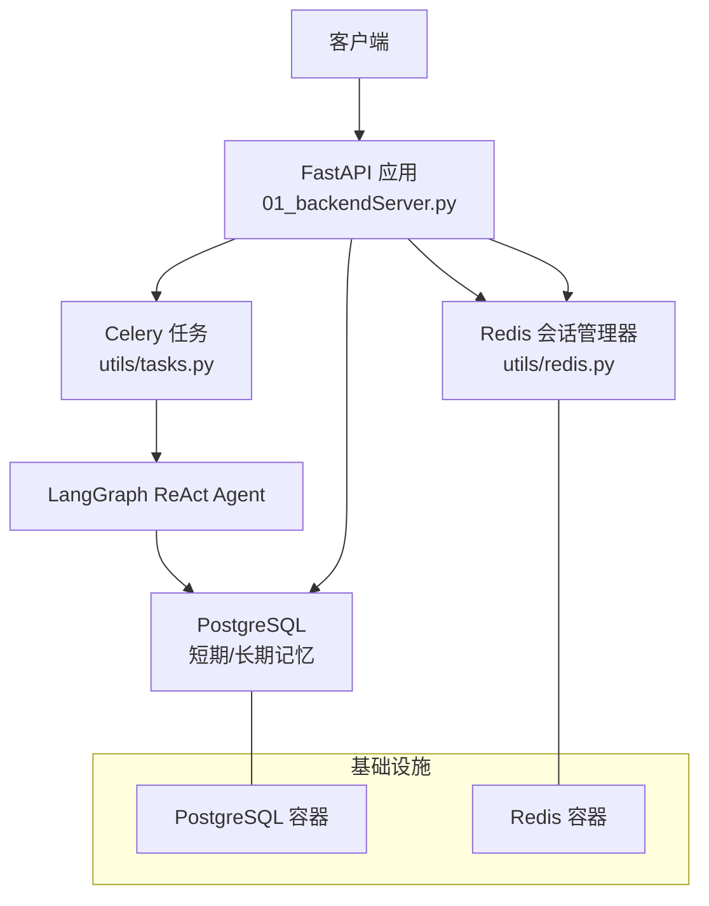
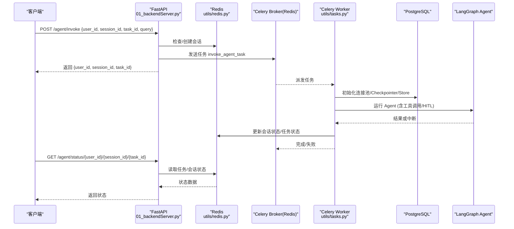
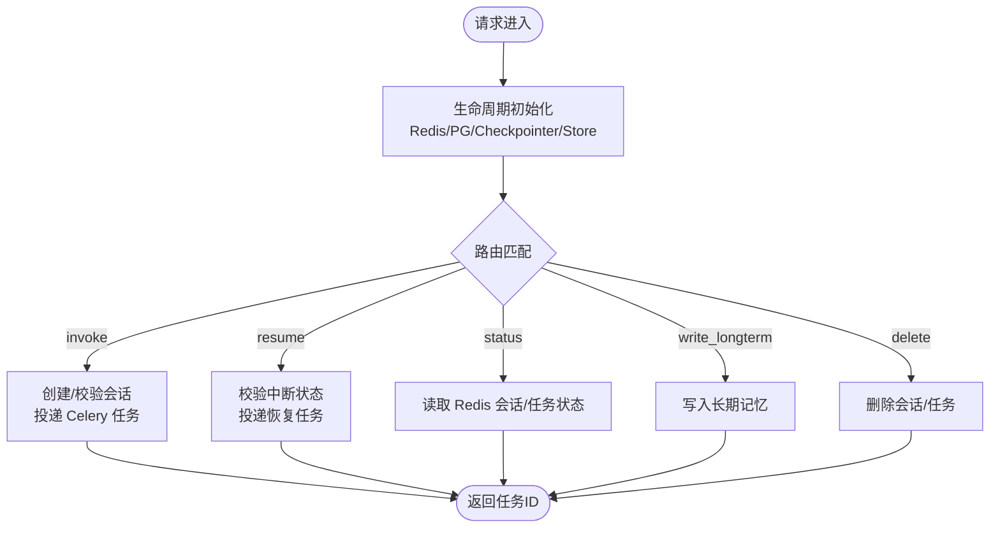
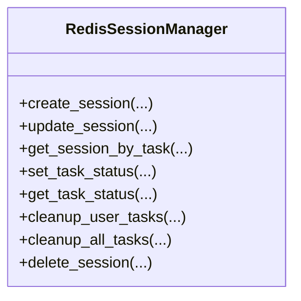
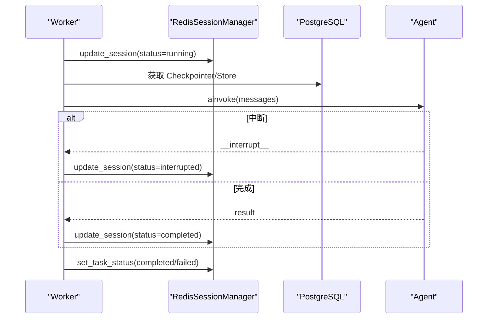
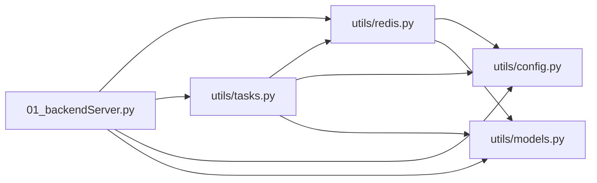

# 集成测试

<cite>
**本文引用的文件**
- [01_backendServer.py](file://01_backendServer.py)
- [utils/config.py](file://utils/config.py)
- [utils/redis.py](file://utils/redis.py)
- [utils/tasks.py](file://utils/tasks.py)
- [utils/models.py](file://utils/models.py)
- [docker/postgresql/docker-compose.yml](file://docker/postgresql/docker-compose.yml)
- [docker/redis/docker-compose.yaml](file://docker/redis/docker-compose.yaml)
- [README.md](file://README.md)
</cite>

## 目录
1. [简介](#简介)
2. [项目结构](#项目结构)
3. [核心组件](#核心组件)
4. [架构总览](#架构总览)
5. [详细组件分析](#详细组件分析)
6. [依赖关系分析](#依赖关系分析)
7. [性能考量](#性能考量)
8. [故障排查指南](#故障排查指南)
9. [结论](#结论)
10. [附录](#附录)

## 简介
本指南面向需要对该 FastAPI + LangGraph + Celery + PostgreSQL + Redis 的 Agent 服务进行系统集成测试的开发者。内容涵盖：
- API 端到端测试（FastAPI）
- 数据库连接与短期/长期记忆存储测试（PostgreSQL）
- Redis 会话与任务状态测试
- 异步任务队列（Celery）测试策略
- 测试环境搭建与配置（Docker Compose 启动 PostgreSQL 与 Redis）
- 完整测试流程示例（从请求发送到响应验证）
- 测试数据隔离与清理机制

## 项目结构
本项目采用分层组织方式：
- 应用入口与路由：后端服务在 01_backendServer.py，定义 RESTful API 并管理生命周期
- 业务逻辑与任务：utils/tasks.py 实现 Celery 任务，调用 LangGraph ReAct Agent
- 数据访问与缓存：utils/redis.py 提供 Redis 会话与任务状态管理；PostgreSQL 通过 psycopg_pool 和 LangGraph 的 AsyncPostgresSaver/AsyncPostgresStore 使用
- 配置：utils/config.py 集中管理数据库、Redis、Celery、LLM 等配置
- 数据模型：utils/models.py 定义 Pydantic 请求/响应模型
- 基础设施：docker/postgresql 与 docker/redis 提供本地开发/测试所需的数据库与缓存服务

图表来源
- [01_backendServer.py:84-130](file://01_backendServer.py#L84-L130)
- [utils/redis.py:37-49](file://utils/redis.py#L37-L49)
- [utils/tasks.py:43-63](file://utils/tasks.py#L43-L63)
- [docker/postgresql/docker-compose.yml:1-25](file://docker/postgresql/docker-compose.yml#L1-L25)
- [docker/redis/docker-compose.yaml:1-38](file://docker/redis/docker-compose.yaml#L1-L38)

章节来源
- [README.md:111-118](file://README.md#L111-L118)
- [01_backendServer.py:84-130](file://01_backendServer.py#L84-L130)
- [utils/config.py:13-33](file://utils/config.py#L13-L33)

## 核心组件
- FastAPI 应用与路由
  - 生命周期管理：初始化 Redis、PostgreSQL 连接池、Checkpointer、Store
  - 关键接口：/agent/invoke、/agent/resume、/system/info、/agent/active/sessionid/{user_id}、/agent/sessionids/{user_id}、/agent/tasks/{user_id}/{session_id}、/agent/status/{user_id}/{session_id}/{task_id}、/agent/write/longterm、/agent/session/{user_id}/{session_id}、/agent/task/{user_id}/{session_id}/{task_id}
- Redis 会话与任务状态管理
  - 会话键空间：session:{user}:{session}:{task}
  - 用户会话集合：user_sessions:{user}
  - 任务映射：task_mapping:{user}:{session}
  - 任务状态：task:{task_id}
- Celery 异步任务
  - invoke_agent_task：创建 Agent、执行、更新会话与任务状态
  - resume_agent_task：恢复中断的任务，继续执行
- 配置中心
  - DB_URI、MIN_SIZE、MAX_SIZE、REDIS_*、CELERY_BROKER_URL、TTL、TASK_TTL、HOST、PORT 等

章节来源
- [01_backendServer.py:132-414](file://01_backendServer.py#L132-L414)
- [utils/redis.py:56-144](file://utils/redis.py#L56-L144)
- [utils/tasks.py:318-451](file://utils/tasks.py#L318-L451)
- [utils/tasks.py:455-559](file://utils/tasks.py#L455-L559)
- [utils/config.py:13-33](file://utils/config.py#L13-L33)

## 架构总览
下图展示了端到端请求处理流程：客户端调用 FastAPI 接口，服务将任务投递到 Celery Worker，Worker 通过 LangGraph 调用 LLM 与工具，读写 PostgreSQL 短期/长期记忆，并通过 Redis 维护会话与任务状态。

图表来源
- [01_backendServer.py:132-173](file://01_backendServer.py#L132-L173)
- [01_backendServer.py:316-344](file://01_backendServer.py#L316-L344)
- [utils/tasks.py:318-451](file://utils/tasks.py#L318-L451)
- [utils/redis.py:392-442](file://utils/redis.py#L392-L442)

## 详细组件分析

### FastAPI 应用与生命周期
- 生命周期函数负责：
  - 初始化 Redis 会话管理器
  - 创建 PostgreSQL 连接池
  - 初始化 LangGraph Checkpointer（短期记忆）与 Store（长期记忆）
  - 资源关闭时释放连接
- 路由职责：
  - /agent/invoke：校验/创建会话，投递异步任务，立即返回任务ID
  - /agent/resume：校验会话处于中断状态，投递恢复任务
  - /agent/status：查询会话与任务状态
  - /agent/write/longterm：写入用户长期记忆
  - 会话与任务删除接口用于测试数据清理

图表来源
- [01_backendServer.py:84-130](file://01_backendServer.py#L84-L130)
- [01_backendServer.py:132-414](file://01_backendServer.py#L132-L414)

章节来源
- [01_backendServer.py:84-130](file://01_backendServer.py#L84-L130)
- [01_backendServer.py:132-414](file://01_backendServer.py#L132-L414)

### Redis 会话与任务状态管理
- 数据结构与键空间
  - session:{user}:{session}:{task}：会话详情（状态、最近查询、最近响应、更新时间）
  - user_sessions:{user}：用户所有 session:task 条目
  - task_mapping:{user}:{session}：会话内所有 task_id
  - task:{task_id}：任务状态（status、result/error、绑定信息）
- 关键方法
  - create_session/update_session/get_session_by_task/delete_session
  - set_task_status/get_single_task_status/get_task_status
  - cleanup_user_tasks/cleanup_all_tasks：清理过期/无效数据
- 测试要点
  - 验证 TTL 与过期行为
  - 验证多用户/多会话/多任务的并发正确性
  - 验证清理逻辑不会误删有效数据

图表来源
- [utils/redis.py:37-493](file://utils/redis.py#L37-L493)

章节来源
- [utils/redis.py:56-144](file://utils/redis.py#L56-L144)
- [utils/redis.py:147-215](file://utils/redis.py#L147-L215)
- [utils/redis.py:246-341](file://utils/redis.py#L246-L341)
- [utils/redis.py:392-442](file://utils/redis.py#L392-L442)
- [utils/redis.py:444-476](file://utils/redis.py#L444-L476)

### Celery 异步任务与 Agent 执行
- 任务定义
  - invoke_agent_task：初始化会话管理器、数据库连接池、Checkpointer、Store、LLM、Tools，构建 ReAct Agent，执行 ainvoke，处理结果（完成/中断），更新会话与任务状态
  - resume_agent_task：基于 Command(resume=...) 恢复中断任务，后续流程类似
- 结果处理
  - process_agent_result：统一封装中断与最终结果，更新会话状态
  - filter_last_human_conversation：筛选最近一次人类对话上下文
- 测试要点
  - 验证任务入队与执行成功
  - 验证中断/恢复流程
  - 验证错误路径（异常捕获、状态置为 failed/error）
  - 验证长时间运行的任务超时与重试策略（结合 Celery 配置）

图表来源
- [utils/tasks.py:318-451](file://utils/tasks.py#L318-L451)
- [utils/tasks.py:455-559](file://utils/tasks.py#L455-L559)
- [utils/tasks.py:194-264](file://utils/tasks.py#L194-L264)

章节来源
- [utils/tasks.py:43-63](file://utils/tasks.py#L43-L63)
- [utils/tasks.py:194-264](file://utils/tasks.py#L194-L264)
- [utils/tasks.py:318-451](file://utils/tasks.py#L318-L451)
- [utils/tasks.py:455-559](file://utils/tasks.py#L455-L559)

### 数据模型与接口契约
- 请求/响应模型集中在 utils/models.py，确保前后端一致性与自动校验
- 典型模型
  - AgentRequest：用户/会话/任务标识、查询、系统提示
  - InterruptResponse：中断反馈类型与参数
  - AgentResponse：任务结果/中断数据/时间戳
  - SystemInfoResponse/SessionInfoResponse/TaskInfoResponse/ActiveSessionInfoResponse/SessionStatusResponse：各类查询响应

章节来源
- [utils/models.py:7-96](file://utils/models.py#L7-L96)

## 依赖关系分析
- 模块耦合
  - 01_backendServer.py 依赖 utils/redis.py、utils/tasks.py、utils/config.py、utils/models.py
  - utils/tasks.py 依赖 utils/redis.py、utils/config.py、utils/models.py，并通过 LangGraph 与 PostgreSQL 交互
  - utils/redis.py 依赖 utils/config.py、utils/models.py
- 外部依赖
  - PostgreSQL：短期记忆（checkpointer）与长期记忆（store）
  - Redis：会话、任务状态、Celery Broker
  - Celery：异步任务调度
  - LangGraph：ReAct Agent、消息修剪、中断机制

图表来源
- [01_backendServer.py:1-19](file://01_backendServer.py#L1-L19)
- [utils/tasks.py:1-19](file://utils/tasks.py#L1-L19)
- [utils/redis.py:1-10](file://utils/redis.py#L1-L10)

章节来源
- [01_backendServer.py:1-19](file://01_backendServer.py#L1-L19)
- [utils/tasks.py:1-19](file://utils/tasks.py#L1-L19)
- [utils/redis.py:1-10](file://utils/redis.py#L1-L10)

## 性能考量
- 连接池与并发
  - PostgreSQL 连接池大小（MIN_SIZE/MAX_SIZE）需根据负载调整，避免连接耗尽
  - Redis 异步客户端减少阻塞，适合高并发会话管理
- 任务队列
  - Celery Worker 数量与并发度应与 LLM 调用速率、工具执行耗时匹配
  - 合理设置 TASK_TTL，避免任务状态堆积
- 内存与上下文
  - 消息修剪（trimmed_messages_hook）控制 token 用量，降低 LLM 成本
- 建议
  - 压测不同并发下的端到端延迟与吞吐
  - 监控 Redis 命中率、PG 连接池使用率、Celery 队列长度

[本节为通用指导，不直接分析具体文件]

## 故障排查指南
- 常见问题定位
  - 服务启动失败：检查 PostgreSQL/Redis 是否可用，环境变量是否正确
  - 任务无法执行：确认 Celery Worker 已启动且 Broker 可达
  - 会话状态不一致：检查 Redis TTL 与清理逻辑，确认未误删
  - 中断恢复失败：确认会话状态为 interrupted，Command 参数正确
- 日志与调试
  - 应用日志输出至 logfile/app.log，级别可调
  - 利用 /agent/status 接口轮询任务状态，结合日志定位问题
- 快速恢复
  - 重启相关服务（PostgreSQL/Redis/Celery Worker）
  - 清理过期/无效会话与任务（cleanup_user_tasks/cleanup_all_tasks）

章节来源
- [01_backendServer.py:21-40](file://01_backendServer.py#L21-L40)
- [utils/redis.py:246-341](file://utils/redis.py#L246-L341)
- [utils/tasks.py:420-446](file://utils/tasks.py#L420-L446)
- [utils/tasks.py:528-554](file://utils/tasks.py#L528-L554)

## 结论
通过对 FastAPI 接口、Redis 会话管理、PostgreSQL 短期/长期记忆、以及 Celery 异步任务的系统化集成测试，可以全面验证 Agent 服务的端到端能力。建议在 CI/CD 中引入自动化测试套件，覆盖正常流程、中断/恢复、错误路径与边界条件，并结合 Docker Compose 一键拉起测试环境，确保回归质量与交付效率。

[本节为总结，不直接分析具体文件]

## 附录

### 测试环境搭建与配置
- 启动 PostgreSQL 与 Redis
  - 进入 docker/postgresql 与 docker/redis 目录分别执行 docker-compose up -d
  - 默认端口：PostgreSQL 5432，Redis 6379
- 配置项
  - DB_URI：PostgreSQL 连接串
  - REDIS_HOST/PORT/DB：Redis 连接参数
  - CELERY_BROKER_URL：Redis 作为 Broker
  - TTL/TASK_TTL：会话与任务状态过期时间
  - HOST/PORT：FastAPI 服务监听地址与端口

章节来源
- [README.md:111-118](file://README.md#L111-L118)
- [docker/postgresql/docker-compose.yml:1-25](file://docker/postgresql/docker-compose.yml#L1-L25)
- [docker/redis/docker-compose.yaml:1-38](file://docker/redis/docker-compose.yaml#L1-L38)
- [utils/config.py:13-33](file://utils/config.py#L13-L33)

### API 端到端测试流程示例
- 前置条件
  - 启动 PostgreSQL、Redis、Celery Worker、FastAPI 服务
- 步骤
  - 调用 POST /agent/invoke，提交用户问题，获得 task_id
  - 轮询 GET /agent/status/{user_id}/{session_id}/{task_id}，直到状态为 completed/interrupted/error
  - 若为 interrupted，调用 POST /agent/resume 提交人类反馈（accept/edit/response/reject）
  - 再次轮询状态直至完成
- 断言
  - 状态流转符合预期（pending -> running -> completed/interrupted/error）
  - 任务结果包含必要字段（result/interrupt_data）
  - Redis 中会话与任务状态一致
  - PostgreSQL 短期/长期记忆可查（可选）

章节来源
- [01_backendServer.py:132-173](file://01_backendServer.py#L132-L173)
- [01_backendServer.py:176-237](file://01_backendServer.py#L176-L237)
- [01_backendServer.py:316-344](file://01_backendServer.py#L316-L344)
- [utils/tasks.py:318-451](file://utils/tasks.py#L318-L451)
- [utils/tasks.py:455-559](file://utils/tasks.py#L455-L559)

### 数据库连接测试（PostgreSQL）
- 目标
  - 验证连接池可用性、Checkpointer/Store 初始化成功
  - 验证短期记忆（checkpointer）与长期记忆（store）读写
- 方法
  - 在应用生命周期中观察初始化日志
  - 调用 /agent/write/longterm 写入长期记忆，再触发 Agent 执行以读取
  - 检查 PostgreSQL 中对应表/索引（由 LangGraph 管理）是否存在数据

章节来源
- [01_backendServer.py:84-130](file://01_backendServer.py#L84-L130)
- [01_backendServer.py:346-374](file://01_backendServer.py#L346-L374)
- [utils/tasks.py:351-374](file://utils/tasks.py#L351-L374)

### Redis 服务测试
- 目标
  - 验证会话创建/更新/查询/删除
  - 验证任务状态设置与查询
  - 验证 TTL 与清理逻辑
- 方法
  - 使用 utils/redis.py 提供的接口进行单元测试
  - 模拟多用户/多会话并发场景，验证一致性
  - 触发清理后验证无效数据被移除

章节来源
- [utils/redis.py:56-144](file://utils/redis.py#L56-L144)
- [utils/redis.py:392-442](file://utils/redis.py#L392-L442)
- [utils/redis.py:246-341](file://utils/redis.py#L246-L341)

### 异步任务队列测试（Celery）
- 目标
  - 验证任务入队、执行、结果持久化
  - 验证中断/恢复流程
  - 验证错误路径与重试
- 方法
  - 启动 Celery Worker 后，调用 /agent/invoke 与 /agent/resume
  - 轮询 /agent/status 验证状态变化
  - 注入异常（如 LLM 不可用）验证 error/failed 分支

章节来源
- [utils/tasks.py:318-451](file://utils/tasks.py#L318-L451)
- [utils/tasks.py:455-559](file://utils/tasks.py#L455-L559)
- [utils/tasks.py:420-446](file://utils/tasks.py#L420-L446)
- [utils/tasks.py:528-554](file://utils/tasks.py#L528-L554)

### 测试数据隔离与清理机制
- 隔离策略
  - 每个测试用例使用独立的 user_id/session_id/task_id，避免数据污染
  - 使用 Redis 的 TTL 自动过期，缩短数据生命周期
- 清理策略
  - 测试结束后调用 delete_session 删除指定会话
  - 必要时调用 cleanup_user_tasks/cleanup_all_tasks 清理残留
  - 对 PostgreSQL 使用独立 schema 或测试库（建议）

章节来源
- [utils/redis.py:444-476](file://utils/redis.py#L444-L476)
- [utils/redis.py:246-341](file://utils/redis.py#L246-L341)