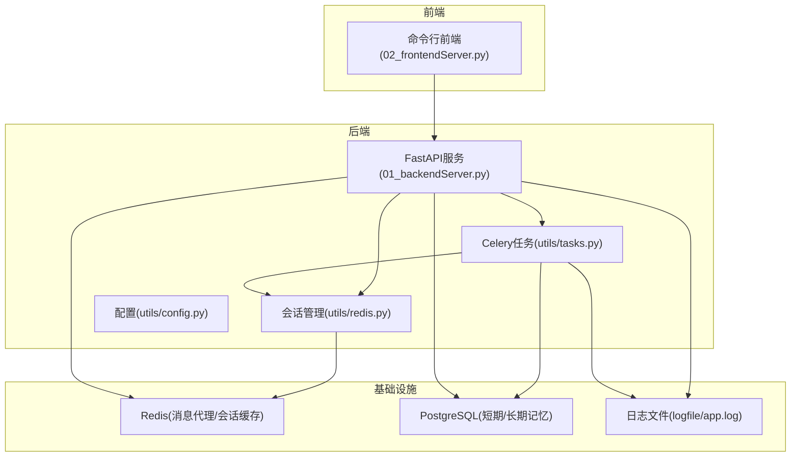
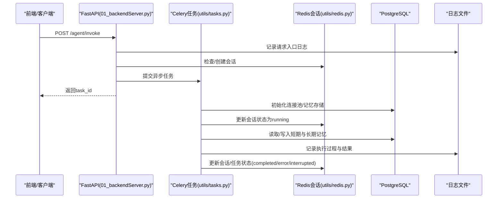
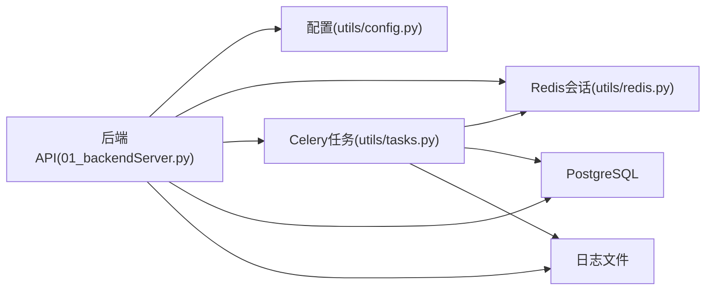

# 监控和日志

<cite>
**本文引用的文件**
- [01_backendServer.py](file://01_backendServer.py)
- [02_frontendServer.py](file://02_frontendServer.py)
- [utils/config.py](file://utils/config.py)
- [utils/tasks.py](file://utils/tasks.py)
- [utils/redis.py](file://utils/redis.py)
- [README.md](file://README.md)
</cite>

## 目录
1. [简介](#简介)
2. [项目结构](#项目结构)
3. [核心组件](#核心组件)
4. [架构总览](#架构总览)
5. [详细组件分析](#详细组件分析)
6. [依赖关系分析](#依赖关系分析)
7. [性能考量](#性能考量)
8. [故障排查指南](#故障排查指南)
9. [结论](#结论)
10. [附录](#附录)

## 简介
本文件面向运维与研发人员，系统化说明本项目的监控与日志体系：日志级别、格式、轮转策略、存储位置与管理；系统监控指标的定义与采集方式（性能、业务、错误统计）；告警机制与故障排查方法；日志分析工具与查询语法建议；以及性能优化建议与最佳实践。目标是帮助团队有效监控系统运行状态，及时发现问题并快速定位根因。

## 项目结构
本项目采用前后端分离的异步架构：
- 后端服务：基于 FastAPI 提供 Agent 智能体 API，使用 Celery + Redis 进行异步任务调度，PostgreSQL 作为短期记忆与长期记忆的持久化存储。
- 前端服务：基于 Rich 的命令行客户端，用于演示与联调，调用后端 API 完成会话管理、任务执行与结果展示。
- 配置中心：统一配置类集中管理数据库、Redis、Celery、日志等参数。
- 日志输出：各模块通过标准 logging 配合并发安全的轮转文件处理器，将日志写入统一目录。

图表来源
- [01_backendServer.py:21-40](file://01_backendServer.py#L21-L40)
- [utils/tasks.py:21-40](file://utils/tasks.py#L21-L40)
- [utils/redis.py:13-32](file://utils/redis.py#L13-L32)
- [utils/config.py:4-34](file://utils/config.py#L4-L34)

章节来源
- [01_backendServer.py:21-40](file://01_backendServer.py#L21-L40)
- [utils/config.py:4-34](file://utils/config.py#L4-L34)
- [README.md:112-192](file://README.md#L112-L192)

## 核心组件
- 日志子系统
  - 使用 Python 标准 logging，配合并发安全的轮转文件处理器，实现按大小轮转与历史保留。
  - 日志格式包含时间戳、模块名、级别、消息内容。
  - 所有模块统一输出到同一日志文件，便于集中查看与分析。
- 会话与任务管理
  - 通过 Redis 维护用户会话、任务状态与映射关系，支持过期清理与一致性校验。
  - 提供创建、更新、查询、删除会话及任务状态的接口。
- 异步任务执行
  - 使用 Celery 将 Agent 执行逻辑从 Web 请求中解耦，提升吞吐与可恢复性。
  - 任务内部记录关键节点日志，并在异常时回写错误状态。
- 配置管理
  - 集中定义日志路径、轮转大小、备份数量、数据库连接池、Redis 连接、Celery Broker、模型类型与服务端口等。

章节来源
- [01_backendServer.py:21-40](file://01_backendServer.py#L21-L40)
- [utils/tasks.py:21-40](file://utils/tasks.py#L21-L40)
- [utils/redis.py:13-32](file://utils/redis.py#L13-L32)
- [utils/config.py:4-34](file://utils/config.py#L4-L34)

## 架构总览
后端服务启动后，初始化日志、Redis 会话管理器、数据库连接池与记忆存储。API 接收请求后将耗时任务投递至 Celery Worker，Worker 执行 Agent 流程并持续更新会话与任务状态。所有关键操作均输出结构化日志，便于后续聚合与检索。

图表来源
- [01_backendServer.py:133-173](file://01_backendServer.py#L133-L173)
- [utils/tasks.py:319-451](file://utils/tasks.py#L319-L451)
- [utils/redis.py:65-144](file://utils/redis.py#L65-L144)

## 详细组件分析

### 日志系统设计
- 日志级别
  - 全局设置为 DEBUG，便于开发与测试阶段捕获更详细信息；生产环境可按需调整为 INFO。
- 日志格式
  - 统一格式：时间戳 - 模块名 - 级别 - 消息内容。
- 日志轮转
  - 使用并发安全的轮转处理器，单文件最大 5MB，达到上限触发轮转，最多保留 3 个历史文件。
- 日志聚合
  - 多模块共用同一日志文件路径，便于集中收集与后续接入日志平台。
- 存储位置与管理策略
  - 默认路径：logfile/app.log。
  - 自动创建目录；按大小轮转；保留固定数量的历史文件。
- 最佳实践
  - 在关键路径（请求入口、外部调用、异常分支、状态变更）记录结构化日志。
  - 避免在高频路径打印过大对象或敏感信息。
  - 结合任务 ID、会话 ID 等上下文字段，便于跨链路追踪。

章节来源
- [01_backendServer.py:21-40](file://01_backendServer.py#L21-L40)
- [utils/tasks.py:21-40](file://utils/tasks.py#L21-L40)
- [utils/redis.py:13-32](file://utils/redis.py#L13-L32)
- [utils/config.py:6-11](file://utils/config.py#L6-L11)

### 监控指标定义与采集
- 性能指标
  - 接口响应时间：可在每个 API 入口与出口处记录耗时（当前代码未内置计时器，建议在入口处增加计时与日志）。
  - 任务执行时长：在 Celery 任务开始与结束处记录时间戳差值。
  - 资源使用：CPU、内存、磁盘 I/O、网络带宽可通过宿主或容器层监控获取。
- 业务指标
  - 会话总数与活跃用户数：通过 Redis 会话计数与用户集合扫描得到。
  - 任务状态分布：completed、error、interrupted、failed 的数量统计。
  - 中断率：interrupted 任务占比，反映人工介入频率。
- 错误统计
  - HTTP 错误码分布：4xx、5xx 比例。
  - 异常堆栈：记录异常类型、消息、调用栈，便于定位根因。
- 采集方法
  - 应用内埋点：在关键函数入口/出口记录指标日志（如耗时、状态、错误）。
  - 外部采集：通过日志聚合平台（如 ELK/Loki）抓取日志文件，解析指标并构建看板。
  - 健康检查：暴露 /system/info 等接口，供外部探针定期探测。

章节来源
- [01_backendServer.py:240-251](file://01_backendServer.py#L240-L251)
- [utils/redis.py:167-204](file://utils/redis.py#L167-L204)
- [utils/tasks.py:195-264](file://utils/tasks.py#L195-L264)

### 日志文件组织结构与管理策略
- 命名规范
  - 主日志文件：app.log。
  - 轮转文件：由轮转处理器自动命名（例如带序号后缀），无需手动干预。
- 存储位置
  - 统一存放于 logfile 目录，便于集中管理与权限控制。
- 保留策略
  - 单文件最大 5MB，超过即轮转；保留最近 3 份历史文件，防止磁盘占用过高。
- 生命周期
  - 服务启动时初始化日志处理器；进程退出时由操作系统回收文件句柄。
- 安全与合规
  - 避免记录敏感数据（如密码、密钥、PII）。
  - 对日志文件设置最小权限访问控制。

章节来源
- [utils/config.py:6-11](file://utils/config.py#L6-L11)
- [01_backendServer.py:21-40](file://01_backendServer.py#L21-L40)
- [utils/tasks.py:21-40](file://utils/tasks.py#L21-L40)
- [utils/redis.py:13-32](file://utils/redis.py#L13-L32)

### 监控告警机制与故障排查
- 告警机制
  - 基于日志关键字（如 error、exception、status_code=5xx）触发告警。
  - 基于指标阈值（如错误率 > 1%、平均响应时间 > 2s、中断率 > 20%）触发告警。
  - 健康检查失败（/system/info 不可用）触发服务级告警。
- 故障排查方法
  - 定位问题：根据 task_id、session_id、user_id 在日志中过滤相关链路。
  - 分析错误：查看异常堆栈与最后一条成功日志，缩小范围。
  - 验证状态：通过 /agent/status/{user}/{session}/{task} 查询会话与任务状态。
  - 复现与修复：在开发环境复现问题，补充缺失的边界条件处理。
- 常见场景
  - 任务长时间 running：检查 Worker 是否存活、队列是否堆积、外部依赖是否超时。
  - 频繁 interrupted：评估工具审批流程与提示词设计，减少不必要的人工介入。
  - 会话丢失：检查 Redis 过期策略与清理逻辑是否正确。

章节来源
- [01_backendServer.py:176-237](file://01_backendServer.py#L176-L237)
- [utils/tasks.py:420-451](file://utils/tasks.py#L420-L451)
- [utils/redis.py:246-341](file://utils/redis.py#L246-L341)

### 日志分析工具与查询语法
- 本地分析
  - 使用 grep/awk/sed 快速筛选关键字（如 ERROR、Exception、status_code）。
  - 使用 tail -f 实时观察日志滚动。
- 平台化分析
  - 接入 ELK/Loki 等平台，建立索引与可视化看板。
  - 常用查询示例（概念性）：
    - 按级别过滤：level:error
    - 按会话过滤：session_id:"{id}"
    - 按任务过滤：task_id:"{id}"
    - 错误率计算：count(errors)/count(all)*100
    - 平均响应时间：avg(response_time)
- 建议
  - 在日志中加入结构化字段（JSON 片段），便于平台解析与查询。
  - 为高频查询建立专用索引或标签。

[本节为通用指导，不直接分析具体文件]

### 性能优化建议与最佳实践
- 日志性能
  - 生产环境将日志级别调整为 INFO，减少 I/O 压力。
  - 避免在热路径打印大对象或复杂序列化。
  - 合理设置轮转大小与备份数量，平衡可追溯性与磁盘占用。
- 任务与队列
  - 调整 Celery Worker 并发度与重试策略，避免队列积压。
  - 为长耗时任务设置超时与幂等保护。
- 数据库与缓存
  - 合理设置连接池大小与超时，避免连接耗尽。
  - 利用 Redis 过期策略与清理逻辑，保持数据整洁。
- 可观测性
  - 引入分布式追踪（TraceID）贯穿请求链路。
  - 建立统一的指标上报与告警规则。

[本节为通用指导，不直接分析具体文件]

## 依赖关系分析
- 模块耦合
  - 后端服务依赖配置、Redis 会话管理、Celery 任务、数据库连接池。
  - 任务模块依赖会话管理、数据库与 LLM/工具链。
  - Redis 模块负责会话与任务状态的一致性维护。
- 外部依赖
  - Redis：消息代理与会话缓存。
  - PostgreSQL：短期/长期记忆持久化。
  - Celery：异步任务执行。
- 潜在风险
  - 外部依赖不可用会导致服务降级或失败，需在日志中明确记录并触发告警。
  - 高并发下日志 I/O 可能成为瓶颈，需评估轮转策略与日志级别。

图表来源
- [01_backendServer.py:21-40](file://01_backendServer.py#L21-L40)
- [utils/tasks.py:21-40](file://utils/tasks.py#L21-L40)
- [utils/redis.py:13-32](file://utils/redis.py#L13-L32)
- [utils/config.py:4-34](file://utils/config.py#L4-L34)

章节来源
- [01_backendServer.py:21-40](file://01_backendServer.py#L21-L40)
- [utils/tasks.py:21-40](file://utils/tasks.py#L21-L40)
- [utils/redis.py:13-32](file://utils/redis.py#L13-L32)
- [utils/config.py:4-34](file://utils/config.py#L4-L34)

## 性能考量
- 日志 I/O
  - 轮转处理器保证并发安全，但高频写入仍会增加磁盘压力。建议生产环境降低日志级别或采样记录。
- 任务执行
  - Celery Worker 并发度应与 CPU/IO 能力匹配，避免过度竞争。
- 数据库连接池
  - 连接池大小应覆盖峰值并发，避免等待与超时。
- 缓存与过期
  - Redis 会话与任务状态设置合理的 TTL，减少脏数据累积。

[本节为通用指导，不直接分析具体文件]

## 故障排查指南
- 快速定位
  - 使用 task_id、session_id、user_id 过滤日志，聚焦单条链路。
  - 关注错误日志与异常堆栈，定位失败步骤。
- 常见问题
  - 任务 stuck 在 running：检查 Worker 状态、队列长度、外部依赖可用性。
  - 会话丢失：检查 Redis 过期时间与清理逻辑，确认 TTL 设置是否合理。
  - 频繁中断：审查工具审批流程与提示词，优化交互体验。
- 恢复策略
  - 重启 Worker 或扩容实例以缓解队列积压。
  - 清理无效会话与任务，释放资源。
  - 调整超时与重试策略，提高鲁棒性。

章节来源
- [utils/tasks.py:420-451](file://utils/tasks.py#L420-L451)
- [utils/redis.py:246-341](file://utils/redis.py#L246-L341)
- [01_backendServer.py:176-237](file://01_backendServer.py#L176-L237)

## 结论
本项目已具备完善的日志与基础监控能力：统一日志格式与轮转策略、基于 Redis 的会话与任务状态管理、异步任务执行与错误回写。建议在生产环境中进一步引入指标采集、告警规则与分布式追踪，形成完整的可观测性体系，确保运维人员能够高效监控系统运行状态并及时发现和处理问题。

[本节为总结性内容，不直接分析具体文件]

## 附录
- 启动与运行
  - 参考 README 中的 Docker 部署与脚本启动方式，确保 Redis、PostgreSQL、Celery Worker、后端服务与前端服务正常启动。
- 常用命令
  - 查看日志：tail -f logfile/app.log
  - 搜索错误：grep -i "error\|exception" logfile/app.log
  - 查询会话状态：调用 /agent/status/{user}/{session}/{task}
  - 查询系统信息：调用 /system/info

章节来源
- [README.md:112-192](file://README.md#L112-L192)
- [01_backendServer.py:240-251](file://01_backendServer.py#L240-L251)