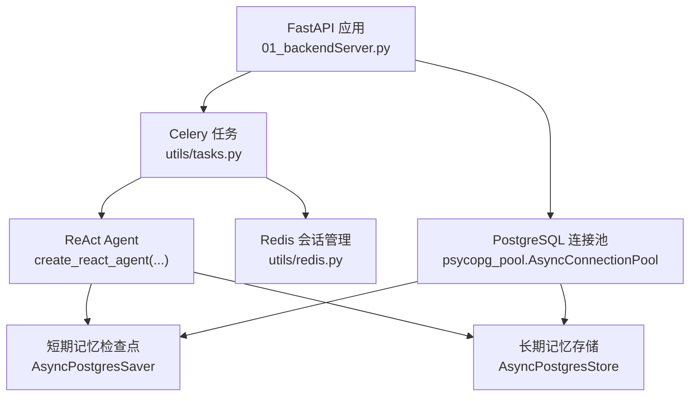
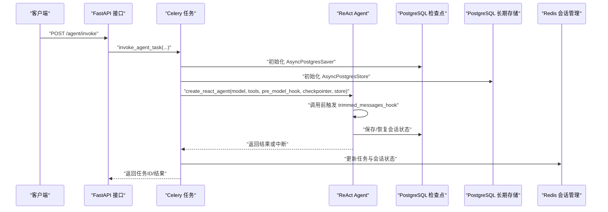
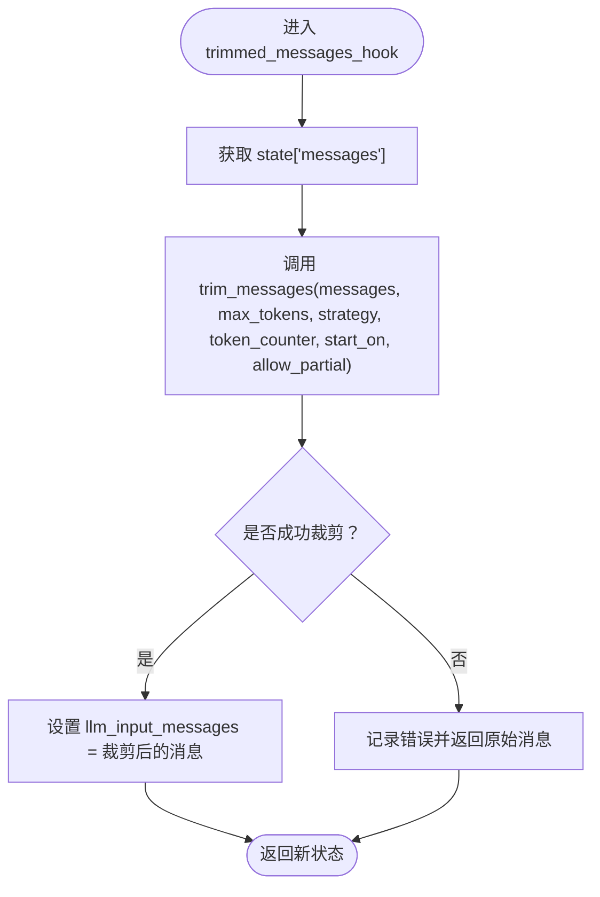
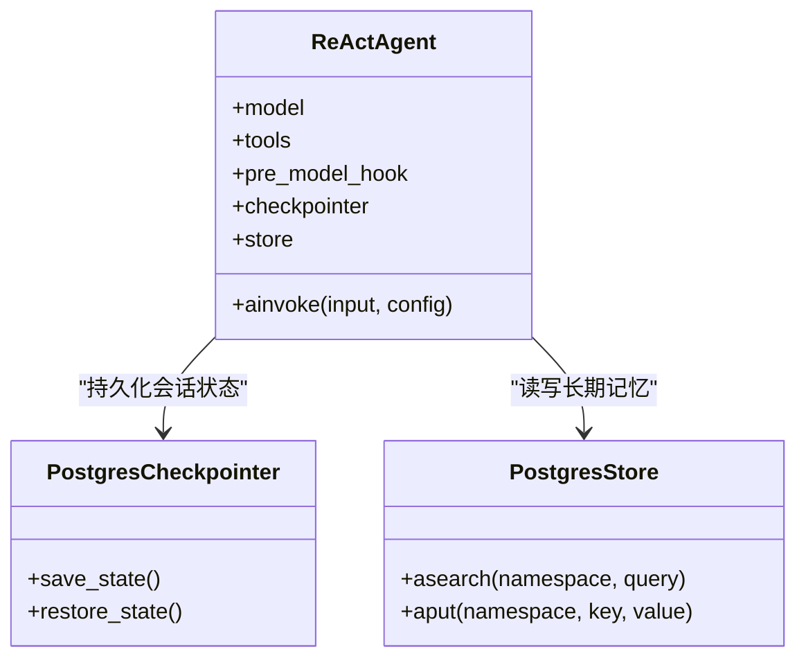
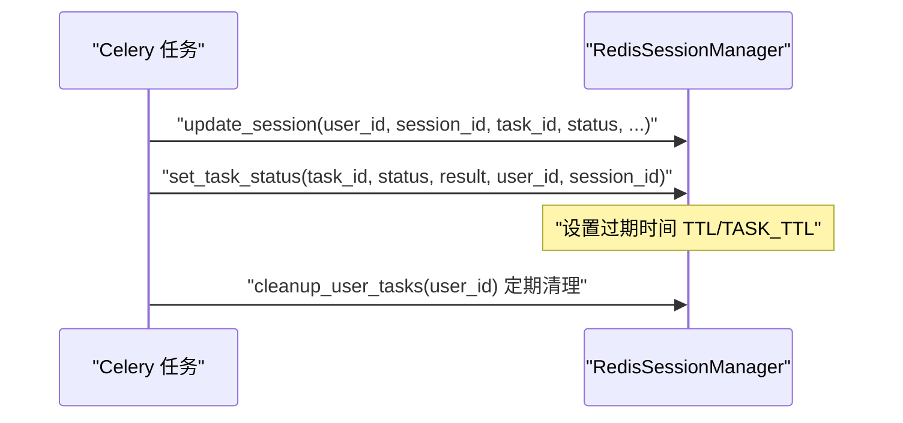
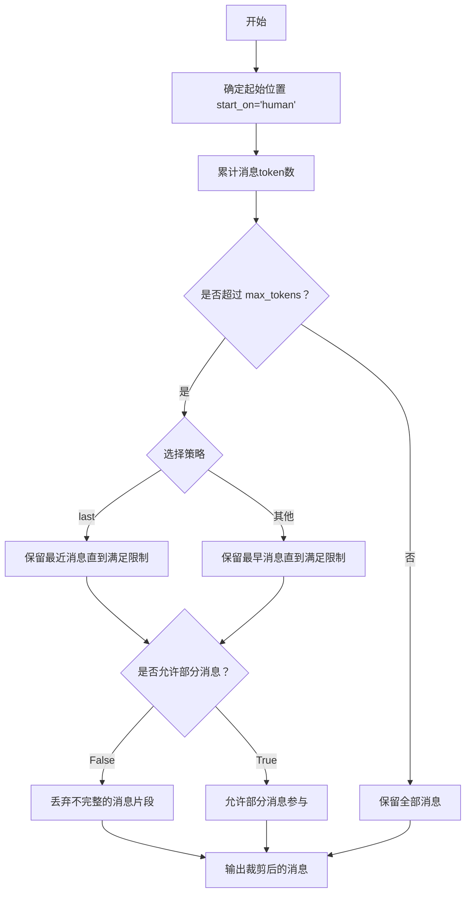
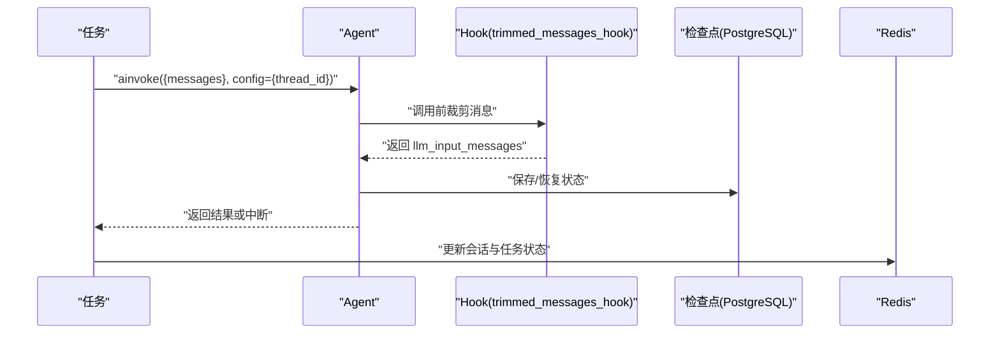
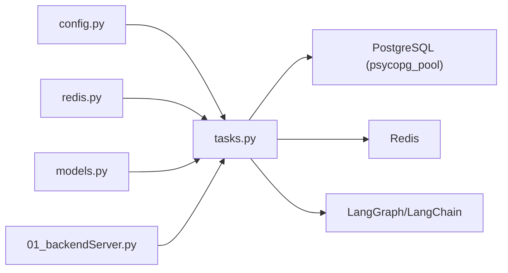

# 短期记忆管理

<cite>
**本文引用的文件**
- [utils/tasks.py](file://utils/tasks.py)
- [01_backendServer.py](file://01_backendServer.py)
- [utils/config.py](file://utils/config.py)
- [utils/redis.py](file://utils/redis.py)
- [docker/postgresql/docker-compose.yml](file://docker/postgresql/docker-compose.yml)
</cite>

## 目录
1. [简介](#简介)
2. [项目结构](#项目结构)
3. [核心组件](#核心组件)
4. [架构总览](#架构总览)
5. [详细组件分析](#详细组件分析)
6. [依赖关系分析](#依赖关系分析)
7. [性能考虑](#性能考虑)
8. [故障排查指南](#故障排查指南)
9. [结论](#结论)
10. [附录：API与配置参考](#附录api与配置参考)

## 简介
本技术文档聚焦于“基于PostgreSQL的短期记忆管理”在ReAct Agent中的实现机制，涵盖消息修剪策略（trimmed_messages_hook）、上下文长度限制、历史消息管理等核心能力；解释trim_messages函数的使用方法与参数配置（max_tokens、strategy、token_counter、start_on、allow_partial）；说明短期记忆在ReAct Agent中的作用与工作流（消息状态管理、检查点checkpointer、会话状态持久化）；并给出消息修剪算法的实现原理、API接口使用方式以及性能优化建议与最佳实践。目标是帮助开发者高效利用短期记忆功能，提升Agent对话质量与效率。

## 项目结构
本项目采用分层组织：后端服务入口负责应用生命周期与资源初始化；任务调度层封装Celery异步任务；工具与模型定义位于utils目录；数据库与缓存通过Docker编排提供。短期记忆的核心逻辑集中在任务层（修剪钩子、Agent创建、检查点与存储），并通过配置集中管理连接池与超时等参数。

图表来源
- [01_backendServer.py:84-123](file://01_backendServer.py#L84-L123)
- [utils/tasks.py:318-451](file://utils/tasks.py#L318-L451)
- [utils/tasks.py:454-559](file://utils/tasks.py#L454-L559)
- [utils/config.py:13-26](file://utils/config.py#L13-L26)

章节来源
- [01_backendServer.py:84-123](file://01_backendServer.py#L84-L123)
- [utils/tasks.py:318-451](file://utils/tasks.py#L318-L451)
- [utils/config.py:13-26](file://utils/config.py#L13-L26)

## 核心组件
- 消息修剪钩子 trimmed_messages_hook：在模型调用前对历史消息进行裁剪，确保输入上下文不超过限制。
- trim_messages 函数：来自LangChain Core，支持按token数量或消息条数裁剪，并提供多种策略与起始位置控制。
- ReAct Agent 构建：通过 create_react_agent 装配模型、工具、pre_model_hook、checkpointer 与 store。
- PostgreSQL 检查点与存储：使用 AsyncPostgresSaver 作为短期记忆的检查点（会话状态持久化），使用 AsyncPostgresStore 作为长期记忆存储。
- Redis 会话管理：维护用户会话、任务状态与过期清理，支撑客户端与服务端故障恢复。
- 配置中心：统一数据库连接池大小、TTL、代理URL等关键参数。

章节来源
- [utils/tasks.py:67-85](file://utils/tasks.py#L67-L85)
- [utils/tasks.py:351-374](file://utils/tasks.py#L351-L374)
- [utils/tasks.py:476-499](file://utils/tasks.py#L476-L499)
- [01_backendServer.py:94-110](file://01_backendServer.py#L94-L110)
- [utils/config.py:13-26](file://utils/config.py#L13-L26)

## 架构总览
短期记忆在ReAct Agent中的工作流如下：
- 前端或外部系统通过FastAPI接口提交请求，进入Celery异步任务。
- 任务内建立PostgreSQL连接池，初始化检查点（短期记忆）与存储（长期记忆）。
- 构建ReAct Agent，注入 pre_model_hook=trimmed_messages_hook，使每次模型调用前自动裁剪历史消息。
- Agent执行过程中，检查点将节点状态与消息序列持久化到PostgreSQL，支持中断恢复与多轮对话。
- 同时，Redis用于会话与任务状态管理，提供快速查询与过期清理。

图表来源
- [01_backendServer.py:84-123](file://01_backendServer.py#L84-L123)
- [utils/tasks.py:318-451](file://utils/tasks.py#L318-L451)
- [utils/tasks.py:454-559](file://utils/tasks.py#L454-L559)

## 详细组件分析

### 消息修剪钩子与 trim_messages 用法
- trimmed_messages_hook(state)：从state中取出messages，调用trim_messages进行裁剪，并将结果以键"llm_input_messages"回写，供后续模型调用使用。
- trim_messages 参数说明（结合当前实现）：
  - messages：待裁剪的消息列表。
  - max_tokens：最大token数量限制（当前示例为20，实际应依据模型上下文窗口调整）。
  - strategy：裁剪策略，当前使用"last"表示保留最近的消息。
  - token_counter：token计数函数，当前使用len作为占位计数（生产环境建议使用真实token计数器）。
  - start_on：起始消息类型，当前设置为"human"，表示从人类消息开始裁剪，避免截断AI或工具消息导致语义不完整。
  - allow_partial：是否允许部分消息被裁剪，当前为False，保证消息完整性。

图表来源
- [utils/tasks.py:67-85](file://utils/tasks.py#L67-L85)

章节来源
- [utils/tasks.py:67-85](file://utils/tasks.py#L67-L85)

### ReAct Agent 中的短期记忆与检查点
- 检查点（checkpointer）：使用 AsyncPostgresSaver 将Agent节点状态与消息序列持久化到PostgreSQL，支持中断后恢复与多轮对话。
- 长期记忆（store）：使用 AsyncPostgresStore 存储用户偏好等长期信息，并在系统提示词中动态拼接。
- Agent构建：create_react_agent 接收 model、tools、pre_model_hook、checkpointer、store，形成完整的推理与记忆闭环。

图表来源
- [utils/tasks.py:351-374](file://utils/tasks.py#L351-L374)
- [utils/tasks.py:476-499](file://utils/tasks.py#L476-L499)
- [01_backendServer.py:94-110](file://01_backendServer.py#L94-L110)

章节来源
- [utils/tasks.py:351-374](file://utils/tasks.py#L351-L374)
- [utils/tasks.py:476-499](file://utils/tasks.py#L476-L499)
- [01_backendServer.py:94-110](file://01_backendServer.py#L94-L110)

### 会话状态管理与Redis持久化
- RedisSessionManager 提供会话创建、更新、查询、清理等功能，支持多用户多会话与任务映射。
- 任务完成后，通过 set_task_status 将任务状态与结果绑定到用户和会话，并设置过期时间，便于故障恢复与资源回收。
- 清理机制会定期扫描无效任务并从集合中移除，保持数据一致性。

图表来源
- [utils/redis.py:65-103](file://utils/redis.py#L65-L103)
- [utils/redis.py:392-415](file://utils/redis.py#L392-L415)
- [utils/redis.py:246-341](file://utils/redis.py#L246-L341)

章节来源
- [utils/redis.py:65-103](file://utils/redis.py#L65-L103)
- [utils/redis.py:392-415](file://utils/redis.py#L392-L415)
- [utils/redis.py:246-341](file://utils/redis.py#L246-L341)

### 消息修剪算法实现原理
- 基于 start_on="human" 的裁剪：从人类消息开始保留，避免截断AI或工具消息造成上下文不完整。
- 基于 max_tokens 的限制：当消息总token超过阈值时，按策略删除最早或最晚的消息，当前使用"last"策略保留最近消息。
- allow_partial=False：禁止部分消息被裁剪，确保每条消息完整参与上下文。
- token_counter=len：当前使用简单长度计数，生产环境建议替换为真实token计数器以获得更精确的上下文控制。

图表来源
- [utils/tasks.py:67-85](file://utils/tasks.py#L67-L85)

章节来源
- [utils/tasks.py:67-85](file://utils/tasks.py#L67-L85)

### 短期记忆在ReAct Agent中的作用与工作流
- 作用：在每次模型调用前，通过 pre_model_hook 裁剪历史消息，控制上下文长度，避免超出模型限制；同时借助检查点持久化会话状态，支持中断恢复。
- 工作流：
  - 构造初始消息体（system + user）。
  - 调用 agent.ainvoke，内部触发 trimmed_messages_hook 进行裁剪。
  - 检查点保存节点状态与消息序列，支持 resume 恢复。
  - 处理结果（完成或中断），更新Redis会话与任务状态。

图表来源
- [utils/tasks.py:387-418](file://utils/tasks.py#L387-L418)
- [utils/tasks.py:454-559](file://utils/tasks.py#L454-L559)

章节来源
- [utils/tasks.py:387-418](file://utils/tasks.py#L387-L418)
- [utils/tasks.py:454-559](file://utils/tasks.py#L454-L559)

## 依赖关系分析
- 模块耦合：
  - tasks.py 依赖 config.py（连接池、TTL等）、redis.py（会话管理）、models.py（响应模型）。
  - backendServer.py 负责应用生命周期，初始化连接池、检查点与存储，并暴露API。
- 外部依赖：
  - PostgreSQL：通过 psycopg_pool.AsyncConnectionPool 管理连接池，支持高并发与持久化。
  - Redis：用于会话与任务状态管理，支持过期清理与快速查询。
  - LangGraph/LangChain：提供ReAct Agent、检查点、消息修剪等能力。

图表来源
- [utils/config.py:13-26](file://utils/config.py#L13-L26)
- [utils/tasks.py:318-451](file://utils/tasks.py#L318-L451)
- [01_backendServer.py:84-123](file://01_backendServer.py#L84-L123)

章节来源
- [utils/config.py:13-26](file://utils/config.py#L13-L26)
- [utils/tasks.py:318-451](file://utils/tasks.py#L318-L451)
- [01_backendServer.py:84-123](file://01_backendServer.py#L84-L123)

## 性能考虑
- 连接池配置：
  - 根据负载调整 min_size 与 max_size，避免连接不足或过多导致资源竞争。
  - 使用 autocommit=True 与 prepare_threshold=0 减少事务开销与预编译成本。
- 修剪策略优化：
  - 将 token_counter 替换为真实token计数器，提高上下文控制的准确性。
  - 根据业务场景选择合适的 strategy（如"last"保留最近对话，"first"保留早期背景）。
- 内存管理：
  - 合理设置 Redis TTL 与 TASK_TTL，及时清理过期会话与任务，降低内存占用。
  - 定期执行 cleanup_user_tasks 与 cleanup_all_tasks，防止脏数据累积。
- 数据库调优：
  - 调整PostgreSQL max_connections 以适应并发需求。
  - 监控慢查询与索引使用情况，优化检查点与存储的读写性能。

[本节为通用性能指导，无需特定文件引用]

## 故障排查指南
- 检查点初始化失败：
  - 确认PostgreSQL连接字符串与权限正确，连接池已打开。
  - 查看日志中关于检查点初始化的错误信息。
- 消息修剪异常：
  - 检查 trim_messages 参数是否正确，尤其是 start_on 与 allow_partial。
  - 若出现上下文不完整，尝试调整 strategy 或启用 allow_partial。
- Redis会话丢失：
  - 检查TTL设置是否过短，导致会话提前过期。
  - 确认清理任务是否误删有效会话。
- 任务状态不一致：
  - 核对 set_task_status 与 update_session 的调用时机与参数。
  - 检查任务映射集合与任务状态键的一致性。

章节来源
- [01_backendServer.py:84-123](file://01_backendServer.py#L84-L123)
- [utils/tasks.py:67-85](file://utils/tasks.py#L67-L85)
- [utils/redis.py:246-341](file://utils/redis.py#L246-L341)
- [utils/redis.py:392-415](file://utils/redis.py#L392-L415)

## 结论
本项目通过 trimmed_messages_hook 与 trim_messages 实现了高效的短期记忆管理，结合PostgreSQL检查点与Redis会话管理，构建了稳定可靠的ReAct Agent工作流。开发者可根据业务需求调整修剪策略、上下文长度与持久化策略，以提升对话质量与系统性能。建议在生产环境中引入真实token计数器、优化连接池与清理策略，并持续监控数据库与缓存的性能指标。

[本节为总结性内容，无需特定文件引用]

## 附录：API与配置参考
- 消息修剪钩子：
  - 路径：utils/tasks.py 中的 trimmed_messages_hook 与 trim_messages 调用。
  - 关键参数：max_tokens、strategy、token_counter、start_on、allow_partial。
- 检查点与存储：
  - 路径：utils/tasks.py 与 01_backendServer.py 中的 AsyncPostgresSaver 与 AsyncPostgresStore 初始化。
- 会话管理：
  - 路径：utils/redis.py 中的 RedisSessionManager 方法（create_session、update_session、set_task_status 等）。
- 配置项：
  - 路径：utils/config.py 中的 DB_URI、MIN_SIZE、MAX_SIZE、TTL、TASK_TTL、CELERY_BROKER_URL 等。
- 数据库编排：
  - 路径：docker/postgresql/docker-compose.yml 中的PostgreSQL服务配置与max_connections设置。

章节来源
- [utils/tasks.py:67-85](file://utils/tasks.py#L67-L85)
- [utils/tasks.py:351-374](file://utils/tasks.py#L351-L374)
- [utils/redis.py:65-103](file://utils/redis.py#L65-L103)
- [utils/config.py:13-26](file://utils/config.py#L13-L26)
- [docker/postgresql/docker-compose.yml:1-25](file://docker/postgresql/docker-compose.yml#L1-L25)