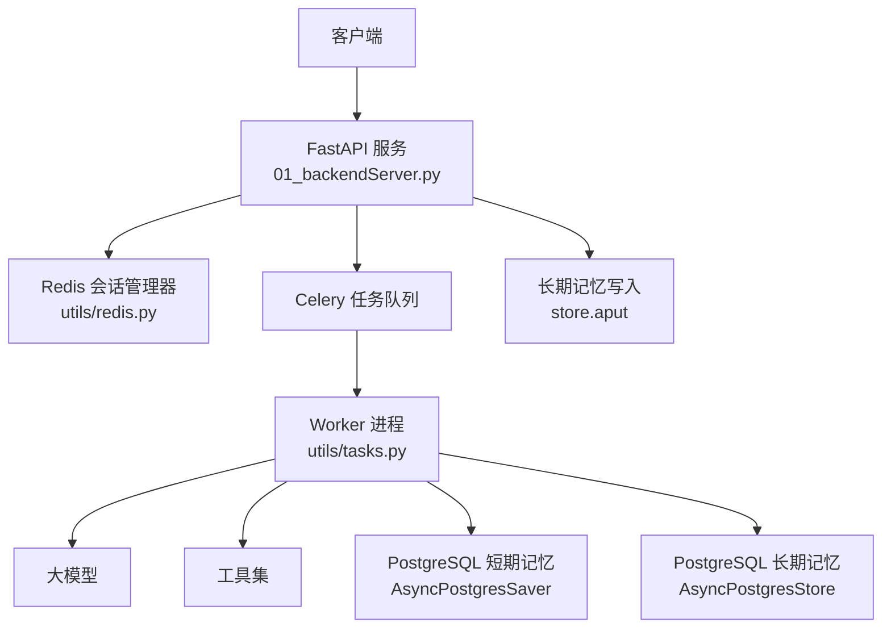
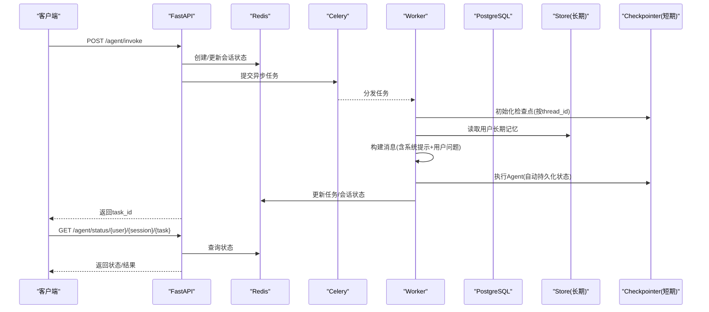
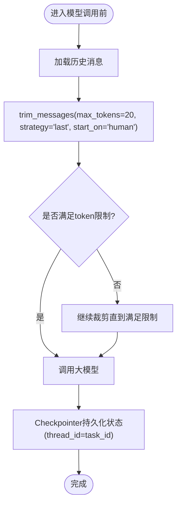
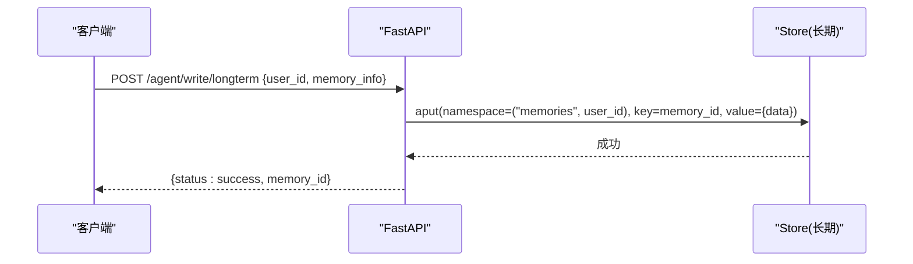
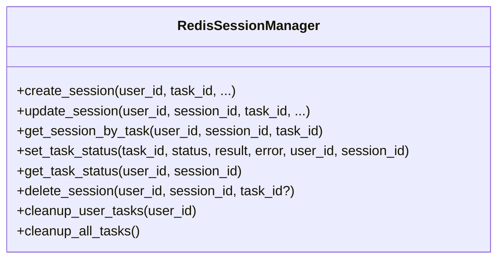
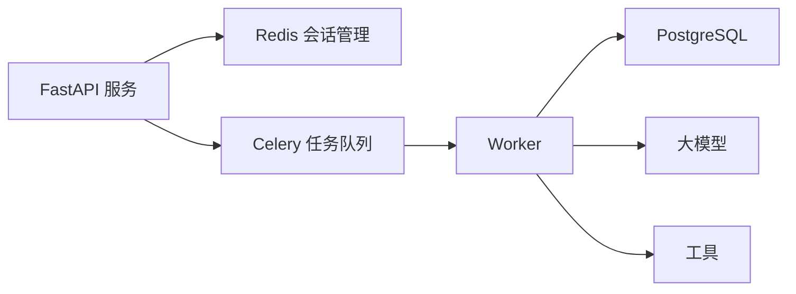

# 记忆系统

<cite>
**本文引用的文件**
- [01_backendServer.py](file://01_backendServer.py)
- [utils/tasks.py](file://utils/tasks.py)
- [utils/redis.py](file://utils/redis.py)
- [utils/config.py](file://utils/config.py)
- [utils/models.py](file://utils/models.py)
</cite>

## 目录
1. [简介](#简介)
2. [项目结构](#项目结构)
3. [核心组件](#核心组件)
4. [架构总览](#架构总览)
5. [详细组件分析](#详细组件分析)
6. [依赖关系分析](#依赖关系分析)
7. [性能与优化](#性能与优化)
8. [故障排查指南](#故障排查指南)
9. [结论](#结论)
10. [附录：API与配置](#附录api与配置)

## 简介
本技术文档围绕“记忆系统”展开，聚焦短期记忆与长期记忆的设计理念、实现机制与使用方法。短期记忆通过 LangGraph 的 Checkpointer 基于 PostgreSQL 持久化会话状态（线程级上下文），并配合消息修剪策略控制上下文长度；长期记忆通过 LangGraph Store 基于 PostgreSQL 存储用户偏好、个性化信息等结构化数据。系统还使用 Redis 管理会话与任务状态、提供多用户多会话的在线状态与恢复能力。

## 项目结构
- 后端服务入口与 API：FastAPI 应用，负责请求路由、资源初始化、调用异步任务、读写长期记忆等。
- 异步任务与 Agent 执行：Celery Worker 执行智能体运行，集成短期记忆（Checkpointer）和长期记忆（Store）。
- 会话与任务状态：Redis 作为内存键值存储，维护会话生命周期、任务状态、过期清理等。
- 配置与模型：统一配置项、Pydantic 数据模型用于接口校验与响应结构。

图表来源
- [01_backendServer.py:84-130](file://01_backendServer.py#L84-L130)
- [utils/tasks.py:319-451](file://utils/tasks.py#L319-L451)
- [utils/redis.py:37-103](file://utils/redis.py#L37-L103)

章节来源
- [01_backendServer.py:84-130](file://01_backendServer.py#L84-L130)
- [utils/tasks.py:319-451](file://utils/tasks.py#L319-L451)
- [utils/redis.py:37-103](file://utils/redis.py#L37-L103)

## 核心组件
- 短期记忆（Short-term Memory）
  - 基于 LangGraph 的 AsyncPostgresSaver，按 thread_id（task_id）持久化对话状态，支持中断/恢复。
  - 通过 pre_model_hook 对历史消息进行修剪，限制上下文 token 数量，避免超出模型窗口。
- 长期记忆（Long-term Memory）
  - 基于 LangGraph 的 AsyncPostgresStore，以命名空间 + key-value 形式存储用户偏好、个性化信息。
  - 在 Agent 运行时读取并注入到系统提示词中，增强个性化回答。
- 会话与任务状态（Redis）
  - 维护 user->session->task 的多维关系，记录状态、最近查询、最近响应、更新时间等。
  - 提供过期清理、活跃会话查找、任务状态聚合等能力。
- 配置与模型
  - 统一配置数据库连接池、Redis 参数、TTL、LLM 类型等。
  - Pydantic 模型定义请求/响应结构，保证接口契约稳定。

章节来源
- [utils/config.py:1-34](file://utils/config.py#L1-L34)
- [utils/models.py:1-97](file://utils/models.py#L1-L97)
- [utils/tasks.py:66-134](file://utils/tasks.py#L66-L134)
- [01_backendServer.py:43-80](file://01_backendServer.py#L43-L80)

## 架构总览
记忆系统由三层构成：
- 短期记忆层：LangGraph Checkpointer（PostgreSQL）+ 消息修剪钩子，确保对话上下文可控且可恢复。
- 长期记忆层：LangGraph Store（PostgreSQL）+ 命名空间隔离，持久化用户偏好与个性化信息。
- 会话管理层：Redis 维护在线会话、任务状态与过期清理，支撑多用户并发与故障恢复。

图表来源
- [01_backendServer.py:132-173](file://01_backendServer.py#L132-L173)
- [utils/tasks.py:319-451](file://utils/tasks.py#L319-L451)
- [utils/redis.py:65-144](file://utils/redis.py#L65-L144)

## 详细组件分析

### 短期记忆：PostgreSQL 持久化与消息修剪
- 设计要点
  - 每个任务对应一个 thread_id（即 task_id），Checkpointer 将对话状态（消息、工具调用、中间态）持久化到 PostgreSQL，支持中断后恢复。
  - 通过 pre_model_hook 在每次模型调用前对历史消息进行修剪，限制最大 token 数，采用“保留最新”的策略，从 human 消息开始计数，避免截断不完整片段。
- 关键流程
  - 任务执行时初始化 AsyncPostgresSaver，并在 create_react_agent 中注入 checkpointer。
  - 调用 agent.ainvoke 时，内部会按 thread_id 加载/保存状态。
  - 修剪钩子 trim_messages 根据 max_tokens、strategy、start_on 等参数裁剪消息列表。
- 复杂度与影响
  - 修剪时间复杂度近似 O(n)，n 为当前消息条数；max_tokens 越小，裁剪越频繁，但可降低上下文成本。
  - 过短的上下文可能丢失必要信息，需结合业务场景调优。

图表来源
- [utils/tasks.py:66-85](file://utils/tasks.py#L66-L85)
- [utils/tasks.py:358-374](file://utils/tasks.py#L358-L374)

章节来源
- [utils/tasks.py:66-85](file://utils/tasks.py#L66-L85)
- [utils/tasks.py:358-374](file://utils/tasks.py#L358-L374)

### 长期记忆：读写与个性化注入
- 写入
  - 通过 FastAPI 接口 /agent/write/longterm，接收 user_id 与 memory_info，生成唯一 memory_id，写入 store 的命名空间 ("memories", user_id)。
  - 写入成功后返回 memory_id，便于后续审计或管理。
- 读取
  - 在 Agent 执行前，按 user_id 命名空间搜索所有记忆条目，拼接成字符串注入系统提示词，使模型具备用户偏好上下文。
  - 若未找到记忆，则保持原系统提示词。
- 数据结构
  - 命名空间：("memories", user_id)
  - Key：memory_id（UUID）
  - Value：{"data": memory_info}
- 注意事项
  - 写入前建议校验用户是否存在（通过 Redis 会话存在性判断）。
  - 读取时注意空结果处理，避免空字符串污染提示词。

图表来源
- [01_backendServer.py:43-80](file://01_backendServer.py#L43-L80)
- [01_backendServer.py:346-374](file://01_backendServer.py#L346-L374)

章节来源
- [01_backendServer.py:43-80](file://01_backendServer.py#L43-L80)
- [01_backendServer.py:346-374](file://01_backendServer.py#L346-L374)
- [utils/tasks.py:87-134](file://utils/tasks.py#L87-L134)

### 会话与任务状态：Redis 管理与清理
- 数据结构
  - session:{user_id}:{session_id}:{task_id} -> JSON（包含 status、last_query、last_response、last_updated 等）
  - user_sessions:{user_id} -> Set(session_id:task_id)
  - task_mapping:{user_id}:{session_id} -> Set(task_id)
  - task:{task_id} -> JSON（任务状态、结果、错误、绑定用户与会话）
- 功能
  - 创建/更新/删除会话与任务
  - 获取用户活跃会话、会话任务列表、任务状态聚合
  - 定期清理无效任务（会话过期或映射不一致）
- 过期策略
  - 会话 TTL 默认来自 Config.SESSION_TIMEOUT，也可在创建/更新时指定自定义 TTL。
  - 任务状态 TTL 来自 Config.TASK_TTL。
  - 清理逻辑在查询前主动执行，确保返回一致视图。

图表来源
- [utils/redis.py:37-103](file://utils/redis.py#L37-L103)
- [utils/redis.py:105-144](file://utils/redis.py#L105-L144)
- [utils/redis.py:392-442](file://utils/redis.py#L392-L442)
- [utils/redis.py:444-476](file://utils/redis.py#L444-L476)
- [utils/redis.py:246-341](file://utils/redis.py#L246-L341)

章节来源
- [utils/redis.py:37-103](file://utils/redis.py#L37-L103)
- [utils/redis.py:105-144](file://utils/redis.py#L105-L144)
- [utils/redis.py:246-341](file://utils/redis.py#L246-L341)
- [utils/redis.py:392-442](file://utils/redis.py#L392-L442)
- [utils/redis.py:444-476](file://utils/redis.py#L444-L476)

### 生命周期与清理策略
- 会话生命周期
  - 创建：首次调用 /agent/invoke 时，若不存在则创建会话，设置初始状态 idle，并绑定 task_id。
  - 运行：任务执行期间更新状态 running，记录 last_query 与 last_updated。
  - 完成/失败：任务完成后更新状态 completed/failed，并写入 last_response 或错误信息。
  - 过期：会话与任务均设置 TTL，超时后自动失效；查询前触发清理，移除孤立条目。
- 清理策略
  - 单用户清理：cleanup_user_tasks 扫描 user_sessions 与 task_mapping，删除不存在的会话与任务。
  - 全局清理：cleanup_all_tasks 遍历所有用户，做一致性修复。
  - 日志记录：关键清理操作均有日志输出，便于审计与排障。

章节来源
- [utils/redis.py:246-341](file://utils/redis.py#L246-L341)
- [utils/redis.py:146-165](file://utils/redis.py#L146-L165)
- [01_backendServer.py:132-173](file://01_backendServer.py#L132-L173)

## 依赖关系分析
- FastAPI 服务依赖：
  - Redis 会话管理器：维护会话与任务状态。
  - Celery：异步任务调度。
  - PostgreSQL：短期记忆（Checkpointer）与长期记忆（Store）。
- Worker 依赖：
  - LangGraph：ReAct Agent、Checkpointer、Store。
  - LLM 与 Tools：实际推理与工具调用。
- 配置依赖：
  - DB_URI、连接池大小、Redis 地址、TTL、LLM 类型等。

图表来源
- [01_backendServer.py:84-130](file://01_backendServer.py#L84-L130)
- [utils/tasks.py:43-63](file://utils/tasks.py#L43-L63)
- [utils/config.py:13-34](file://utils/config.py#L13-L34)

章节来源
- [utils/config.py:13-34](file://utils/config.py#L13-L34)
- [utils/tasks.py:43-63](file://utils/tasks.py#L43-L63)
- [01_backendServer.py:84-130](file://01_backendServer.py#L84-L130)

## 性能与优化
- 短期记忆
  - 调整修剪策略：适当增大 max_tokens 可减少裁剪频率，提升上下文完整性；过小会增加裁剪开销并可能丢失信息。
  - 控制消息数量：减少历史消息条数有助于降低 Token 消耗与延迟。
- 长期记忆
  - 命名空间隔离：按 user_id 划分，避免跨用户干扰。
  - 写入批量：如需大量写入，考虑批处理以减少网络往返。
- Redis
  - TTL 合理设置：避免过早过期导致状态丢失，或过长占用内存。
  - 清理频率：在高并发下，查询前清理可保证一致性，但需评估扫描成本。
- PostgreSQL
  - 连接池：min_size/max_size 根据负载调优，避免连接耗尽或空闲浪费。
  - 索引与表结构：建议为常用查询字段建立索引（如 thread_id、namespace、key）。

[本节为通用性能建议，不直接分析具体代码文件]

## 故障排查指南
- 常见问题
  - 会话不存在：检查 Redis 中 user_sessions 与 task_mapping 是否一致，必要时执行清理。
  - 任务状态异常：查看任务状态键 task:{task_id} 是否存在，确认 TTL 是否过期。
  - 长期记忆写入失败：确认用户是否存在（Redis 中存在会话），以及 Store 连接是否正常。
  - 短期记忆恢复失败：确认 Checkpointer 是否正确初始化，thread_id 是否与 task_id 一致。
- 日志定位
  - 服务日志：FastAPI 与 Worker 均输出关键步骤日志，包括创建/更新/删除会话、任务状态变更、记忆读写等。
  - 清理日志：清理无效任务时会记录详细信息，便于定位数据不一致问题。

章节来源
- [utils/redis.py:246-341](file://utils/redis.py#L246-L341)
- [01_backendServer.py:132-173](file://01_backendServer.py#L132-L173)
- [utils/tasks.py:319-451](file://utils/tasks.py#L319-L451)

## 结论
该记忆系统通过短期记忆（PostgreSQL Checkpointer）与长期记忆（PostgreSQL Store）的结合，实现了对话状态的持久化与用户偏好的个性化注入；借助 Redis 的会话与任务状态管理，提供了高可用的多用户并发支持与故障恢复能力。开发者可通过调整修剪策略、TTL、连接池等参数，平衡性能与体验，并通过 API 安全地读写长期记忆，提升 Agent 的智能水平与服务稳定性。

[本节为总结性内容，不直接分析具体代码文件]

## 附录：API与配置

### API 接口
- 异步运行智能体
  - 方法：POST
  - 路径：/agent/invoke
  - 请求体：{user_id, session_id, task_id, query, system_message?}
  - 响应：{user_id, session_id, task_id}
  - 说明：立即返回 task_id，实际执行在 Worker 中异步完成。
- 恢复被中断的智能体
  - 方法：POST
  - 路径：/agent/resume
  - 请求体：{user_id, session_id, task_id, response_type, args?}
  - 响应：{user_id, session_id, task_id}
  - 说明：仅当会话状态为 interrupted 时可恢复。
- 写入长期记忆
  - 方法：POST
  - 路径：/agent/write/longterm
  - 请求体：{user_id, memory_info}
  - 响应：{status, memory_id, message}
  - 说明：写入前校验用户是否存在。
- 查询系统信息
  - 方法：GET
  - 路径：/system/info
  - 响应：{sessions_count, active_users}
- 查询用户活跃会话
  - 方法：GET
  - 路径：/agent/active/sessionid/{user_id}
  - 响应：{active_session_id}
- 查询用户所有会话
  - 方法：GET
  - 路径：/agent/sessionids/{user_id}
  - 响应：{session_ids}
- 查询会话任务列表
  - 方法：GET
  - 路径：/agent/tasks/{user_id}/{session_id}
  - 响应：{task_ids}
- 查询会话与任务状态
  - 方法：GET
  - 路径：/agent/status/{user_id}/{session_id}/{task_id}
  - 响应：{user_id, session_id, task_id, status, last_query, last_updated, last_response}
- 删除会话
  - 方法：DELETE
  - 路径：/agent/session/{user_id}/{session_id}
  - 响应：{status, message}
- 删除任务
  - 方法：DELETE
  - 路径：/agent/task/{user_id}/{session_id}/{task_id}
  - 响应：{status, message}

章节来源
- [01_backendServer.py:132-173](file://01_backendServer.py#L132-L173)
- [01_backendServer.py:175-237](file://01_backendServer.py#L175-L237)
- [01_backendServer.py:239-313](file://01_backendServer.py#L239-L313)
- [01_backendServer.py:315-344](file://01_backendServer.py#L315-L344)
- [01_backendServer.py:346-374](file://01_backendServer.py#L346-L374)
- [01_backendServer.py:376-414](file://01_backendServer.py#L376-L414)

### 配置选项
- 数据库
  - DB_URI：PostgreSQL 连接串
  - MIN_SIZE/MAX_SIZE：连接池最小/最大连接数
- Redis
  - REDIS_HOST/REDIS_PORT/REDIS_DB：连接参数
  - SESSION_TIMEOUT：会话默认过期时间（秒）
  - TTL：会话/任务默认 TTL（秒）
  - CELERY_BROKER_URL：Celery 消息代理地址
  - TASK_TTL：任务状态默认过期时间（秒）
- 其他
  - LLM_TYPE：大模型类型（openai/qwen/oneapi/ollama）
  - HOST/PORT：API 服务监听地址与端口
  - LOG_FILE/MAX_BYTES/BACKUP_COUNT：日志轮转配置

章节来源
- [utils/config.py:1-34](file://utils/config.py#L1-L34)

### 数据迁移与备份恢复
- 短期记忆（Checkpointer）
  - 数据位置：PostgreSQL 中由 LangGraph 管理的表（通常包含 thread_id、checkpoint、metadata 等）。
  - 备份：使用 pg_dump/pg_restore 或云厂商提供的备份工具导出相关表。
  - 恢复：导入备份至新实例，确保连接池与权限正确。
- 长期记忆（Store）
  - 数据位置：PostgreSQL 中由 LangGraph Store 管理的表（通常包含 namespace、key、value、metadata 等）。
  - 备份：同上，导出相关表。
  - 恢复：导入后验证命名空间与 key 的一致性。
- 会话与任务状态（Redis）
  - 备份：可使用 redis-cli 的 BGSAVE/RDB 快照或 AOF 日志。
  - 恢复：替换 dump.rdb 或重放 AOF，重启 Redis。
- 注意事项
  - 迁移前后核对 thread_id、namespace、key 的一致性。
  - 建议在低峰期执行迁移，避免写入冲突。
  - 迁移后执行健康检查：调用 /system/info 与 /agent/status 验证状态。

[本节为通用指导，不直接分析具体代码文件]