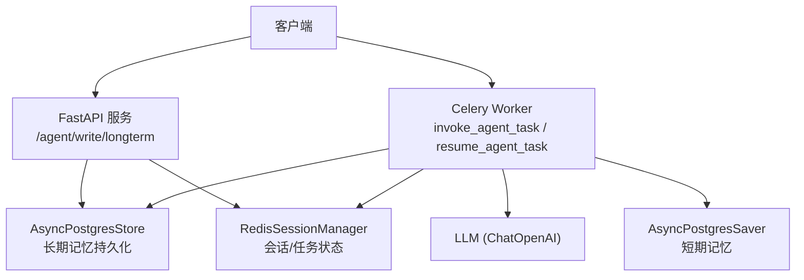
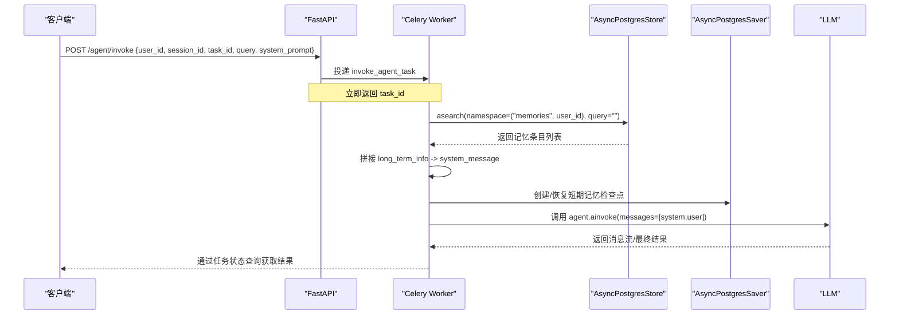
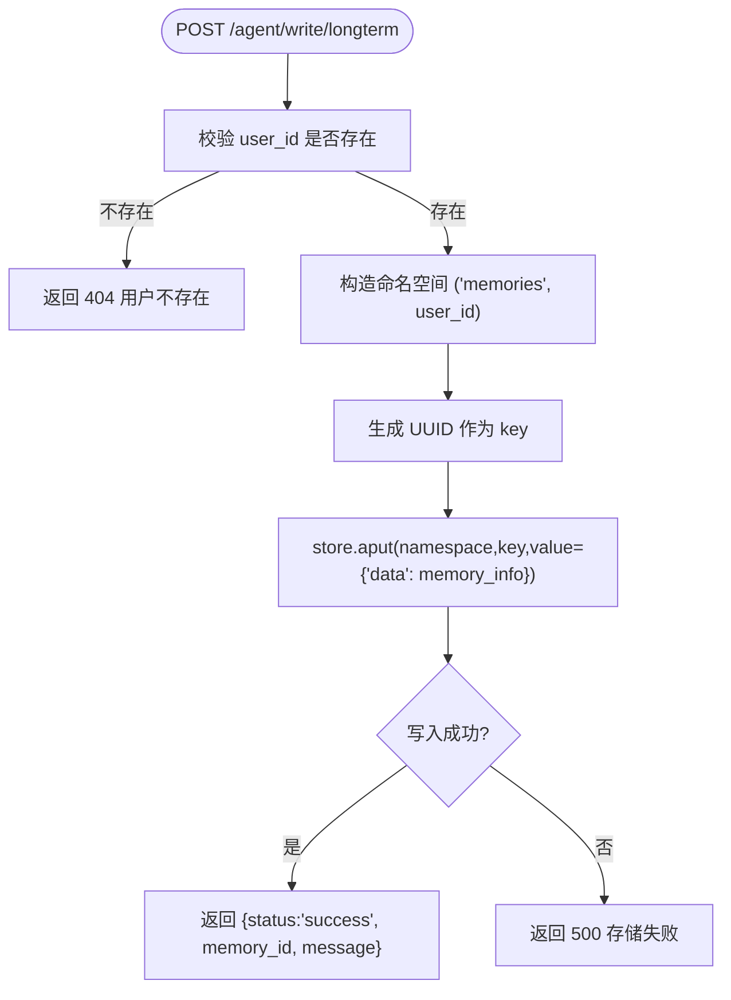
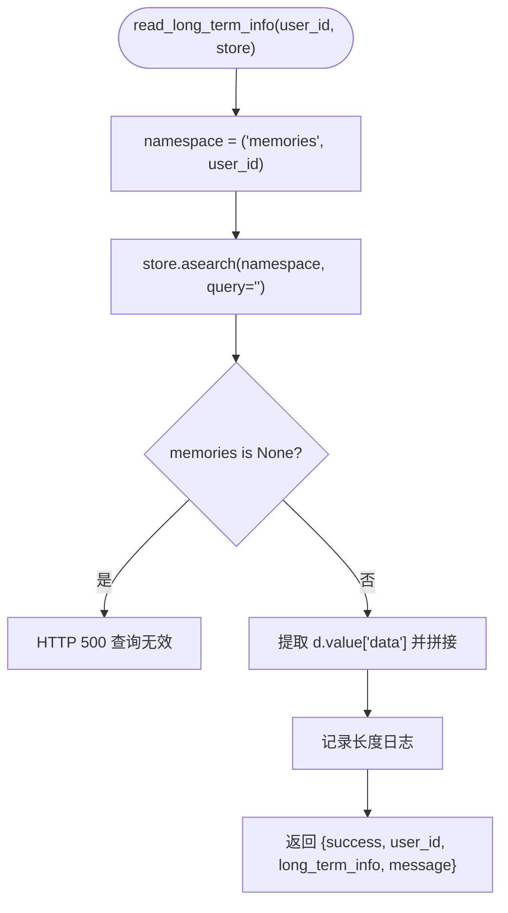
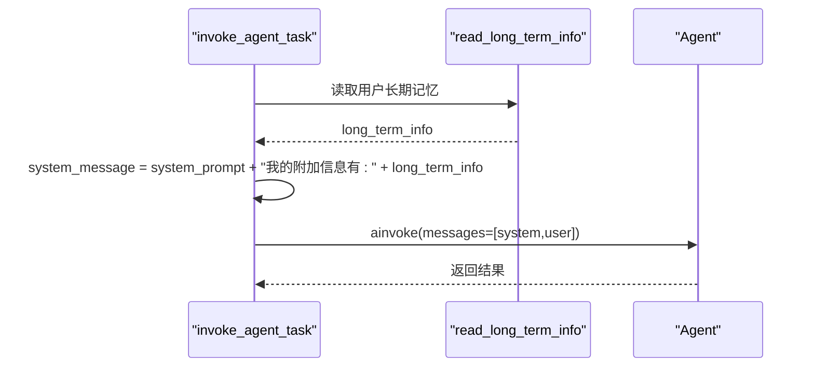
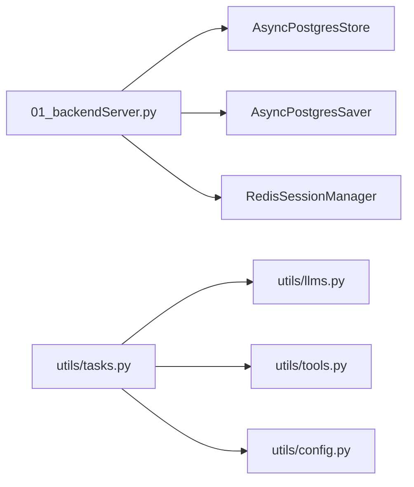

# 长期记忆管理

<cite>
**本文引用的文件**
- [01_backendServer.py](file://01_backendServer.py)
- [utils/tasks.py](file://utils/tasks.py)
- [utils/models.py](file://utils/models.py)
- [utils/config.py](file://utils/config.py)
- [utils/redis.py](file://utils/redis.py)
- [utils/tools.py](file://utils/tools.py)
- [utils/llms.py](file://utils/llms.py)
- [README.md](file://README.md)
</cite>

## 目录
1. [简介](#简介)
2. [项目结构](#项目结构)
3. [核心组件](#核心组件)
4. [架构总览](#架构总览)
5. [详细组件分析](#详细组件分析)
6. [依赖关系分析](#依赖关系分析)
7. [性能考虑](#性能考虑)
8. [故障排查指南](#故障排查指南)
9. [结论](#结论)
10. [附录](#附录)

## 简介
本技术文档聚焦于基于 AsyncPostgresStore 的长期记忆管理机制，覆盖用户偏好设置、个性化信息等数据的存储与检索；详解 read_long_term_info 的工作原理（命名空间设计、查询机制、结果处理）；说明长期记忆如何动态注入到 Agent 的系统提示词中；给出读写操作流程、数据模型与校验规则、生命周期管理（更新、删除、备份恢复）以及 API 接口规范；并提供数据库索引优化、查询缓存等性能调优建议，帮助开发者高效利用长期记忆能力为用户提供个性化的智能服务体验。

## 项目结构
- 后端服务入口：FastAPI 应用初始化、资源生命周期管理、长期记忆写入 API
- 任务执行：Celery 异步任务，构建 ReAct Agent，读取并注入长期记忆
- 数据存储：PostgreSQL（短期记忆 Checkpointer + 长期记忆 Store）、Redis（会话状态与任务状态）
- 工具与模型：工具注册、LLM 初始化
- 配置：统一配置类（DB、Redis、日志、端口等）

图表来源
- [01_backendServer.py:84-130](file://01_backendServer.py#L84-L130)
- [utils/tasks.py:318-451](file://utils/tasks.py#L318-L451)
- [utils/redis.py:37-103](file://utils/redis.py#L37-L103)

章节来源
- [01_backendServer.py:84-130](file://01_backendServer.py#L84-L130)
- [utils/tasks.py:318-451](file://utils/tasks.py#L318-L451)
- [utils/config.py:1-34](file://utils/config.py#L1-L34)

## 核心组件
- 长期记忆写入：通过 FastAPI 接口接收请求，使用 AsyncPostgresStore 将用户偏好等信息以命名空间隔离的方式持久化
- 长期记忆读取：在 Agent 执行前调用 read_long_term_info，按用户维度检索并拼接为系统提示词的附加信息
- 会话与任务状态：Redis 维护多用户多会话的任务状态、最近会话、过期清理等
- 工具与模型：工具列表注册、人工审查（HITL），LLM 初始化与调用
- 配置：集中管理数据库连接池、Redis、日志、端口等

章节来源
- [01_backendServer.py:43-80](file://01_backendServer.py#L43-L80)
- [utils/tasks.py:87-134](file://utils/tasks.py#L87-L134)
- [utils/redis.py:37-103](file://utils/redis.py#L37-L103)
- [utils/tools.py:121-175](file://utils/tools.py#L121-L175)
- [utils/llms.py:70-138](file://utils/llms.py#L70-L138)
- [utils/config.py:1-34](file://utils/config.py#L1-L34)

## 架构总览
长期记忆在系统中的角色是“用户级个性化上下文”。每次 Agent 执行前，会从 Postgres 中长期记忆 Store 中检索该用户的记忆片段，并将其拼接到系统提示词中，从而让 Agent 在推理时具备用户偏好与历史背景。

图表来源
- [01_backendServer.py:132-173](file://01_backendServer.py#L132-L173)
- [utils/tasks.py:318-451](file://utils/tasks.py#L318-L451)
- [utils/tasks.py:87-134](file://utils/tasks.py#L87-L134)

## 详细组件分析

### 长期记忆写入流程（/agent/write/longterm）
- 输入模型：LongMemRequest(user_id, memory_info)
- 命名空间：("memories", user_id)，确保用户间数据隔离
- 存储键：UUID 作为唯一 key，value 为 {"data": memory_info}
- 错误处理：用户不存在或存储异常时返回 HTTP 错误
- 响应：包含 memory_id 和成功消息

图表来源
- [01_backendServer.py:346-374](file://01_backendServer.py#L346-L374)
- [01_backendServer.py:43-80](file://01_backendServer.py#L43-L80)
- [utils/models.py:19-25](file://utils/models.py#L19-L25)

章节来源
- [01_backendServer.py:346-374](file://01_backendServer.py#L346-L374)
- [01_backendServer.py:43-80](file://01_backendServer.py#L43-L80)
- [utils/models.py:19-25](file://utils/models.py#L19-L25)

### 长期记忆读取流程（read_long_term_info）
- 命名空间：("memories", user_id)
- 查询：store.asearch(namespace, query="") 空查询表示返回该命名空间下全部条目
- 结果处理：过滤 value 为 dict 且包含 data 字段的条目，将其 data 值用空格拼接成字符串
- 返回：结构化响应，包含 success、user_id、long_term_info、message
- 错误处理：查询结果为 None 或异常时抛出 HTTP 500

图表来源
- [utils/tasks.py:87-134](file://utils/tasks.py#L87-L134)

章节来源
- [utils/tasks.py:87-134](file://utils/tasks.py#L87-L134)

### 长期记忆与系统提示词集成
- 在 invoke_agent_task 中，先读取长期记忆，若存在则将其拼接到 system_prompt 后，形成新的 system_message
- 构造 messages：[{"role":"system","content":system_message}, {"role":"user","content":query}]
- 调用 agent.ainvoke 传入上述消息，使 Agent 在推理时具备用户长期信息

图表来源
- [utils/tasks.py:318-451](file://utils/tasks.py#L318-L451)
- [utils/tasks.py:87-134](file://utils/tasks.py#L87-L134)

章节来源
- [utils/tasks.py:318-451](file://utils/tasks.py#L318-L451)
- [utils/tasks.py:87-134](file://utils/tasks.py#L87-L134)

### 数据模型与验证规则
- LongMemRequest：user_id（必填）、memory_info（必填）
- AgentRequest：user_id、session_id、task_id、query、system_message（可选，默认提示）
- AgentResponse：session_id、task_id、status、timestamp、message、result、interrupt_data
- InterruptResponse：user_id、session_id、task_id、response_type、args
- SystemInfoResponse、SessionInfoResponse、TaskInfoResponse、ActiveSessionInfoResponse、SessionStatusResponse：用于系统信息与状态查询

这些 Pydantic 模型在服务端进行请求体校验，确保数据结构一致性与完整性。

章节来源
- [utils/models.py:6-97](file://utils/models.py#L6-L97)

### 生命周期管理（更新、删除、备份恢复）
- 更新：通过再次调用 /agent/write/longterm 追加新的记忆条目（当前实现为新增条目而非原地更新）
- 删除：当前代码未提供直接删除单条记忆的 API；如需删除，可在业务层扩展删除接口或使用命名空间级清理策略
- 备份恢复：长期记忆存储在 PostgreSQL 中，可通过数据库层面的备份与恢复机制完成；也可导出 memories 命名空间下的所有条目进行离线归档
- 短期记忆恢复：通过 AsyncPostgresSaver 的 checkpointer 实现节点状态恢复，支持中断后的继续执行

章节来源
- [01_backendServer.py:346-374](file://01_backendServer.py#L346-L374)
- [utils/tasks.py:318-451](file://utils/tasks.py#L318-L451)

### API 接口规范
- 写入长期记忆
  - 方法：POST
  - 路径：/agent/write/longterm
  - 请求体：LongMemRequest
  - 响应：{status, memory_id, message}
- 读取长期记忆
  - 服务端内部函数 read_long_term_info，供 Agent 执行流程调用
- 删除操作
  - 当前未暴露删除单条记忆的 API；可参考会话/任务删除接口模式扩展

章节来源
- [01_backendServer.py:346-374](file://01_backendServer.py#L346-L374)
- [utils/tasks.py:87-134](file://utils/tasks.py#L87-L134)

## 依赖关系分析
- FastAPI 应用依赖：
  - AsyncPostgresStore（长期记忆）
  - AsyncPostgresSaver（短期记忆）
  - RedisSessionManager（会话/任务状态）
  - Celery Worker（异步执行 Agent）
- 任务执行依赖：
  - LLM 初始化（get_llm）
  - 工具注册（get_tools）
  - 配置（Config）

图表来源
- [01_backendServer.py:84-130](file://01_backendServer.py#L84-L130)
- [utils/tasks.py:318-451](file://utils/tasks.py#L318-L451)
- [utils/llms.py:70-138](file://utils/llms.py#L70-L138)
- [utils/tools.py:121-175](file://utils/tools.py#L121-L175)
- [utils/config.py:1-34](file://utils/config.py#L1-L34)

章节来源
- [01_backendServer.py:84-130](file://01_backendServer.py#L84-L130)
- [utils/tasks.py:318-451](file://utils/tasks.py#L318-L451)
- [utils/llms.py:70-138](file://utils/llms.py#L70-L138)
- [utils/tools.py:121-175](file://utils/tools.py#L121-L175)
- [utils/config.py:1-34](file://utils/config.py#L1-L34)

## 性能考虑
- 数据库索引优化
  - 为 AsyncPostgresStore 的 namespace 字段建立索引，加速按用户维度的 asearch 查询
  - 对 key 字段建立唯一索引，避免重复写入与提升查找效率
  - 对 value.data 内容建立全文索引（如 pg_trgm 或向量索引）以支持更复杂的语义搜索
- 查询缓存策略
  - 对 read_long_term_info 的结果进行短时缓存（例如基于 user_id 的内存缓存或 Redis 缓存），减少频繁 DB 查询
  - 缓存失效策略：当同一用户有新写入时主动失效对应缓存
- 连接池与并发
  - 合理调整 psycopg_pool 的 min_size/max_size，匹配并发量
  - 控制 Celery worker 数量，避免过多并发导致数据库压力过大
- 消息修剪
  - 使用 trimmed_messages_hook 限制短期记忆的消息数量，降低上下文长度与 token 消耗
- 日志与监控
  - 使用 ConcurrentRotatingFileHandler 轮转日志，避免磁盘占用过大
  - 监控 asearch 耗时与错误率，及时定位瓶颈

章节来源
- [utils/tasks.py:66-85](file://utils/tasks.py#L66-L85)
- [utils/config.py:13-26](file://utils/config.py#L13-L26)
- [01_backendServer.py:21-40](file://01_backendServer.py#L21-L40)

## 故障排查指南
- 写入长期记忆失败
  - 检查用户是否存在（Redis 中存在 user_sessions:user_id）
  - 检查数据库连接池是否可用（DB_URI、连接数）
  - 查看日志中的异常堆栈，确认 store.aput 是否抛出异常
- 读取长期记忆失败
  - 检查 asearch 返回值是否为 None，可能是存储系统错误
  - 检查命名空间是否正确（memories 与 user_id）
  - 查看日志记录的 long_term_info 长度，确认是否有数据
- 系统提示词未生效
  - 确认 read_long_term_info 返回 success 且 long_term_info 非空
  - 检查 system_message 拼接逻辑，确保格式正确
- 会话/任务状态异常
  - 检查 Redis 连接与 TTL 配置
  - 清理无效任务（cleanup_user_tasks/cleanup_all_tasks）
  - 核对任务状态更新逻辑（set_task_status/update_session）

章节来源
- [01_backendServer.py:346-374](file://01_backendServer.py#L346-L374)
- [utils/tasks.py:87-134](file://utils/tasks.py#L87-L134)
- [utils/redis.py:246-341](file://utils/redis.py#L246-L341)

## 结论
本系统通过 AsyncPostgresStore 实现了用户级的长期记忆管理，结合 Celery 异步任务与 LangGraph 的 ReAct Agent，将用户偏好与个性化信息动态注入到系统提示词中，从而实现更具针对性的智能服务。配合 Redis 的会话与任务状态管理，系统具备良好的可扩展性与容错能力。建议在后续迭代中完善删除 API、引入语义搜索与缓存策略，进一步提升长期记忆的检索效率与用户体验。

## 附录
- 前端交互示例：支持通过命令 “setting” 触发写入长期记忆
- 文档参考：README 中描述了系统功能与测试流程

章节来源
- [02_frontendServer.py:128-156](file://02_frontendServer.py#L128-L156)
- [02_frontendServer.py:818-833](file://02_frontendServer.py#L818-L833)
- [README.md:1-39](file://README.md#L1-L39)