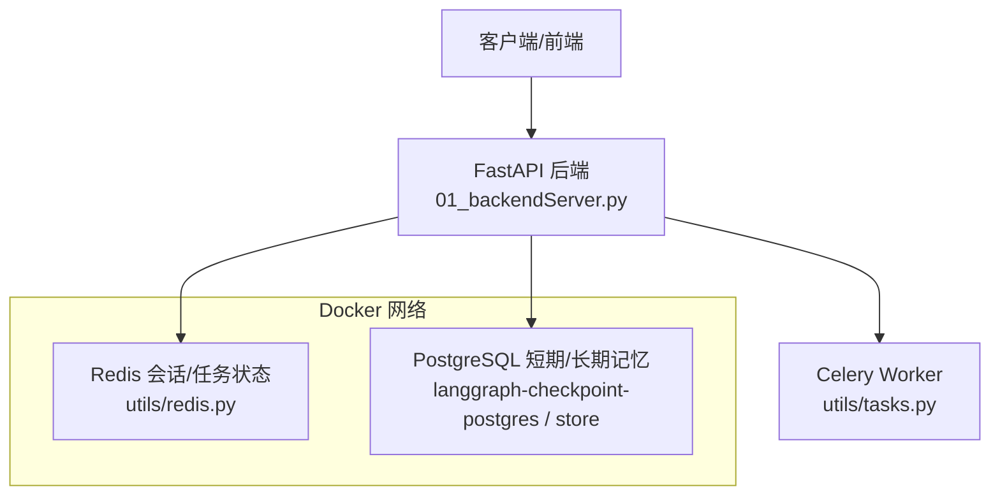
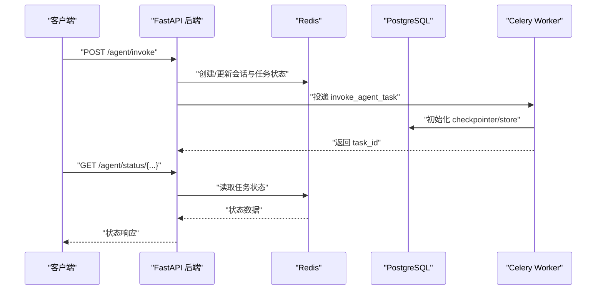
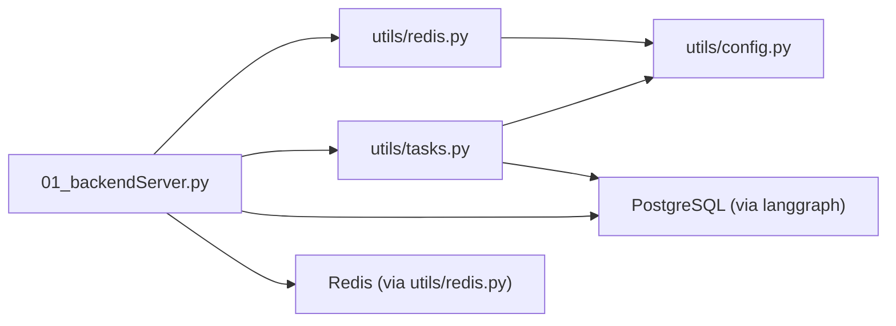

# 安全配置

<cite>
**本文引用的文件**
- [README.md](file://README.md)
- [01_backendServer.py](file://01_backendServer.py)
- [02_frontendServer.py](file://02_frontendServer.py)
- [utils/config.py](file://utils/config.py)
- [utils/redis.py](file://utils/redis.py)
- [utils/tasks.py](file://utils/tasks.py)
- [utils/models.py](file://utils/models.py)
- [docker/postgresql/docker-compose.yml](file://docker/postgresql/docker-compose.yml)
- [docker/redis/docker-compose.yaml](file://docker/redis/docker-compose.yaml)
</cite>

## 目录
1. [简介](#简介)
2. [项目结构](#项目结构)
3. [核心组件](#核心组件)
4. [架构总览](#架构总览)
5. [详细组件分析](#详细组件分析)
6. [依赖关系分析](#依赖关系分析)
7. [性能与安全权衡](#性能与安全权衡)
8. [故障排查指南](#故障排查指南)
9. [结论](#结论)
10. [附录：生产部署清单](#附录生产部署清单)

## 简介
本指南面向生产环境，围绕网络安全、数据安全、身份认证与授权、日志审计与安全监控、威胁防护与漏洞扫描等方面，结合当前代码库的实际实现，给出可落地的安全配置建议与加固方案。重点覆盖：
- 防火墙规则、端口暴露、网络隔离
- 敏感信息加密、数据库连接安全、API访问控制
- 用户权限管理、API密钥管理
- 日志审计与安全监控
- 常见威胁防护与漏洞扫描策略

## 项目结构
本项目包含后端FastAPI服务、前端CLI演示、Redis会话存储、PostgreSQL短期/长期记忆存储、Celery异步任务队列等。关键入口与配置如下：
- 后端服务入口：[01_backendServer.py](file://01_backendServer.py)
- 前端演示脚本：[02_frontendServer.py](file://02_frontendServer.py)
- 统一配置：[utils/config.py](file://utils/config.py)
- Redis会话管理：[utils/redis.py](file://utils/redis.py)
- Celery任务与Agent执行：[utils/tasks.py](file://utils/tasks.py)
- 数据模型定义：[utils/models.py](file://utils/models.py)
- Docker编排（PostgreSQL、Redis）：见[docker/postgresql/docker-compose.yml](file://docker/postgresql/docker-compose.yml)、[docker/redis/docker-compose.yaml](file://docker/redis/docker-compose.yaml)

图表来源
- [01_backendServer.py:84-130](file://01_backendServer.py#L84-L130)
- [utils/redis.py:37-49](file://utils/redis.py#L37-L49)
- [utils/tasks.py:43-63](file://utils/tasks.py#L43-L63)
- [docker/postgresql/docker-compose.yml:4-22](file://docker/postgresql/docker-compose.yml#L4-L22)
- [docker/redis/docker-compose.yaml:5-28](file://docker/redis/docker-compose.yaml#L5-L28)

章节来源
- [README.md:1-38](file://README.md#L1-L38)
- [01_backendServer.py:84-130](file://01_backendServer.py#L84-L130)
- [utils/config.py:13-33](file://utils/config.py#L13-L33)
- [docker/postgresql/docker-compose.yml:4-22](file://docker/postgresql/docker-compose.yml#L4-L22)
- [docker/redis/docker-compose.yaml:5-28](file://docker/redis/docker-compose.yaml#L5-L28)

## 核心组件
- 后端API：提供智能体调用、恢复、会话与任务管理等接口，使用FastAPI与Uvicorn启动。
- 会话与任务状态：基于Redis的异步会话管理器，维护用户会话、任务状态与过期策略。
- 短期/长期记忆：通过PostgreSQL持久化，使用LangGraph的checkpointer与store。
- 异步任务：Celery作为消息代理与任务执行器，Broker为Redis。
- 配置中心：集中管理数据库、Redis、LLM类型、服务监听地址与端口等。

章节来源
- [01_backendServer.py:132-424](file://01_backendServer.py#L132-L424)
- [utils/redis.py:37-493](file://utils/redis.py#L37-L493)
- [utils/tasks.py:318-564](file://utils/tasks.py#L318-L564)
- [utils/config.py:1-33](file://utils/config.py#L1-L33)

## 架构总览
下图展示请求从前端到后端，再到Redis、PostgreSQL与Celery Worker的完整链路，并标注了安全关键点（如鉴权、限流、TLS、最小权限）。

图表来源
- [01_backendServer.py:132-173](file://01_backendServer.py#L132-L173)
- [utils/redis.py:65-103](file://utils/redis.py#L65-L103)
- [utils/tasks.py:318-451](file://utils/tasks.py#L318-L451)

## 详细组件分析

### 网络安全与访问控制
- 监听地址与端口
  - 后端默认监听 0.0.0.0:8001，生产环境应绑定内网或仅暴露必要端口，并通过反向代理（Nginx/Traefik）对外提供服务。
  - 参考：[utils/config.py:31-33](file://utils/config.py#L31-L33)、[01_backendServer.py:418-424](file://01_backendServer.py#L418-L424)
- 防火墙与端口暴露
  - PostgreSQL 默认映射 5432:5432，Redis 默认映射 6379:6379。生产环境不应将数据库与缓存直接暴露给公网，应限制来源IP或使用私有网络。
  - 参考：[docker/postgresql/docker-compose.yml:12-13](file://docker/postgresql/docker-compose.yml#L12-L13)、[docker/redis/docker-compose.yaml:12-13](file://docker/redis/docker-compose.yaml#L12-L13)
- 网络隔离
  - 建议使用Docker网络将应用容器与数据库/缓存容器隔离，仅允许应用容器访问数据库与缓存端口。
  - 参考：[docker/redis/docker-compose.yaml:26-28](file://docker/redis/docker-compose.yaml#L26-L28)
- TLS终止
  - 在反向代理层启用HTTPS，对上游HTTP通信进行加密；避免在生产环境直接暴露明文HTTP。
- 最小暴露原则
  - 仅开放API网关端口（如443），数据库与缓存端口仅在内部网络可达。

章节来源
- [utils/config.py:31-33](file://utils/config.py#L31-L33)
- [docker/postgresql/docker-compose.yml:12-13](file://docker/postgresql/docker-compose.yml#L12-L13)
- [docker/redis/docker-compose.yaml:12-13](file://docker/redis/docker-compose.yaml#L12-L13)
- [docker/redis/docker-compose.yaml:26-28](file://docker/redis/docker-compose.yaml#L26-L28)
- [01_backendServer.py:418-424](file://01_backendServer.py#L418-L424)

### 数据安全与传输安全
- 数据库连接安全
  - 当前DB URI未强制SSL，且包含用户名密码。生产环境应：
    - 启用sslmode=require或verify-full，使用受信任CA证书
    - 通过环境变量注入凭据，禁止硬编码
  - 参考：[utils/config.py:13-16](file://utils/config.py#L13-L16)、[01_backendServer.py:94-102](file://01_backendServer.py#L94-L102)
- 敏感信息加密
  - 对静态敏感数据（如API密钥、数据库密码）使用密钥管理服务（KMS/Secrets Manager）或环境变量注入，避免写入代码仓库。
- 传输加密
  - 客户端到API网关必须使用HTTPS；API网关到后端可使用内网HTTP或mTLS。
- 输入校验与输出过滤
  - 使用Pydantic模型对入参进行强类型校验，防止注入攻击。
  - 参考：[utils/models.py:7-97](file://utils/models.py#L7-L97)

章节来源
- [utils/config.py:13-16](file://utils/config.py#L13-L16)
- [01_backendServer.py:94-102](file://01_backendServer.py#L94-L102)
- [utils/models.py:7-97](file://utils/models.py#L7-L97)

### 身份认证与授权
- 现状
  - 当前API未实现统一的认证与授权机制，所有端点均无鉴权中间件。
- 建议方案
  - 引入JWT/OAuth2或API Key机制，在反向代理或FastAPI中间件中统一鉴权。
  - 对写操作（删除会话/任务、写入长期记忆）实施更严格的权限控制。
  - 为不同角色（管理员、普通用户）设置细粒度访问控制。
- 会话与令牌管理
  - 使用Redis存储会话与黑名单令牌，支持快速失效与限流。
  - 参考：[utils/redis.py:37-493](file://utils/redis.py#L37-L493)

章节来源
- [01_backendServer.py:132-424](file://01_backendServer.py#L132-L424)
- [utils/redis.py:37-493](file://utils/redis.py#L37-L493)

### 日志审计与安全监控
- 日志记录
  - 后端与工具模块已使用ConcurrentRotatingFileHandler进行轮转日志，便于审计与排障。
  - 参考：[01_backendServer.py:21-40](file://01_backendServer.py#L21-L40)、[utils/redis.py:13-32](file://utils/redis.py#L13-L32)、[utils/tasks.py:21-40](file://utils/tasks.py#L21-L40)
- 日志安全
  - 确保日志中不记录敏感信息（如密码、密钥、完整token）；对PII进行脱敏。
  - 将日志文件权限设置为最小可读，并定期归档与清理。
- 监控指标
  - 收集API请求量、错误率、延迟、Redis/PG连接数、Worker负载等指标，接入监控系统（Prometheus/Grafana）。
  - 对异常登录、频繁失败、越权访问等行为设置告警。

章节来源
- [01_backendServer.py:21-40](file://01_backendServer.py#L21-L40)
- [utils/redis.py:13-32](file://utils/redis.py#L13-L32)
- [utils/tasks.py:21-40](file://utils/tasks.py#L21-L40)

### 常见威胁防护与漏洞扫描
- 威胁防护
  - 防暴力破解：对认证接口实施速率限制与账户锁定策略。
  - 防注入：对所有输入进行严格校验与参数化查询（ORM/驱动层面）。
  - 防越权：服务端校验资源归属（user_id/session_id/task_id），拒绝跨用户访问。
  - 防重放：对关键操作引入nonce或时间戳校验。
- 漏洞扫描
  - 代码级：SAST（静态分析）、SCA（依赖漏洞扫描）纳入CI流水线。
  - 运行期：DAST（动态应用安全测试）、容器镜像扫描、基线检查。
  - 合规：定期进行渗透测试与第三方审计。

[本节为通用指导，无需具体文件引用]

## 依赖关系分析
- 后端依赖Redis与PostgreSQL，用于会话状态与记忆持久化。
- Celery Worker依赖Redis作为Broker，执行Agent推理与工具调用。
- 配置集中管理，便于在不同环境切换。

图表来源
- [01_backendServer.py:84-130](file://01_backendServer.py#L84-L130)
- [utils/redis.py:37-49](file://utils/redis.py#L37-L49)
- [utils/tasks.py:43-63](file://utils/tasks.py#L43-L63)
- [utils/config.py:13-33](file://utils/config.py#L13-L33)

章节来源
- [01_backendServer.py:84-130](file://01_backendServer.py#L84-L130)
- [utils/redis.py:37-493](file://utils/redis.py#L37-L493)
- [utils/tasks.py:43-63](file://utils/tasks.py#L43-L63)
- [utils/config.py:13-33](file://utils/config.py#L13-L33)

## 性能与安全权衡
- 连接池与超时
  - 合理设置PostgreSQL连接池大小与超时，避免连接耗尽与慢查询影响可用性。
  - 参考：[01_backendServer.py:94-102](file://01_backendServer.py#L94-L102)
- 会话过期与清理
  - 利用Redis TTL与定期清理逻辑减少内存占用与僵尸数据。
  - 参考：[utils/redis.py:65-103](file://utils/redis.py#L65-L103)、[utils/redis.py:246-341](file://utils/redis.py#L246-L341)
- 限流与并发
  - 在反向代理或API网关层实施限流，保护后端免受突发流量冲击。
- 日志与性能
  - 生产环境降低日志级别，避免过多I/O影响性能；对关键路径采样记录。

章节来源
- [01_backendServer.py:94-102](file://01_backendServer.py#L94-L102)
- [utils/redis.py:65-103](file://utils/redis.py#L65-L103)
- [utils/redis.py:246-341](file://utils/redis.py#L246-L341)

## 故障排查指南
- 常见问题定位
  - 数据库连接失败：检查DB_URI、网络连通性与健康检查。
    - 参考：[docker/postgresql/docker-compose.yml:17-22](file://docker/postgresql/docker-compose.yml#L17-L22)
  - Redis不可用：检查端口映射、网络与凭据。
    - 参考：[docker/redis/docker-compose.yaml:19-25](file://docker/redis/docker-compose.yaml#L19-L25)
  - 任务执行失败：查看Worker日志与任务状态。
    - 参考：[utils/tasks.py:420-451](file://utils/tasks.py#L420-L451)
- 日志与监控
  - 通过轮转日志定位错误堆栈与上下文；结合系统指标观察瓶颈。
  - 参考：[01_backendServer.py:21-40](file://01_backendServer.py#L21-L40)、[utils/redis.py:13-32](file://utils/redis.py#L13-L32)、[utils/tasks.py:21-40](file://utils/tasks.py#L21-L40)

章节来源
- [docker/postgresql/docker-compose.yml:17-22](file://docker/postgresql/docker-compose.yml#L17-L22)
- [docker/redis/docker-compose.yaml:19-25](file://docker/redis/docker-compose.yaml#L19-L25)
- [utils/tasks.py:420-451](file://utils/tasks.py#L420-L451)
- [01_backendServer.py:21-40](file://01_backendServer.py#L21-L40)
- [utils/redis.py:13-32](file://utils/redis.py#L13-L32)
- [utils/tasks.py:21-40](file://utils/tasks.py#L21-L40)

## 结论
当前项目在功能上具备完整的会话管理、异步任务与记忆持久化能力，但在生产安全方面仍需加强：
- 必须实现统一的认证与授权机制，并对敏感配置进行外部化管理
- 数据库与缓存不应直接暴露于公网，需通过网络隔离与最小端口暴露
- 强化日志审计与监控告警，完善输入校验与输出过滤
- 建立完善的漏洞扫描与渗透测试流程，确保持续合规

[本节为总结性内容，无需具体文件引用]

## 附录：生产部署清单
- 网络与访问控制
  - 绑定内网地址或经反向代理对外暴露
  - 关闭数据库与缓存的公网端口映射
  - 启用TLS终止与HSTS
- 配置与凭据
  - 使用环境变量或密钥管理服务注入DB_URI、Redis凭据、LLM密钥
  - 开启数据库SSL连接，验证证书链
- 认证与授权
  - 引入JWT/OAuth2或API Key，实施RBAC
  - 对写接口增加权限校验与审计
- 日志与监控
  - 调整日志级别与轮转策略，脱敏敏感字段
  - 接入APM与指标采集，设置阈值告警
- 安全加固
  - 容器镜像最小化，定期更新依赖
  - SAST/SCA/DAST纳入CI/CD
  - 定期渗透测试与合规审计

[本节为通用指导，无需具体文件引用]