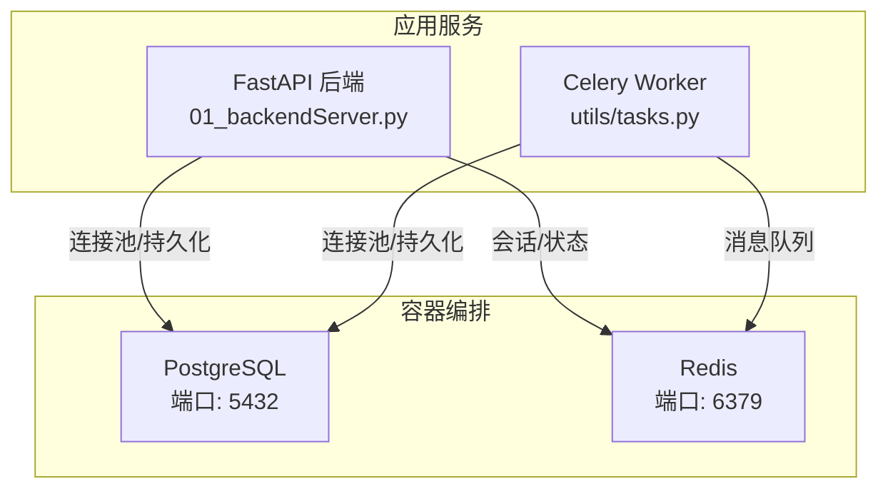
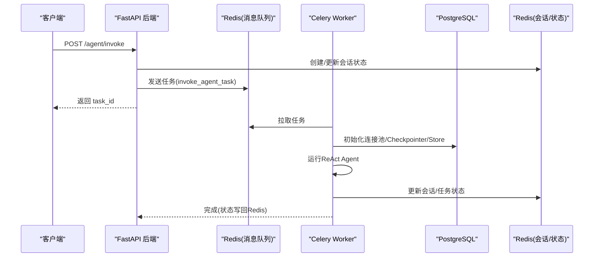
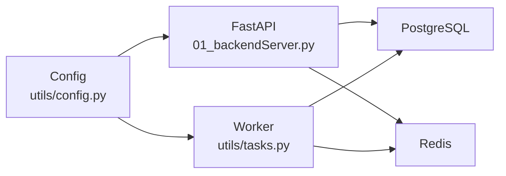

# 容器化部署

<cite>
**本文引用的文件**
- [docker/postgresql/docker-compose.yml](file://docker/postgresql/docker-compose.yml)
- [docker/redis/docker-compose.yaml](file://docker/redis/docker-compose.yaml)
- [utils/config.py](file://utils/config.py)
- [utils/redis.py](file://utils/redis.py)
- [01_backendServer.py](file://01_backendServer.py)
- [utils/tasks.py](file://utils/tasks.py)
- [README.md](file://README.md)
</cite>

## 目录
1. [简介](#简介)
2. [项目结构](#项目结构)
3. [核心组件](#核心组件)
4. [架构总览](#架构总览)
5. [详细组件分析](#详细组件分析)
6. [依赖关系分析](#依赖关系分析)
7. [性能与资源限制](#性能与资源限制)
8. [故障排查指南](#故障排查指南)
9. [结论](#结论)
10. [附录：生产环境编排清单](#附录生产环境编排清单)

## 简介
本指南面向将本项目容器化并部署到生产环境的读者，重点说明：
- Docker Compose 配置结构与参数（PostgreSQL、Redis）
- 镜像构建思路与环境变量配置
- 数据卷挂载与网络设置
- 多服务协调与依赖管理（FastAPI 后端、Celery Worker、数据库、缓存）
- 健康检查、自动重启策略、资源限制等生产最佳实践
- 监控与日志收集方案建议
- 确保稳定性与可维护性的关键要点

## 项目结构
仓库包含两个独立的 Compose 示例：
- PostgreSQL 服务编排：位于 docker/postgresql/docker-compose.yml
- Redis 服务编排：位于 docker/redis/docker-compose.yaml

应用侧通过 utils/config.py 集中读取环境变量；后端 FastAPI 在启动时初始化连接池、短期/长期记忆存储与会话管理器；异步任务由 Celery Worker 消费。

**图表来源**
- [docker/postgresql/docker-compose.yml:1-25](file://docker/postgresql/docker-compose.yml#L1-L25)
- [docker/redis/docker-compose.yaml:1-38](file://docker/redis/docker-compose.yaml#L1-L38)
- [01_backendServer.py:84-123](file://01_backendServer.py#L84-L123)
- [utils/tasks.py:43-63](file://utils/tasks.py#L43-L63)

**章节来源**
- [docker/postgresql/docker-compose.yml:1-25](file://docker/postgresql/docker-compose.yml#L1-L25)
- [docker/redis/docker-compose.yaml:1-38](file://docker/redis/docker-compose.yaml#L1-L38)
- [README.md:112-118](file://README.md#L112-L118)

## 核心组件
- PostgreSQL：用于短期记忆（Checkpointer）与长期记忆（Store）的持久化存储
- Redis：用于会话状态、任务状态与 Celery 消息代理
- FastAPI 后端：提供 HTTP API，初始化连接池、会话管理器、记忆存储
- Celery Worker：异步执行智能体任务，读写 Redis 与 PostgreSQL

**章节来源**
- [01_backendServer.py:84-123](file://01_backendServer.py#L84-L123)
- [utils/tasks.py:318-451](file://utils/tasks.py#L318-L451)
- [utils/redis.py:35-49](file://utils/redis.py#L35-L49)

## 架构总览
下图展示了请求从前端进入后端，再到异步任务处理，以及数据落盘与状态同步的整体流程。

**图表来源**
- [01_backendServer.py:132-173](file://01_backendServer.py#L132-L173)
- [utils/tasks.py:318-451](file://utils/tasks.py#L318-L451)
- [utils/redis.py:65-103](file://utils/redis.py#L65-L103)

## 详细组件分析

### PostgreSQL 服务编排
- 镜像与版本：使用固定版本的官方镜像，便于复现
- 环境变量：用户名、密码、数据库名、时区
- 端口映射：宿主机 5432 -> 容器 5432
- 数据卷：pgdata 持久化至宿主机或命名卷
- 重启策略：unless-stopped
- 健康检查：使用内置命令检测就绪
- 自定义参数：通过 command 调整最大连接数等

生产建议
- 为敏感信息使用 secrets 或外部密钥管理
- 根据负载调优 max_connections、shared_buffers、work_mem
- 定期备份 pgdata 或使用云托管数据库

**章节来源**
- [docker/postgresql/docker-compose.yml:1-25](file://docker/postgresql/docker-compose.yml#L1-L25)

### Redis 服务编排
- 镜像：官方 redis:latest
- 端口映射：宿主机 6379 -> 容器 6379
- 数据卷：redis-data 持久化
- 重启策略：unless-stopped
- 健康检查：redis-cli ping
- 网络：定义 app-network（当前仅 Redis 加入）

生产建议
- 启用 AOF/RDB 持久化策略
- 配置内存上限与淘汰策略
- 使用独立网络隔离业务容器

**章节来源**
- [docker/redis/docker-compose.yaml:1-38](file://docker/redis/docker-compose.yaml#L1-L38)

### 应用配置与环境变量
- 统一配置类集中读取环境变量，默认值便于本地开发
- 关键配置项包括数据库连接串、Redis 地址/端口/库号、会话超时、Celery Broker URL、LLM 类型、服务监听地址与端口

生产建议
- 所有敏感配置通过环境变量注入，避免硬编码
- 区分 dev/staging/prod 配置集
- 对 DB_URI 使用加密或密钥管理服务

**章节来源**
- [utils/config.py:1-34](file://utils/config.py#L1-L34)

### 后端服务生命周期与依赖初始化
- 启动时创建 Redis 会话管理器、PostgreSQL 连接池、短期记忆 Checkpointer、长期记忆 Store
- 优雅关闭：关闭会话管理器、连接池，记录日志

生产建议
- 增加 readiness/liveness 探针（HTTP 端点）
- 连接失败重试与熔断
- 资源限制（CPU/内存）防止 OOM

**章节来源**
- [01_backendServer.py:84-123](file://01_backendServer.py#L84-L123)

### 异步任务与多服务协调
- Celery 使用 Redis 作为消息代理
- Worker 中创建连接池、初始化 Checkpointer/Store，调用 ReAct Agent，最终写回 Redis 状态
- 支持中断恢复流程（resume）

生产建议
- 多 Worker 实例水平扩展
- 任务幂等与去重
- 失败重试与死信队列

**章节来源**
- [utils/tasks.py:43-63](file://utils/tasks.py#L43-L63)
- [utils/tasks.py:318-451](file://utils/tasks.py#L318-L451)
- [utils/tasks.py:454-559](file://utils/tasks.py#L454-L559)

### 会话与状态管理（Redis）
- 会话键空间设计：session:{user_id}:{session_id}:{task_id}
- 用户会话集合：user_sessions:{user_id}
- 任务映射：task_mapping:{user_id}:{session_id}
- 任务状态：task:{task_id}
- 提供创建、更新、查询、清理、删除等方法

生产建议
- 合理设置 TTL，避免僵尸数据
- 定期清理无效任务与空集合
- 监控 Redis 内存与命中率

**章节来源**
- [utils/redis.py:35-49](file://utils/redis.py#L35-L49)
- [utils/redis.py:65-103](file://utils/redis.py#L65-L103)
- [utils/redis.py:246-341](file://utils/redis.py#L246-L341)
- [utils/redis.py:392-442](file://utils/redis.py#L392-L442)

## 依赖关系分析
- 后端依赖：PostgreSQL（短/长期记忆）、Redis（会话/任务/Celery Broker）
- Worker 依赖：同上，并通过 Redis 接收任务
- 配置依赖：全部通过环境变量注入，解耦部署

**图表来源**
- [utils/config.py:1-34](file://utils/config.py#L1-L34)
- [01_backendServer.py:84-123](file://01_backendServer.py#L84-L123)
- [utils/tasks.py:43-63](file://utils/tasks.py#L43-L63)

**章节来源**
- [utils/config.py:1-34](file://utils/config.py#L1-L34)
- [01_backendServer.py:84-123](file://01_backendServer.py#L84-L123)
- [utils/tasks.py:43-63](file://utils/tasks.py#L43-L63)

## 性能与资源限制
- 数据库连接池：最小/最大连接数按并发与数据库承载能力设定
- Redis：设置内存上限、持久化策略、TTL 与淘汰策略
- Worker：根据 CPU/内存限制实例数量，避免争抢资源
- 健康检查：为各服务配置就绪/存活探针
- 自动重启：unless-stopped 或 on-failure 策略
- 日志轮转：应用层已实现日志轮转，建议配合外部日志采集

[本节为通用指导，不直接分析具体文件]

## 故障排查指南
常见问题与定位要点
- 无法连接数据库：检查 DB_URI、PostgreSQL 端口与网络连通性
- Redis 不可用：检查端口、认证、内存与持久化配置
- 任务堆积：检查 Worker 是否运行、Broker 是否可达、队列长度
- 会话丢失：检查 Redis TTL、清理逻辑与数据卷挂载
- 健康检查失败：确认健康检查命令与服务实际监听端口

定位步骤
- 查看容器日志与应用日志（logfile/app.log）
- 检查健康检查与重启策略
- 验证环境变量与密钥注入
- 使用数据库客户端与 Redis 客户端进行连通性测试

**章节来源**
- [utils/config.py:1-34](file://utils/config.py#L1-L34)
- [utils/redis.py:246-341](file://utils/redis.py#L246-L341)
- [docker/postgresql/docker-compose.yml:17-22](file://docker/postgresql/docker-compose.yml#L17-L22)
- [docker/redis/docker-compose.yaml:19-25](file://docker/redis/docker-compose.yaml#L19-L25)

## 结论
通过分离式 Compose 编排 PostgreSQL 与 Redis，结合应用侧的环境变量配置与健康检查，可实现稳定可靠的容器化部署。生产环境应进一步引入资源限制、监控与日志采集、密钥管理与备份策略，确保系统在高可用与可维护性方面达到要求。

[本节为总结性内容，不直接分析具体文件]

## 附录：生产环境编排清单
- 服务拆分与编排
  - 将 FastAPI 与 Celery Worker 拆分为独立服务
  - 将 PostgreSQL、Redis 纳入同一网络，便于服务间通信
- 环境变量与密钥
  - DB_URI、REDIS_HOST/PORT/DB、CELERY_BROKER_URL、LLM_TYPE、HOST/PORT 等通过环境变量注入
  - 敏感信息使用密钥管理服务或 Compose Secrets
- 数据持久化
  - PostgreSQL 数据卷 pgdata
  - Redis 数据卷 redis-data
- 健康检查与重启
  - 为各服务配置 healthcheck
  - restart: unless-stopped 或 on-failure
- 资源限制
  - 为每个服务设置 CPU/内存限制
- 监控与日志
  - 应用日志写入 logfile/app.log，建议接入集中日志系统
  - 暴露指标端点（如 Prometheus），采集服务与中间件指标
- 多服务协调
  - 使用 depends_on 与 healthcheck 控制启动顺序
  - 使用共享网络访问服务名而非 localhost

[本节为通用指导，不直接分析具体文件]