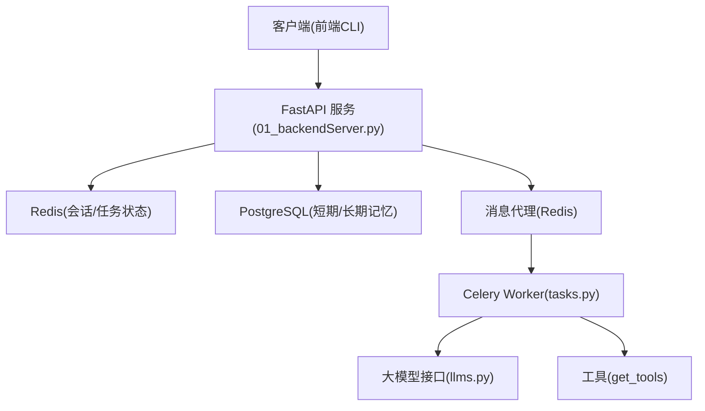
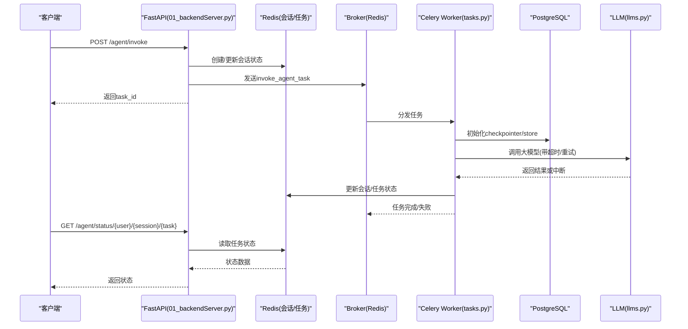
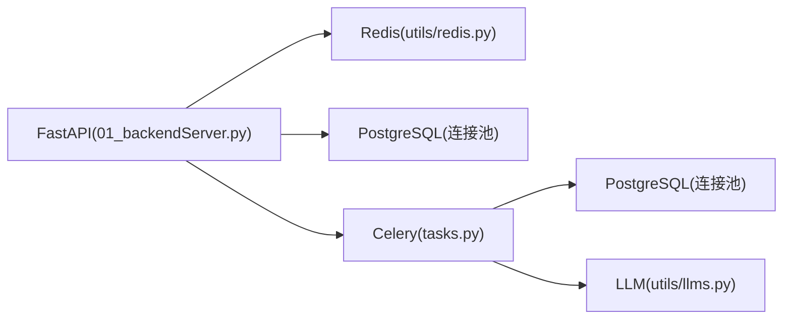

# 性能优化

<cite>
**本文引用的文件**
- [01_backendServer.py](file://01_backendServer.py)
- [02_frontendServer.py](file://02_frontendServer.py)
- [utils/config.py](file://utils/config.py)
- [utils/redis.py](file://utils/redis.py)
- [utils/tasks.py](file://utils/tasks.py)
- [utils/models.py](file://utils/models.py)
- [utils/llms.py](file://utils/llms.py)
- [docker/postgresql/docker-compose.yml](file://docker/postgresql/docker-compose.yml)
- [docker/redis/docker-compose.yaml](file://docker/redis/docker-compose.yaml)
- [README.md](file://README.md)
</cite>

## 目录
1. [引言](#引言)
2. [项目结构](#项目结构)
3. [核心组件](#核心组件)
4. [架构总览](#架构总览)
5. [详细组件分析](#详细组件分析)
6. [依赖关系分析](#依赖关系分析)
7. [性能考虑与调优指南](#性能考虑与调优指南)
8. [故障排查指南](#故障排查指南)
9. [结论](#结论)
10. [附录](#附录)

## 引言
本指南面向生产环境，围绕系统资源规划、数据库性能调优、Redis缓存优化、应用层性能优化（异步处理、负载均衡、缓存策略）、以及性能监控与瓶颈分析，提供可落地的优化建议。结合代码实现，重点覆盖：
- CPU、内存、存储资源的合理分配与容量规划
- PostgreSQL连接池、查询与索引策略
- Redis会话与任务状态管理、过期策略与集群化扩展
- Celery异步任务队列与FastAPI高并发服务
- 监控指标采集、日志与链路追踪、压测与容量评估

## 项目结构
本项目采用前后端分离的演示形态：
- 后端：基于FastAPI提供Agent智能体API，使用Celery进行异步任务调度，PostgreSQL作为短期记忆检查点与长期记忆存储，Redis用于会话与任务状态管理
- 前端：基于Rich的命令行交互客户端，调用后端API完成会话创建、任务提交、状态轮询与中断恢复
- 基础设施：通过Docker Compose部署PostgreSQL与Redis

图表来源
- [01_backendServer.py:84-130](file://01_backendServer.py#L84-L130)
- [utils/tasks.py:44-63](file://utils/tasks.py#L44-L63)
- [utils/redis.py:37-103](file://utils/redis.py#L37-L103)
- [utils/llms.py:70-112](file://utils/llms.py#L70-L112)

章节来源
- [README.md:1-39](file://README.md#L1-L39)
- [01_backendServer.py:126-130](file://01_backendServer.py#L126-L130)
- [utils/config.py:1-34](file://utils/config.py#L1-L34)

## 核心组件
- FastAPI服务：负责HTTP接口路由、请求校验、会话生命周期管理、任务入队
- Celery Worker：执行Agent推理、工具调用、结果回写
- Redis会话管理器：维护用户会话、任务状态、过期清理
- PostgreSQL：短期记忆（checkpointer）与长期记忆（store）持久化
- LLM适配层：统一多厂商模型接入，支持超时与重试

章节来源
- [01_backendServer.py:132-424](file://01_backendServer.py#L132-L424)
- [utils/tasks.py:318-560](file://utils/tasks.py#L318-L560)
- [utils/redis.py:37-493](file://utils/redis.py#L37-L493)
- [utils/llms.py:70-139](file://utils/llms.py#L70-L139)

## 架构总览
下图展示从请求到响应的主流程，包括异步任务、状态更新与中断恢复路径。

图表来源
- [01_backendServer.py:132-173](file://01_backendServer.py#L132-L173)
- [utils/tasks.py:318-451](file://utils/tasks.py#L318-L451)
- [utils/redis.py:392-442](file://utils/redis.py#L392-L442)
- [utils/llms.py:95-112](file://utils/llms.py#L95-L112)

## 详细组件分析

### FastAPI服务与接口
- 生命周期管理：在应用启动时初始化Redis会话管理器、PostgreSQL连接池、短期记忆checkpointer与长期记忆store；关闭时释放资源
- 关键接口：
  - /agent/invoke：接收请求，创建或校验会话，投递Celery任务，立即返回task_id
  - /agent/resume：校验会话处于中断状态，投递恢复任务
  - /system/info、/agent/active/sessionid、/agent/sessionids、/agent/tasks、/agent/status：会话与任务状态查询
  - /agent/write/longterm：写入长期记忆
  - 删除会话/任务接口
- 错误处理：对不存在、非法状态等场景返回明确的状态码与消息

章节来源
- [01_backendServer.py:84-124](file://01_backendServer.py#L84-L124)
- [01_backendServer.py:132-424](file://01_backendServer.py#L132-L424)

### Celery异步任务与Agent执行
- 任务定义：invoke_agent_task与resume_agent_task两个核心任务
- 执行流程：
  - 初始化Redis会话管理器与PostgreSQL连接池
  - 构建ReAct Agent（含工具、短期记忆、长期记忆）
  - 调用LLM并解析消息，处理中断或最终结果
  - 更新会话与任务状态，过滤最近一次完整对话并持久化
- 健壮性：异常捕获后更新会话为error，任务标记failed，记录错误信息

章节来源
- [utils/tasks.py:44-63](file://utils/tasks.py#L44-L63)
- [utils/tasks.py:318-451](file://utils/tasks.py#L318-L451)
- [utils/tasks.py:455-560](file://utils/tasks.py#L455-L560)

### Redis会话与任务状态管理
- 数据结构：
  - session:{user}:{session}:{task}：会话详情（状态、最后查询、最后响应、更新时间）
  - user_sessions:{user}：用户所有会话集合
  - task_mapping:{user}:{session}：会话内任务映射
  - task:{task_id}：任务状态（status、result、error、绑定用户与会话）
- 功能：
  - 创建/更新/删除会话与任务
  - 获取会话列表、活跃会话、任务状态
  - 定期清理无效任务与空集合，避免内存膨胀
- 过期策略：会话TTL与任务TTL控制，防止僵尸数据

章节来源
- [utils/redis.py:37-103](file://utils/redis.py#L37-L103)
- [utils/redis.py:146-215](file://utils/redis.py#L146-L215)
- [utils/redis.py:246-341](file://utils/redis.py#L246-L341)
- [utils/redis.py:392-442](file://utils/redis.py#L392-L442)
- [utils/redis.py:444-476](file://utils/redis.py#L444-L476)

### PostgreSQL短期与长期记忆
- 短期记忆：通过AsyncPostgresSaver作为checkpointer，保存节点状态以支持断点续跑
- 长期记忆：通过AsyncPostgresStore按命名空间存储用户偏好等信息，并在Agent执行前注入系统提示词
- 连接池：使用psycopg_pool.AsyncConnectionPool，配置min_size/max_size与autocommit

章节来源
- [01_backendServer.py:94-110](file://01_backendServer.py#L94-L110)
- [utils/tasks.py:351-374](file://utils/tasks.py#L351-L374)
- [utils/tasks.py:87-134](file://utils/tasks.py#L87-L134)

### LLM适配与多厂商支持
- 统一封装get_llm，支持openai、oneapi、qwen、ollama
- 配置项包含base_url、api_key、模型名、温度、超时与重试次数
- 异常处理：配置错误或初始化失败时降级或抛出明确异常

章节来源
- [utils/llms.py:31-57](file://utils/llms.py#L31-L57)
- [utils/llms.py:70-139](file://utils/llms.py#L70-L139)

## 依赖关系分析
- FastAPI依赖Redis会话管理与PostgreSQL连接池
- Celery Worker依赖Redis作为Broker，同时访问PostgreSQL与外部LLM
- 前端通过HTTP调用后端API，不直接依赖中间件

图表来源
- [01_backendServer.py:84-130](file://01_backendServer.py#L84-L130)
- [utils/tasks.py:44-63](file://utils/tasks.py#L44-L63)
- [utils/redis.py:37-103](file://utils/redis.py#L37-L103)
- [utils/llms.py:70-112](file://utils/llms.py#L70-L112)

章节来源
- [utils/config.py:13-34](file://utils/config.py#L13-L34)
- [docker/postgresql/docker-compose.yml:1-25](file://docker/postgresql/docker-compose.yml#L1-L25)
- [docker/redis/docker-compose.yaml:1-38](file://docker/redis/docker-compose.yaml#L1-L38)

## 性能考虑与调优指南

### 一、系统资源规划（CPU、内存、存储）
- CPU
  - FastAPI进程数：建议设置为CPU核数的1-2倍（uvicorn workers），在高并发I/O场景下可适当增加
  - Celery Worker并发：根据任务耗时与CPU占用调整concurrency，避免上下文切换开销过大
- 内存
  - 会话与任务状态：Redis内存需预估活跃会话数×单会话大小×冗余系数；设置maxmemory与淘汰策略
  - PostgreSQL：连接池大小与内存缓冲（shared_buffers）需匹配工作集大小
  - LLM调用：注意消息长度与token限制，避免OOM
- 存储
  - PostgreSQL数据卷：预留增长空间，开启自动清理与归档
  - 日志：使用轮转策略，控制单文件大小与保留数量

章节来源
- [utils/config.py:6-11](file://utils/config.py#L6-L11)
- [docker/postgresql/docker-compose.yml:14-22](file://docker/postgresql/docker-compose.yml#L14-L22)
- [docker/redis/docker-compose.yaml:14-25](file://docker/redis/docker-compose.yaml#L14-L25)

### 二、数据库性能调优（PostgreSQL）
- 连接池配置
  - min_size/max_size：根据并发请求数与Worker数量设定，避免连接耗尽或过多导致上下文切换
  - autocommit与prepare_threshold：减少事务开销与预编译阈值
- 查询优化
  - 短期记忆checkpointer：合理设置线程ID与检查点粒度，避免频繁写入
  - 长期记忆store：按命名空间组织数据，查询时限定范围
- 索引策略
  - 为常用查询字段建立索引（如user_id、session_id、task_id、last_updated）
  - 对历史会话与任务表建立复合索引，提升查询效率
- 连接池与事务
  - 合理设置pool大小与超时，避免阻塞
  - 长事务拆分为短事务，降低锁竞争

章节来源
- [01_backendServer.py:94-101](file://01_backendServer.py#L94-L101)
- [utils/tasks.py:351-361](file://utils/tasks.py#L351-L361)
- [utils/tasks.py:87-134](file://utils/tasks.py#L87-L134)

### 三、Redis缓存优化
- 内存管理
  - 设置maxmemory与淘汰策略（如allkeys-lru），防止内存溢出
  - 监控key数量与内存使用，及时清理无效键
- 过期策略
  - 会话TTL与任务TTL：根据业务SLA设置合理过期时间，避免僵尸数据
  - 定期清理：利用cleanup_all_tasks/cleanup_user_tasks清理无效任务与空集合
- 集群配置
  - 水平扩展：使用Redis Cluster分片，提升吞吐与容灾能力
  - 主从复制：读写分离，读多写少场景提升性能
- 键设计
  - 扁平化命名空间，避免深层嵌套导致的序列化开销
  - 批量操作：使用pipeline/transaction减少网络往返

章节来源
- [utils/redis.py:246-341](file://utils/redis.py#L246-L341)
- [utils/redis.py:392-442](file://utils/redis.py#L392-L442)
- [docker/redis/docker-compose.yaml:14-25](file://docker/redis/docker-compose.yaml#L14-L25)

### 四、应用层性能优化
- 异步处理
  - 使用Celery将Agent执行放入后台任务，快速返回task_id，前端轮询状态
  - Worker并发度与任务队列分区，避免热点任务阻塞
- 负载均衡
  - 多实例FastAPI部署，配合反向代理（Nginx/HAProxy）进行请求分发
  - 健康检查与优雅停机，确保滚动升级无感
- 缓存策略
  - 会话与任务状态缓存于Redis，减少DB压力
  - 对只读热点数据（如系统信息）可引入本地缓存（TTL短）
- 限流与熔断
  - 对LLM调用与外部工具调用设置超时与重试上限
  - 针对慢接口实施限流，保护下游服务

章节来源
- [01_backendServer.py:132-173](file://01_backendServer.py#L132-L173)
- [utils/tasks.py:318-451](file://utils/tasks.py#L318-L451)
- [utils/llms.py:95-112](file://utils/llms.py#L95-L112)

### 五、性能监控与瓶颈分析
- 指标采集
  - 应用层：QPS、延迟分布、错误率、连接池使用率、Redis命中率
  - 数据库：连接数、慢查询、锁等待、IO吞吐
  - 中间件：Redis内存、键数量、持久化频率
- 日志与追踪
  - 结构化日志：统一格式，包含trace_id、user_id、session_id、task_id
  - 链路追踪：跨服务传递trace_id，便于定位瓶颈
- 压测与容量评估
  - 使用压测工具模拟高并发，观察各组件负载曲线
  - 逐步扩容，验证线性扩展能力与拐点

[本节为通用指导，不直接分析具体文件]

## 故障排查指南
- 常见问题
  - 会话不存在：检查Redis键是否过期或被清理，确认TTL设置
  - 任务状态异常：查看Worker日志与任务结果，确认异常堆栈
  - 数据库连接池耗尽：调整min_size/max_size，检查长事务与泄漏
  - LLM调用超时：调整timeout与max_retries，检查网络与配额
- 定位方法
  - 查看应用日志与Worker日志，结合trace_id定位请求链路
  - 使用Redis CLI检查键空间与内存使用
  - 使用pg_stat_statements分析慢查询

章节来源
- [01_backendServer.py:175-237](file://01_backendServer.py#L175-L237)
- [utils/tasks.py:420-451](file://utils/tasks.py#L420-L451)
- [utils/tasks.py:528-560](file://utils/tasks.py#L528-L560)

## 结论
通过合理的资源规划、数据库与Redis调优、异步任务与负载均衡、以及完善的监控与压测体系，可在高压环境下保障系统的稳定运行与高效响应。建议在生产环境中持续观测指标，动态调整参数，确保系统具备弹性与可维护性。

## 附录
- 启动命令参考
  - 启动Celery Worker：celery -A 01_backendServer.celery_app worker --loglevel=info
  - 启动后端服务：python 01_backendServer.py
  - 启动前端服务：python 02_frontendServer.py
- Docker Compose
  - PostgreSQL：docker compose up -d（位于docker/postgresql）
  - Redis：docker compose up -d（位于docker/redis）

章节来源
- [README.md:187-193](file://README.md#L187-L193)
- [docker/postgresql/docker-compose.yml:1-25](file://docker/postgresql/docker-compose.yml#L1-L25)
- [docker/redis/docker-compose.yaml:1-38](file://docker/redis/docker-compose.yaml#L1-L38)