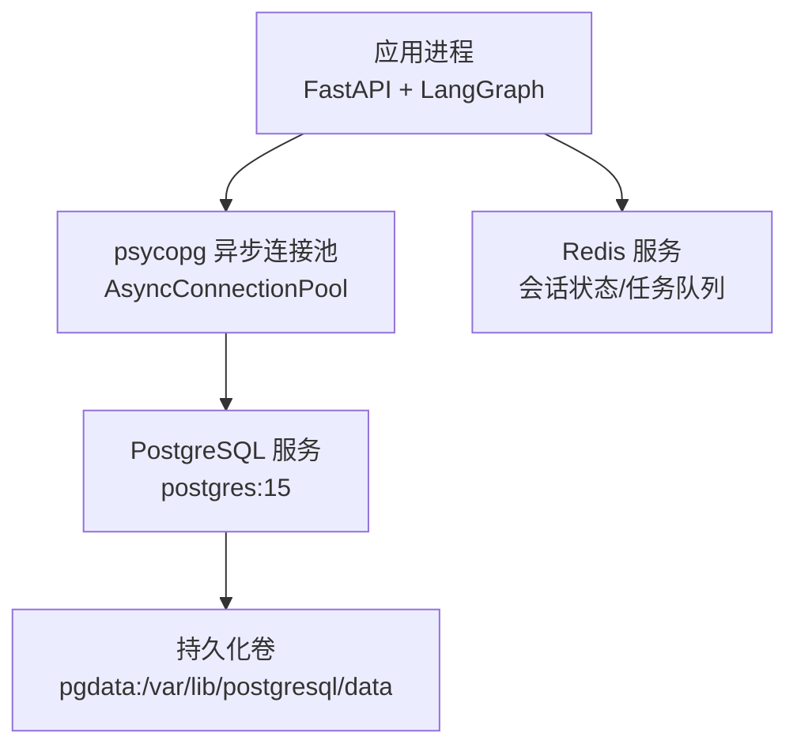
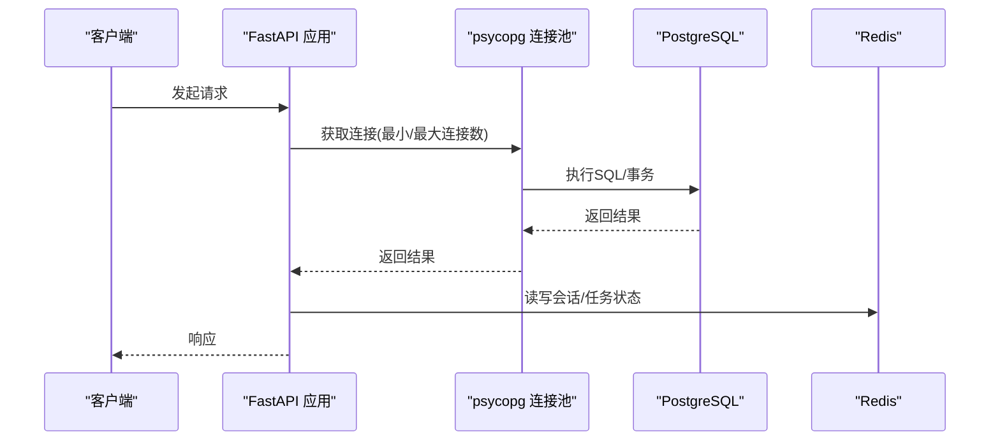
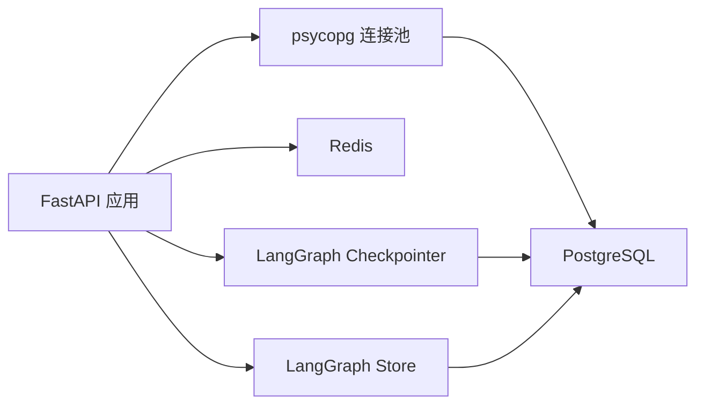

# 数据库部署

<cite>
**本文引用的文件**
- [docker/postgresql/docker-compose.yml](file://docker/postgresql/docker-compose.yml)
- [utils/config.py](file://utils/config.py)
- [01_backendServer.py](file://01_backendServer.py)
- [README.md](file://README.md)
</cite>

## 目录
1. [简介](#简介)
2. [项目结构](#项目结构)
3. [核心组件](#核心组件)
4. [架构总览](#架构总览)
5. [详细组件分析](#详细组件分析)
6. [依赖关系分析](#依赖关系分析)
7. [性能考虑](#性能考虑)
8. [故障排查指南](#故障排查指南)
9. [结论](#结论)
10. [附录](#附录)

## 简介
本指南面向生产环境，提供基于本项目代码与配置的PostgreSQL数据库部署方案。内容涵盖：容器化部署、用户权限与时区设置、连接池配置与性能调优（如max_connections）、数据持久化与备份恢复策略、安全配置（密码管理、访问控制、SSL加密）、监控与健康检查，以及高可用性与数据安全建议。所有说明均基于仓库中现有配置文件与后端代码实现进行解读与扩展。

## 项目结构
与数据库相关的核心位置如下：
- Docker Compose定义PostgreSQL服务、环境变量、端口映射、卷挂载、健康检查与启动参数
- 应用配置集中管理数据库连接串、连接池大小等
- 后端服务在生命周期内初始化异步连接池、短期记忆Checkpointer与长期记忆Store
- README描述了使用Docker运行PostgreSQL与Redis的步骤

图表来源
- [01_backendServer.py:84-123](file://01_backendServer.py#L84-L123)
- [docker/postgresql/docker-compose.yml:4-22](file://docker/postgresql/docker-compose.yml#L4-L22)
- [utils/config.py:13-16](file://utils/config.py#L13-L16)

章节来源
- [docker/postgresql/docker-compose.yml:1-25](file://docker/postgresql/docker-compose.yml#L1-L25)
- [utils/config.py:1-34](file://utils/config.py#L1-L34)
- [01_backendServer.py:84-123](file://01_backendServer.py#L84-L123)
- [README.md:111-118](file://README.md#L111-L118)

## 核心组件
- PostgreSQL 容器服务：镜像版本、环境变量（用户、密码、库名、时区）、端口、数据卷、重启策略、健康检查、启动参数（max_connections）
- 应用侧数据库配置：DB_URI、连接池最小/最大连接数
- 后端服务生命周期：创建并打开连接池，初始化LangGraph的短期记忆Checkpointer与长期记忆Store
- 文档指引：通过Docker Compose启动PostgreSQL与Redis

章节来源
- [docker/postgresql/docker-compose.yml:4-22](file://docker/postgresql/docker-compose.yml#L4-L22)
- [utils/config.py:13-16](file://utils/config.py#L13-L16)
- [01_backendServer.py:84-123](file://01_backendServer.py#L84-L123)
- [README.md:111-118](file://README.md#L111-L118)

## 架构总览
下图展示了应用如何通过连接池访问PostgreSQL，并使用LangGraph的Checkpointer与Store分别存储短期与长期记忆；同时通过Redis维护会话与任务状态。

图表来源
- [01_backendServer.py:84-123](file://01_backendServer.py#L84-L123)
- [utils/config.py:13-16](file://utils/config.py#L13-L16)
- [docker/postgresql/docker-compose.yml:4-22](file://docker/postgresql/docker-compose.yml#L4-L22)

## 详细组件分析

### PostgreSQL 容器配置与初始化
- 镜像与版本：使用固定版本镜像以保障可重复性
- 环境变量：
  - 用户名、密码、默认库名
  - 时区TZ设置为Asia/Shanghai
- 端口映射：将容器5432端口暴露到宿主机
- 数据持久化：通过命名卷pgdata挂载至/var/lib/postgresql/data
- 重启策略：unless-stopped
- 健康检查：使用内置命令检测数据库就绪
- 启动参数：通过command传入max_connections=200，限制最大并发连接数

注意：健康检查中的用户参数与当前环境变量定义的用户不一致，需统一为同一用户以避免误报。

章节来源
- [docker/postgresql/docker-compose.yml:4-22](file://docker/postgresql/docker-compose.yml#L4-L22)

### 连接池配置与性能调优
- 连接串：DB_URI支持从环境变量覆盖，默认指向本地PostgreSQL，默认禁用SSL模式
- 连接池大小：
  - 最小连接数：MIN_SIZE
  - 最大连接数：MAX_SIZE
- 事务与准备语句：autocommit开启，prepare_threshold设为0
- 最大连接数：通过容器启动参数设置max_connections=200

建议：
- 根据业务并发与资源调整MIN_SIZE/MAX_SIZE，避免连接不足或过多导致上下文切换开销
- 确保应用侧最大连接数不超过数据库max_connections，预留其他工具连接空间
- 生产环境建议启用SSL并在DB_URI中配置sslmode=require或verify-ca/verify-full

章节来源
- [utils/config.py:13-16](file://utils/config.py#L13-L16)
- [01_backendServer.py:94-100](file://01_backendServer.py#L94-L100)
- [docker/postgresql/docker-compose.yml:22](file://docker/postgresql/docker-compose.yml#L22)

### 数据库初始化与权限
- 默认用户与库：由环境变量创建默认用户与数据库
- 健康检查用户：需与应用使用的用户一致，避免健康检查失败
- 建议：
  - 为应用创建专用数据库与只读/读写分离用户
  - 通过外部脚本或迁移工具初始化表结构与索引
  - 在生产环境使用强密码并定期轮换

章节来源
- [docker/postgresql/docker-compose.yml:7-11](file://docker/postgresql/docker-compose.yml#L7-L11)
- [docker/postgresql/docker-compose.yml:17-21](file://docker/postgresql/docker-compose.yml#L17-L21)

### 时区设置
- 容器时区TZ设置为Asia/Shanghai，保证时间戳一致性
- 应用层日志与业务时间应保持一致时区

章节来源
- [docker/postgresql/docker-compose.yml:11](file://docker/postgresql/docker-compose.yml#L11)

### 数据持久化与备份恢复策略
- 持久化：通过命名卷pgdata持久化PostgreSQL数据目录
- 备份建议：
  - 定期逻辑备份：使用pg_dump导出数据库对象与数据
  - 物理备份：对数据卷进行快照或拷贝
  - 增量备份：结合WAL归档与时间点恢复（PITR）
- 恢复流程：
  - 逻辑恢复：使用pg_restore导入备份
  - 物理恢复：替换数据目录并启动服务
- 注意事项：
  - 备份前停止写入或进入只读模式
  - 校验备份完整性与可恢复性
  - 将备份文件异地保存并加密

章节来源
- [docker/postgresql/docker-compose.yml:14-15](file://docker/postgresql/docker-compose.yml#L14-L15)

### 安全配置
- 密码管理：
  - 使用环境变量注入敏感信息，避免硬编码
  - 生产环境强制使用强密码并定期轮换
- 访问控制：
  - 仅开放必要端口，限制来源IP
  - 使用数据库角色与权限最小化原则
- SSL加密：
  - 在DB_URI中启用sslmode=require或更高级别
  - 配置证书与私钥，验证服务端证书
- 审计与日志：
  - 开启登录与查询日志，便于审计与排障
  - 将日志外置存储并设置保留策略

章节来源
- [utils/config.py:14](file://utils/config.py#L14)
- [docker/postgresql/docker-compose.yml:7-11](file://docker/postgresql/docker-compose.yml#L7-L11)

### 监控与健康检查
- 健康检查：使用内置命令检测数据库是否就绪，间隔、超时与重试次数合理配置
- 指标采集：
  - 收集连接数、慢查询、锁等待、缓存命中率等
  - 结合Prometheus+Grafana或云厂商监控方案
- 告警：
  - 连接数接近上限、长时间慢查询、磁盘空间不足等阈值告警
- 可用性：
  - 多副本与主从复制，自动故障转移
  - 定期演练切换与恢复流程

章节来源
- [docker/postgresql/docker-compose.yml:17-21](file://docker/postgresql/docker-compose.yml#L17-L21)

## 依赖关系分析
- 应用依赖psycopg异步连接池访问PostgreSQL
- LangGraph的Checkpointer与Store依赖该连接池进行短期与长期记忆存取
- Redis用于会话状态与任务队列，与PostgreSQL共同支撑高可用与故障恢复

图表来源
- [01_backendServer.py:84-123](file://01_backendServer.py#L84-L123)
- [utils/config.py:13-16](file://utils/config.py#L13-L16)

章节来源
- [01_backendServer.py:84-123](file://01_backendServer.py#L84-L123)
- [utils/config.py:13-16](file://utils/config.py#L13-L16)

## 性能考虑
- max_connections：容器启动参数已设置为200，需结合应用并发与资源评估是否足够
- 连接池大小：MIN_SIZE与MAX_SIZE应根据峰值QPS与延迟目标调整
- 事务与准备语句：autocommit与prepare_threshold影响性能，可根据场景优化
- 资源限制：为容器设置CPU与内存限制，避免争用
- 索引与查询优化：针对高频查询建立合适索引，避免全表扫描
- 监控与压测：持续监控关键指标并进行容量规划

[本节为通用性能指导，不直接分析具体文件]

## 故障排查指南
- 健康检查失败：
  - 检查健康检查使用的用户是否与数据库用户一致
  - 确认端口可达与服务启动完成
- 连接失败：
  - 核对DB_URI、端口、网络连通性
  - 检查防火墙与安全组规则
- 连接池耗尽：
  - 观察连接数是否接近max_connections
  - 调整MIN_SIZE/MAX_SIZE或优化长事务
- 备份不可恢复：
  - 校验备份完整性
  - 按恢复流程逐步验证

章节来源
- [docker/postgresql/docker-compose.yml:17-21](file://docker/postgresql/docker-compose.yml#L17-L21)
- [utils/config.py:13-16](file://utils/config.py#L13-L16)

## 结论
本项目通过Docker Compose部署PostgreSQL，结合应用侧的连接池与LangGraph的Checkpointer/Store实现了短期与长期记忆的持久化。生产环境中需重点关注：
- 统一健康检查用户与数据库用户
- 合理设置max_connections与连接池大小
- 启用SSL与严格访问控制
- 制定并演练备份恢复流程
- 建立完善的监控与告警体系
以确保高可用与数据安全。

[本节为总结性内容，不直接分析具体文件]

## 附录
- 快速启动：参考README中的步骤，使用Docker Compose启动PostgreSQL与Redis
- 常用命令：
  - 查看容器状态与健康检查
  - 进入容器执行数据库命令
  - 执行备份与恢复操作

章节来源
- [README.md:111-118](file://README.md#L111-L118)