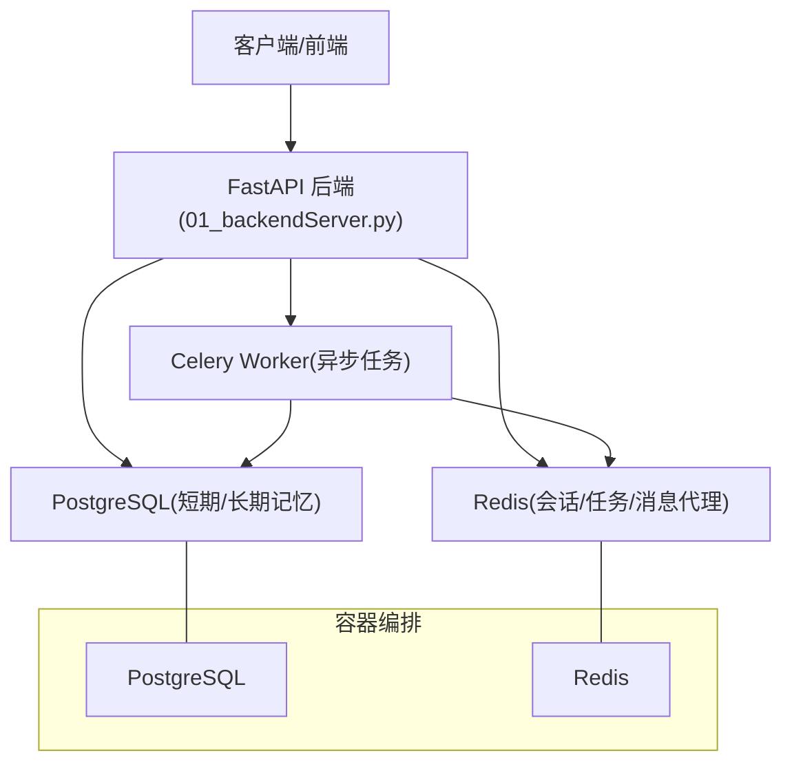
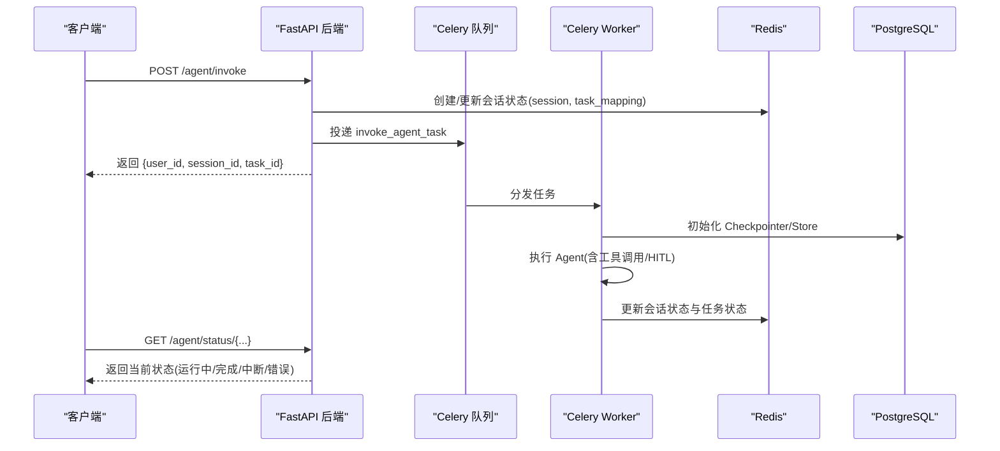
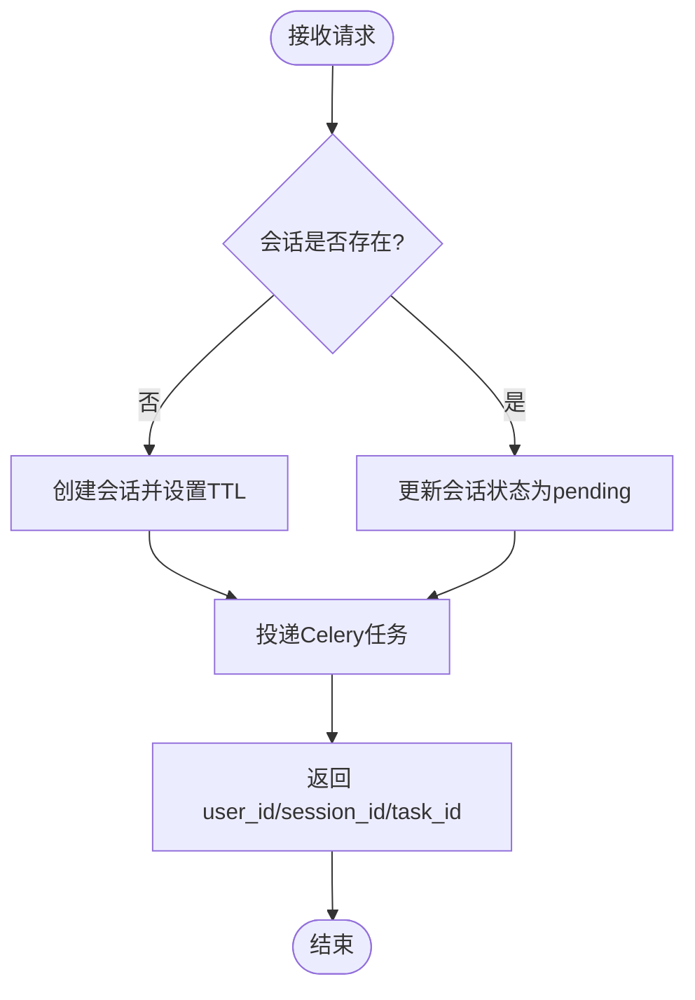
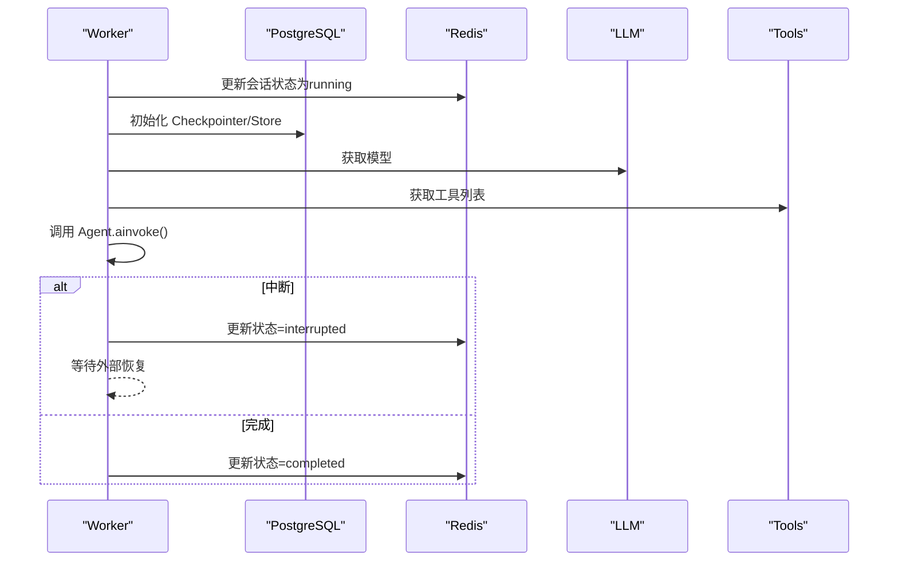
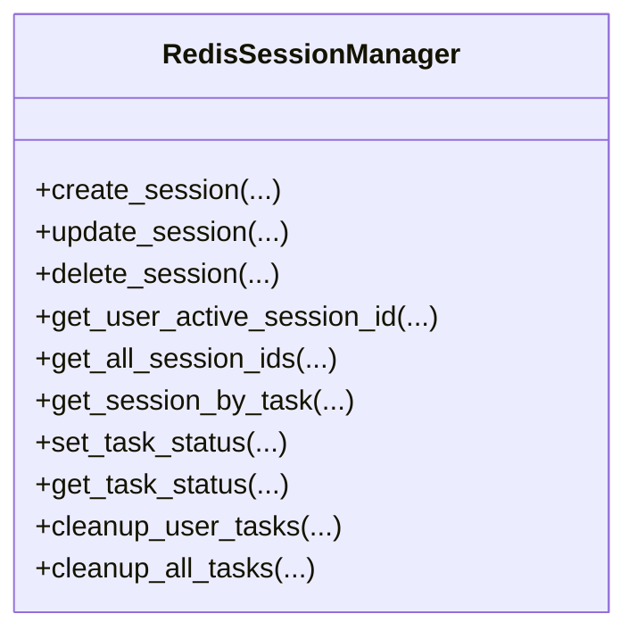
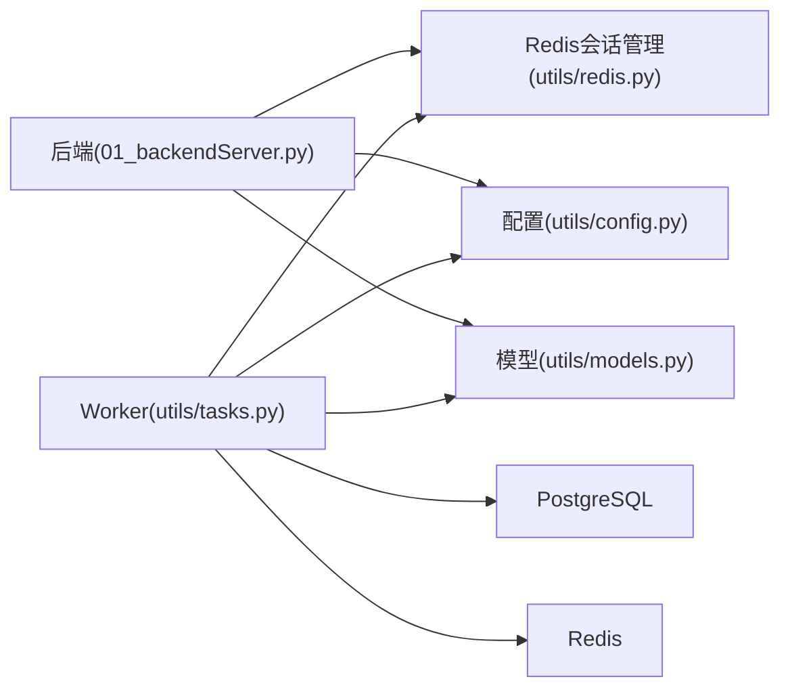

# 部署和生产环境

<cite>
**本文引用的文件**
- [README.md](file://README.md)
- [01_backendServer.py](file://01_backendServer.py)
- [02_frontendServer.py](file://02_frontendServer.py)
- [utils/config.py](file://utils/config.py)
- [utils/redis.py](file://utils/redis.py)
- [utils/tasks.py](file://utils/tasks.py)
- [utils/models.py](file://utils/models.py)
- [docker/postgresql/docker-compose.yml](file://docker/postgresql/docker-compose.yml)
- [docker/redis/docker-compose.yaml](file://docker/redis/docker-compose.yaml)
- [pip.sh](file://pip.sh)
</cite>

## 目录
1. [简介](#简介)
2. [项目结构](#项目结构)
3. [核心组件](#核心组件)
4. [架构总览](#架构总览)
5. [详细组件分析](#详细组件分析)
6. [依赖关系分析](#依赖关系分析)
7. [性能考虑](#性能考虑)
8. [故障排查指南](#故障排查指南)
9. [结论](#结论)
10. [附录](#附录)

## 简介
本指南面向生产环境，提供从硬件与操作系统、网络与安全、容器化编排、数据库与缓存、服务发现与高可用、到监控告警与性能调优的完整部署方案。系统基于 FastAPI 后端、Celery 异步任务队列、PostgreSQL（短期记忆检查点与长期记忆存储）、Redis（会话状态与任务队列）构建，支持多用户、多会话、HITL（人工审查）与多模型接入。

## 项目结构
- 应用入口
  - 后端 API：FastAPI 应用，暴露 Agent 调用、会话管理、系统信息等接口
  - 前端演示：Rich CLI 客户端，用于联调与演示
- 配置与数据模型
  - 统一配置类集中管理日志、数据库、Redis、Celery、LLM 等参数
  - Pydantic 模型定义请求与响应结构
- 异步任务
  - Celery Worker 执行智能体推理、工具调用、中断恢复
- 中间件与存储
  - Redis：会话状态、任务状态、消息代理
  - PostgreSQL：短期记忆（Checkpointer）与长期记忆（Store）
- 容器编排
  - Docker Compose 启动 PostgreSQL 与 Redis

图表来源
- [01_backendServer.py:84-130](file://01_backendServer.py#L84-L130)
- [utils/tasks.py:43-63](file://utils/tasks.py#L43-L63)
- [docker/postgresql/docker-compose.yml:3-22](file://docker/postgresql/docker-compose.yml#L3-L22)
- [docker/redis/docker-compose.yaml:5-28](file://docker/redis/docker-compose.yaml#L5-L28)

章节来源
- [README.md:1-199](file://README.md#L1-L199)
- [01_backendServer.py:1-424](file://01_backendServer.py#L1-L424)
- [02_frontendServer.py:1-860](file://02_frontendServer.py#L1-L860)
- [utils/config.py:1-34](file://utils/config.py#L1-L34)
- [utils/redis.py:35-493](file://utils/redis.py#L35-L493)
- [utils/tasks.py:1-564](file://utils/tasks.py#L1-L564)
- [utils/models.py:1-97](file://utils/models.py#L1-L97)
- [docker/postgresql/docker-compose.yml:1-25](file://docker/postgresql/docker-compose.yml#L1-L25)
- [docker/redis/docker-compose.yaml:1-38](file://docker/redis/docker-compose.yaml#L1-L38)

## 核心组件
- 后端 API（FastAPI）
  - 生命周期初始化：创建 Redis 会话管理器、数据库连接池、短期记忆 Checkpointer、长期记忆 Store
  - 接口：/agent/invoke、/agent/resume、/system/info、/agent/active/sessionid/{user_id}、/agent/sessionids/{user_id}、/agent/tasks/{user_id}/{session_id}、/agent/status/{user_id}/{session_id}/{task_id}、/agent/write/longterm、/agent/session/{user_id}/{session_id}、/agent/task/{user_id}/{session_id}/{task_id}
- 异步任务（Celery）
  - invoke_agent_task：异步执行 ReAct Agent，处理中断与结果，更新会话与任务状态
  - resume_agent_task：恢复被中断的 Agent 执行
- 会话与任务管理（Redis）
  - 会话键空间：session:{user_id}:{session_id}:{task_id}
  - 任务映射：task_mapping:{user_id}:{session_id} -> set of task_id
  - 任务状态：task:{task_id}
  - 自动清理过期任务与空集合
- 配置中心（Config）
  - 日志、DB_URI、连接池大小、Redis 地址、TTL、Celery Broker、LLM 类型、服务监听地址与端口
- 数据模型（Pydantic）
  - 统一的请求/响应结构，便于校验与文档生成

章节来源
- [01_backendServer.py:84-130](file://01_backendServer.py#L84-L130)
- [01_backendServer.py:132-424](file://01_backendServer.py#L132-L424)
- [utils/tasks.py:318-560](file://utils/tasks.py#L318-L560)
- [utils/redis.py:35-493](file://utils/redis.py#L35-L493)
- [utils/config.py:1-34](file://utils/config.py#L1-L34)
- [utils/models.py:1-97](file://utils/models.py#L1-L97)

## 架构总览
系统采用“Web 服务 + 异步任务 + 持久化”的分层架构：
- 前端/客户端通过 HTTP 调用 FastAPI 后端
- 后端将耗时任务投递至 Celery Worker 异步执行
- 会话状态与任务状态由 Redis 维护，具备 TTL 与自动清理
- 短期记忆（对话上下文）与长期记忆（用户偏好等）使用 PostgreSQL 存储
- 通过环境变量或配置文件注入数据库与缓存连接信息

图表来源
- [01_backendServer.py:132-173](file://01_backendServer.py#L132-L173)
- [utils/tasks.py:318-451](file://utils/tasks.py#L318-L451)
- [utils/redis.py:56-144](file://utils/redis.py#L56-L144)
- [utils/redis.py:392-442](file://utils/redis.py#L392-L442)

## 详细组件分析

### 后端服务（FastAPI）
- 生命周期管理
  - 初始化 Redis 会话管理器、数据库连接池、短期记忆 Checkpointer、长期记忆 Store
  - 资源释放：关闭 Redis 连接与数据库连接池
- 关键接口
  - /agent/invoke：创建或复用会话，投递异步任务，立即返回任务 ID
  - /agent/resume：校验会话状态为中断后，恢复执行并返回任务 ID
  - /system/info：统计活跃会话与用户
  - /agent/active/sessionid/{user_id}：获取最近活跃的会话 ID
  - /agent/sessionids/{user_id}：获取用户所有会话 ID
  - /agent/tasks/{user_id}/{session_id}：获取会话下所有任务 ID 及状态
  - /agent/status/{user_id}/{session_id}/{task_id}：查询会话与任务状态
  - /agent/write/longterm：写入用户长期记忆
  - /agent/session/{user_id}/{session_id}：删除会话
  - /agent/task/{user_id}/{session_id}/{task_id}：删除指定任务

图表来源
- [01_backendServer.py:132-173](file://01_backendServer.py#L132-L173)
- [utils/redis.py:56-144](file://utils/redis.py#L56-L144)

章节来源
- [01_backendServer.py:84-130](file://01_backendServer.py#L84-L130)
- [01_backendServer.py:132-424](file://01_backendServer.py#L132-L424)

### 异步任务（Celery Worker）
- invoke_agent_task
  - 初始化 Redis 会话管理器、数据库连接池、Checkpointer/Store、LLM、工具
  - 读取长期记忆并拼接系统提示词
  - 调用 Agent 执行，处理中断与最终结果，更新会话与任务状态
- resume_agent_task
  - 使用 Command(resume=command_data) 恢复中断流程
  - 同样更新会话与任务状态
- 消息修剪
  - 使用 trim_messages 控制输入消息 token 数量，避免上下文过大

图表来源
- [utils/tasks.py:318-451](file://utils/tasks.py#L318-L451)
- [utils/tasks.py:455-560](file://utils/tasks.py#L455-L560)

章节来源
- [utils/tasks.py:1-564](file://utils/tasks.py#L1-L564)

### 会话与任务管理（Redis）
- 数据结构
  - session:{user_id}:{session_id}:{task_id}：会话数据（状态、最后查询、最后响应、更新时间）
  - user_sessions:{user_id}：集合，包含 session_id:task_id
  - task_mapping:{user_id}:{session_id}：集合，包含 task_id
  - task:{task_id}：任务状态（status、result、error、绑定信息）
- 功能
  - 创建/更新/删除会话与任务
  - 查询用户活跃会话、会话任务列表、任务状态
  - 自动清理过期任务与空集合，保证内存整洁
- TTL 与超时
  - 会话与任务均设置 TTL，防止僵尸数据

图表来源
- [utils/redis.py:35-493](file://utils/redis.py#L35-L493)

章节来源
- [utils/redis.py:35-493](file://utils/redis.py#L35-L493)

### 配置与环境变量
- 日志
  - 日志文件路径、轮转大小、保留份数
- 数据库
  - DB_URI、最小/最大连接数
- Redis
  - 主机、端口、库号、会话超时、TTL
- Celery
  - Broker URL（Redis）、任务 TTL
- LLM
  - 模型类型（如 qwen）
- 服务
  - 监听地址与端口

章节来源
- [utils/config.py:1-34](file://utils/config.py#L1-L34)

### 数据模型（Pydantic）
- AgentRequest、LongMemRequest、AgentResponse、InterruptResponse
- SystemInfoResponse、SessionInfoResponse、TaskInfoResponse、ActiveSessionInfoResponse、SessionStatusResponse

章节来源
- [utils/models.py:1-97](file://utils/models.py#L1-L97)

## 依赖关系分析
- 模块耦合
  - 后端依赖 Redis 会话管理与 PostgreSQL 存储
  - Worker 依赖 LLM、工具、Checkpointer/Store、Redis
  - 配置集中管理，降低耦合度
- 外部依赖
  - PostgreSQL 镜像与版本固定
  - Redis 镜像与持久化卷
  - Celery 通过 Redis 作为消息代理

图表来源
- [01_backendServer.py:84-130](file://01_backendServer.py#L84-L130)
- [utils/tasks.py:43-63](file://utils/tasks.py#L43-L63)
- [utils/redis.py:35-493](file://utils/redis.py#L35-L493)
- [utils/config.py:1-34](file://utils/config.py#L1-L34)
- [utils/models.py:1-97](file://utils/models.py#L1-L97)

章节来源
- [01_backendServer.py:1-424](file://01_backendServer.py#L1-L424)
- [utils/tasks.py:1-564](file://utils/tasks.py#L1-L564)
- [utils/redis.py:1-493](file://utils/redis.py#L1-L493)
- [utils/config.py:1-34](file://utils/config.py#L1-L34)
- [utils/models.py:1-97](file://utils/models.py#L1-L97)

## 性能考虑
- 连接池与并发
  - PostgreSQL 连接池 min_size/max_size 根据负载调整
  - Redis 使用异步客户端，减少阻塞
- 会话与任务 TTL
  - 合理设置 TTL 避免内存膨胀，同时保证任务执行窗口
- 消息修剪
  - 使用 trim_messages 控制输入消息 token 数量，降低 LLM 调用成本
- 日志轮转
  - 限制日志文件大小与保留份数，避免磁盘占满
- 扩展性
  - 水平扩展 Worker 实例提升吞吐
  - 使用反向代理（Nginx/Ingress）进行负载均衡与健康检查

[本节为通用指导，不直接分析具体文件]

## 故障排查指南
- 常见错误
  - 会话不存在：检查 Redis 键空间与 TTL，确认是否已过期或被清理
  - 任务失败：查看 Worker 日志与任务状态，定位异常堆栈
  - 数据库连接失败：检查 DB_URI、连接池配置与网络连通性
  - Redis 不可用：检查健康检查与端口映射
- 诊断步骤
  - 使用 /system/info 与 /agent/status 接口观察状态
  - 检查 Redis 中的 session_*、task_mapping_*、task_* 键
  - 检查 PostgreSQL 连接与表结构（Checkpointer/Store）
  - 查看日志文件轮转输出，定位错误时间点

章节来源
- [01_backendServer.py:176-237](file://01_backendServer.py#L176-L237)
- [utils/redis.py:246-341](file://utils/redis.py#L246-L341)
- [utils/tasks.py:420-451](file://utils/tasks.py#L420-L451)
- [utils/tasks.py:528-559](file://utils/tasks.py#L528-L559)

## 结论
本系统以 FastAPI + Celery + Redis + PostgreSQL 为核心，实现了可伸缩、可恢复、可观测的智能体服务。生产部署需重点关注：
- 稳定的数据库与缓存基础设施
- 合理的连接池与会话 TTL
- 完善的日志与监控
- 安全加固与访问控制
- 可扩展的 Worker 集群与负载均衡

[本节为总结，不直接分析具体文件]

## 附录

### 生产环境部署要求
- 硬件资源
  - CPU：建议 4 核以上（后端与 Worker 可独立扩缩）
  - 内存：建议 8GB 以上（根据并发与上下文长度调整）
  - 磁盘：SSD 优先，预留日志与数据卷空间
- 操作系统
  - Linux 发行版（Ubuntu/CentOS），内核稳定，启用 cgroups
- 网络配置
  - 开放后端端口（默认 8001）
  - 数据库与缓存内网互通，禁止外网直连
  - 如需公网访问，使用反向代理与 TLS 终止

### 容器化部署方案
- Docker 镜像构建
  - 基础镜像：Python 3.11
  - 安装依赖：参考 README 与 pip.sh
  - 复制代码与配置，设置环境变量
- 容器编排
  - 使用 docker-compose 启动 PostgreSQL 与 Redis
  - 后端与 Worker 分别作为服务运行，共享同一网络
- 服务发现
  - 同 compose 网络内通过服务名解析（如 postgres、redis）
  - 生产建议使用 K8s Service/ConfigMap/Secret

章节来源
- [docker/postgresql/docker-compose.yml:1-25](file://docker/postgresql/docker-compose.yml#L1-L25)
- [docker/redis/docker-compose.yaml:1-38](file://docker/redis/docker-compose.yaml#L1-L38)
- [README.md:111-118](file://README.md#L111-L118)
- [pip.sh:1-14](file://pip.sh#L1-L14)

### 数据库部署与配置（PostgreSQL）
- 主从复制
  - 使用官方镜像，配置 WAL 与流复制（生产建议独立集群）
  - 读写分离：主库写，从库读
- 备份恢复
  - 定期 pg_dump/pg_basebackup，异地存储
  - 制定恢复演练计划
- 性能优化
  - 调整 max_connections、shared_buffers、work_mem
  - 索引优化与查询计划分析

章节来源
- [docker/postgresql/docker-compose.yml:3-22](file://docker/postgresql/docker-compose.yml#L3-L22)
- [utils/config.py:13-16](file://utils/config.py#L13-L16)

### Redis 集群配置与高可用
- 单机模式（当前）
  - 使用 redis:latest，开启持久化卷
  - 健康检查与重启策略
- 集群模式（生产建议）
  - Redis Cluster 或 Sentinel 实现高可用
  - 分片与副本，确保故障转移
  - 配置 ACL 与密码认证

章节来源
- [docker/redis/docker-compose.yaml:5-28](file://docker/redis/docker-compose.yaml#L5-L28)
- [utils/config.py:18-26](file://utils/config.py#L18-L26)

### 安全加固措施
- 网络安全
  - 仅开放必要端口，使用防火墙策略
  - 使用反向代理（Nginx/Ingress）+ TLS
- 数据安全
  - 数据库与 Redis 使用强密码与最小权限账户
  - 敏感配置使用 Secret 管理
- 访问控制
  - API 鉴权（JWT/OAuth2）
  - 限流与防刷（IP 白名单、速率限制）
  - 审计日志与告警

[本节为通用指导，不直接分析具体文件]

### 性能调优与监控告警
- 性能调优
  - 调整连接池大小与 Worker 并发度
  - 合理设置 TTL，避免频繁重建会话
  - 使用消息修剪控制上下文长度
- 监控告警
  - 指标：QPS、延迟、错误率、连接池使用率、Redis 命中率
  - 日志：结构化日志，集中收集（ELK/Loki）
  - 告警：阈值触发（CPU/内存/磁盘/错误率）

[本节为通用指导，不直接分析具体文件]

### 启动与运行（生产）
- 启动顺序
  - 先启动 PostgreSQL 与 Redis
  - 启动后端服务（FastAPI）
  - 启动 Celery Worker
- 验证
  - 调用 /system/info 与 /agent/status 接口
  - 检查日志与指标

章节来源
- [README.md:187-192](file://README.md#L187-L192)
- [01_backendServer.py:418-424](file://01_backendServer.py#L418-L424)
- [utils/tasks.py:43-63](file://utils/tasks.py#L43-L63)